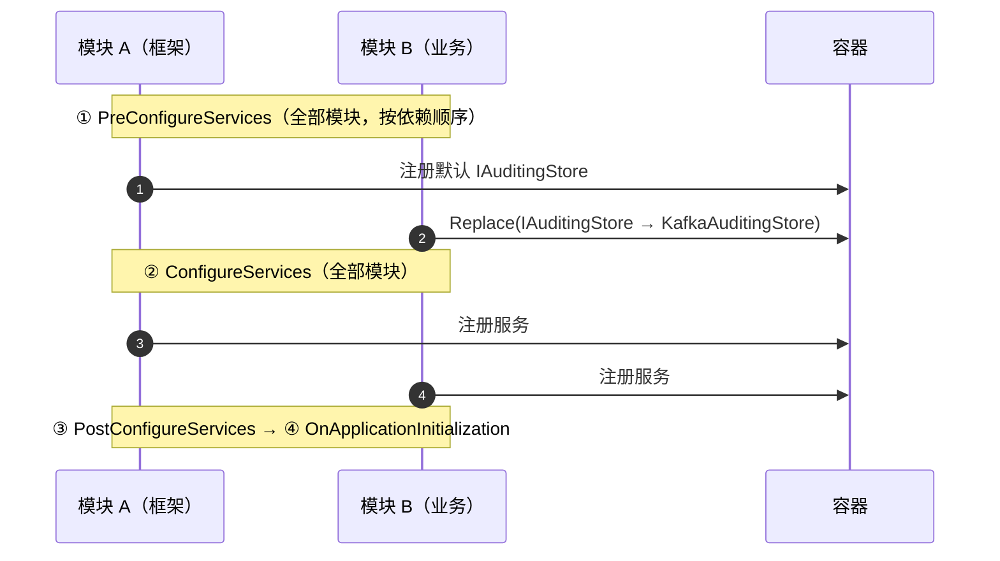
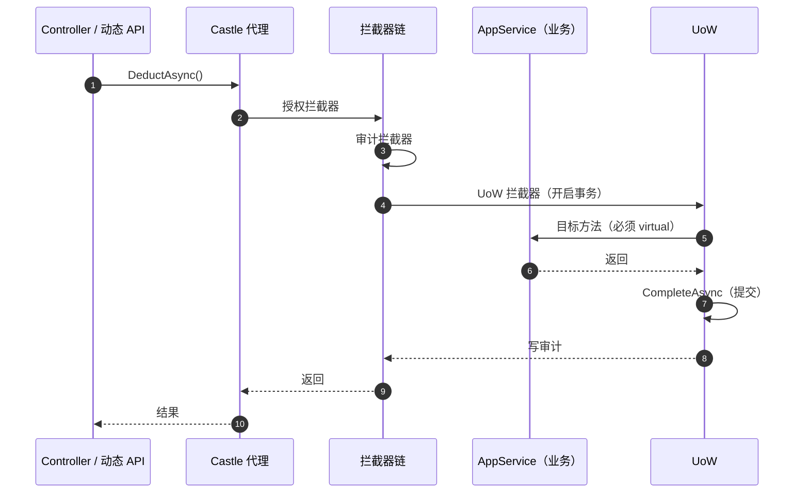
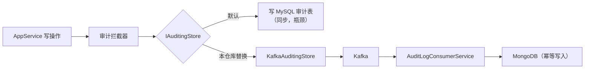
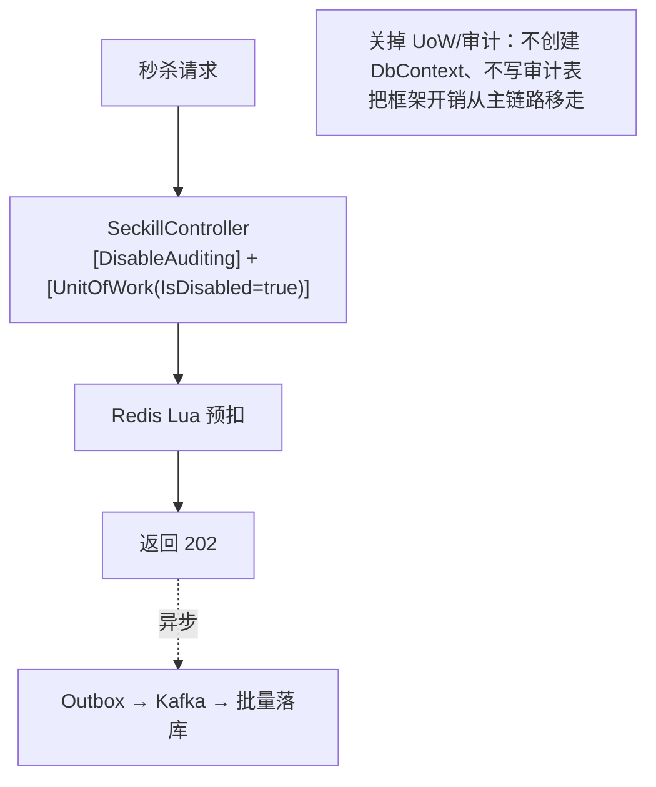

# ABP Framework 面试题（含要点与本仓库实例）

> 以 **Volo.Abp 8.x**（Autofac + MS DI）为主，兼顾经典版 `Abp.*` 9.x（Castle，仓库里两者并存）。
> 主线：**模块化 → 分层与约定 → 基础设施（UoW/审计/权限/多租户/事件）→ 性能与坑**。
> 每题尽量给"框架做了什么 + 代价是什么"，这是 ABP 面试的加分点。

## 目录

- [一、模块化与启动](#一模块化与启动)
- [二、分层与约定](#二分层与约定)
- [三、基础设施](#三基础设施)
- [四、运行时与性能](#四运行时与性能)
- [五、场景与选型](#五场景与选型)
- [自测清单](#自测清单)
- [附录 A：15 分钟背诵卡](#附录-a15-分钟背诵卡)
- [附录 B：模拟面试 20 题（含追问链）](#附录-b模拟面试-20-题含追问链)
- [附录 C：口述版——3 分钟讲清 ABP 的取舍](#附录-c口述版3-分钟讲清-abp-的取舍)
- [附录 D：关键图示](#附录-d关键图示)

---

## 一、模块化与启动

### 1. ABP 是什么？它解决什么问题？

**一个模块化的 .NET 应用框架**，把 DDD 的分层骨架 + 常用基础设施（DI、UoW、审计、权限、多租户、事件总线、动态 API、缓存）都做成开箱可用。

| 它提供的 | 它不提供的 |
| --- | --- |
| 模块系统与依赖排序 | 业务边界（限界上下文要自己划） |
| 约定式 DI 注册 | 聚合设计 |
| UoW / 事务 / 审计 | 你的性能优化 |
| 动态 API 控制器 | 部署与运维 |

> 追问：不用 ABP 能落地 DDD 吗？—— 能，但要自己写 UoW、事件总线、审计、权限；ABP 的价值是**把这些"每次都要写一遍"的东西标准化**。

---

### 2. ABP 的模块系统是怎么工作的？

```csharp
[DependsOn(
    typeof(AbpAspNetCoreModule),
    typeof(HostEntityFrameworkModule),
    typeof(HostApplicationModule))]
public class HostWebHostModule : AbpModule
{
    public override void PreConfigureServices(ServiceConfigurationContext context) { }
    public override void ConfigureServices(ServiceConfigurationContext context) { }
    public override void OnApplicationInitialization(ApplicationInitializationContext context) { }
}
```

**加载顺序**：按 `[DependsOn]` 做**拓扑排序**，保证依赖先加载；模块间通过 `configuration` 共享配置。

**生命周期四段**（每段都对所有模块按顺序执行完，再进入下一段）：

```text
PreConfigureServices  → ConfigureServices → PostConfigureServices
  → OnPreApplicationInitialization → OnApplicationInitialization → OnPostApplicationInitialization
  → OnApplicationShutdown
```

> 追问：为什么分 Pre/Post？—— Pre 阶段所有模块先"登记"（如替换服务描述符、加约定），Configure 阶段再注册；这样后面的模块能覆盖前面的行为。
> 本仓库实例：`HostApplicationModule.PreConfigureServices` 里 `services.Replace(IAuditingStore → KafkaAuditingStore)`，正好利用了"先登记、后可覆盖"的顺序。

---

### 3. ABP 的依赖注入是"约定式"的，怎么理解？

三种注册方式：

| 方式 | 写法 | 场景 |
| --- | --- | --- |
| 标记接口 | `ITransientDependency` / `IScopedDependency` / `ISingletonDependency` | 最常见，零配置 |
| 命名约定 | `XxxAppService` / `XxxManager` / `XxxStore` / `XxxService` | 框架自动按后缀注册 |
| 显式注册 | `context.Services.AddTransient<I, Impl>()` | 需要精确控制时 |

> 追问：约定式的好处和风险？—— 好处是少写样板；风险是**隐式**：新人不看约定就找不到实现，且同名接口容易被错误注入。
> 本仓库实例（经典版 ABP）：`HostApplicationModule.Initialize()` 里 `IocManager.RegisterAssemblyByConvention(assembly)` —— Castle 版本用 `IocManager` 扫描；Volo.Abp 版本则靠 `ITransientDependency` 等标记。

---

### 4. 应用启动时 ABP 做了哪些事？

```text
Program.cs → AddApplicationAsync<HostWebHostModule>()
  ① 发现所有模块（含依赖），拓扑排序
  ② 执行各模块的 Pre/Configure/PostConfigureServices
  ③ 构建 IServiceProvider（Autofac 接管）
  ④ 执行 OnApplicationInitialization（注册中间件、配置 Swagger、初始化数据）
  ⑤ 启动 Kestrel
```

> 追问：初始化顺序错了会怎样？—— 典型是"中间件注册在 `UseRouting` 之后"，或"初始化数据时 UoW 还没就绪"；ABP 把顺序固定在模块生命周期里，但**模块内部**的先后还得自己管。

---

### 5. ABP 和裸 ASP.NET Core 比，值不值得？

**值得的场景**：多模块、要 DDD 分层、要现成的审计/权限/多租户、团队需要统一规范。
**不值得的场景**：单模块小服务、极致性能、团队不熟约定（会写出"四不像"）。

> 追问：ABP 会不会太重？—— 取决于你**用它的多少能力**；只用模块 + DI + 动态 API 时开销很小，全量开审计 + 实体历史才是重。

---

## 二、分层与约定

### 6. ABP 的标准分层是什么？

```text
Domain.Shared     枚举、常量、共享 DTO（无依赖）
Domain            实体、聚合根、领域服务、仓储接口
Application.Contracts  IAppService、DTO、权限定义
Application        应用服务实现、AutoMapper Profile
EntityFrameworkCore   DbContext、仓储实现、迁移
HttpApi            API 控制器（或不写，用动态 API）
HttpApi.Host       启动项目、配置、中间件
```

依赖方向：**外层依赖内层，领域层不依赖任何基础设施**。

> 追问：一定要这么多项目吗？—— 小项目可以合并，但**Domain 和 Application 的边界必须存在**，否则领域逻辑会漏到 Controller。

---

### 7. ABP 的实体基类怎么选？

| 基类/接口 | 提供 |
| --- | --- |
| `Entity<TKey>` / `AggregateRoot<TKey>` | 主键、聚合根标记（可发布领域事件） |
| `CreationAuditedEntity` | `CreationTime`、`CreatorId` |
| `AuditedEntity` | 再加 `LastModificationTime/Id` |
| `FullAuditedEntity` | 再加 `IsDeleted`（**软删除**）、`DeleterId` |
| `IMultiTenant` | `TenantId`（自动加数据过滤） |

> 追问：软删除的代价？—— 所有查询都带 `IsDeleted = false`（ABP 用全局过滤器自动加），索引要包含该列，且**唯一索引要考虑已删除行**（否则删了不能再建同名）。

---

### 8. ABP 的仓储该用框架的还是自己写？

- `IRepository<TEntity, TKey>`：`GetAsync/InsertAsync/UpdateAsync/DeleteAsync/GetListAsync/GetPagedListAsync`，够 CRUD。
- 自定义仓储：继承 `EfCoreRepository<TDbContext, TEntity, TKey>`，加领域语义方法（`FindByOrderNoAsync`）。
- **不建议**在 ABP 仓储外再包一层 `IMyRepository<T>` —— `DbContext` 已是 UoW + Repository，双层仓储只是噪音。

> 追问：什么时候必须自定义？—— 需要返回聚合（带导航）、需要复杂查询、需要**跨聚合读模型**（那其实应该走 CQRS 的查询服务）。

---

### 9. 为什么 ABP 的应用服务方法都是 `virtual`？

因为 ABP 用 **Castle 动态代理**在方法外层织入：UoW、审计、授权、异常包装、缓存。

```csharp
public class InventoryAppService : ApplicationService, IInventoryAppService
{
    public virtual async Task<InventoryProductDto> GetAsync() { ... }
}
```

- `virtual` 才能被子类代理覆盖；**非 virtual 的方法不会被拦截**（UoW 不生效、审计不记录）。
- `sealed` 类无法代理。

> 追问：接口方法不是 virtual 吗？—— 接口实现方法默认可以被代理（Castle 生成接口代理），但**类代理**要求 virtual；ABP 默认按接口注册，实际项目里两种都会遇到。

---

### 10. 动态 API 控制器是怎么生成的？

```csharp
Configure<AbpAspNetCoreMvcOptions>(options =>
{
    options.ConventionalControllers.Create(typeof(HostApplicationModule).Assembly,
        opts => opts.RootPath = "app");
});
```

- 扫描所有 `IApplicationService`（或 `XxxAppService`），按 `方法名 → HTTP 动词` 约定生成 Controller：`GetXxx` → GET、`CreateXxx` → POST、`UpdateXxx` → PUT、`DeleteXxx` → DELETE。
- 路由默认 `/api/app/{service-name}/{method-name}`。

**关闭方式**：`[RemoteService(IsEnabled = false)]`（类或方法级）。

> 追问：什么时候不该用动态 API？—— 需要精确控制路由/状态码/文件上传/非 REST 语义时，写显式 Controller（本仓库秒杀就用了显式 `SeckillController`，因为它需要 `[DisableAuditing]` 和禁用 UoW）。

---

### 11. DTO 映射与校验怎么做？

- 映射：`ObjectMapper.Map<TEntity, TDto>()`（AutoMapper），Profile 里 `CreateMap<Order, OrderDto>()`。
- 校验：DTO 上 `[Required]` / `[StringLength]`，或 `IValidatableObject`；ABP 会把校验失败包装成 `AbpValidationException` → 400。

> 追问：映射的性能问题？—— AutoMapper 首次编译表达式有开销，可用 `ProjectTo` 直接生成 SQL 投影，避免"查全表再映射"。

---

### 12. 领域服务和应用服务在 ABP 里怎么分？

| | 应用服务 | 领域服务 |
| --- | --- | --- |
| 位置 | `*.Application` | `*.Domain` |
| 职责 | 编排用例、UoW、权限、DTO | 跨聚合/跨实体规则 |
| 依赖 | 仓储、领域服务、基础设施 | 仓储、其他领域服务 |
| 是否暴露 API | 是（动态 API） | 否 |

> 追问：业务规则写在应用服务有什么后果？—— 无法被其他用例复用、容易被绕过、单测要拖起整个应用层。

---

### 13. 本地事件和分布式事件有什么区别？

| | 本地事件 | 分布式事件 |
| --- | --- | --- |
| 接口 | `ILocalEventHandler<TEvent>` | `IDistributedEventHandler<TEto>` |
| 范围 | 进程内，同事务或事务后 | 跨服务，走 MQ（RabbitMQ/Kafka） |
| 事务 | 可在同一 UoW 内 | 需要 outbox 保证不丢 |
| 本仓库 | 少量进程内通知 | `StockDeductedEto` → `StockDeductedHandler` |

> 追问：分布式事件怎么保证不丢？—— ABP 提供 **outbox/inbox**（`IHasEventOutbox` / `IHasEventInbox`），本仓库的 `T1FrameAbpDbContext` 就实现了这两个接口，消息与业务在同一事务里落库，再由后台投递。

---

## 三、基础设施

### 14. UoW（工作单元）是什么？ABP 怎么用？

`IUnitOfWork` = 一个事务边界 + 一组共享的 `DbContext`。

```csharp
// ① 自动：应用服务方法外由拦截器创建（默认事务性）
public virtual async Task DoAsync() { ... }

// ② 手动：需要独立事务时
using var uow = _unitOfWorkManager.Begin(requiresNew: true, isTransactional: true);
// ... 操作
await uow.CompleteAsync();      // 不调用就不会提交

// ③ 关闭：高频只读接口
[UnitOfWork(IsDisabled = true)]
```

> 追问：`CompleteAsync` 忘了会怎样？—— 事务不提交，且 `using` 结束时回滚；这是 ABP 新手最常见的"数据没存上"。
> 本仓库实例：`InventoryAppService` 里显式 `Begin(requiresNew: true, isTransactional: true)`，在"扣减失败"分支主动 `RollbackAsync()` 后返回业务失败。

---

### 15. ABP 的事务默认行为是什么？

- UoW 默认**事务性**（EF Core 下 `TransactionBehavior` 默认 `Auto`），一个应用服务方法 = 一个事务。
- `[UnitOfWork(isTransactional: false)]` 可关闭（只读查询）。
- 嵌套调用默认**加入外层 UoW**（`requiresNew: false`），不会开启新事务。

> 追问：跨服务怎么办？—— 本地 UoW 管不了跨服务；用分布式事件 + outbox + 幂等，或 Saga（见 [microservices-interview.md](microservices-interview.md)）。

---

### 16. 审计日志是怎么记录的？为什么会拖慢性能？

`AbpAuditingOptions` 控制：是否记录 action、是否记录实体变更（EntityHistory）、是否记录未登录请求等。

- **Action 级审计**：每个请求一条 `AuditLog`（方法名、参数、耗时、异常）。
- **实体变更历史**：需要显式 `options.EntityHistory.IsEnabledForEntity<T>()`，否则不记录。
- 写入走 `IAuditingStore`，默认存库 → **高并发时审计表就是瓶颈**。

**优化手段**（本仓库真实做法）：

1. 热点接口 `[DisableAuditing]`（秒杀 Controller 类上就加了）。
2. 替换 `IAuditingStore`：`services.Replace(ServiceDescriptor.Singleton<IAuditingStore, KafkaAuditingStore>())`，审计写 MQ 而不是同步写库。
3. 异步消费落 MongoDB（`StockDeductedHandler`）。

> 追问：审计和业务日志有什么区别？—— 审计回答"**谁在什么时候做了什么**"（合规），业务日志回答"**系统发生了什么**"（排障）；两者存储与保留策略不同。

---

### 17. 权限系统怎么用？

```csharp
public class BookStorePermissions : PermissionDefinitionProvider
{
    public override void Define(IPermissionDefinitionContext context)
    {
        var group = context.AddGroup("Inventory");
        group.AddPermission("Inventory.Deduct", L("Permission:Deduct"));
    }
}
// 使用
[Authorize("Inventory.Deduct")]
public virtual Task DeductAsync() { ... }
```

- 权限定义在启动时注册，UI 通过 `/api/abp/application-configuration` 拿到权限列表。
- 代码里可用 `IPermissionChecker.IsGrantedAsync("Inventory.Deduct")` 做条件判断。

> 追问：权限和认证的区别？—— 认证回答"你是谁"（JWT/Cookie），权限回答"你能不能做"；ABP 把两者都做成中间件 + 过滤器。

---

### 18. 多租户是怎么实现的？

- 实体实现 `IMultiTenant` → ABP 自动加 `TenantId` 全局过滤器。
- `ICurrentTenant.Change(tenantId)` 切换上下文（通常由中间件根据请求解析租户）。
- 隔离级别：共享库共享表（`TenantId`）/ 独立 schema / 独立库（ABP 支持按连接串切换）。

> 追问：最容易出的问题？—— **绕过过滤器**（`IDataFilter.Disable<IMultiTenant>()` 用错地方）导致越权；以及后台任务/消息消费没有租户上下文，写入了错误的 `TenantId`。

---

### 19. ABP 的缓存怎么用？

- `IDistributedCache<TCacheItem, TKey>`：ABP 封装的分布式缓存（Redis 实现），自动做 key 归一化，避免手拼 key。
- `[RemoteService]` 层的缓存用 `[Cache]` 拦截器？—— 更常见的是在应用服务里显式调用缓存接口（可控性更好）。
- 缓存穿透/击穿仍需自己处理（空值缓存、互斥、逻辑过期）。

> 追问：ABP 缓存和 `IMemoryCache` 的区别？—— 前者跨实例（Redis），后者进程内；多实例必须用分布式缓存，否则数据不一致。

---

### 20. 异常怎么统一处理？

- 业务异常抛 `BusinessException("Code", "message")`，ABP 的异常过滤器转成统一响应（含 `error.code`）。
- `IExceptionToErrorInfoConverter` 可自定义映射（比如把领域异常映射成业务码）。
- 未处理异常默认返回 500 + 脱敏信息（不暴露堆栈）。

> 追问：为什么不用自定义异常到处 try-catch？—— 会让业务代码充满错误处理；统一在边界转换更干净，也便于前端按 `code` 处理。

---

### 21. 后台任务怎么做？

- `IBackgroundJobManager.EnqueueAsync(...)`：需要**持久化 + 重试**的任务（Hangfire/Quartz 适配）。
- `BackgroundService` / `IBackgroundWorker`：常驻轮询（本仓库的 `SeckillOutboxRelay`、`SeckillKafkaConsumer` 都是 `BackgroundService`）。
- 关键点：后台任务里**没有 HTTP 上下文**，租户/用户信息要显式传入。

> 追问：为什么不能直接在请求里 `Task.Run`？—— 请求结束服务可能被回收、异常无人处理、无法重试；必须走持久化队列或常驻服务。

---

## 四、运行时与性能

### 22. ABP 的性能开销主要在哪？

| 来源 | 影响 | 缓解 |
| --- | --- | --- |
| 动态代理 | 每次调用多一层虚派发 | 必要，别在全量热路径上滥用拦截器 |
| 审计 / 实体历史 | 每次写多一条审计记录 | `[DisableAuditing]`、异步 store |
| UoW / 事务 | 每个方法一个事务 | 只读方法 `isTransactional: false` |
| DTO 映射 | 反射/表达式编译 | `ProjectTo` 直接投影 |
| 模块初始化 | 启动扫描程序集 | 减少模块数量、按需加载 |

> 追问：什么时候该关掉 ABP 的某些能力？—— 秒杀/高频接口：关审计、关 UoW、直接访问 Redis；此时 ABP 只作为"模块 + DI"用。

---

### 23. 秒杀接口为什么在 ABP 里要特殊处理？

本仓库 `SeckillController` 的实际写法：

```csharp
[ApiController]
[Route("api/seckill")]
[DisableAuditing]                 // 不写审计日志
[UnitOfWork(IsDisabled = true)]   // 不开事务、不解析 DbContext
public class SeckillController : ControllerBase { ... }
```

原因：秒杀入口只碰 Redis + 内存/outbox，**开 UoW 会创建 DbContext 和事务**，审计会写库 —— 直接把 1000 QPS 打回原形。

> 追问：关掉 UoW 有什么风险？—— 这一层不再有自动事务；如果方法里真的要写库，就必须手动 `Begin`（本仓库在落库环节用后台批量写入解决）。

---

### 24. ABP 里 EF Core 的集成要注意什么？

- `AbpDbContext<T>`：自动应用数据过滤器（软删除、多租户）、审计字段填充、事件 outbox。
- 迁移：设计时工厂（`IDesignTimeDbContextFactory<T>`）+ 独立迁移项目；**不要在启动时 `Migrate()`**（见 [efcore-interview.md](efcore-interview.md)）。
- 实体属性名直接映射列（本仓库领域实体用 `snake_case`）。

> 追问：`AbpDbContext` 和原生 `DbContext` 冲突吗？—— 不冲突，它是子类；但**数据过滤器是隐式的**，调试时看 SQL 才发现多了 `IsDeleted = 0 AND TenantId = x`。

---

### 25. ABP 项目怎么测试？

- `AbpIntegratedTest<TStartupModule>`：起一个内存/容器化的应用，带完整 DI、UoW、数据种子。
- 常用模式：`WithUnitOfWorkAsync(...)` 包住测试逻辑；替换外部依赖（Redis/MQ）用 `context.Services.Replace`。
- 单元测试领域层时不要拖起整个 ABP，直接 new 聚合即可。

> 追问：集成测试慢怎么办？—— 只对"装配 + 数据过滤器 + 权限"这类跨层行为写集成测试，其余用纯单测；数据库用 Testcontainers 而不是共享实例。

---

### 26. ABP 版本与依赖冲突怎么处理？

本仓库的真实情况：**两套 ABP 并存** —— 经典 `Abp.*` 9.4.1（Castle）与 `Volo.Abp.*` 8.3.4（Autofac）。它们**不是同一套框架**，不能混用同一套模块/DI。

- `t1_frame.sln` 整体构建会因 `Pomelo.EntityFrameworkCore.MySql` 9.x 与 8.0.3 的版本约束报 `NU1605`（预存在的已知问题，非 bug）。
- 处理方式：按项目单独构建；统一 `PackageReference` 的版本；`dotnet list package --include-transitive` 查冲突来源。

> 追问：为什么要并存？—— 历史迁移成本；正确做法是**一次性迁到 Volo.Abp**，而不是长期两套并行。

---

## 五、场景与选型

### 27. ABP 的模块划分和 DDD 的限界上下文是什么关系？

- ABP 的"模块"是**部署/装配单元**，DDD 的"限界上下文"是**模型边界**。
- 常见做法：**一个限界上下文对应一个或多个 ABP 模块**（Domain/Application/HttpApi 拆成多个模块），但边界本身要按业务划。

> 追问：模块拆太细有什么问题？—— 启动扫描变慢、依赖图复杂、循环依赖（ABP 会直接报错，这是好事）。

---

### 28. ABP 适合什么规模的项目？

| 规模 | 建议 |
| --- | --- |
| 单体小服务、1~2 人 | 不建议，直接用 ASP.NET Core + 少量自研 |
| 多模块、3~10 人、要做 DDD | **最合适** |
| 大团队、多租户 SaaS | 合适（权限/租户/审计开箱即用） |
| 极致性能网关/秒杀核心 | 只借它的模块与 DI，基础设施关掉 |

> 追问：什么时候该脱离 ABP？—— 当你 80% 的代码都在"绕过框架"时；或团队根本不理解约定，框架变成了负担。

---

### 29. 本仓库的 ABP 实践清单（可当项目案例）

| 实践 | 位置 |
| --- | --- |
| 模块依赖声明 `[DependsOn]` + 构造函数注入配置 | `t1_frame/src/webapi/t1_frame.webapi.abp/HostWebHostModule.cs` |
| 动态 API（`ConventionalControllers` + `RootPath = "app"`） | `.../application/t1_frame.application.abp/HostApplicationModule.cs` |
| 替换审计存储为 Kafka（`services.Replace(IAuditingStore)`） | 同上（`PreConfigureServices`） |
| 应用服务继承 `ApplicationService` + 显式 UoW | `.../Inventory/InventoryAppService.cs` |
| 秒杀入口 `[DisableAuditing]` + `[UnitOfWork(IsDisabled = true)]` | `.../Controllers/SeckillController.cs` |
| 分布式事件 + outbox/inbox | `T1FrameAbpDbContext`（`IHasEventOutbox` / `IHasEventInbox`）、`StockDeductedHandler` |
| 审计日志异步落 MongoDB | `StockDeductedHandler`（按 `biz_no` upsert 幂等） |

> 追问：这套里最值得讲的一点？—— **同一套 ABP，普通接口享受 UoW + 审计，秒杀接口全关** —— 说明框架能力要按场景开关，而不是全局开满。

---

## 自测清单

- [ ] ABP 提供什么、不提供什么
- [ ] `[DependsOn]` 与拓扑排序、四段生命周期
- [ ] 为什么有 Pre/PostConfigureServices
- [ ] 三种 DI 注册方式与约定式的风险
- [ ] 标准分层与依赖方向
- [ ] 实体基类选择（软删除 / 多租户 / 审计字段）
- [ ] 仓储什么时候该自定义、什么时候是噪音
- [ ] 为什么应用服务方法要 `virtual`
- [ ] 动态 API 的生成规则与关闭方式
- [ ] 应用服务 vs 领域服务
- [ ] 本地事件 vs 分布式事件，outbox 的作用
- [ ] UoW 的自动/手动/关闭三种用法，忘 `CompleteAsync` 的后果
- [ ] 审计开销与三种优化手段
- [ ] 权限系统三件套（定义/授权/检查）
- [ ] 多租户的过滤器与越权风险
- [ ] 缓存分层与穿透处理
- [ ] 异常统一转换
- [ ] 后台任务的三种形态
- [ ] 秒杀接口为什么要关审计和 UoW
- [ ] ABP + EF Core 的隐式过滤器
- [ ] 集成测试的边界
- [ ] 模块 vs 限界上下文

---

# 附录 A：15 分钟背诵卡

1. ABP = **模块化框架 + DDD 骨架 + 基础设施**；业务边界还得自己划。
2. `[DependsOn]` 拓扑排序；四段生命周期，每段等所有模块跑完再进下一段。
3. Pre 阶段先"登记"（可覆盖），Configure 阶段再注册 —— 这是 `services.Replace` 能生效的原因。
4. DI 三种：标记接口（`ITransientDependency`）、后缀约定（AppService/Manager/Store）、显式注册。
5. 分层：Domain 不依赖任何基础设施，依赖方向永远向内。
6. 实体基类：`FullAuditedEntity` 带软删除；`IMultiTenant` 带 `TenantId` 自动过滤。
7. 仓储够用就别包；要包是因为要领域语义或聚合加载，不是"规范好看"。
8. 应用服务必须 **virtual**，否则 UoW/审计/授权拦截器不生效。
9. 动态 API 按 `IApplicationService` + 方法名前缀生成；`[RemoteService(false)]` 关闭。
10. 本地事件 `ILocalEventHandler` 进程内；分布式事件 `IDistributedEventHandler<TEto>` 走 MQ。
11. 分布式事件不丢靠 **outbox/inbox**（`IHasEventOutbox`）。
12. UoW 默认事务性；`[UnitOfWork(IsTransactional=false)]` 关事务，`IsDisabled=true` 全关。
13. `uow.CompleteAsync()` 不调用 = 不提交（最常见的新手坑）。
14. 审计两个层级：Action 审计 + 实体变更历史（后者需显式开启）。
15. 审计优化三招：`[DisableAuditing]`、替换 `IAuditingStore` 走 MQ、异步落库。
16. 权限：`PermissionDefinitionProvider` 定义 → `[Authorize("X")]` 使用 → `IPermissionChecker` 判断。
17. 多租户靠全局过滤器；`IDataFilter.Disable<IMultiTenant>()` 用错就越好权。
18. 后台任务没有 HTTP 上下文，租户/用户信息要显式传。
19. 性能开销来源：代理、审计、UoW、DTO 映射、启动扫描。
20. 秒杀接口 `[DisableAuditing]` + `[UnitOfWork(IsDisabled = true)]`，只碰 Redis。
21. `AbpDbContext` 隐式加 `IsDeleted = 0 AND TenantId = x`，看 SQL 才发现。
22. 迁移用设计时工厂 + 独立项目，别在启动时 `Migrate()`。
23. 模块 ≠ 限界上下文：模块是装配单元，边界按业务划。
24. 两套 ABP（`Abp.*` vs `Volo.Abp.*`）**不能混用**，迁移要一次到位。

> 记忆锚点：**模块 → 分层 → 基础设施 → 性能**。

---

# 附录 B：模拟面试 20 题（含追问链）

### 1. ABP 是什么？你们为什么用？

**开口**：模块化框架 + DDD 分层骨架 + 开箱的 UoW/审计/权限/多租户/事件总线。
**追问**：不用行不行？→ 行，但要自己实现这些基础设施；ABP 省的是"每次都重写一遍"。

### 2. 模块怎么加载的？

**开口**：`[DependsOn]` 声明依赖，框架做拓扑排序，按四段生命周期依次执行。
**追问**：为什么分 Pre/Configure/Post？→ Pre 阶段先登记，后面的模块可以覆盖前面的注册。

### 3. ABP 的 DI 是约定式的，怎么找到实现？

**开口**：标记接口（`ITransientDependency`）、命名后缀（AppService/Manager/Store）、或显式注册。
**追问**：风险是什么？→ 隐式、难排查；新人找不到实现，同名接口容易被错注入。

### 4. 为什么应用服务方法要 virtual？

**开口**：ABP 用 Castle 动态代理在方法外套 UoW、审计、授权；非 virtual 拦不到。
**追问**：sealed 类呢？→ 无法继承代理，同样失效。

### 5. 动态 API 是怎么出来的？

**开口**：扫描 `IApplicationService`，按方法名前缀映射 HTTP 动词，生成 Controller。
**追问**：怎么关？→ `[RemoteService(IsEnabled = false)]`，或者干脆写显式 Controller。

### 6. UoW 是什么？为什么忘了 CompleteAsync 数据没存？

**开口**：UoW 是事务 + DbContext 的作用域；不调用 `CompleteAsync` 就不会提交，using 结束回滚。
**追问**：什么时候手写 UoW？→ 需要独立事务（`requiresNew`）或部分回滚时。

### 7. ABP 的事务默认开吗？

**开口**：EF Core 下默认事务性，一个应用服务方法一个事务。
**追问**：只读接口怎么优化？→ `[UnitOfWork(IsTransactional = false)]`。

### 8. 审计日志怎么记录？性能怎么办？

**开口**：Action 审计每次请求一条；实体变更历史要显式开启；写库就是瓶颈。
**追问**：三招优化？→ 热点接口 `[DisableAuditing]`、替换 `IAuditingStore` 走 MQ、异步落库。

### 9. 秒杀接口为什么要关 UoW？

**开口**：开 UoW 会创建 DbContext 和事务，审计还会写库，直接吃掉 QPS。
**追问**：关了有什么风险？→ 这一层没有自动事务，真写库必须手动 Begin。

### 10. 本地事件和分布式事件的区别？

**开口**：本地是进程内、可同事务；分布式走 MQ、需要 outbox 保证不丢。
**追问**：outbox 怎么保证原子？→ 业务与消息同库同事务，后台 relay 投递。

### 11. 多租户怎么实现？

**开口**：实体实现 `IMultiTenant`，全局过滤器自动加 `TenantId`；`ICurrentTenant` 切上下文。
**追问**：最容易错的地方？→ 后台任务没租户上下文，或误用 `IDataFilter.Disable` 导致越权。

### 12. 权限怎么定义和使用？

**开口**：`PermissionDefinitionProvider` 定义，`[Authorize("X")]` 使用，`IPermissionChecker` 做条件判断。
**追问**：权限和认证区别？→ 认证是"你是谁"，权限是"能不能做"。

### 13. 软删除有什么坑？

**开口**：全局过滤器自动加条件，索引要考虑 `IsDeleted`，唯一索引要处理"删了还能重建"。
**追问**：怎么物理删？→ `IRepository.HardDeleteAsync`（ABP 提供）或手动执行 SQL。

### 14. ABP 的仓储还要不要自己封一层？

**开口**：默认不要，`DbContext` 已是 UoW + Repository；要封是为了领域语义或聚合加载。
**追问**：那复杂查询放哪？→ 读模型/查询服务，不要塞进仓储。

### 15. AbpDbContext 和原生 DbContext 有什么区别？

**开口**：它自动应用软删除/多租户过滤器、填充审计字段、支持事件 outbox。
**追问**：调试时注意什么？→ SQL 里会多出隐式条件，别以为写错了。

### 16. ABP 项目怎么测？

**开口**：`AbpIntegratedTest` 起完整容器，测装配、过滤器、权限；领域逻辑用纯单测。
**追问**：外部依赖怎么办？→ `services.Replace` 换成内存实现，或用 Testcontainers。

### 17. 迁移怎么管理？

**开口**：独立迁移项目 + 设计时工厂；生产用幂等脚本或 bundle，不在启动时 Migrate。
**追问**：为什么不启动时迁移？→ 多实例并发、失败导致服务起不来、DDL 锁表。

### 18. ABP 会不会太重？

**开口**：看用多少能力。只借模块 + DI + 动态 API 很轻，全量审计 + 实体历史才重。
**追问**：什么项目不该用？→ 单模块小服务、极致性能的核心链路。

### 19. 你们遇到过 ABP 的坑吗？

**开口**：两套 ABP 并存导致包冲突（NU1605）、忘了 CompleteAsync 不提交、非 virtual 方法拦截失效。
**追问**：怎么解决的？→ 统一版本、按项目构建、代码评审加 checklist。

### 20. ABP 和 DDD 什么关系？

**开口**：ABP 提供 DDD 的分层骨架和基础设施，但**边界和聚合要自己划**。
**追问**：模块等于限界上下文吗？→ 不等于，模块是装配单元，边界按业务划。

---

# 附录 C：口述版——3 分钟讲清 ABP 的取舍

> 面试官问「你们为什么用 ABP / 你怎么看 ABP」时用。约 800 字 ≈ 3 分钟。

### 逐字稿

**【开场 · 15 秒】**
我对 ABP 的定位是：**它把 DDD 的骨架和一堆"每次都要写一遍"的基础设施标准化了**。但边界和模型它不管，那是你自己的事。

**【模块与分层 · 45 秒】**
它的核心是模块系统。`[DependsOn]` 声明依赖，框架做拓扑排序，四段生命周期依次执行。有个细节值得说：**Pre 阶段所有模块先登记，Configure 阶段才真正注册**——这就是为什么你能在 Pre 里 `Replace` 掉框架默认的审计存储。
分层上是标准四层，依赖永远向内。实体基类帮你把审计字段、软删除、多租户都做掉，代价是**全局过滤器隐式加条件**，调 SQL 的时候会看到多出来的 `IsDeleted = 0`。

**【基础设施 · 50 秒】**
最值钱的是基础设施三件套：UoW、审计、权限。
UoW 默认就是事务性的，一个应用服务方法一个事务；忘了 `CompleteAsync` 就不会提交，这是新人最常见的坑。
审计分两层：Action 审计是每次请求一条，实体变更历史要显式开启。它默认写库，高并发下审计表就是瓶颈——所以我们把 `IAuditingStore` 换成了写 Kafka，再异步落 MongoDB。
权限和认证分开：认证管你是谁，权限管你能不能做；定义、授权、检查三步。

**【性能与坑 · 40 秒】**
ABP 的开销主要四处：动态代理、审计、UoW、DTO 映射。
所以秒杀这种接口我们是全关的：`[DisableAuditing]` 加 `[UnitOfWork(IsDisabled = true)]`，只碰 Redis。**同一套框架，普通接口享受事务和审计，热点接口全关**——这说明能力要按场景开关，不能全局开满。
另一个坑是两套 ABP：经典 `Abp.*` 和 `Volo.Abp.*` 不是一套东西，混用会包冲突，我们仓库就因为版本约束踩过 NU1605。

**【收尾 · 30 秒】**
最后一个判断：**如果你 80% 的代码都在绕过框架，那就是用错了**。
ABP 适合多模块、要做 DDD、需要多租户和权限的项目；单模块小服务或者极致性能的核心链路，直接用 ASP.NET Core 更划算。
一句话：**ABP 买的是规范和基础设施，付的是隐式行为和启动复杂度**。

---

### 压缩版

**一句话版（10 秒）**
> ABP 买的是 DDD 骨架和 UoW/审计/权限等基础设施，付的是隐式行为和开销，热点链路要按需关闭。

**30 秒版**
> 模块靠 `[DependsOn]` 拓扑排序，四段生命周期，Pre 先登记后可覆盖。分层依赖向内，实体基类自带审计/软删除/多租户，但过滤器是隐式的。UoW 默认事务、忘 CompleteAsync 不提交；审计默认写库是瓶颈，可替换 IAuditingStore。秒杀接口关审计和 UoW。两套 ABP 不能混用。

### 时间分配

| 段落 | 时长 | 只说一件事 |
| --- | --- | --- |
| 开场 | 15s | 定位：骨架 + 基础设施标准化 |
| 模块与分层 | 45s | 拓扑排序 + Pre/Configure 顺序 + 隐式过滤器 |
| 基础设施 | 50s | UoW / 审计（可替换 store）/ 权限 |
| 性能与坑 | 40s | 四处开销 + 秒杀全关 + 两套 ABP 冲突 |
| 收尾 | 30s | 80% 在绕过框架就是用错了 |

### 被打断时怎么接

| 面试官插话 | 接续句 |
| --- | --- |
| 「ABP 是不是太重？」 | 「看用多少能力，我们的秒杀接口几乎不用它的基础设施」 |
| 「拦截器怎么生效？」 | 「Castle 动态代理，所以方法必须 virtual，sealed 类不行」 |
| 「审计会不会拖慢？」 | 「会，所以我们替换了 IAuditingStore 走 Kafka，热点接口直接关审计」 |
| 「踩过什么坑？」 | 「忘 CompleteAsync 导致数据没提交，还有两套 ABP 的版本冲突」 |

---

# 附录 D：关键图示

### 1. 模块生命周期与覆盖



### 2. 应用服务的一次调用



### 3. 审计存储替换



### 4. 秒杀接口的"开关"


