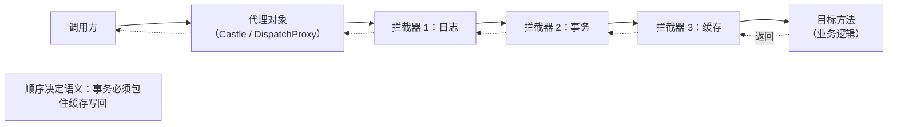
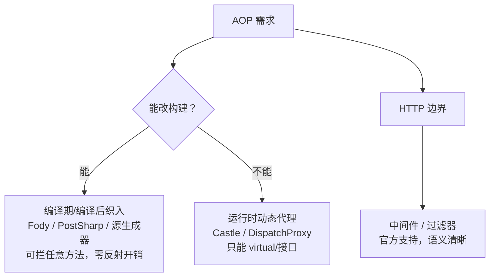
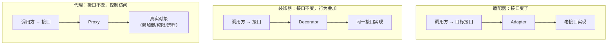
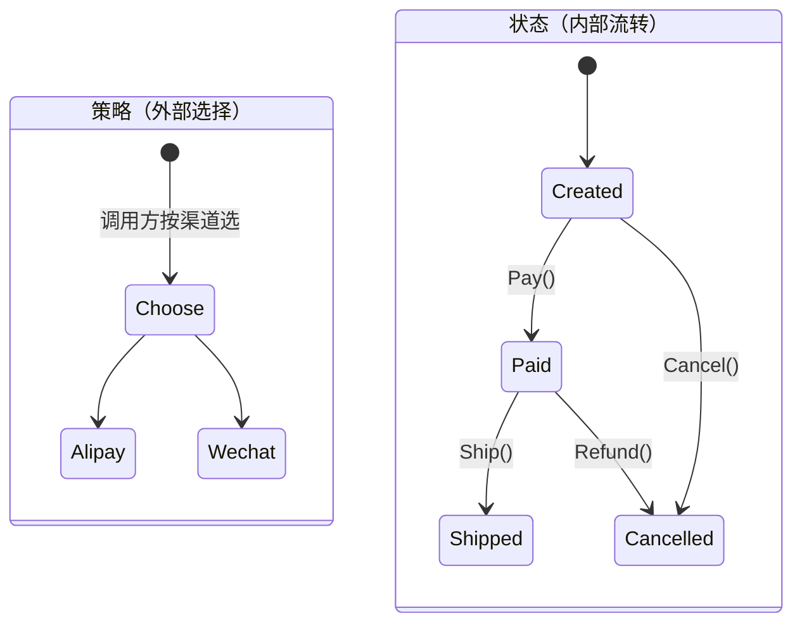

# AOP 与设计模式面试题（含要点与代码）

> 两件事常被一起问：**设计模式是"怎么组织代码"，AOP 是"怎么把横切逻辑从业务里剥出去"**。
> 题目按「AOP 原理与 .NET 落地 → SOLID 与 23 种模式 → 模式辨析 → 现代实践」组织，代码用 C#。

## 目录

- [第一部分 AOP](#第一部分-aop)
  - [一、AOP 基础](#一aop-基础)
  - [二、.NET 里的 AOP 落地](#二net-里的-aop-落地)
- [第二部分 设计模式](#第二部分-设计模式)
  - [三、SOLID 与分类](#三solid-与分类)
  - [四、创建型](#四创建型)
  - [五、结构型](#五结构型)
  - [六、行为型](#六行为型)
- [第三部分 辨析与现代实践](#第三部分-辨析与现代实践)
- [自测清单](#自测清单)
- [附录 A：15 分钟背诵卡](#附录-a15-分钟背诵卡)
- [附录 B：模拟面试 20 题（含追问链）](#附录-b模拟面试-20-题含追问链)
- [附录 C：口述版——3 分钟讲清 AOP 与模式](#附录-c口述版3-分钟讲清-aop-与模式)
- [附录 D：关键图示](#附录-d关键图示)

---

# 第一部分 AOP

## 一、AOP 基础

### 1. 什么是 AOP？它解决什么问题？

**横切关注点（cross-cutting concerns）** 的重复代码：日志、事务、缓存、权限、重试、幂等、度量、审计。

这些逻辑在**几乎每个方法**里都要出现，但它们和业务规则无关。AOP 的目标：**把这些逻辑从业务代码里抽出去，集中声明、自动织入**。

```csharp
// 没有 AOP：业务方法被日志/事务淹没
public async Task<Order> PlaceAsync(CreateOrderDto input)
{
    _logger.LogInformation("下单开始 {Dto}", input);            // 横切
    using var tx = await _db.Database.BeginTransactionAsync();   // 横切
    try
    {
        var order = await DoPlaceAsync(input);                   // 业务（只有这一行）
        await tx.CommitAsync();
        _metrics.Count("order.placed");
        return order;
    }
    catch (Exception ex) { _logger.LogError(ex, "下单失败"); throw; }
}
```

> 追问：不用 AOP 行不行？—— 行，**装饰器模式**手写也能做到；AOP 的价值是"声明式 + 不用改业务代码"，代价是隐式行为、调试变难。

---

### 2. AOP 的核心术语有哪些？

| 术语 | 含义 | .NET 对应 |
| --- | --- | --- |
| **切面 Aspect** | 横切逻辑的模块 | 拦截器类 / 装饰器类 |
| **连接点 Join point** | 可以被织入的位置 | 方法调用、属性访问 |
| **切点 Pointcut** | 选中哪些连接点的表达式 | `[UnitOfWork]` 特性、表达式/命名约定 |
| **通知 Advice** | 在切点上做什么 | Before/After/Around |
| **织入 Weaving** | 把切面插进目标的过程 | 动态代理 / IL 织入 / 源生成器 |
| **目标 Target** | 被代理的对象 | 你的 AppService |

> 追问：切点和连接点的区别？—— 连接点是"所有可以织入的地方"，切点是"我实际选中的那部分"（子集）。

---

### 3. 五种通知类型？

| 通知 | 时机 | 用途 |
| --- | --- | --- |
| Before | 进入方法前 | 参数校验、权限、打点 |
| After（finally） | 无论如何 | 释放资源、耗时统计 |
| AfterReturning | 成功返回后 | 缓存写入、审计 |
| AfterThrowing | 抛异常时 | 日志、异常转换 |
| **Around** | 包住整个调用 | 事务、重试、缓存、超时（最强大） |

> 追问：Around 和其余四种什么关系？—— Around 能模拟其余四种；但 Around 里忘记 `proceed()` 就会**静默跳过目标方法**，这是最常见的 AOP bug。

---

### 4. 织入的三个时机？

| 时机 | 手段 | 优点 | 缺点 |
| --- | --- | --- | --- |
| **编译期 / 编译后** | PostSharp、Fody（IL 织入）、源生成器 | 无运行时开销、能拦截私有/静态方法 | 构建变复杂、调试符号可能错位 |
| **运行时（动态代理）** | Castle DynamicProxy、`DispatchProxy` | 无需改构建、可按 DI 配置 | 只能拦截 virtual/接口方法，有调用开销 |
| 容器/管道层 | ASP.NET Core 中间件、过滤器 | 官方支持、语义清晰 | 只作用于 HTTP 边界，不在业务方法级 |

> 追问：大部分 .NET 项目用哪种？—— **动态代理**（Castle/DispatchProxy）最多，因为与 DI 天然结合；性能极致的场景才上 IL 织入。

---

## 二、.NET 里的 AOP 落地

### 5. Castle DynamicProxy 的原理？有什么限制？

运行时代码生成：为接口生成实现类，或为类生成**子类**，在子类方法里插入拦截逻辑。

```csharp
public sealed class LoggingInterceptor : IInterceptor
{
    public void Intercept(IInvocation invocation)
    {
        Console.WriteLine($"→ {invocation.Method.Name}");
        var sw = Stopwatch.StartNew();
        try
        {
            invocation.Proceed();          // 调目标方法
        }
        finally
        {
            Console.WriteLine($"← {invocation.Method.Name} {sw.ElapsedMilliseconds}ms");
        }
    }
}

var proxy = new ProxyGenerator()
    .CreateClassProxy<OrderService>(new LoggingInterceptor());
```

**四个限制**：

1. 只能拦截 **virtual 方法**（类的代理）或接口方法 —— 非 virtual 方法直接调用，拦截不到。
2. **sealed 类**无法代理（不能继承）。
3. **静态方法**拦截不到。
4. **self-invocation**：`this.Foo()` 不走代理 → 拦截失效（和 Spring 的经典坑一样）。

> 追问：怎么解决 self-invocation？—— 拆成两个类，或者注入自身接口（`ISelf`），或者干脆把这部分逻辑显式调用（不要依赖隐式织入）。

---

### 6. `DispatchProxy` 是什么？

.NET Core 内置的接口代理（`System.Reflection.DispatchProxy`），无需第三方库：

```csharp
public class TimingProxy : DispatchProxy
{
    protected override object? Invoke(MethodInfo? targetMethod, object?[]? args)
    {
        var sw = Stopwatch.StartNew();
        try { return targetMethod!.Invoke(_target, args); }
        finally { Console.WriteLine($"{targetMethod!.Name}: {sw.ElapsedMilliseconds}ms"); }
    }

    private object _target = default!;
    public static T Create<T>(T target) where T : class
    {
        var proxy = Create<T, TimingProxy>();
        ((TimingProxy)(object)proxy)._target = target;
        return proxy;
    }
}
```

> 追问：和 Castle 比怎么选？—— 只需要接口代理、不想引第三方依赖时用 `DispatchProxy`；需要类代理、拦截器链、异步/泛型支持（ABP/EF 场景）用 Castle。

---

### 7. 源生成器/IL 织入能做到什么？

- **IL 织入（Fody / PostSharp）**：编译后改写 IL，能拦截任意方法（含私有/静态），无反射开销；代价是构建链复杂、AOT/单文件发布可能冲突。
- **源生成器**：生成**替代实现**（如 `LoggerMessage`、`IFormattable` 包装），编译期展开、零运行时开销；但**不能改写既有方法的调用点**（除非用 interceptors）。
- **C# interceptors**（`[InterceptsLocation]`，C# 12 起引入、仍在预览/演进）：可以让源生成器**替换调用点**，接近编译期 AOP；但受命名空间白名单和语法约束，不适合作为通用方案。

> 追问：`LoggerMessage` 算 AOP 吗？—— 算"编译期织入"的一种：把日志模板在编译期生成强类型方法，省掉装箱与模板解析。

---

### 8. 中间件、过滤器、拦截器、装饰器到底该用哪个？

| 机制 | 作用域 | 典型用途 |
| --- | --- | --- |
| **中间件** | 整个 HTTP 管道 | 认证、异常兜底、请求日志、限流、traceId |
| **过滤器** | MVC/端点 | 模型校验、授权、统一响应包装 |
| **拦截器（动态代理）** | 任意服务方法 | 事务（UoW）、缓存、审计、重试 |
| **装饰器** | 手写包装特定服务 | 明确的、需要显式组合的增强 |

判断：**只在 HTTP 边界需要 → 中间件；需要包在业务方法外 → 拦截器；逻辑与某个服务强相关且要可见 → 装饰器**。

> 追问：为什么 ABP 用拦截器做 UoW 而不用中间件？—— 事务边界应该跟随**应用服务方法**（而不是 HTTP 请求），这样后台任务、消息消费也能复用同一套事务语义。

---

### 9. AOP 的性能开销体现在哪？

| 环节 | 成本 |
| --- | --- |
| 代理生成 | 启动时一次（每类型），可忽略 |
| 每次调用 | 虚方法派发 + 拦截器链 + 反射元数据访问 |
| 参数/返回值 | 装箱、数组分配（`object[] args`） |
| 异步方法 | 需额外处理 `Task`/`ValueTask` 状态 |

经验值：纯转发拦截大约**百纳秒级**，相比一次 DB 调用可忽略；但**高频纯内存方法**（如 getter、计算密集循环）被拦就会明显变慢。

> 追问：怎么减少开销？—— 只拦需要的切点（别 `*` 全包）、缓存 `MethodInfo`、用 `ValueTask`、热点路径改用显式装饰器。

---

### 10. AOP 的坑与最佳实践？

1. **隐式行为难排查**：日志里看不到"这个方法被拦截了"，要在拦截器里打点。
2. **拦截一切**：把整个程序集都代理，启动慢、调试难、易踩 self-invocation。
3. **顺序问题**：事务拦截器必须在缓存拦截器外层（先开事务再查缓存？其实相反），顺序错了语义就变了。
4. **吞异常**：拦截器 `catch` 后不抛，事务不会回滚。
5. **异步方法**：`Invoke` 返回 `Task` 时，`finally` 在**任务未完成前**就执行 → 耗时统计错误、事务提前释放。
6. **AOT/裁剪**：动态代理在 NativeAOT 下受限。

> 追问：异步方法的 `finally` 为什么早执行？—— 拦截的是"返回 Task 的那一刻"，不是"Task 完成"；要么 `await` 内部任务，要么用支持异步的拦截器基类。

---

### 11. 不用第三方库，手写 AOP 可行吗？

可行，**装饰器 + DI** 就是最小 AOP：

```csharp
public sealed class CachedOrderService : IOrderService
{
    private readonly IOrderService _inner;
    private readonly IMemoryCache _cache;

    public CachedOrderService(IOrderService inner, IMemoryCache cache)
        => (_inner, _cache) = (inner, cache);

    public async Task<Order?> GetAsync(int id)
    {
        if (_cache.TryGetValue(id, out Order? cached)) return cached;
        var order = await _inner.GetAsync(id);
        _cache.Set(id, order, TimeSpan.FromMinutes(1));
        return order;
    }
}

// 注册：真正的实现放在里面
services.AddScoped<OrderService>();
services.AddScoped<IOrderService>(sp =>
    new CachedOrderService(sp.GetRequiredService<OrderService>(), sp.GetRequiredService<IMemoryCache>()));
```

> 追问：装饰器的优势？—— **显式、可调试、可组合**（缓存 → 重试 → 日志 逐层包）；缺点是每个被增强的服务都要写一个包装类。

---

# 第二部分 设计模式

## 三、SOLID 与分类

### 12. SOLID 五原则？

| 原则 | 含义 | C# 反例 |
| --- | --- | --- |
| **S** 单一职责 | 一个类只有一个变化原因 | `OrderService` 同时管下单、发邮件、生成 PDF |
| **O** 开闭 | 对扩展开放、对修改关闭 | `switch(channel)` 每加一种支付就改一次 |
| **L** 里氏替换 | 子类可替换父类且行为不变 | 子类重写方法抛 `NotSupportedException` |
| **I** 接口隔离 | 接口要小而专 | 一个 `IRepository` 塞了 30 个方法，实现类大半抛异常 |
| **D** 依赖倒置 | 依赖抽象而非实现 | 业务层 `new MySqlHelper()` |

> 追问：SOLID 和设计模式什么关系？—— 设计模式是**实现这些原则的常见手法**；先有原则，模式才有意义，否则就是背菜谱。

---

### 13. 23 种模式怎么分类？面试该重点准备哪些？

| 类别 | 模式 |
| --- | --- |
| **创建型**（5） | 单例、工厂方法、抽象工厂、建造者、原型 |
| **结构型**（7） | 适配器、桥接、组合、装饰器、外观、享元、代理 |
| **行为型**（11） | 责任链、命令、解释器、迭代器、中介者、备忘录、观察者、状态、策略、模板方法、访问者 |

**必须能讲清的 8 个**（出现频率最高）：
策略、责任链、观察者、装饰器、代理、适配器、工厂（方法/抽象）、单例。
**容易混的 4 组**：适配器 vs 装饰器 vs 代理、策略 vs 状态、工厂方法 vs 抽象工厂、观察者 vs 发布订阅。

> 追问：为什么不用全背？—— 面试问的是"你在什么场景下用过"，而不是名词解释；能把 8 个讲透 + 4 组辨析清楚就够。

---

## 四、创建型

### 14. 单例有几种写法？哪个最推荐？

```csharp
// ① 静态构造（CLR 保证线程安全，推荐）
public sealed class Config
{
    public static Config Instance { get; } = new();
    private Config() { }
}

// ② Lazy<T>（可延迟初始化，默认 ExecutionAndPublication）
public sealed class Config2
{
    private static readonly Lazy<Config2> _lazy = new(() => new Config2(), true);
    public static Config2 Instance => _lazy.Value;
    private Config2() { }
}

// ③ 双重检查锁（要 volatile，历史上最常见的错误写法）
public sealed class Config3
{
    private static volatile Config3? _instance;
    private static readonly object _lock = new();
    public static Config3 Instance
    {
        get
        {
            if (_instance is null)
                lock (_lock)
                    _instance ??= new Config3();
            return _instance;
        }
    }
}
```

**推荐 ①**：CLR 的静态构造保证只执行一次且线程安全，代码最短、无锁。

> 追问：单例什么时候是反模式？—— 当它隐藏依赖、持有可变状态、让测试无法隔离时；服务端更推荐**用 DI 注册 Singleton**，而不是手写静态单例。

---

### 15. 工厂方法、抽象工厂、简单工厂的区别？

| | 谁创建 | 扩展方式 |
| --- | --- | --- |
| 简单工厂 | 一个工厂类 + switch | 加产品要改工厂（违反 OCP） |
| **工厂方法** | 每个产品一个工厂子类 | 加产品加工厂，不改旧代码 |
| **抽象工厂** | 一个工厂创建**一族**相关产品 | 换"产品族"只换工厂 |

```csharp
// 简单工厂（够用就行，别过度设计）
public static class PaymentFactory
{
    public static IPayment Create(string channel) => channel switch
    {
        "alipay" => new AlipayPayment(),
        "wechat" => new WechatPayment(),
        _ => throw new NotSupportedException(channel)
    };
}
```

> 追问：什么时候该升级到工厂方法？—— 创建逻辑本身有变化（不同环境/租户不同实现）且要遵守 OCP 时；否则简单工厂 + DI 注册就够。

---

### 16. 建造者模式用在哪？和 Fluent API 什么关系？

用于**参数多、有必填/可选组合、需要分步构造**的对象。

```csharp
var request = new HttpRequestBuilder()
    .WithUrl("/orders")
    .WithMethod(HttpMethod.Post)
    .WithHeader("trace-id", id)
    .WithJsonBody(payload)
    .Build();
```

C# 里的 `StringBuilder`、`DbContextOptionsBuilder`、`IHostBuilder` 都是建造者；`record` + `with` 表达式是"不可变变体"的现代替代。

> 追问：建造者 vs 工厂？—— 工厂关心"**造什么**"（选类型），建造者关心"**怎么一步步造**"（装配参数）。

---

### 17. 原型模式还需要吗？

场景：创建成本高（大对象、要查库/网络）、需要复制现有对象。

- **浅拷贝** `MemberwiseClone()`：引用类型共享。
- **深拷贝**：手动递归、序列化、或 `record` 值语义。
- 现代替代：**不可变对象 + `with` 表达式**（本质是复制后改字段）。

> 追问：`record` 的 `with` 是深拷贝吗？—— 是**浅拷贝语义**：值类型字段整体复制，引用类型字段共享同一实例。

---

## 五、结构型

### 18. 适配器、装饰器、代理有什么区别？（高频）

| | 目的 | 接口 | 是否新增行为 |
| --- | --- | --- | --- |
| **适配器** | 让**不兼容的接口**能一起工作 | **改变**（包装成目标接口） | 只做翻译 |
| **装饰器** | **动态增强**已有对象 | **相同**接口 | 新增行为（可叠加多层） |
| **代理** | **控制访问**（远程/懒加载/权限） | **相同**接口 | 行为通常透明 |

```csharp
// 装饰器：接口不变，行为叠加
IOrderService svc = new RetryDecorator(new LogDecorator(new OrderService()));

// 适配器：接口变了
IPayment Gateway => new LegacyPayAdapter(new OldPaySdk());   // 老 SDK 的 API → IPayment

// 代理：控制访问（这里用 DispatchProxy / Castle 生成）
IOrderService proxy = ProxyGenerator.CreateClassProxy<IOrderService>(interceptor);
```

> 追问：怎么一句话区分？—— **适配器改接口、装饰器加行为、代理控访问**；三者结构都像"包一层"，但意图不同。

---

### 19. 外观（Facade）和中介者（Mediator）有什么区别？

- **外观**：给**子系统**一个简化入口（单向，客户端 → 外观 → 多个子系统）。
- **中介者**：让**平级对象**通过中介通信（多向，同事之间不再互相引用）。

> 追问：外观会变成上帝对象吗？—— 会，如果往里塞业务逻辑；外观应只做编排与转发。

---

### 20. 组合（Composite）和桥接（Bridge）？

- **组合**：树形结构统一对待（叶子与容器同一接口）—— 组织架构、菜单树、表达式树。
- **桥接**：把"抽象"和"实现"两个维度拆开独立变化 —— 跨平台渲染（形状 × 平台）。

> 追问：桥接和策略的区别？—— 结构相似，但桥接解决的是**两个维度的组合爆炸**（M×N → M+N），策略只解决**一个维度的可替换**。

---

### 21. 享元（Flyweight）在 .NET 里有哪些体现？

共享不可变对象以省内存：**字符串驻留**（`string.Intern`）、`Array.Empty<T>()`、枚举缓存、`ValueTask.CompletedTask`、连接池/对象池（`ArrayPool<T>`）。

> 追问：享元和对象池的区别？—— 享元是**同一份不可变数据被多处共享**；对象池是**可变对象复用**（要重置状态）。

---

## 六、行为型

### 22. 策略模式和状态模式怎么区分？（高频）

| | 策略 | 状态 |
| --- | --- | --- |
| 谁决定切换 | **外部**（调用方选） | **内部**（状态自己流转） |
| 对象是否变化 | 策略本身无状态、可替换 | 状态对象随业务演进 |
| 典型 | 支付渠道、折扣算法、压缩算法 | 订单状态机、连接状态 |

```csharp
// 策略：调用方选
var strategy = _strategies[channel];
await strategy.PayAsync(order);

// 状态：自己流转
public void Pay() { EnsureState<Created>(); _state = new Paid(); }
```

> 追问：为什么订单状态用状态机而不是一堆 if？—— 状态流转规则集中在一处、非法流转直接抛异常、新增状态不影响既有代码。

---

### 23. 观察者和发布订阅的区别？

| | 观察者 | 发布订阅 |
| --- | --- | --- |
| 耦合 | 主题**直接持有**观察者列表 | 通过**事件总线/中间件**解耦 |
| 同步性 | 通常同步调用 | 通常异步（可跨进程） |
| 范围 | 进程内 | 跨服务 |

C# 里：`event` / `IObservable<T>` 是观察者；ABP 的**分布式事件总线**、MQ 是发布订阅。

> 追问：`event` 有什么坑？—— 订阅者被强引用导致**内存泄漏**（静态事件尤其）、异常会让后续订阅者不执行、无顺序保证。

---

### 24. 责任链用在哪？

一条链上依次处理，任一环可终止或传递：

- **ASP.NET Core 中间件**（最典型）
- 审批流（金额 < 1 万主管批，否则总监批）
- MediatR 的 `IPipelineBehavior`（日志 → 校验 → 事务）

```csharp
public sealed class ApprovalChain
{
    private readonly List<IApprover> _approvers;

    public void Handle(LeaveRequest req) => _approvers.FirstOrDefault(a => a.CanApprove(req))?.Approve(req);
}
```

> 追问：责任链和装饰器的区别？—— 装饰器**每一层都执行**并增强同一个调用；责任链**只由某一环处理**（或依次处理直到中断）。

---

### 25. 模板方法 vs 策略？

- **模板方法**：父类定流程骨架，子类填步骤（**继承**，编译期绑定）。
- **策略**：把可变部分抽成接口，运行时注入（**组合**，运行期替换）。

> 追问：为什么现代倾向策略？—— 组合优于继承：不污染类型层次、可运行时替换、更易单测。

---

### 26. 命令模式解决什么？

把"请求"封装成对象：可排队、可撤销、可记录日志、可事务化。

- 典型：操作撤销（`Undo`）、任务队列（把命令序列化进 MQ）、CQRS 的 Command。
- .NET 里 `ICommand`（WPF）、MediatR 的 `IRequest` 都是它的变体。

> 追问：命令和事件的区别？—— 命令是"**请做**"（点对点、可能失败、有明确接收者）；事件是"**已发生**"（广播、不可拒绝）。

---

### 27. 迭代器模式在 C# 里怎么体现？

`foreach` + `IEnumerable<T>` + `yield return`（编译器生成状态机）。好处：**惰性求值、无限序列、零额外集合分配**。

> 追问：`yield` 的坑？—— 延迟执行（异常推迟到枚举时）、每次枚举从头开始、不能在 `try-catch` 的 catch 块里 yield。

---

### 28. 中介者、备忘录、访问者还要会吗？

- **中介者**：减少多对多引用（聊天室、事件总线）。
- **备忘录**：保存/恢复状态（撤销、快照）。
- **访问者**：在不改元素类的前提下加操作（AST 遍历、报表导出），代价是新增元素类型要改所有访问者。

> 追问：访问者什么时候值得？—— 元素类型**稳定**、操作**经常新增**时；反之用模式匹配 `switch` 更简单。

---

# 第三部分 辨析与现代实践

### 29. 控制反转、依赖注入、DI 容器是一回事吗？

- **IoC**：控制权反转（对象的创建/生命周期交给外部）—— 是**原则**。
- **DI**：实现 IoC 的方式之一（通过构造函数/属性/方法注入依赖）—— 是**模式**。
- **DI 容器**：自动完成注册与解析的工具（`Microsoft.Extensions.DependencyInjection`）—— 是**基础设施**。

> 追问：DI 一定是构造函数注入吗？—— 不是，但构造函数注入最推荐：依赖显式、不可变、易测。

---

### 30. 仓储（Repository）和工作单元（UoW）是反模式吗？

**不是反模式，但常被滥用**。

- 在 EF Core 之上再包一层 `IRepository<T>`，而 `DbContext` 本身已是 UoW + Repository → **冗余**。
- 有价值的情况：需要**替换持久化技术**、需要**领域层不依赖 ORM**、需要统一查询策略（软删除/多租户）。

> 追问：你们怎么做的？—— 领域层定义仓储接口（按聚合根），基础设施层用 EF Core 实现；简单 CRUD 直接注入 `DbContext`，不为每个实体造仓储。

---

### 31. 模式滥用的信号是什么？

1. 为了用模式而用（"这里必须有个工厂"）。
2. 接口只有**一个实现**且没有替换预期。
3. 为了"扩展性"加了 5 层抽象，实际从没扩展过。
4. 读一段代码要跳 6 个文件才看懂。
5. 简单 `switch` 被拆成 8 个类。

> 追问：怎么权衡？—— **先写直白代码，等变化出现第二次再抽象**（Rule of Three）；模式是应对变化的，不是预防所有变化。

---

### 32. 本仓库里的模式与 AOP（可当项目案例）

| 模式/技术 | 位置 |
| --- | --- |
| **AOP 拦截器**（UoW、审计、异常） | ABP 的 `AbpInterceptor` / `[UnitOfWork]`，应用服务被 Castle 代理 |
| 责任链 | ASP.NET Core 中间件管道、ABP 的 `AbpMiddleware` |
| 观察者/发布订阅 | ABP 分布式事件：`StockDeductedEto` → `StockDeductedHandler` |
| 策略 | 库存扣减多方案（DB 原子/乐观锁/悲观锁/Redis 预扣）按场景选择 |
| 建造者 | `HostWebHostModule` 里的 `Configure<AbpAuditingOptions>` 等配置链 |
| 单例 + DI | `IConnectionMultiplexer`、`IMongoClient` 注册为单例 |
| 模板方法 | `ApplicationService` 基类、`BackgroundService.ExecuteAsync` |

> 追问：ABP 的拦截器算不算 AOP 的"完整实现"？—— 算运行时织入（动态代理）的典型；它把 UoW、审计、授权都做成拦截器，业务代码里看不到这些横切逻辑。

---

## 自测清单

**AOP**

- [ ] AOP 解决什么问题（横切关注点），不用它怎么替代
- [ ] 切面/连接点/切点/通知/织入/代理
- [ ] 五种通知，Around 为什么最强也最容易出错
- [ ] 三种织入时机的取舍
- [ ] Castle 的四个限制（非 virtual/sealed/静态/self-invocation）
- [ ] `DispatchProxy` 的适用场景
- [ ] 中间件 / 过滤器 / 拦截器 / 装饰器怎么选
- [ ] 异步方法拦截的 `finally` 时机问题

**设计模式**

- [ ] SOLID 五条 + 各自的 C# 反例
- [ ] 单例三种写法和推荐理由
- [ ] 简单工厂 / 工厂方法 / 抽象工厂
- [ ] 建造者与 fluent API
- [ ] 适配器 vs 装饰器 vs 代理
- [ ] 组合 vs 桥接
- [ ] 策略 vs 状态
- [ ] 观察者 vs 发布订阅，`event` 的坑
- [ ] 责任链 vs 装饰器
- [ ] 模板方法 vs 策略
- [ ] 命令 vs 事件
- [ ] 迭代器与 `yield` 的坑

**实践**

- [ ] IoC / DI / 容器的区别
- [ ] 仓储与 UoW 什么时候是冗余
- [ ] 模式滥用的五个信号
- [ ] 能说出项目里真实用过的 3 个模式

---

# 附录 A：15 分钟背诵卡

### AOP

1. AOP 治**横切关注点**：日志、事务、缓存、权限、重试、审计。
2. 术语链：切面 → 切点（选中哪些）→ 通知（做什么）→ 织入（怎么插）。
3. 通知五种；**Around 最强，但忘了 `Proceed()` 会静默跳过目标**。
4. 织入三时机：编译期（Fody/PostSharp/源生成器）、运行时（Castle/DispatchProxy）、管道层（中间件/过滤器）。
5. Castle 四个限制：只能 virtual/接口、sealed 不行、静态不行、**self-invocation 不走代理**。
6. `DispatchProxy` 是内置的接口代理，零第三方依赖。
7. 中间件管 HTTP 边界、过滤器管端点、**拦截器管业务方法**、装饰器管具体服务。
8. 异步拦截的坑：`finally` 在 Task 未完成时就执行 → 耗时统计/事务释放都会错。
9. 不用库也能 AOP：**装饰器 + DI**，显式可调试。
10. 别拦截一切：只拦需要的切点，热点路径用显式装饰器。

### 设计模式

11. SOLID：单一职责、开闭、里氏替换、接口隔离、依赖倒置。
12. 模式是**实现原则的手法**，背名词没用，要能说场景。
13. 单例首选**静态构造**（CLR 保证线程安全），其次 `Lazy<T>`。
14. 简单工厂够用；工厂方法解决"新增不改旧"；抽象工厂解决"产品族"。
15. 建造者管"怎么一步步造"，工厂管"造什么"。
16. **适配器改接口、装饰器加行为、代理控访问**。
17. 桥接解决 M×N 组合爆炸，策略只替换一个维度。
18. 享元共享不可变数据（字符串驻留、`Array.Empty`）；对象池复用可变对象。
19. **策略由外部选、状态自己流转**。
20. 观察者是同步直连，发布订阅经总线可跨进程。
21. 责任链只由某一环处理；装饰器每层都执行。
22. 模板方法靠继承定骨架；策略靠组合换实现。
23. 命令是"请做"（可撤销/可排队），事件是"已发生"（广播）。
24. 迭代器靠 `yield` 生成状态机；坑是延迟执行与重复枚举。
25. IoC 是原则、DI 是模式、容器是工具。
26. 仓储在 EF Core 之上常是冗余，除非要隔离 ORM 或统一查询策略。
27. 滥用信号：为模式而模式、单实现接口、跳 6 个文件才看懂。
28. **Rule of Three**：变化出现第二次再抽象。

> 记忆锚点：**横切剥离（AOP）→ 原则（SOLID）→ 模式（分类辨析）→ 克制**。

---

# 附录 B：模拟面试 20 题（含追问链）

### 1. 什么是 AOP？

**开口**：把日志、事务、缓存这类横切逻辑从业务代码里剥出来，集中声明、自动织入。
**追问**：不用它行不行？→ 行，装饰器也能做；AOP 的价值是声明式、不改业务代码。

### 2. AOP 的切点和连接点区别？

**开口**：连接点是所有可织入的位置，切点是我实际选中的子集。
**追问**：切点怎么表达？→ 特性标记、命名约定、表达式；.NET 里常用特性 + 命名约定。

### 3. Around 通知为什么最强？

**开口**：它能包住整个调用，能在前后加逻辑、改返回值、吞异常、重试。
**追问**：最容易犯什么错？→ 忘记 `Proceed()`，目标方法被静默跳过。

### 4. .NET 里 AOP 怎么实现？

**开口**：运行时代理（Castle/DispatchProxy）最常用，编译期 IL 织入（Fody/PostSharp）性能最好但构建复杂。
**追问**：源生成器算 AOP 吗？→ 算编译期织入的一种，但不能改写既有调用点（interceptors 除外，仍在预览）。

### 5. Castle 有什么限制？

**开口**：只能拦 virtual 或接口方法，sealed 类和静态方法不行，self-invocation 不走代理。
**追问**：self-invocation 怎么解？→ 拆类、注入自身接口，或显式调用而不是依赖隐式织入。

### 6. 中间件和拦截器怎么选？

**开口**：中间件管 HTTP 边界（认证、异常兜底、traceId），拦截器管业务方法（事务、缓存、审计）。
**追问**：为什么事务不用中间件？→ 事务边界应跟随应用服务方法，后台任务和消息消费也要能复用。

### 7. AOP 有什么代价？

**开口**：隐式行为难排查、启动和调用有开销、顺序敏感、异步拦截容易出错。
**追问**：怎么降低？→ 只拦必要切点、拦截器里打日志、热点路径用显式装饰器。

### 8. 异步方法拦截的坑？

**开口**：拦截器 `Invoke` 返回 `Task` 时，`finally` 在任务完成前就跑了。
**追问**：后果？→ 耗时统计错误、事务提前释放；要 `await` 内部任务或用异步拦截器基类。

### 9. 你手写过 AOP 吗？

**开口**：用装饰器 + DI 手写过缓存/重试包装，显式可调试。
**追问**：为什么最后用了代理？→ 服务太多、每个都写包装类不现实，且要和事务/审计统一。

### 10. SOLID 讲一下？

**开口**：单一职责、开闭、里氏替换、接口隔离、依赖倒置。
**追问**：最容易违反哪个？→ 单一职责，尤其是"顺手加个方法"的 Service。

### 11. 单例怎么写最稳？

**开口**：静态构造或 `Lazy<T>`，由 CLR 保证线程安全；双重检查锁要 `volatile`。
**追问**：单例有什么问题？→ 隐藏依赖、持有可变状态、难测试；服务端更推荐 DI 注册 Singleton。

### 12. 工厂三种怎么选？

**开口**：简单工厂 + switch 够用；要新增不改旧用工厂方法；要换产品族用抽象工厂。
**追问**：什么时候是过度设计？→ 产品只有一种实现、且没有新增预期。

### 13. 适配器、装饰器、代理怎么区分？

**开口**：适配器改接口、装饰器加行为、代理控访问。
**追问**：举个各自的项目例子？→ 老支付 SDK 适配、缓存装饰器、Castle 生成的权限代理。

### 14. 策略和状态的区别？

**开口**：策略由外部选择、无状态；状态由对象内部流转、非法流转要报错。
**追问**：订单状态用哪种？→ 状态机，把流转规则收在聚合里。

### 15. 观察者和发布订阅？

**开口**：观察者是主题直接持有观察者、通常同步；发布订阅经总线、可跨进程异步。
**追问**：`event` 有什么坑？→ 静态事件内存泄漏、异常中断后续订阅者、无顺序保证。

### 16. 责任链和装饰器？

**开口**：责任链只由某一环处理（或依次处理直到中断），装饰器每层都执行。
**追问**：中间件是哪一个？→ 责任链，因为可以短路不调用 `next()`。

### 17. 为什么框架里到处是接口只一个实现？

**开口**：为了可测试、可替换、AOP 代理需要接口/virtual。
**追问**：什么时候不该抽？→ 纯数据/工具类、没有替换与测试需求时，接口只是噪音。

### 18. 仓储模式在 EF Core 里还需要吗？

**开口**：默认不需要，`DbContext` 已是 UoW + Repository；需要隔离 ORM 或统一软删除/多租户策略时才封装。
**追问**：那你们怎么分层？→ 领域层定义仓储接口（按聚合根），基础设施实现，简单 CRUD 直接用 DbContext。

### 19. 设计模式会不会过度设计？

**开口**：会，典型信号是"为模式而模式"和"跳六个文件才看懂"。
**追问**：怎么把握？→ Rule of Three，变化出现第二次再抽象。

### 20. 你项目里用了哪些模式？

**开口**：AOP 拦截器做事务审计、责任链做中间件、观察者做领域事件、策略做库存扣减方案选择。
**追问**：哪个最有效？→ 拦截器，把事务和审计从几百个服务方法里抽出来，改一次全局生效。

---

# 附录 C：口述版——3 分钟讲清 AOP 与模式

> 面试官问「你怎么理解 AOP 和设计模式」时用。约 800 字 ≈ 3 分钟。

### 逐字稿

**【开场 · 15 秒】**
我把这两件事看成一句话：**设计模式是"怎么组织代码应对变化"，AOP 是"怎么把不属于业务的逻辑挪出去"**。前者管结构，后者管切面。

**【AOP · 45 秒】**
AOP 解决的是横切关注点：日志、事务、缓存、权限、重试。这些东西如果在每个方法里手写，业务代码就被淹了。
实现上分三档：编译期织入最彻底（Fody、PostSharp），但构建链复杂；运行时代理最常用（Castle、DispatchProxy），代价是只能拦 virtual 或接口方法，而且**self-invocation 不走代理**；再往上就是管道层，中间件和过滤器。
.NET 里我优先按范围选：HTTP 边界用中间件，端点用过滤器，业务方法用拦截器，单个服务的明确增强用装饰器。

**【AOP 的坑 · 40 秒】**
三个坑必须知道。第一，Around 忘了 `Proceed()` 会静默跳过目标方法。第二，异步方法拦截时 `finally` 在 Task 完成前就执行了，耗时统计和事务释放都会错。第三，拦截器顺序敏感——事务、缓存、重试的先后直接改变语义。
还有一点：别拦截一切，否则启动慢、调试难，热点路径反而应该用显式装饰器。

**【设计模式 · 50 秒】**
模式我先讲原则：SOLID。然后只重点准备八个：策略、责任链、观察者、装饰器、代理、适配器、工厂、单例。
四组辨析是高频：**适配器改接口、装饰器加行为、代理控访问**；**策略由外部选、状态自己流转**；工厂方法解决"新增不改旧"、抽象工厂解决"产品族"；观察者是同步直连、发布订阅经总线。
现在框架里其实处处是模式：中间件是责任链，领域事件是观察者，DI 是控制反转，`yield` 是迭代器。

**【收尾 · 30 秒】**
最后是克制。模式滥用的信号很明显：接口只有一个实现且没有替换预期、为了扩展性加五层抽象、读一个方法要跳六个文件。
我的原则是 **Rule of Three**：变化出现第二次再抽象。
一句话总结：**AOP 让业务代码只剩业务，设计模式让变化只改一处；两者都靠克制才有效**。

---

### 压缩版

**一句话版（10 秒）**
> AOP 把横切逻辑挪出去（拦截器/装饰器），设计模式让变化只改一处（八种 + 四组辨析），都要靠克制。

**30 秒版**
> AOP 治横切关注点，实现分编译期织入、动态代理、管道层三档；Castle 只能拦 virtual/接口，self-invocation 无效，异步拦截 `finally` 时机要注意。设计模式重点八个，四组辨析：适配器/装饰器/代理、策略/状态、工厂方法/抽象工厂、观察者/发布订阅。实践靠 Rule of Three 防过度设计。

### 时间分配

| 段落 | 时长 | 只说一件事 |
| --- | --- | --- |
| 开场 | 15s | 结构 vs 切面 |
| AOP 落地 | 45s | 三档实现 + 按范围选机制 |
| AOP 的坑 | 40s | Proceed / 异步 finally / 顺序 / 别全拦 |
| 设计模式 | 50s | SOLID + 八个 + 四组辨析 |
| 收尾 | 30s | Rule of Three + 一句话 |

### 被打断时怎么接

| 面试官插话 | 接续句 |
| --- | --- |
| 「AOP 有什么缺点？」 | 「隐式和顺序敏感，所以我们只在事务、审计、缓存这三类上用」 |
| 「你写过代理吗？」 | 「用 DispatchProxy 写过接口代理，Castle 用在需要类代理和拦截器链的场景」 |
| 「策略和状态你项目里用了吗？」 | 「库存扣减是策略（外部选方案），订单流转是状态机（内部流转）」 |
| 「怎么判断该不该抽接口？」 | 「看有没有第二个实现或测试替身；没有就是噪音」 |

---

# 附录 D：关键图示

### 1. AOP 的织入位置



### 2. 三种织入时机



### 3. 适配器 vs 装饰器 vs 代理



### 4. 策略 vs 状态


