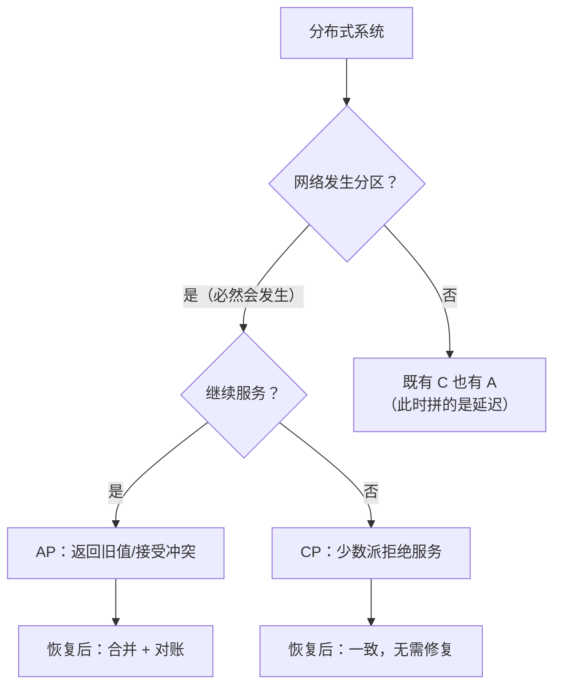
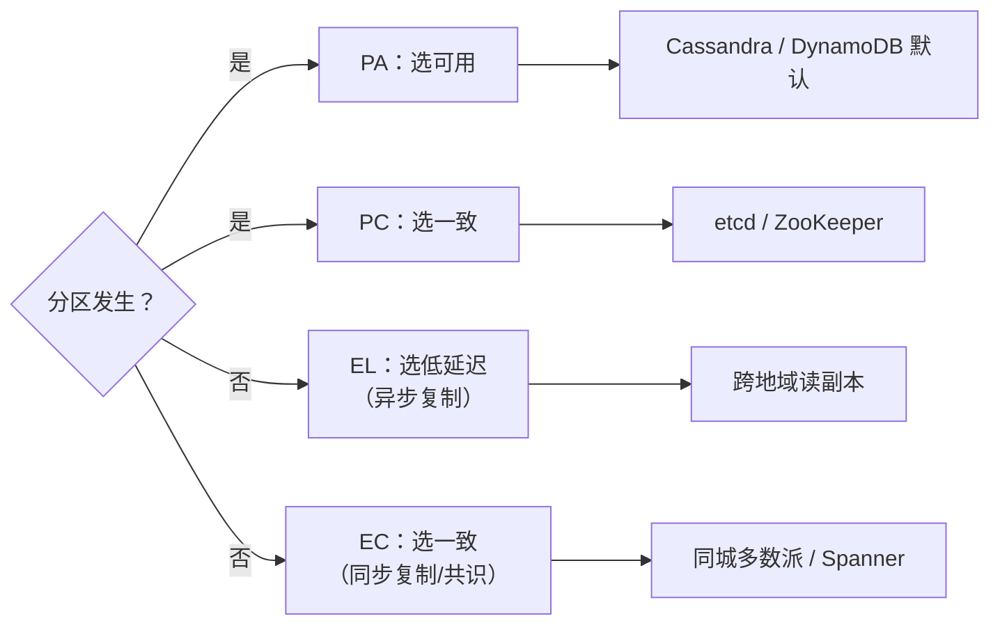
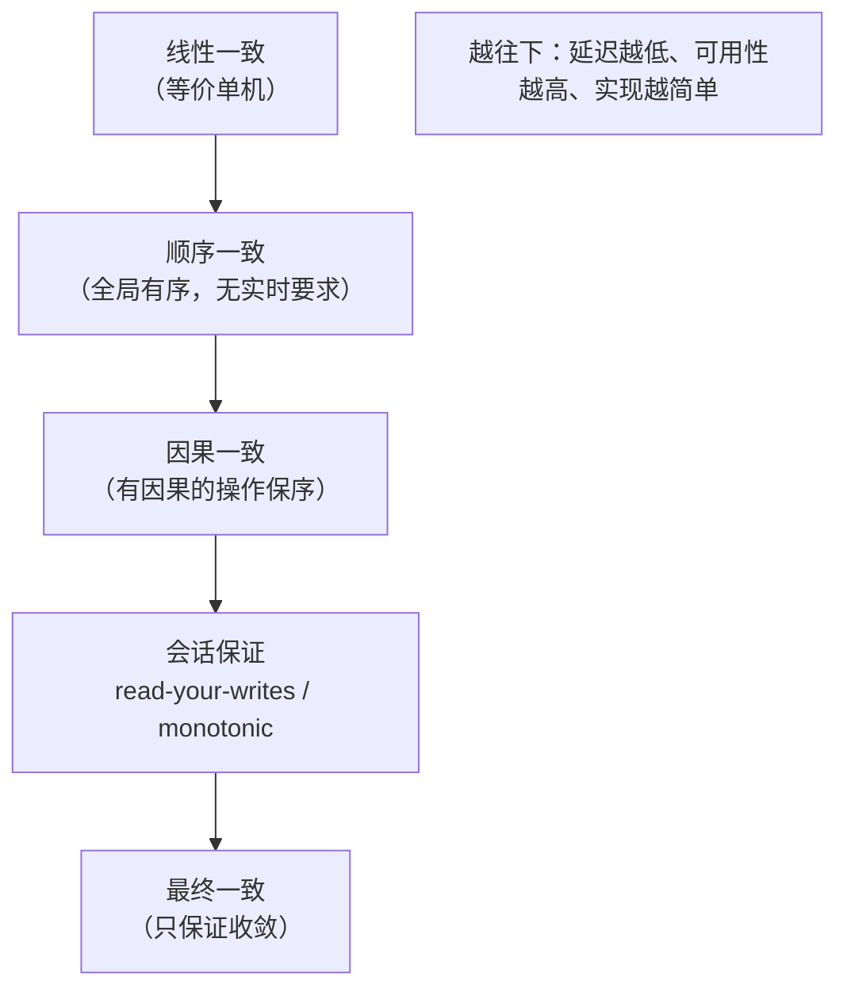
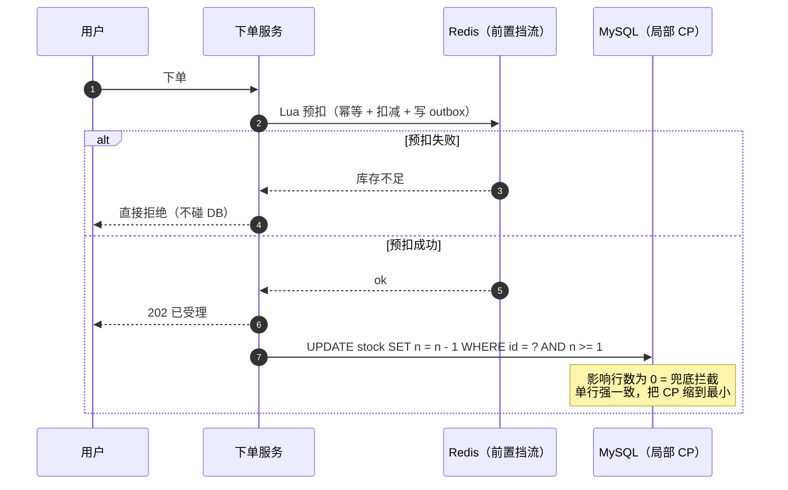

# CAP 与分布式一致性面试题（含要点与追问）

> CAP 是面试里**最容易被答错**的题：多数人背成"三选二"，却说不出「C 是哪种 C」「为什么没有 CA」「AP 到底牺牲了什么」。
> 这一篇只讲理论怎么落到工程：一致性模型谱系 → 共识与事务的定位 → 各中间件与业务场景的取舍。

## 目录

- [一、CAP 的准确定义](#一cap-的准确定义)
- [二、PACELC 与延迟](#二pacelc-与延迟)
- [三、一致性模型谱系](#三一致性模型谱系)
- [四、共识、事务与 CAP](#四共识事务与-cap)
- [五、工程映射与场景选型](#五工程映射与场景选型)
- [自测清单](#自测清单)
- [附录 A：15 分钟背诵卡](#附录-a15-分钟背诵卡)
- [附录 B：模拟面试 20 题（含追问链）](#附录-b模拟面试-20-题含追问链)
- [附录 C：口述版——3 分钟讲清 CAP](#附录-c口述版3-分钟讲清-cap)
- [附录 D：关键图示](#附录-d关键图示)

---

## 一、CAP 的准确定义

### 1. CAP 的 C、A、P 分别是什么？

| 字母 | 严格定义 | 常见误读 |
| --- | --- | --- |
| **C** Consistency | **线性一致性**：所有操作看起来像在单机上按某个全局顺序执行，且读到的永远是最新已提交值 | 误读成"最终一致"或"数据一致" |
| **A** Availability | 每个**非故障**节点都能在**有限时间**内返回**非错误**响应 | 误读成"系统永远可用"（不要求正确） |
| **P** Partition tolerance | 网络分区时系统**继续运行** | 误读成"不会分区"或"容忍故障" |

**关键**：A 允许返回**旧值**（只要不是错误/超时），C 不允许返回旧值。两者在分区时**直接冲突**。

> 追问：CAP 的 C 和 ACID 的 C 一样吗？—— 不一样。ACID 的 C 是"约束不被破坏"（业务不变量），CAP 的 C 是**副本间的一致性模型**。

---

### 2. 为什么不能说"我们选 CA"？

**因为分区不是选项，是事实**：网线断、交换机重启、GC 停顿导致心跳超时、机房断电 —— 任何分布式系统都会经历分区。

所以真实的选择只有两个：

- 分区发生时**拒绝服务**，保住一致性 → **CP**。
- 分区发生时**继续服务**，接受可能读到旧数据/写冲突 → **AP**。

> 追问：单机数据库是 CA 吗？—— 单机没有"分区"这个概念（P 不适用），所以谈不上 CAP；CAP 只讨论**多副本系统**。

---

### 3. CP 和 AP 各牺牲了什么？

| | CP | AP |
| --- | --- | --- |
| 分区时 | 少数派**不可用**（拒绝写或读） | 所有节点都服务，但可能**返回旧值** |
| 恢复后 | 一致，无需人工介入 | 需要**冲突解决**（合并、回滚、人工核账） |
| 延迟 | 写要等多数派确认 → 更高 | 本地写即可 → 更低 |
| 典型 | ZooKeeper、etcd、HBase、MySQL 半同步 | Eureka、Cassandra、Redis 主从、DNS |

> 追问：CP 的"不可用"具体长什么样？—— 3 节点挂 2 个，剩下那个会**拒绝读写**（选不出 leader），直到多数派恢复；对外表现是"服务整体不可用"。

---

### 4. CAP 是"三种里挑两种"吗？

**不是静态配置，而是分区期间的行为**：

- 同一个系统可以在**不同操作上做不同选择**（如 Kafka：`acks=all` 偏 C，`acks=1` 偏 A）。
- 同一个系统可以在**不同时间**表现不同（网络正常时既有 C 又有 A）。
- P 不是"要不要"，而是"分区一定会发生，你打算怎么办"。

> 追问：那面试怎么答才不挨批？—— 说清三点：① C 是线性一致；② P 不可避免；③ 我们实际是在分区时选了 A，并用幂等 + 对账兜底。

---

## 二、PACELC 与延迟

### 5. PACELC 是什么？为什么 CAP 不够用？

```
P（分区）  → 选 A 还是 C
Else（无分区） → 选 L（延迟）还是 C（一致性）
```

**CAP 只描述"故障时"**，但系统 99% 时间没分区。PACELC 补上正常时期的核心矛盾：**跨地域复制的延迟 vs 一致性**。

- **PC/EC**：分区选一致性，平时也选一致性（ZooKeeper、etcd）。
- **PA/EL**：分区选可用，平时选低延迟（Cassandra、DynamoDB 默认、Redis 主从）。
- **PC/EL**：分区选一致性，平时优先低延迟（部分配置下的 MongoDB）。
- **PA/EC**：分区选可用，平时保一致（少见，如某些主备方案）。

> 追问：延迟为什么是硬约束？—— 物理下限：上海到北京 RTT ≈ 25~30ms，跨太平洋 ≈ 150ms；同步复制至少一个 RTT，强一致写入绕不开。

---

### 6. 延迟和一致性怎么量化取舍？

| 方案 | 写延迟 | 一致性 |
| --- | --- | --- |
| 本地写 + 异步复制 | 最低（本地写盘） | 最终一致（可能丢/旧） |
| 同步写多数派（同城） | +1 RTT（1~3ms） | 线性一致（同城） |
| 同步写多数派（跨地域） | +1 RTT（几十~上百 ms） | 线性一致（跨地域） |
| TrueTime + commit-wait | +时钟误差（Spanner 约 7ms） | 外部一致（跨地域） |

> 追问：业务上怎么选？—— 先问"用户能接受多久的不一致"：余额要强一致（同城多数派），点赞/浏览数可以最终一致（异步）。

---

## 三、一致性模型谱系

### 7. 一致性模型从强到弱怎么排？

```text
线性一致（Linearizable）       ← 等价于单机，最强
  ↓
顺序一致（Sequential）          ← 全局有顺序，但不要求实时
  ↓
因果一致（Causal）              ← 有因果关系的操作保序
  ↓
最终一致（Eventual）            ← 只保证"最终"收敛
```

**会话保证**（介于因果与最终之间，实践中很实用）：

| 保证 | 含义 | 实现手段 |
| --- | --- | --- |
| Read-your-writes | 读到自己刚写的 | 写后读主 / sticky session / 版本号 |
| Monotonic reads | 不会读到比上次更旧的数据 | 绑定同一副本 |
| Monotonic writes | 同一客户端的写按序生效 | 客户端序号 |
| Writes-follow-reads | 基于读到的版本写 | 携带版本号做前置条件 |

> 追问：为什么业务更该关心会话保证？—— 用户能感知的是"我改完刷新看不到"，而不是"全世界是否同时看到"；会话保证用很低成本解决 90% 的体感问题。

---

### 8. 线性一致怎么实现？

四种常见手段：

1. **单主 + 读写都走主**（最简单，牺牲扩展性）。
2. **Quorum 读写**：`R + W > N`，读的集合与写的集合必然相交。代价是延迟与可用性。
3. **Lease（租约）**：主节点持租约期间可安全服务读，避免每次读都问多数派；风险是时钟漂移。
4. **TrueTime + commit-wait**（Spanner）：给时间戳一个误差区间，提交后等到"误差过去了"再对外可见。

> 追问：`R + W > N` 一定线性一致吗？—— 不一定，还需**写者唯一 + 读时校验**（读修复/paxos round）；纯 Dynamo 风格的 quorum 只保证"读到最新写"，不保证并发写不冲突。

---

### 9. 最终一致里"最终"怎么定义？

必须**可度量**，否则等于没有保证：

- **重试**：次数上限、退避策略、死信。
- **对账**：周期（分钟/天）、口径（三方比对）、差异处理（自动修复 + 人工）。
- **告警**：不一致的数量与持续时间阈值。
- **SLO**：例如"99.99% 的订单在 5 秒内一致，99.999% 在 1 分钟内一致"。

> 追问：只靠 MQ 重试够吗？—— 不够：消息会丢、消费会失败、业务会抛异常；**对账是最终一致的最后一道保险**。

---

### 10. 冲突解决有哪些策略？

| 策略 | 做法 | 风险 |
| --- | --- | --- |
| **LWW（最后写入获胜）** | 比时间戳 | 时钟漂移 → 丢写；并发写静默丢失 |
| 版本向量（Version Vector） | 记录因果，检测并发 | 需要业务合并逻辑 |
| **CRDT** | 数学上可交换合并（计数、集合、序列） | 只适合特定数据类型 |
| 业务合并 | 按规则合并（取最大、求和、按优先级） | 需要领域知识 |
| 人工兜底 | 冲突进队列，人工处理 | 成本高但最安全（资金） |

> 追问：LWW 为什么危险？—— 服务器时钟不同步时，后发生的写可能带更小的时间戳，被覆盖；而且并发写只保留一个，另一个**静默消失**。

---

## 四、共识、事务与 CAP

### 11. 共识算法为什么是 CP？

共识要求：**多数派确认才能提交**。分区时少数派无法凑够多数派 → 拒绝服务 → 这就是 **CP**。

- Raft：5 节点挂 3 个 → 无法选主 → 不可写。
- 代价是可用性；收益是**不存在双主写入**，日志不会分叉。

> 追问：共识能解决 CAP 吗？—— 不能，它只是"选了 C"的一种实现；想在分区时也服务，就只能选 A（放弃强一致）。

---

### 12. 2PC 是 CP 吗？Saga 呢？

| 方案 | CAP 定位 | 说明 |
| --- | --- | --- |
| **2PC / XA** | **CP**（且更糟：分区时参与者长时间阻塞） | 协调者单点、同步阻塞，牺牲可用性换原子性 |
| **TCC** | 偏 CP（业务层两阶段，仍需补偿） | 失败要 Cancel，本质是最终一致 |
| **Saga** | **AP** | 各服务本地提交 + 补偿，接受中间态 |
| **本地消息表** | **AP** | 业务原子 + 消息最终投递 |

> 追问：为什么 2PC 在分区时特别糟？—— 参与者 prepare 后持锁等待 commit，协调者挂了就一直等；既不可用也不释放资源（比"不可用"更严重）。

---

### 13. 共识和分布式事务是一回事吗？

不是：

- **共识**解决"多个副本对**同一份数据**达成一致"（复制日志）。
- **分布式事务**解决"多个**不同数据**的写要么全成要么全败"（跨资源）。

实践中常组合：用共识（Raft）保证日志副本一致，再在日志上做事务（如 TiKV 的 Percolator）。

---

## 五、工程映射与场景选型

### 14. 常见中间件的 CAP 定位？

| 组件 | 定位 | 说明 |
| --- | --- | --- |
| ZooKeeper / etcd | **CP** | 多数派写，选主期间少数派不可用 |
| Eureka | **AP** | 自我保护，宁可返回旧实例 |
| Nacos | AP（Distro）/ CP（Raft） | 可配置 |
| Redis 主从 | **AP** | 异步复制，主挂可能丢写 |
| Redis Cluster | AP（偏） | 故障转移期间可能丢写 |
| Kafka | **偏 CP**（可调） | `acks=all` + `min.insync` 是 C；不足时拒写=牺牲 A |
| MySQL 异步主从 | **AP** | 主挂丢未同步事务 |
| MySQL 半同步 / MGR | **偏 CP** | 半同步等一个 ACK；MGR 多数派 |
| Cassandra / DynamoDB | **AP** | 可调 quorum，LWW/向量时钟 |
| Spanner | **CP + 低延迟** | TrueTime 把延迟做成可控成本 |

> 追问：为什么说 Kafka 是"可调"的？—— 同一集群里，`acks=0/1` 是 AP，`acks=all + min.insync.replicas=2` 是 CP；**按 topic/生产者配置**决定。

---

### 15. 注册中心为什么大多选 AP？

注册中心的核心是"**别让调用方拿不到实例列表**"：

- 选主期间不可用（CP）会导致整站服务发现失败。
- 短暂返回旧实例，客户端重试仍可能成功（比直接不可用强）。
- 配合**客户端本地缓存**，注册中心短暂故障不影响已有调用。

> 追问：什么时候该选 CP？—— 需要"绝不返回过期配置"的场景（如分片路由、元数据），这时宁可不可用也不能读错。

---

### 16. 分布式锁该选 CP 还是 AP？

| | Redis 锁 | etcd / ZK 锁 |
| --- | --- | --- |
| CAP | AP（主从切换可能丢锁） | CP |
| 性能 | 高 | 中 |
| 正确性 | 极端情况下两个持有者 | 不会双持（多数派 + 租约） |

结论：**效率型锁（防重复执行）用 Redis；正确性型锁（资金、选主）用 CP 系统**，并在下游加 fencing token 兜底。

> 追问：为什么加了 fencing token 就不怕丢锁？—— 存储层只接受**单调递增 token** 的写，旧持有者的写会被拒绝，即使它以为自己还持锁。

---

### 17. 库存、订单这类业务该选什么？

**思路：把 CP 缩小到最小粒度**，而不是整个系统选 CP。

| 环节 | 选择 | 手段 |
| --- | --- | --- |
| 浏览商品、库存展示 | AP | 缓存 + 最终一致 |
| 下单（创建订单） | AP | 本地事务 + 消息 |
| **库存扣减** | **CP（局部）** | `UPDATE ... WHERE stock >= n` 单行强一致 |
| 支付记账 | CP（局部） | 单库事务 / 数据库约束 |
| 通知、积分、统计 | AP | 异步 + 对账 |

> 追问：为什么这算 CP？—— 数据库单行更新是**单副本强一致**（外加主库路由），不需要跨节点共识；我们只是把"需要强一致的范围"压到一行。

---

### 18. AP 系统怎么给用户"看起来强一致"？

| 手段 | 解决 |
| --- | --- |
| 写后读主库 | Read-your-writes |
| Sticky session / 会话粘性 | 用户固定读同一副本 |
| 客户端缓存版本号 + 条件读 | 避免读到更旧 |
| 本地回写（写穿到本地视图） | 立即看到自己的修改 |
| 版本号/时间戳（乐观并发） | 冲突检测而不是静默覆盖 |

> 追问：这算不算"欺骗用户"？—— 不算，这是**把一致性保证从"全局"降到"每个用户视角"**，工程上性价比最高。

---

### 19. 异地多活怎么处理 CAP？

核心：**单元化** —— 按用户/租户切片，每个单元内部自洽（单元内 CP），跨单元异步（AP）。

- 单元内：本地事务 + 多数派副本 → 强一致。
- 跨单元：数据同步 + 冲突解决，接受最终一致。
- 全局共享资源（库存、全局 ID）单独设计：要么路由到主单元，要么用号段/预分配避免跨单元写。

> 追问：难点在哪？—— 不是流量调度，是**跨单元的数据**：写冲突、路由表变更、扩容时的数据迁移。

---

### 20. 怎么验证一个系统真的"线性一致"？

- **Jepsen**：注入分区/时钟漂移/进程崩溃，验证是否违反一致性模型（业界事实标准）。
- **线性一致检查器**：记录操作历史（调用/返回时间 + 返回值），离线判定是否存在合法线性化顺序。
- **混沌工程**：常态注入网络延迟、丢包、分区，观察行为是否符合预期。

> 追问：为什么必须做故障注入？—— 一致性 bug 只在分区/超时/重试路径上出现，正常压测永远测不出来。

---

### 21. 面试里 CAP 最容易犯的三个错误？

1. **"我们选 CA"** —— 分布式系统没有 CA（P 不可选）。
2. **"CAP 是性能取舍"** —— CAP 讲的是**分区时的可用性与一致性**，不是吞吐与延迟（那是 PACELC 的 E 分支）。
3. **"我们保证强一致"** —— 除非能说清实现手段（单主 + 多数派 / quorum / TrueTime）和代价（延迟、可用性），否则就是口号。

> 追问：正确的答法长什么样？—— 「我们是 AP：分区时容忍短时间读到旧值，用写后读主保证 read-your-writes，用幂等 + 定时对账把最终一致收敛在 5 秒内。」

---

### 22. 一句话怎么回答"你们系统是 CP 还是 AP"？

> **整体 AP、关键路径局部 CP**：绝大多数读走最终一致（缓存/副本），只有库存扣减、账户记账这类"错了就赔钱"的写走单行强一致或多数派；跨服务用消息表 + 幂等 + 对账兜底。

---

## 自测清单

- [ ] CAP 三个字母的**严格定义**，C 是线性一致不是"最终一致"
- [ ] 为什么不存在 CA
- [ ] CP 与 AP 分别牺牲了什么（具体表现）
- [ ] CAP 不是静态三选二，而是分区期间的行为
- [ ] PACELC 的四个象限
- [ ] 跨地域复制的延迟下限
- [ ] 一致性模型谱系（线性/顺序/因果/最终）
- [ ] 四种会话保证及实现手段
- [ ] 线性一致的四种实现（单主、quorum、lease、TrueTime）
- [ ] 最终一致要可度量（重试/对账/告警/SLO）
- [ ] LWW 为什么会丢数据
- [ ] 共识为什么是 CP，代价是什么
- [ ] 2PC/Saga/消息表的 CAP 定位
- [ ] 共识 vs 分布式事务的区别
- [ ] 各中间件的 CP/AP 定位
- [ ] 注册中心为什么选 AP
- [ ] Redis 锁 vs etcd 锁，fencing token 的作用
- [ ] 库存为什么可以"局部 CP"
- [ ] 单元化怎么缩小 CP 范围
- [ ] Jepsen 与故障注入

---

# 附录 A：15 分钟背诵卡

1. CAP 的 C = **线性一致**；A = 有限时间返回**非错误**响应；P = 分区时继续运行。
2. **没有 CA**：分区不可避免，只能选 CP 或 AP。
3. CP 的代价：少数派**拒绝服务**；AP 的代价：可能读旧值 + 冲突要解决。
4. CAP 不是三选二，是**分区期间**的行为；同一系统不同操作可以不同选择。
5. **PACELC**：分区时选 A/C，平时选**延迟 L** 还是 C。
6. 跨地域同步复制至少一个 RTT（同城 1~3ms，跨洋 150ms）。
7. 一致性谱系：线性 > 顺序 > 因果 > 最终。
8. 会话保证：read-your-writes、monotonic reads/writes、writes-follow-reads。
9. 线性一致实现：单主、`R+W>N`、lease、TrueTime + commit-wait。
10. `R+W>N` 只保证读到最新写，不保证并发写不冲突。
11. 最终一致必须可度量：重试上限、对账周期、告警阈值、SLO。
12. LWW 依赖时钟 → 时钟漂移会**静默丢写**。
13. 共识（Raft）是 CP：多数派提交，少数派不可用。
14. 2PC 是 CP 且更糟（阻塞 + 协调者单点）；Saga 是 AP。
15. 共识解决"同一份数据的副本一致"，分布式事务解决"多个不同资源的原子性"。
16. ZK/etcd = CP；Eureka/Redis 主从/Cassandra = AP；Kafka 可调。
17. 注册中心选 AP + 客户端缓存，避免选主期间服务发现全挂。
18. 分布式锁：效率型用 Redis，正确性型用 etcd/ZK，并加 fencing token。
19. 库存扣减可以"局部 CP"：`UPDATE ... WHERE stock >= n` 单行强一致。
20. 单元化 = 把 CP 缩到单元内，跨单元异步（AP）。
21. AP 系统用"写后读主 + 会话粘性 + 版本号"给用户会话级强一致。
22. 只有故障注入（Jepsen）能证明一致性，正常压测测不出来。
23. 三个高频错误：答"选 CA"、把 CAP 当性能取舍、空喊"强一致"。
24. 满分答法：**整体 AP、关键路径局部 CP + 幂等 + 对账**。

> 记忆锚点：**定义 → 取舍 → 谱系 → 落地**。

---

# 附录 B：模拟面试 20 题（含追问链）

### 1. 说说 CAP？

**开口**：C 是线性一致、A 是有限时间返回非错误响应、P 是分区时继续运行；分区不可避免，所以实际只能选 CP 或 AP。
**追问**：那你们选哪个？→ 整体 AP，库存扣减和记账这类关键写局部 CP。

### 2. 为什么不能选 CA？

**开口**：网络分区不是选项而是事实，光缆、交换机、GC 停顿都会造成分区；所以 P 不是"要不要"，是"怎么办"。
**追问**：单机数据库算 CA 吗？→ 单机没有多副本分区问题，CAP 不适用。

### 3. CAP 的 C 和 ACID 的 C 有什么区别？

**开口**：CAP 的 C 是副本间的一致性模型（线性一致），ACID 的 C 是业务约束不被破坏。
**追问**：两者有关联吗？→ 有，ACID 的 C 往往靠 A/I/D 加业务约束共同保证。

### 4. CP 系统分区时会怎样？

**开口**：少数派凑不够多数派，会拒绝读写，对外表现为不可用。
**追问**：值得吗？→ 看业务，元数据、锁、选主值得；注册中心和商品浏览不值得。

### 5. AP 系统分区时的风险？

**开口**：可能读到旧值、并发写冲突，需要合并或人工核账。
**追问**：怎么降低影响？→ 会话级一致 + 幂等 + 定期对账。

### 6. PACELC 是什么？

**开口**：CAP 只讲分区时；PACELC 补上平时——没有分区时在**延迟 L** 和一致性 C 之间选。
**追问**：为什么平时也要取舍？→ 跨地域同步复制至少一个 RTT，强一致必然带来延迟。

### 7. 一致性模型有哪些？

**开口**：线性、顺序、因果、最终，从强到弱。
**追问**：哪种最常用？→ 业务上多用最终一致 + 会话保证，很少真的需要全局线性一致。

### 8. 什么是 read-your-writes？

**开口**：用户读到自己刚写的数据，属于会话级保证。
**追问**：怎么实现？→ 写后读主库、sticky session、或携带版本号条件读。

### 9. 线性一致怎么实现？

**开口**：单主读写、quorum 读写（R+W>N）、租约、或 TrueTime + commit-wait。
**追问**：quorum 一定线性一致吗？→ 不一定，还要处理并发写冲突和读修复。

### 10. 共识算法为什么是 CP？

**开口**：提交需要多数派，分区时少数派无法提交，只能拒绝服务。
**追问**：代价是什么？→ 可用性；5 节点挂 3 个就彻底不可写。

### 11. 2PC 和 Saga 的 CAP 定位？

**开口**：2PC 是 CP，而且分区时会长时间阻塞；Saga 是 AP，本地提交加补偿。
**追问**：为什么互联网公司不用 2PC？→ 连接和行锁持到提交，吞吐崩，协调者还会单点。

### 12. 共识和分布式事务是一回事吗？

**开口**：不是。共识解决副本一致（复制日志），分布式事务解决多个不同资源的原子性。
**追问**：能组合吗？→ 能，TiKV 就是在 Raft 日志上做 Percolator 事务。

### 13. Redis 是 CP 还是 AP？

**开口**：主从是 AP，异步复制，主挂可能丢写；Cluster 故障转移期间也可能丢。
**追问**：那能当锁用吗？→ 能当效率型锁，正确性要求高要配 fencing token 或用 etcd。

### 14. Kafka 是 CP 还是 AP？

**开口**：可调。`acks=all + min.insync.replicas=2` 是 CP（不足就拒写），`acks=0/1` 是 AP。
**追问**：生产怎么配？→ 关键 topic 用 all + RF3 + min.insync 2。

### 15. 注册中心为什么是 AP？

**开口**：宁可返回旧实例也不能让服务发现整体不可用；客户端还有本地缓存。
**追问**：什么场景要 CP？→ 分片路由、元数据这种读错就出事的。

### 16. 分布式锁该用哪一种？

**开口**：效率型用 Redis，正确性型用 etcd/ZK，并在下游加 fencing token。
**追问**：为什么 Redis 锁会丢？→ 主库加锁未同步就宕机，从库升主后锁消失。

### 17. 库存扣减怎么做到强一致又不慢？

**开口**：把 CP 缩到单行——`UPDATE ... WHERE stock >= n`，判断影响行数；Redis 只做前置挡流量。
**追问**：Redis 和 DB 不一致怎么办？→ 以 DB 为准，定时对账 + 补偿。

### 18. 异地多活怎么处理一致性？

**开口**：单元化——按用户分片，单元内 CP，跨单元异步（AP）。
**追问**：最难的是什么？→ 跨单元的共享资源：全局库存、全局 ID、路由变更。

### 19. 怎么证明系统是线性一致的？

**开口**：用 Jepsen 之类工具注入分区和时钟漂移，记录操作历史做线性化检查。
**追问**：为什么压测测不出来？→ 一致性问题只在超时、重试、分区路径上出现。

### 20. 一句话总结 CAP 在你们的实践？

**开口**：整体 AP、关键路径局部 CP，跨服务用消息表 + 幂等 + 对账把最终一致收敛在可度量时间内。
**追问**：怎么度量？→ 对账差异率 + 端到端一致延迟的 P99。

---

# 附录 C：口述版——3 分钟讲清 CAP

> 面试官问「你怎么理解 CAP」时用。约 800 字 ≈ 3 分钟。

### 逐字稿

**【开场 · 20 秒】**
CAP 这题我一般先纠正两个误解：第一，**C 不是"最终一致"，而是线性一致**——读到的永远是最新已提交值；第二，**没有 CA 这个选项**，因为网络分区不是选择题，是必然会发生的。
所以真正的选择只有两个：分区的时候要么拒绝服务保住一致性，要么继续服务接受读到旧值。

**【三种选择的代价 · 45 秒】**
CP 的代价很直观：五节点挂三个，剩下两个凑不够多数派，整个系统不可写——ZooKeeper、etcd 就是这样。
AP 的代价更隐蔽：不是"偶尔慢"，而是可能**读到旧数据、并发写冲突**，而且恢复后要解决冲突。Eureka、Redis 主从、Cassandra 都是这一类。
还有一个点很多人漏掉：**同一个系统可以在不同操作上做不同选择**。Kafka 的 `acks=all` 就是偏 C，`acks=1` 就是偏 A，取决于你按 topic 怎么配。

**【CAP 不够用 · 40 秒】**
CAP 只描述"故障时"。但系统 99% 时间没有分区，这时真正的矛盾是**延迟和一致性**——这就是 PACELC 的 E 分支。
同城同步复制多一个 RTT，一两毫秒还能接受；跨太平洋就是 150 毫秒，业务上根本扛不住。所以异地多活的常见做法是单元化：**把 CP 缩小到单元内，跨单元异步**。

**【落到工程 · 45 秒】**
具体到选型，我会先看"读错会不会出事"。
注册中心选 AP，因为选主期间服务发现全挂比返回旧实例严重得多；分布式锁看用途，效率型用 Redis，正确性型用 etcd 并加 fencing token。
库存扣减其实不需要整个系统 CP——`UPDATE ... WHERE stock >= n` 一行就是强一致，把 CP 的范围压到最小，其他环节全走最终一致。
AP 系统给用户的体感可以很强：写后读主、会话粘性、版本号，做到 read-your-writes，用户就感知不到不一致。

**【收尾 · 30 秒】**
最后一句我通常会说：**最终一致必须可度量**——重试上限、对账周期、差异率、端到端一致的 P99，否则"最终"就是"永远不"。
总结一下：**整体 AP、关键路径局部 CP、用幂等和对账兜底**，这三句话能覆盖 90% 的 CAP 追问。

---

### 压缩版

**一句话版（10 秒）**
> C 是线性一致、P 不可避免，所以只有 CP 或 AP；我们整体 AP、关键路径局部 CP，用幂等和对账兜底。

**30 秒版**
> CAP 的 C 是线性一致，A 是有限时间返回非错误响应，P 是分区时继续运行。没有 CA，只有分区时选 C 还是选 A。CP 的代价是少数派不可用，AP 的代价是旧值和冲突。实际系统按操作分别选择，比如 Kafka 的 acks。最终一致必须可度量：重试、对账、差异率、SLO。

### 时间分配

| 段落 | 时长 | 只说一件事 |
| --- | --- | --- |
| 开场 | 20s | 纠正两个误解（C 是什么、没有 CA） |
| 三种选择的代价 | 45s | CP 少数派不可用 / AP 旧值与冲突 / 按操作分选 |
| CAP 不够用 | 40s | PACELC 的延迟维度 + 单元化 |
| 落到工程 | 45s | 注册中心 AP、锁分级、库存局部 CP、会话一致 |
| 收尾 | 30s | 最终一致要可度量 + 三句话总结 |

### 被打断时怎么接

| 面试官插话 | 接续句 |
| --- | --- |
| 「你们是 CP 还是 AP？」 | 「整体 AP，库存和记账是局部 CP——我把 CP 的范围压到单行更新」 |
| 「AP 会读到旧数据怎么办？」 | 「会话级保证：写后读主 + 版本号，用户感知不到全局不一致」 |
| 「2PC 算 CP 吗？」 | 「算，而且更糟——分区时参与者持锁阻塞，比不可用还难受」 |
| 「怎么证明你们真的一致？」 | 「故障注入加对账报表，把不一致做成一个可观测指标」 |

---

# 附录 D：关键图示

### 1. CAP 的真相



### 2. PACELC 决策



### 3. 一致性模型谱系



### 4. 局部 CP：库存扣减


