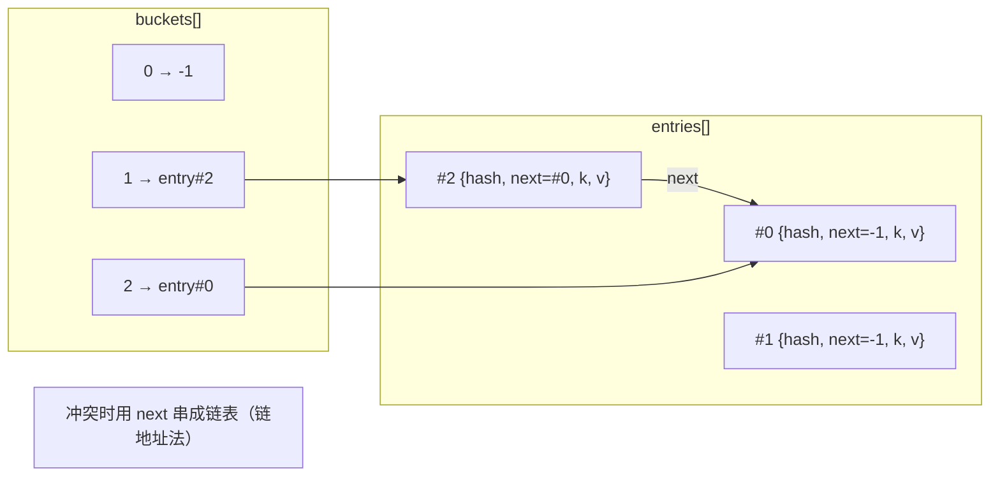
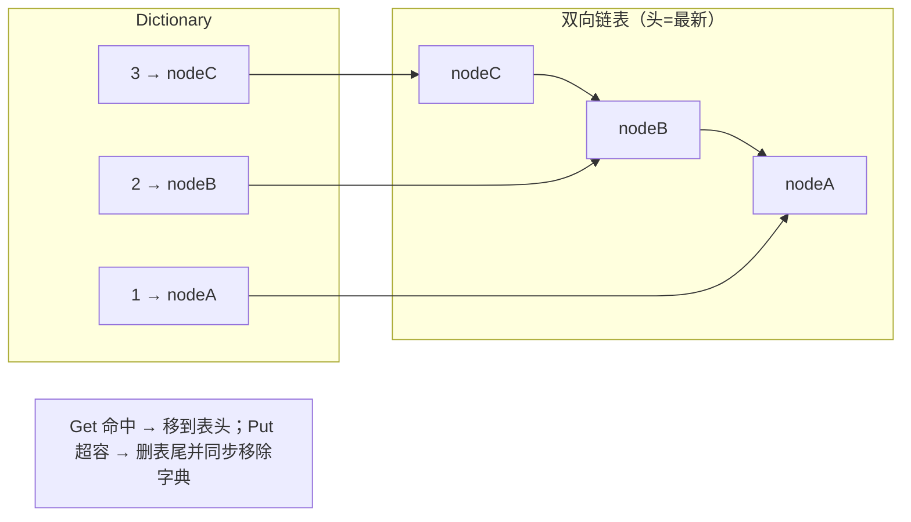
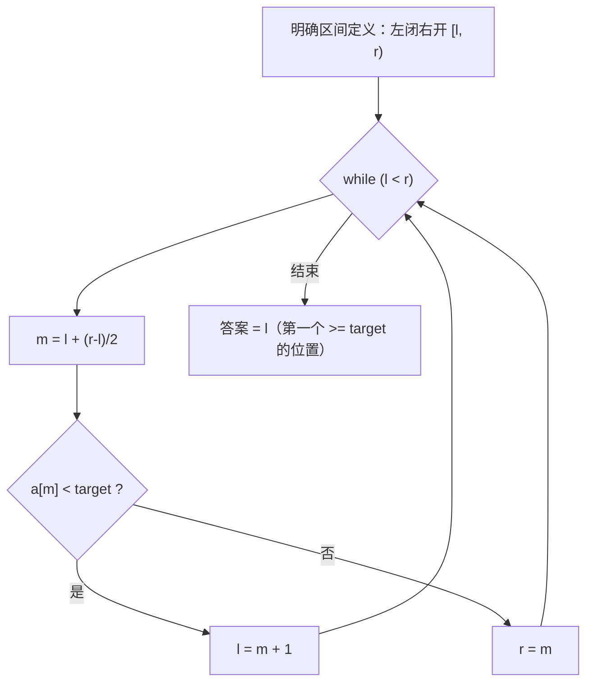
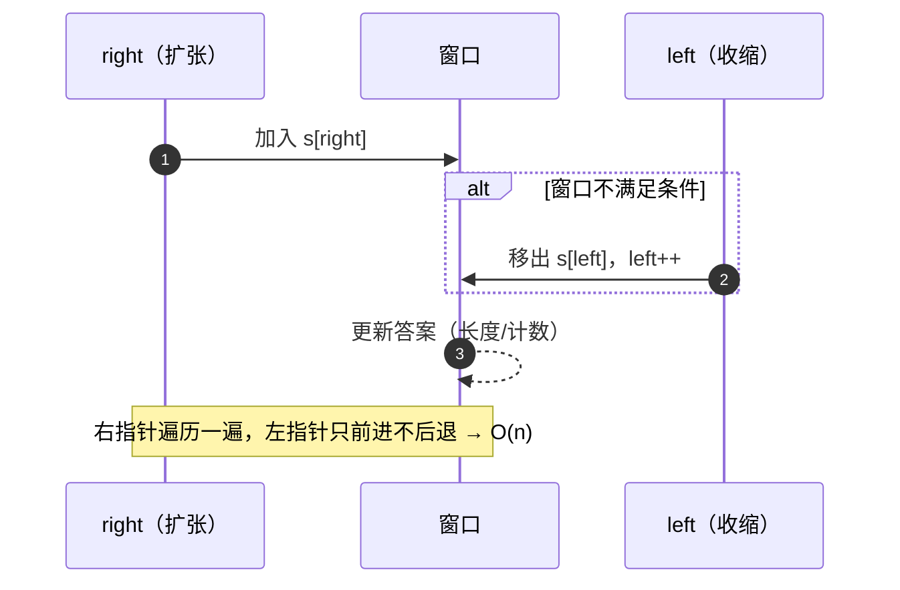

# C# 数据结构与算法面试题（含要点与代码）

> 面向 C# / .NET 后端面试：**集合选型 + 手写数据结构 + 算法套路 + 面试坑**。
> 代码按现代 C# 风格写（`Span`、`PriorityQueue`、pattern matching），每题给复杂度与追问。

## 目录

- [一、复杂度与集合选型](#一复杂度与集合选型)
- [二、手写数据结构](#二手写数据结构)
- [三、算法套路](#三算法套路)
- [四、面试实战](#四面试实战)
- [自测清单](#自测清单)
- [附录 A：15 分钟背诵卡](#附录-a15-分钟背诵卡)
- [附录 B：模拟面试 20 题（含追问链）](#附录-b模拟面试-20-题含追问链)
- [附录 C：口述版——3 分钟讲清「怎么选容器、怎么估复杂度」](#附录-c口述版3-分钟讲清怎么选容器怎么估复杂度)
- [附录 D：关键图示](#附录-d关键图示)
- [附录 E：资源与刷题路线](#附录-e资源与刷题路线)

---

## 一、复杂度与集合选型

### 1. 复杂度怎么分析？均摊复杂度是什么？

三条规则：

1. 只看**最高阶项**，忽略常数与低阶（`3n² + 100n + 7` → O(n²)）。
2. **嵌套循环相乘**，顺序执行相加。
3. 递归看**递推式**（如归并 `T(n)=2T(n/2)+O(n)` → O(n log n)）。

**均摊（amortized）**：单次可能很贵，但一串操作平均下来便宜。典型是 `List<T>.Add` —— 扩容那一次是 O(n)，但均摊到 n 次插入就是 **O(1)**。

> 追问：均摊和平均有什么区别？—— 平均是概率意义上的期望（如快排的期望 O(n log n)），均摊是**确定性的**、对最坏序列也成立的界。

---

### 2. `List<T>`、`LinkedList<T>`、数组、`Span<T>` 怎么选？

| 类型 | 底层 | 随机访问 | 头尾插入 | 内存/缓存 |
| --- | --- | --- | --- | --- |
| `T[]` | 连续数组 | O(1) | 头部 O(n) | 最紧凑，缓存友好 |
| `List<T>` | 连续数组 + 自动扩容 | O(1) | 尾部均摊 O(1)、头部 O(n) | 同上，略有冗余容量 |
| `LinkedList<T>` | 双向链表（每个节点单独分配） | **O(n)** | 首尾 O(1) | 节点分散，缓存不友好，开销大 |
| `Span<T>` | 栈上视图（不拥有内存） | O(1) | 不可扩容 | **零分配**切片 |
| `ImmutableArray<T>` | 不可变数组 | O(1) | 每次修改复制 | 适合共享只读数据 |

**结论**：默认用 `List<T>`；只有"频繁在中间插入/删除且已持有节点引用"才考虑 `LinkedList<T>`；切片传参用 `Span<T>`/`ReadOnlySpan<T>` 免分配。

> 追问：为什么 `LinkedList<T>` 在多数场景反而更慢？—— 节点分散在堆上，遍历时 **cache miss** 远超数组；而且每个节点还有对象头与两个指针的开销。

---

### 3. `Dictionary<TKey,TValue>` 是怎么实现的？

```text
buckets[]  →  存 entry 下标（或 -1）
entries[]  →  { hashCode, next, key, value }
```

- **链地址法**：哈希冲突时用 `next` 串成链表（不是开放寻址）。
- 容量取**质数**（3 → 7 → 17 → 37 …），减少聚集。
- **负载因子 1.0**：entries 满了才扩容（容量翻倍后取下一个质数）。
- 扩容要**重新计算所有 key 的桶位置**，是 O(n) 的一次性开销。
- .NET Core 3.0+ 引入了**开放寻址的 `FrozenDictionary`（.NET 8）** 与更快的哈希算法（非随机化 `string` 哈希仍受影响）。

> 追问：为什么 key 要重写 `GetHashCode` 和 `Equals`？—— 先用哈希定位桶，再用 `Equals` 在桶内精确比较；只重写一个会出现"存进去找不到"。

---

### 4. `HashSet<T>`、`SortedSet<T>`、`SortedDictionary<TKey,TValue>` 有什么区别？

| 类型 | 结构 | 查找 | 有序 | 典型用途 |
| --- | --- | --- | --- | --- |
| `HashSet<T>` | 哈希表 | O(1) | ❌ | 去重、集合运算（`UnionWith`/`IntersectWith`） |
| `SortedSet<T>` | **红黑树** | O(log n) | ✅ | 需要有序遍历 + 去重、范围查询（`GetViewBetween`） |
| `SortedDictionary<,>` | **红黑树** | O(log n) | ✅ | 有序字典；插入删除比 `SortedList` 快 |
| `SortedList<,>` | 有序数组 | O(log n) 查找 / O(n) 插入 | ✅ | 数据量小、读多写少（内存更省） |

> 追问：需要"按分数取排名"用什么？—— 红黑树本身不存 rank；要么 `SortedSet` + 手工计数，要么自己实现带子树节点数的平衡树 / 跳表（Redis ZSet 的做法）。

---

### 5. `PriorityQueue<TElement,TPriority>` 是什么？怎么用？

.NET 6+ 内置的**二叉最小堆**。

```csharp
var pq = new PriorityQueue<string, int>();
pq.Enqueue("low", 10);
pq.Enqueue("high", 1);
Console.WriteLine(pq.Dequeue());   // high

// 自定义比较：最大值优先就取负，或用 Comparer
var maxHeap = new PriorityQueue<int, int>(Comparer<int>.Create((a, b) => b.CompareTo(a)));
```

- `Enqueue`/`Dequeue`/`Peek`：O(log n)。
- **枚举顺序是内部的堆数组顺序，不是有序的**（这点常被考）。
- 需要"更新优先级"时要自己实现（内置不支持 decrease-key）。

> 追问：建堆是 O(n) 还是 O(n log n)？—— **自底向上 sift-down 是 O(n)**；一个个 `Enqueue` 才是 O(n log n)。

---

### 6. 队列、栈、并发队列、Channel 怎么选？

| 类型 | 场景 |
| --- | --- |
| `Queue<T>` / `Stack<T>` | 单线程、循环数组实现 |
| `ConcurrentQueue<T>` / `ConcurrentStack<T>` | 多线程无锁（分段 + 原子操作） |
| `BlockingCollection<T>` | 需要阻塞等待、有界容量（老 API） |
| **`Channel<T>`** | 现代推荐：`BoundedChannel` 内置背压，支持 `async` 读写 |
| `ConcurrentBag<T>` | 只关心"塞进去、最后取完"，不保证顺序 |

> 追问：为什么推荐 `Channel<T>` 而不是 `BlockingCollection<T>`？—— `Channel` 原生支持 `await`（不占线程）、有 `Bounded` 背压策略（`Wait`/`DropOldest`/`DropWrite`），是异步流水线的标准件。

---

### 7. 集合选型速查与常见坑

| 需求 | 选 |
| --- | --- |
| 顺序列表 | `List<T>` |
| 键值查找 | `Dictionary<TKey,TValue>` |
| 去重 | `HashSet<T>` |
| 有序 + 范围 | `SortedSet<T>` / `SortedDictionary<,>` |
| TopK / 调度 | `PriorityQueue<,>` |
| 先进先出 / 后进先出 | `Queue<T>` / `Stack<T>` |
| 多线程生产消费 | `Channel<T>` / `ConcurrentQueue<T>` |
| 只读快照 | `FrozenDictionary` / `ImmutableArray<T>` |

**五个常见坑**：

1. **遍历时修改**：`foreach` 中增删会抛 `InvalidOperationException`（版本号校验）。
2. **自定义类型当 key 不重写 `Equals`/`GetHashCode`**：`Dictionary` 里永远查不到。
3. **不预分配容量**：已知大小的场景用 `new List<T>(capacity)` / `new Dictionary<,>(capacity)`，省掉多次扩容。
4. **值类型当 key 但可变**：改了字段后哈希变了，同样查不到。
5. **`string` 大量拼接**：用 `StringBuilder`，别 `+=`。

> 追问：为什么 `Dictionary` 遍历顺序看起来"稳定"但不能依赖？—— 它按 entries 数组顺序遍历，删除会在空闲位插入新元素；顺序取决于历史操作，**不是契约**。

---

## 二、手写数据结构

### 8. 动态数组的扩容策略？

```csharp
public sealed class DynamicArray<T>
{
    private T[] _items = new T[4];
    private int _count;

    public int Count => _count;

    public void Add(T item)
    {
        if (_count == _items.Length)
        {
            var next = new T[_items.Length * 2];   // 翻倍：均摊 O(1)
            Array.Copy(_items, next, _count);
            _items = next;
        }
        _items[_count++] = item;
    }

    public T this[int index] => _items[index];
}
```

**为什么翻倍**：每次扩容成本与当前规模成正比，按几何级数增长时，n 次插入的总拷贝量是 O(n) → **均摊 O(1)**。若每次只加 1，就是 O(n²)。

> 追问：为什么不少扩容一点（1.5 倍）？—— 1.5 倍更省内存（可复用旧块），2 倍更快但可能浪费 50% 空间；`List<T>` 用 2 倍。

---

### 9. 单链表反转与环检测？

```csharp
public sealed class ListNode
{
    public int Val;
    public ListNode? Next;
    public ListNode(int v) => Val = v;
}

// 反转：三指针原地
public static ListNode? Reverse(ListNode? head)
{
    ListNode? prev = null;
    while (head is not null)
    {
        var next = head.Next;
        head.Next = prev;
        prev = head;
        head = next;
    }
    return prev;
}

// 环检测：快慢指针（Floyd）
public static bool HasCycle(ListNode? head)
{
    var slow = head;
    var fast = head;
    while (fast?.Next is not null)
    {
        slow = slow!.Next;
        fast = fast.Next.Next;
        if (ReferenceEquals(slow, fast)) return true;
    }
    return false;
}
```

> 追问：怎么找环的**入口**？—— 相遇后把一个指针放回头部，两者同速前进，再次相遇点就是入口（数学可证）。
> 追问：怎么找**中点**？—— 快指针走两步、慢指针走一步，快指针到尾时慢指针在中点（偶数个节点时在后中点）。

---

### 10. 用数组实现一个循环队列？

```csharp
public sealed class CircularQueue<T>
{
    private readonly T[] _buffer;
    private int _head, _tail, _count;

    public CircularQueue(int capacity)
    {
        _buffer = new T[capacity + 1];   // 留一个空位区分空/满
    }

    public bool IsEmpty => _count == 0;
    public bool IsFull  => _count == _buffer.Length - 1;

    public bool Enqueue(T item)
    {
        if (IsFull) return false;
        _buffer[_tail] = item;
        _tail = (_tail + 1) % _buffer.Length;
        _count++;
        return true;
    }

    public bool TryDequeue(out T item)
    {
        if (IsEmpty) { item = default!; return false; }
        item = _buffer[_head];
        _head = (_head + 1) % _buffer.Length;
        _count--;
        return true;
    }
}
```

> 追问：为什么留一个空位？—— 用 `head == tail` 同时表示"空"和"满"会歧义；留空位或用 `_count` 计数都能解决（`Queue<T>` 用的是计数）。

---

### 11. 哈希表怎么手写？

```csharp
public sealed class SimpleHashMap<TKey, TValue> where TKey : notnull
{
    private sealed class Entry
    {
        public TKey Key = default!;
        public TValue Value = default!;
        public Entry? Next;
        public int Hash;
    }

    private Entry?[] _buckets = new Entry?[16];
    private int _count;

    private static int IndexOf(int hash, int len) => hash & (len - 1);   // 容量取 2 的幂

    public void Put(TKey key, TValue value)
    {
        var hash = key.GetHashCode();
        var idx = IndexOf(hash, _buckets.Length);

        for (var e = _buckets[idx]; e is not null; e = e.Next)
        {
            if (e.Hash == hash && EqualityComparer<TKey>.Default.Equals(e.Key, key))
            {
                e.Value = value;      // 已存在：覆盖
                return;
            }
        }

        _buckets[idx] = new Entry { Key = key, Value = value, Hash = hash, Next = _buckets[idx] };
        if (++_count > _buckets.Length) Resize();   // 负载因子 1.0
    }

    private void Resize()
    {
        var old = _buckets;
        _buckets = new Entry?[old.Length * 2];
        foreach (var head in old)
        {
            for (var e = head; e is not null;)
            {
                var next = e.Next;
                var idx = IndexOf(e.Hash, _buckets.Length);
                e.Next = _buckets[idx];
                _buckets[idx] = e;
                e = next;
            }
        }
    }
}
```

要点：**哈希 → 桶下标 → 桶内比较（先比 hash 再比 Equals）→ 头插/尾插 → 超负载因子扩容**。

> 追问：容量为什么取 2 的幂？—— 可以用 `hash & (len-1)` 代替取模，快得多（.NET 的 `Dictionary` 用质数是为了更均匀，各有取舍）。

---

### 12. 二叉堆的上浮与下沉？

```csharp
public sealed class MinHeap
{
    private readonly List<int> _a = new();

    public void Push(int v)
    {
        _a.Add(v);
        SiftUp(_a.Count - 1);
    }

    public int Pop()
    {
        var top = _a[0];
        _a[0] = _a[^1];
        _a.RemoveAt(_a.Count - 1);
        SiftDown(0);
        return top;
    }

    private void SiftUp(int i)
    {
        while (i > 0)
        {
            var parent = (i - 1) / 2;
            if (_a[parent] <= _a[i]) break;
            (_a[parent], _a[i]) = (_a[i], _a[parent]);
            i = parent;
        }
    }

    private void SiftDown(int i)
    {
        while (true)
        {
            var l = i * 2 + 1;
            var r = l + 1;
            var min = i;
            if (l < _a.Count && _a[l] < _a[min]) min = l;
            if (r < _a.Count && _a[r] < _a[min]) min = r;
            if (min == i) break;
            (_a[min], _a[i]) = (_a[i], _a[min]);
            i = min;
        }
    }
}
```

> 追问：TopK 用大顶堆还是小顶堆？—— 取**最大的 K 个**用小顶堆（堆顶是当前 K 个里最小的，新元素比堆顶大就替换）；取最小的 K 个反过来。复杂度 O(n log K)。

---

### 13. 并查集怎么写？

```csharp
public sealed class UnionFind
{
    private readonly int[] _parent;
    private readonly int[] _rank;

    public UnionFind(int n)
    {
        _parent = new int[n];
        _rank = new int[n];
        for (var i = 0; i < n; i++) _parent[i] = i;
    }

    public int Find(int x)          // 路径压缩
    {
        while (_parent[x] != x)
        {
            _parent[x] = _parent[_parent[x]];
            x = _parent[x];
        }
        return x;
    }

    public bool Union(int a, int b) // 按秩合并
    {
        var ra = Find(a);
        var rb = Find(b);
        if (ra == rb) return false;
        if (_rank[ra] < _rank[rb]) (ra, rb) = (rb, ra);
        _parent[rb] = ra;
        if (_rank[ra] == _rank[rb]) _rank[ra]++;
        return true;
    }
}
```

复杂度：路径压缩 + 按秩合并后近似 **O(α(n)) ≈ O(1)**。

> 追问：典型应用？—— 连通分量、Kruskal 最小生成树、账户合并、朋友圈、检测图中是否有环（无向）。

---

### 14. Trie（前缀树）怎么写？

```csharp
public sealed class Trie
{
    private sealed class Node
    {
        public readonly Dictionary<char, Node> Children = new();
        public bool IsWord;
    }

    private readonly Node _root = new();

    public void Insert(string word)
    {
        var node = _root;
        foreach (var c in word)
        {
            if (!node.Children.TryGetValue(c, out var next))
                node.Children[c] = next = new Node();
            node = next;
        }
        node.IsWord = true;
    }

    public bool Search(string word) => Find(word)?.IsWord == true;
    public bool StartsWith(string prefix) => Find(prefix) is not null;

    private Node? Find(string s)
    {
        var node = _root;
        foreach (var c in s)
            if (!node.Children.TryGetValue(c, out node)) return null;
        return node;
    }
}
```

> 追问：什么时候用 Trie？—— 前缀检索、自动补全、敏感词过滤、IP 路由表；代价是空间（每个节点一个字典），可用数组/压缩 Trie 优化。

---

### 15. LRU 缓存怎么写？

```csharp
public sealed class LruCache
{
    private readonly int _capacity;
    private readonly Dictionary<int, LinkedListNode<(int Key, int Value)>> _map = new();
    private readonly LinkedList<(int Key, int Value)> _list = new();   // 头=最新

    public LruCache(int capacity) => _capacity = capacity;

    public int Get(int key)
    {
        if (!_map.TryGetValue(key, out var node)) return -1;
        _list.Remove(node);
        _list.AddFirst(node);           // 命中即提到最前
        return node.Value.Value;
    }

    public void Put(int key, int value)
    {
        if (_map.TryGetValue(key, out var node))
        {
            _list.Remove(node);
            _list.AddFirst(node);
            node.Value = (key, value);
            return;
        }

        if (_map.Count == _capacity)    // 淘汰最久未使用
        {
            var last = _list.Last!;
            _map.Remove(last.Value.Key);
            _list.RemoveLast();
        }

        var created = _list.AddFirst((key, value));
        _map[key] = created;
    }
}
```

复杂度：`Get`/`Put` 均 O(1)。**`Dictionary` 做 O(1) 定位 + 双向链表做 O(1) 移动**。

> 追问：怎么让 LRU 线程安全？—— 加锁（简单）或用 `ConcurrentDictionary` + 细粒度锁；也可以直接用 `Microsoft.Extensions.Caching.Memory` 的 `MemoryCache`（带容量与过期）。

---

## 三、算法套路

### 16. 双指针有哪几种？

| 类型 | 场景 | 例子 |
| --- | --- | --- |
| **对撞**（左右向中间） | 有序数组两数之和、回文判断 | `left++ / right--` |
| **快慢**（同向不同速） | 环检测、找中点、删除倒数第 N 个 | 快走两步 |
| **滑动窗口**（同向区间） | 最长/最短子串 | 见下一题 |

> 追问：双指针能降复杂度的本质？—— 把"枚举所有 pair 的 O(n²)"利用**单调性**剪枝成 O(n)。

---

### 17. 滑动窗口的模板？

```csharp
// 求最长无重复字符子串
public static int LengthOfLongestSubstring(string s)
{
    var last = new Dictionary<char, int>();     // 字符 → 最后出现下标
    int left = 0, best = 0;

    for (var right = 0; right < s.Length; right++)
    {
        if (last.TryGetValue(s[right], out var idx) && idx >= left)
            left = idx + 1;                     // 收缩左边界
        last[s[right]] = right;
        best = Math.Max(best, right - left + 1);
    }
    return best;
}
```

模板三段：**扩张右边界 → 不满足条件时收缩左边界 → 更新答案**。

> 追问：什么时候不能用滑动窗口？—— 窗口不满足单调性时（比如数组含负数求"和恰好等于 K"的最短子数组），要换前缀和 + 哈希。

---

### 18. 二分查找的三种写法？

```csharp
// ① 精确查找（闭区间）
public static int BinarySearch(int[] a, int target)
{
    int l = 0, r = a.Length - 1;
    while (l <= r)
    {
        var m = l + (r - l) / 2;        // 防溢出
        if (a[m] == target) return m;
        if (a[m] < target) l = m + 1; else r = m - 1;
    }
    return -1;
}

// ② 第一个 >= target 的位置（左边界，答案落在 [0, n]）
public static int LowerBound(int[] a, int target)
{
    int l = 0, r = a.Length;
    while (l < r)
    {
        var m = l + (r - l) / 2;
        if (a[m] < target) l = m + 1; else r = m;
    }
    return l;
}

// ③ 最后一个 <= target 的位置
public static int UpperBound(int[] a, int target)
{
    int l = 0, r = a.Length;
    while (l < r)
    {
        var m = l + (r - l) / 2;
        if (a[m] <= target) l = m + 1; else r = m;
    }
    return l - 1;
}
```

> 追问：`mid = (l + r) / 2` 有什么问题？—— 大数组会整数溢出；写成 `l + (r - l) / 2`。
> 追问：旋转数组怎么二分？—— 先判断哪一半有序，再判断 target 是否在有序那一半里。

---

### 19. 常见排序算法怎么对比？

| 算法 | 平均 | 最坏 | 空间 | 稳定 | 特点 |
| --- | --- | --- | --- | --- | --- |
| 快排 | O(n log n) | **O(n²)** | O(log n) 栈 | ❌ | 常数小、cache 友好；有序数据要三数取中/随机化 |
| 归并 | O(n log n) | O(n log n) | **O(n)** | ✅ | 稳定、可外部排序；适合链表 |
| 堆排 | O(n log n) | O(n log n) | O(1) | ❌ | 原地、无最坏退化；cache 不友好 |
| 插入 | O(n²) | O(n²) | O(1) | ✅ | 小数组快（常数极小），常做快排的收尾 |
| 计数/桶 | O(n+k) | O(n+k) | O(k) | ✅ | 需要值域小/可映射 |

**C# 的实现**：`Array.Sort` / `List<T>.Sort` 用 **introsort**（快排 + 堆排 + 插入排序，**不稳定**）；`Enumerable.OrderBy` 是**稳定**的归并式排序，但有额外分配。

> 追问：为什么 `OrderBy` 稳定而 `List.Sort` 不稳定？—— LINQ 的排序为了可预测性选择稳定排序；`List.Sort` 优先性能。要稳定又不想分配，就自己排序键 + 索引。

---

### 20. DFS、BFS 怎么选？

| | DFS | BFS |
| --- | --- | --- |
| 结构 | 递归/显式栈 | 队列 |
| 擅长 | 回溯、连通性、拓扑排序、路径存在性 | **最短步数**（无权图）、层序遍历 |
| 空间 | O(深度) | O(宽度) |
| 风险 | 深递归爆栈（C# 默认 1MB 栈，约几千层） | 队列膨胀 |

```csharp
// BFS 模板：网格最短路径
public static int Bfs(int[][] grid, (int r, int c) start, (int r, int c) end)
{
    var q = new Queue<(int r, int c, int d)>();
    var seen = new HashSet<(int, int)>();
    q.Enqueue((start.r, start.c, 0));
    seen.Add(start);
    int[] dr = { 1, -1, 0, 0 }, dc = { 0, 0, 1, -1 };

    while (q.Count > 0)
    {
        var (r, c, d) = q.Dequeue();
        if ((r, c) == end) return d;
        for (var i = 0; i < 4; i++)
        {
            int nr = r + dr[i], nc = c + dc[i];
            if (nr < 0 || nr >= grid.Length || nc < 0 || nc >= grid[0].Length) continue;
            if (!seen.Add((nr, nc))) continue;
            q.Enqueue((nr, nc, d + 1));
        }
    }
    return -1;
}
```

> 追问：为什么无权图 BFS 第一次到达就是最短？—— 它按层扩展，先到的层数一定更小。

---

### 21. 回溯的模板？

```csharp
// 组合总和 / 子集 / 排列 的统一骨架
public static IList<IList<int>> Subsets(int[] nums)
{
    var result = new List<IList<int>>();
    var path = new List<int>();

    void Backtrack(int start)
    {
        result.Add(new List<int>(path));        // 每个节点都是一个解

        for (var i = start; i < nums.Length; i++)
        {
            path.Add(nums[i]);                  // 做选择
            Backtrack(i + 1);                   // 递归（i+1 表示不重复取）
            path.RemoveAt(path.Count - 1);      // 撤销
        }
    }

    Backtrack(0);
    return result;
}
```

三种变体的差别只在**"下一层从哪开始"**：

- 子集/组合：`i + 1`（不重复选）。
- 排列：每层都从 0 开始 + `used[]` 标记。
- 可重复取：`i`（而不是 `i + 1`）。
- 去重：先排序，再 `if (i > start && nums[i] == nums[i-1]) continue;`。

> 追问：回溯的时间复杂度怎么算？—— 一般是指数级（子集 2ⁿ、排列 n!）；关键是**剪枝**（排序 + 提前返回）决定实际耗时。

---

### 22. 动态规划怎么入手？

四步：**定义状态 → 写转移 → 定边界 → 定顺序（自底向上）/ 加记忆化（自顶向下）**。

```csharp
// 0-1 背包：容量 W，物品 (重量 w, 价值 v)，每件最多一次
public static int Knapsack(int[] w, int[] v, int W)
{
    var dp = new int[W + 1];                 // dp[j] = 容量 j 时的最大价值
    for (var i = 0; i < w.Length; i++)
        for (var j = W; j >= w[i]; j--)      // 倒序：保证每件只用一次
            dp[j] = Math.Max(dp[j], dp[j - w[i]] + v[i]);
    return dp[W];
}
```

关键辨析：

| 类型 | 遍历顺序 | 原因 |
| --- | --- | --- |
| 0-1 背包 | 容量**倒序** | 防止同一件物品被重复使用 |
| 完全背包 | 容量**正序** | 允许重复使用 |
| 组合数 vs 排列数 | 外层物品/外层容量互换 | 决定"是否考虑顺序" |

> 追问：什么时候用 DP 而不是贪心？—— 局部最优不能推出全局最优时（例如零钱兑换用贪心会错）；先用小数据反例验证贪心是否成立。

---

### 23. 位运算常用技巧？

```csharp
x & (x - 1);     // 清掉最低位的 1（判断 2 的幂：x > 0 && (x & (x-1)) == 0）
x & -x;          // 取出最低位的 1（lowbit）
x ^ y;           // 找出不同的位；a^a=0、a^0=a → 找唯一出现一次的数
1 << k;          // 第 k 位置 1
(x >> k) & 1;    // 取第 k 位
```

> 追问：C# 里位移要注意什么？—— `int` 是 32 位、`long` 是 64 位；`>>` 对负数**算术右移**（补符号位），逻辑右移要用 `>>>`（C# 11+）或转 `uint`。

---

### 24. 图算法要会哪些？

| 算法 | 用途 | 复杂度 |
| --- | --- | --- |
| **拓扑排序（Kahn）** | 依赖排序、检测有向环 | O(V+E) |
| **Dijkstra** | 非负权最短路 | O((V+E) log V)（用 `PriorityQueue`） |
| **BFS** | 无权最短路 | O(V+E) |
| **并查集** | 连通分量、Kruskal | 近似 O(1) 每次 |
| Bellman-Ford | 含负权/判负环 | O(VE) |

```csharp
// 拓扑排序
public static int[] TopoSort(int n, int[][] edges)
{
    var adj = new List<int>[n];
    var indeg = new int[n];
    for (var i = 0; i < n; i++) adj[i] = new List<int>();
    foreach (var e in edges) { adj[e[0]].Add(e[1]); indeg[e[1]]++; }

    var q = new Queue<int>();
    for (var i = 0; i < n; i++) if (indeg[i] == 0) q.Enqueue(i);

    var order = new List<int>(n);
    while (q.Count > 0)
    {
        var u = q.Dequeue();
        order.Add(u);
        foreach (var v in adj[u])
            if (--indeg[v] == 0) q.Enqueue(v);
    }
    return order.Count == n ? order.ToArray() : Array.Empty<int>();   // 空 = 有环
}
```

> 追问：Dijkstra 为什么不能有负权？—— 它的贪心假设"已确定的最短距离不会再被更新"，负权会破坏这个假设（用 Bellman-Ford 或 SPFA）。

---

## 四、面试实战

### 25. C# 刷算法题的坑有哪些？

1. **整数溢出**：`(l + r) / 2` 大数组溢出；`int.MinValue` 取绝对值仍为负。
2. **`int.MaxValue + 1`** 得到负数（unchecked 默认），求最小路径时用 `int.MaxValue / 2` 当无穷大。
3. **字符串不可变**：循环里 `s += c` 是 O(n²)，用 `StringBuilder`。
4. **`char` 与 `int`**：`c - '0'` 转数字，`(char)('a' + i)` 转字母。
5. **引用相等 vs 值相等**：`ReferenceEquals` 用于链表节点判环；元组/record 用 `==` 是值比较。
6. **LINQ 在热路径**：`Where/Select` 每次分配迭代器，循环里慎用。
7. **`Dictionary` 遍历时修改**：抛异常，先 `ToList()` 或用副本。
8. **递归深度**：C# 默认栈约 1MB，深递归改写迭代或 `Thread` 加大栈。

> 追问：怎么减少分配？—— `Span<T>` 切片、`ArrayPool<T>`、`stackalloc`（小数组）、避免装箱（泛型 + `struct` 约束）。

---

### 26. 怎么测算法性能？

```csharp
[MemoryDiagnoser]
public class SortBench
{
    private int[] _data = null!;

    [GlobalSetup]
    public void Setup() => _data = Enumerable.Range(0, 10_000).Reverse().ToArray();

    [Benchmark]
    public int[] ListSort() { var a = (int[])_data.Clone(); Array.Sort(a); return a; }

    [Benchmark]
    public int[] LinqOrderBy() => _data.OrderBy(x => x).ToArray();
}
```

- **BenchmarkDotNet**：看均值、分配量（`Allocated`）、GC 次数。
- `Stopwatch` 只适合粗测，JIT 预热与 GC 会干扰结果。

> 追问：为什么 Release + 预热很重要？—— Debug 下无内联与优化；不预热会把 JIT 时间算进去。

---

### 27. 面试常考手写题清单

按出现频率排：

1. 反转链表 / 合并两个有序链表 / 删除倒数第 N 个
2. 环形链表（检测 + 入口）
3. 两数之和 / 三数之和（双指针）
4. 最长无重复子串（滑动窗口）
5. 二分查找变体（左右边界、旋转数组）
6. TopK（堆 / 快速选择）
7. LRU 缓存
8. 二叉树层序 / 最大深度 / 最近公共祖先
9. 有效的括号（栈）
10. 岛屿数量（DFS/BFS）
11. 全排列 / 子集（回溯）
12. 爬楼梯 / 零钱兑换（DP）
13. 合并区间
14. 字符串反转 / 回文判断
15. 生产者-消费者（`Channel`）

> 追问：面试时先写什么？—— **先说思路和复杂度，再写；写完主动举边界用例**（空输入、单元素、重复、溢出）。

---

## 自测清单

- [ ] 均摊 vs 平均的区别，`List.Add` 为什么是 O(1)
- [ ] `List` / `LinkedList` / `Span` 的取舍与 cache 影响
- [ ] `Dictionary` 的桶 + 链表结构，为什么要重写 `Equals` + `GetHashCode`
- [ ] `HashSet` / `SortedSet` / `SortedList` 的复杂度差异
- [ ] `PriorityQueue` 的枚举顺序坑，建堆 O(n)
- [ ] `Channel<T>` 相比 `BlockingCollection<T>` 的优势
- [ ] 遍历时修改集合为什么会抛异常
- [ ] 动态数组为什么翻倍扩容
- [ ] 链表反转 / 环检测 / 找中点
- [ ] 循环队列为什么留空位
- [ ] 哈希表的扩容与重新散列
- [ ] 堆的上浮下沉，TopK 选大顶还是小顶
- [ ] 并查集的路径压缩 + 按秩合并
- [ ] Trie 的适用场景与空间代价
- [ ] LRU 的 Dictionary + 双向链表组合
- [ ] 双指针三种形态
- [ ] 滑动窗口模板与失效场景
- [ ] 二分三种边界写法，`mid` 防溢出
- [ ] 快排最坏退化与 `Array.Sort` 是 introsort
- [ ] DFS/BFS 选择依据
- [ ] 回溯三种变体（子集/排列/可重复）
- [ ] 0-1 背包倒序、完全背包正序的原因
- [ ] 位运算三个常用技巧
- [ ] Dijkstra 为什么不能有负权

---

# 附录 A：15 分钟背诵卡

1. 复杂度只看最高阶；**均摊是确定性的界**，平均是期望。
2. `List<T>` 是数组 + 2 倍扩容，`Add` 均摊 O(1)，`RemoveAt` O(n)。
3. `LinkedList<T>` 头尾 O(1) 但遍历 O(n) 且 cache 不友好，多数场景不如 `List`。
4. `Dictionary` = **buckets + entries 链地址法**，负载因子 1.0，扩容重新散列。
5. `HashSet` 同 `Dictionary` 的键集；`SortedSet/SortedDictionary` 是红黑树 O(log n) 且有序。
6. `PriorityQueue` 是二叉堆，`Peek/Dequeue` O(log n)，**枚举无序**。
7. 建堆 O(n)（自底向上），逐个入堆才是 O(n log n)。
8. `Channel<T>` 支持 `await` + 有界背压，是异步流水线首选。
9. 五个坑：遍历时改集合、key 不重写 Equals/GetHashCode、不预分配、可变 key、字符串 `+=`。
10. 动态数组翻倍扩容 → 均摊 O(1)；每次 +1 会退化成 O(n²)。
11. 环检测用快慢指针；找入口：相遇后一指针回头部同速走。
12. 循环队列留一个空位或用计数区分空/满。
13. 哈希表步骤：哈希 → 桶 → 先比 hash 再比 Equals → 超阈值扩容。
14. 并查集 = 路径压缩 + 按秩合并 ≈ O(α(n))。
15. Trie 用于前缀检索，代价是空间。
16. LRU = `Dictionary`（O(1) 定位）+ 双向链表（O(1) 移动）。
17. 双指针靠**单调性**把 O(n²) 降到 O(n)。
18. 滑动窗口三段：扩张右、收缩左、更新答案。
19. 二分：`mid = l + (r-l)/2`；找边界用 `while (l < r)` + 不返回提前退出。
20. `Array.Sort` 是 introsort 且**不稳定**；`OrderBy` 稳定但有分配。
21. 快排最坏 O(n²)（有序数据），三数取中或随机化。
22. BFS 求无权最短步数，DFS 适合回溯/连通性。
23. 回溯变体差别只在"下一层起点"：`i+1` / `0+used` / `i`。
24. 0-1 背包容量**倒序**、完全背包**正序**。
25. `x & (x-1)` 清最低位 1；`x & -x` 取最低位 1。
26. Dijkstra 不能有负权；有负权用 Bellman-Ford。

> 记忆锚点：**选容器 → 手写结构 → 套路 → 坑**。

---

# 附录 B：模拟面试 20 题（含追问链）

### 1. 为什么 `List<T>` 尾部插入是 O(1)？

**开口**：数组翻倍扩容，n 次插入的总拷贝量是 O(n)，均摊到每次 O(1)。
**追问**：为什么不是 1.5 倍？→ 更省内存但扩容更频繁；`List<T>` 用 2 倍。

### 2. `Dictionary` 和 `HashSet` 内部一样吗？

**开口**：都是哈希桶 + 链地址法；`HashSet` 可以看作只有 key 的 `Dictionary`。
**追问**：`Dictionary` 的负载因子是多少？→ 1.0（entries 满才扩容），和 Java 的 0.75 不同。

### 3. 自定义对象做 key 有什么坑？

**开口**：不重写 `GetHashCode` 和 `Equals` 就永远查不到；只重写一个更危险。
**追问**：可变对象做 key？→ 改字段后哈希变了，原桶里找不回来，必须用不可变对象。

### 4. 什么时候用 `LinkedList<T>`？

**开口**：已持有节点引用且频繁在中间插入删除，或需要 O(1) 头尾操作时。
**追问**：为什么它通常更慢？→ 节点分散、cache miss 多，还有对象头开销。

### 5. `SortedSet` 和 `HashSet` 怎么选？

**开口**：要有序或范围查询用 `SortedSet`（红黑树 O(log n)），只要去重用 `HashSet`（O(1)）。
**追问**：要按排名查第 K 个呢？→ 红黑树不存 rank，得自己维护子树大小或用跳表。

### 6. `PriorityQueue` 有什么坑？

**开口**：枚举顺序是内部堆数组顺序，不是有序的；不支持更新优先级。
**追问**：要更新优先级怎么办？→ 惰性删除（重复入堆，出堆时校验版本）。

### 7. 动态数组为什么翻倍而不是每次加 1？

**开口**：每次 +1 的总拷贝是 O(n²)，翻倍是几何级数所以均摊 O(1)。
**追问**：会不会浪费内存？→ 会（最多浪费一半），可以 `TrimExcess` 收缩。

### 8. 怎么判断链表有环？

**开口**：快慢指针，相遇即有环；O(1) 空间。
**追问**：入口怎么找？→ 相遇后一指针回头部，同速前进再相遇即入口。

### 9. 循环队列怎么区分空和满？

**开口**：留一个空位、或用计数、或用标记位。
**追问**：为什么留空位能行？→ `tail+1 == head` 表示满，`head == tail` 表示空，不再歧义。

### 10. 哈希表扩容为什么要重新散列？

**开口**：桶数量变了，`hash % len` 的位置全变，必须重算并重新挂链。
**追问**：扩容时有什么优化？→ 容量取 2 的幂时可用位运算；JDK8 用"高低位拆分"只遍历一次。

### 11. 建堆的时间复杂度？

**开口**：自底向上 sift-down 是 O(n)；逐个 `Enqueue` 是 O(n log n)。
**追问**：为什么 sift-down 是 O(n)？→ 大部分节点在底层，需要下沉的高度很小，求和收敛。

### 12. TopK 用什么堆？

**开口**：取最大的 K 个用小顶堆，堆顶是当前 K 个里最小的，新元素更大才替换。
**追问**：复杂度？→ O(n log K)，比全排序 O(n log n) 优。

### 13. 并查集怎么做到近似 O(1)？

**开口**：路径压缩把树压平，按秩合并控制树高，两个一起用复杂度是反阿克曼函数。
**追问**：只用一个行不行？→ 行但会退化；单用路径压缩是均摊 O(log n)。

### 14. LRU 怎么做到 O(1)？

**开口**：`Dictionary` 定位节点（O(1)），双向链表移动节点（O(1)），命中就提到头部。
**追问**：线程安全怎么办？→ 加锁或用 `MemoryCache`；高并发可以分段。

### 15. 二分查找什么时候会死循环？

**开口**：`l < r` 时更新写成 `l = m` 而 `m` 取下界，区间不缩小就死循环。
**追问**：怎么避免？→ 明确区间定义（左闭右开），保证每轮区间严格变小。

### 16. 为什么 `Array.Sort` 不稳定？

**开口**：introsort 追求性能，快排的分区交换会打乱相等元素的相对顺序。
**追问**：需要稳定排序怎么办？→ `OrderBy`（有分配）或排序键带原始下标。

### 17. BFS 和 DFS 怎么选？

**开口**：无权最短路径、层序用 BFS；回溯、连通性、拓扑用 DFS。
**追问**：DFS 递归太深怎么办？→ 改显式栈；C# 默认栈约 1MB，几千层就爆。

### 18. 回溯怎么去重？

**开口**：先排序，同一层跳过相邻重复：`if (i > start && nums[i] == nums[i-1]) continue;`。
**追问**：为什么只在同层去重？→ 不同层的重复是合法组合（比如 [1,1,2] 里两个 1 可以用两次）。

### 19. 0-1 背包为什么倒序遍历容量？

**开口**：倒序保证 `dp[j-w]` 还是"上一轮"的值，即每件物品最多用一次。
**追问**：完全背包呢？→ 正序，允许同一物品被重复使用。

### 20. 算法题写完怎么自检？

**开口**：先说复杂度，再举空输入、单元素、重复值、极值（溢出）四类边界。
**追问**：面试官说"能再优化吗"？→ 从数据结构换（哈希/堆）、从套路换（双指针/滑窗）、从空间换时间（缓存/前缀和）三个方向想。

---

# 附录 C：口述版——3 分钟讲清「怎么选容器、怎么估复杂度」

> 面试官问「你数据结构和算法基础怎么样」时用。约 800 字 ≈ 3 分钟。

### 逐字稿

**【开场 · 15 秒】**
我一般分两层讲：**日常写业务靠选对容器**，**面试写算法靠套路 + 边界**。这两件事其实是同一个能力——知道每种结构的代价在哪。

**【容器 · 50 秒】**
C# 里我基本只用四五个容器。有序列表用 `List<T>`，它背后是数组加翻倍扩容，尾部插入均摊 O(1)，随机访问 O(1)，代价是中间插入删除要搬元素。键值用 `Dictionary`，桶加链地址法，扩容要重新散列，所以**已知规模一定要预分配容量**。
需要有序或范围查询才用 `SortedSet`/`SortedDictionary`，它们是红黑树，O(log n)。TopK 和调度用 `PriorityQueue`，注意它枚举是无序的。
链表我很少用——`LinkedList<T>` 虽然头尾 O(1)，但节点分散、cache 不友好，除了 LRU 这种需要 O(1) 移动节点的场景。
并发场景优先 `Channel<T>`，它支持 await，还有有界背压。

**【复杂度 · 45 秒】**
复杂度我强调两个容易混的点。一个是**均摊**：`List.Add` 单次可能是 O(n) 的扩容，但均摊下来是 O(1)，而且这是确定性的界，不是概率。另一个是**最坏情况**：快排平均 O(n log n)，但有序数据会退化成 O(n²)，所以 `Array.Sort` 用的是 introsort，混了堆排兜底；顺带说一句它不稳定，`OrderBy` 才稳定。

**【套路 · 50 秒】**
算法题我总结成几个模板。双指针靠**单调性**把 O(n²) 降成 O(n)，有对撞、快慢、滑窗三种。二分的关键是先把区间定义清楚，然后保证每轮严格缩小；`mid` 要写成 `l + (r-l)/2` 防溢出。DFS/BFS 按需求选——无权最短用 BFS，回溯和连通性用 DFS。回溯的三种变体差别只在"下一层从哪开始"。DP 就四步：状态、转移、边界、顺序，0-1 背包倒序、完全背包正序。

**【收尾 · 30 秒】**
最后是自检：写完先说复杂度，再举四类边界——空输入、单元素、重复值、极值溢出。C# 特有的坑我会特别注意整数溢出、字符串 `+=` 变 O(n²)、还有遍历时改集合会抛异常。
一句话：**选容器看"读多还是写多、要不要有序"，写算法先定不变量，再谈优化**。

---

### 压缩版

**一句话版（10 秒）**
> 业务靠选容器（List / Dictionary / SortedSet / PriorityQueue / Channel），算法靠套路（双指针、二分、DFS-BFS、回溯、DP）+ 边界自检。

**30 秒版**
> `List` 是数组 + 翻倍扩容，`Dictionary` 是哈希桶 + 链地址法且要重写 Equals/GetHashCode，有序用红黑树，TopK 用 `PriorityQueue`，并发用 `Channel`。复杂度注意均摊和最坏情况，`Array.Sort` 是 introsort 且不稳定。算法五大套路加四类边界自检。C# 注意 int 溢出、字符串拼接和集合遍历修改。

### 时间分配

| 段落 | 时长 | 只说一件事 |
| --- | --- | --- |
| 开场 | 15s | 选容器 + 写算法是同一个能力 |
| 容器 | 50s | List / Dictionary / 有序树 / PriorityQueue / Channel |
| 复杂度 | 45s | 均摊是确定性界，快排最坏退化 |
| 套路 | 50s | 双指针 / 二分 / DFS-BFS / 回溯 / DP 各一句 |
| 收尾 | 30s | 四类边界 + C# 三大坑 |

### 被打断时怎么接

| 面试官插话 | 接续句 |
| --- | --- |
| 「Dictionary 为什么不用红黑树？」 | 「哈希平均 O(1) 更快；要有序或范围查询才上红黑树，就是 SortedDictionary」 |
| 「快排最坏怎么避免？」 | 「三数取中或随机选 pivot，`Array.Sort` 干脆用 introsort 兜底」 |
| 「LRU 你手写过吗？」 | 「手写过，Dictionary + 双向链表，Get/Put 都是 O(1)，淘汰尾部」 |
| 「你刷了多少题？」 | 「按模板刷，重点是能说清复杂度和边界，不是题数」 |

---

# 附录 D：关键图示

### 1. `Dictionary` 的结构



### 2. LRU 的 O(1) 组合



### 3. 二分边界



### 4. 滑动窗口



---

# 附录 E：资源与刷题路线

### 书籍（按投入产出比排）

| 书 | 定位 | 建议 |
| --- | --- | --- |
| 《剑指 Offer（第 2 版）》 | 面试高频题，有 C# 版题解 | **第一本**，70 题覆盖 80% 考点 |
| 《算法（第 4 版）》Sedgewick | 体系完整、图论讲得好 | 当教材，配套 C# 移植版可跑 |
| 《labuladong 的算法小抄》 | 套路化（双指针/滑窗/DP 模板） | 建立"套路感"最快 |
| 《编程珠玑》 | 思维训练 | 进阶，非面试必需 |
| 《算法导论》 | 理论完备 | **不建议面试期读**，当字典查 |

### 在线资源

- **LeetCode**：按 tag 刷（Hash / Two Pointers / Binary Search / Sliding Window / DFS / BFS / DP / Heap / Trie / Union-Find），目标 150~250 题。
- **NeetCode 150**：有体系、有视频，英文但讲解清晰，适合按清单推进。
- **C# 专用**：`dotnet/runtime` 源码里看 `Dictionary`、`PriorityQueue`、`LinkedList` 的真实实现（比任何博客都准）。
- **可视化**：VisuAlgo（数据结构动画）、Algorithm-Visualizer。

### 六周路线（每天 1~1.5 小时）

| 周 | 主题 | 目标 |
| --- | --- | --- |
| 1 | 数组 / 字符串 / 双指针 / 滑窗 | 20 题，能写滑窗模板 |
| 2 | 哈希表 / 栈 / 队列 / 链表 | 20 题，手写 LRU 与环检测 |
| 3 | 二分 / 排序 / 堆 | 20 题，TopK 与边界二分熟练 |
| 4 | 二叉树 / DFS / BFS / 回溯 | 25 题，层序与全排列模板化 |
| 5 | 动态规划（线性/背包/区间） | 25 题，能说清状态定义 |
| 6 | 图（拓扑/Dijkstra/并查集）+ 复盘错题 | 20 题，错题重写一遍 |

### 刷题方法（比题数重要）

1. **一题三遍**：第一遍看思路、第二遍不看题解写、第三遍隔天盲写。
2. **写复杂度**：每道题标注时间/空间，面试时先说出来。
3. **错题本**：只记"为什么错"（边界？套路选错？），不抄代码。
4. **模板化**：二分、滑窗、回溯、BFS 写成自己的固定骨架。
5. **口述练习**：对着空编辑器讲思路 3 分钟，比闷头写更接近面试。
