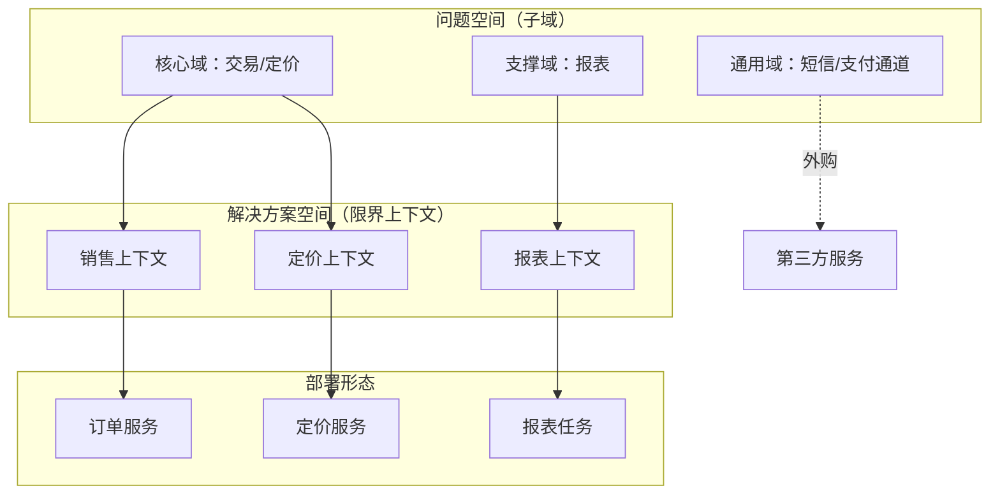
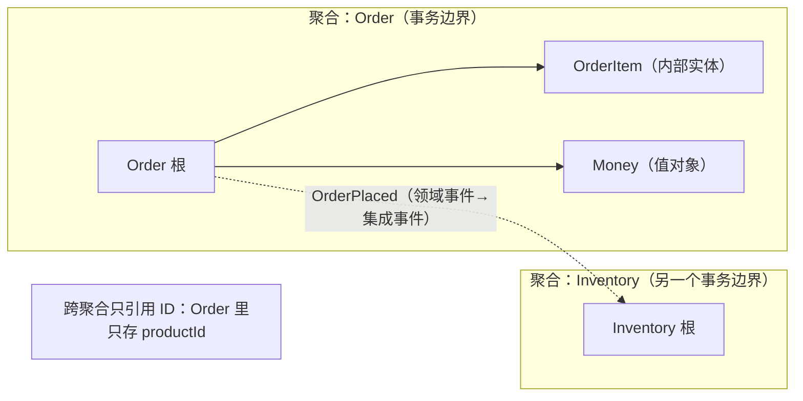
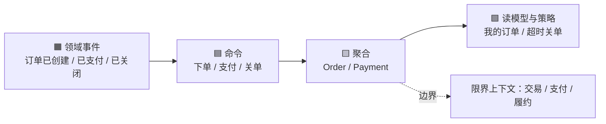
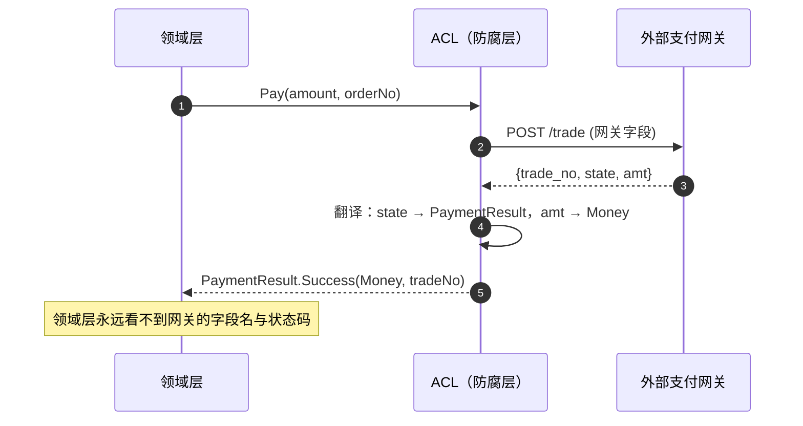

# DDD 经典面试题（含要点与追问）

> 只讲**领域建模**：战略设计划边界、战术设计落模型、实践怎么把需求推成代码。
> 每题给结论 + 判据 + 追问；核心不是背模式，而是**能说清"为什么这样划"**。

## 目录

- [一、战略设计](#一战略设计)
- [二、战术设计](#二战术设计)
- [三、建模实践](#三建模实践)
- [自测清单](#自测清单)
- [附录 A：15 分钟背诵卡](#附录-a15-分钟背诵卡)
- [附录 B：模拟面试 20 题（含追问链）](#附录-b模拟面试-20-题含追问链)
- [附录 C：口述版——3 分钟讲清一次领域建模](#附录-c口述版3-分钟讲清一次领域建模)
- [附录 D：关键图示](#附录-d关键图示)

---

## 一、战略设计

### 1. DDD 解决什么问题？什么时候不该用？

**它治的是"业务复杂度"**，不是技术复杂度。

| 该用 | 不该用 |
| --- | --- |
| 规则多、状态多、生命周期长（订单、结算、库存、风控） | CRUD 为主（后台管理、配置表） |
| 业务方与开发长期协作、术语需要统一 | 一次性脚本、数据迁移工具 |
| 系统要长期演进（5 年以上） | 需求还在剧烈变化、先验证 MVP |
| 复杂度来自"业务语义" | 复杂度来自"高并发/大数据" → 那是架构问题 |

> 追问：高并发系统需要 DDD 吗？—— 需要它的**边界划分**，但不需要为了 DDD 而 DDD；秒杀的核心是流量控制，不是领域模型复杂度。

---

### 2. 核心域、支撑域、通用域怎么分？

| 子域 | 含义 | 投入策略 |
| --- | --- | --- |
| **核心域** | 公司的竞争力所在（电商的"交易/定价"） | 自研、最好的团队、最细的建模 |
| **支撑域** | 必要但不差异化（仓储管理、报表） | 自研但控成本，能简化就简化 |
| **通用域** | 行业通用能力（认证、支付通道、短信） | **买/用开源**，不要自研 |

> 追问：分错了会怎样？—— 把通用域当核心域自研，烧掉团队半年；把核心域当支撑域外包，做出个没法改的黑盒。
> 追问：和限界上下文什么关系？—— **子域是问题空间（业务怎么分），限界上下文是解决方案空间（模型怎么分）**，通常一对一，但也可以一个子域拆成多个上下文。

---

### 3. 限界上下文怎么找？

四个信号：

1. **词汇歧义**：同一个词在不同场景含义不同（"商品"在销售/仓储/财务里是三个东西）。
2. **业务事件**：事件的参与者、数据所有者在哪，边界往往就在哪。
3. **组织边界**：不同团队负责、不同考核指标。
4. **变化频率**：改一个需求时，哪些代码总是一起动、哪些从不动。

> 追问：边界太大或太小有什么症状？—— 太大：一个需求改十处、术语打架；太小：到处跨上下文同步数据、同一份数据多个 owner。

---

### 4. 通用语言（Ubiquitous Language）怎么落地？

不是"写个术语表就完了"，落地点有三：

1. **代码命名直接映射**：类名、方法名、状态枚举用业务词（`Order.Confirm()` 而不是 `UpdateStatus(2)`）。
2. **口径唯一**：同一个概念在 UI、API、DB、文档里叫法一致。
3. **随模型演进**：业务改叫法，代码和文档必须同批改（否则语言就死了）。

> 追问：和"领域专家开会"有什么不同？—— 会议只是手段，**产出必须沉淀到代码与测试**；术语只活在 PPT 里就是没落地。

---

### 5. 上下文映射有哪几种模式？

| 模式 | 关系 | 什么时候用 |
| --- | --- | --- |
| **防腐层 ACL** | 下游在自己边界做适配 | 集成外部/遗留系统（最常用） |
| 开放主机服务 OHS | 上游提供稳定公开协议 | 上游要服务多个下游 |
| 发布语言 PL | 用统一 DTO/事件契约 | 配合 OHS |
| 客户-供应商 | 下游提需求、上游排期 | 上下游有协商机制 |
| 遵奉者 Conformist | 下游照抄上游模型 | 上游强势且不会为你改（省事但被动） |
| 共享内核 | 共享一小块模型 | 团队同一、模型极稳定（易腐化，慎用） |
| 分离方式 | 干脆不集成 | 集成成本高于收益 |
| 合作关系 | 双向同步发布 | 两个团队命运绑定 |

> 追问：最危险的是哪个？—— **共享内核**：一开始省事，最后变成没人敢改的公共泥潭。ACL 反而是最安全的默认项。

---

### 6. 防腐层（ACL）具体怎么写？

结构：**外部模型 → 转换器 → 内部模型**。

```csharp
// 外部支付网关的返回（字段命名、状态码都不受我们控制）
public sealed record GatewayPaymentResponse(string trade_no, int state, string amt);

// ACL：翻译成内部语言，外部变化止步于此
public sealed class PaymentGatewayAdapter : IPaymentGateway
{
    public PaymentResult Translate(GatewayPaymentResponse raw) => raw.state switch
    {
        1 => PaymentResult.Success(Money.Parse(raw.amt), raw.trade_no),
        2 => PaymentResult.Failed("declined"),
        _ => PaymentResult.Pending(raw.trade_no)
    };
}
```

要点：**外部字段名/协议绝不进领域层**；换供应商只改适配器。

> 追问：ACL 和 DTO 转换有什么区别？—— DTO 转换是"形状适配"，ACL 是**语义适配**（概念、单位、状态机都要翻译），它属于边界职责，不是工具方法。

---

## 二、战术设计

### 7. 实体和值对象怎么区分？

| | 实体 | 值对象 |
| --- | --- | --- |
| 判等 | 靠 **ID** | 靠**全部属性** |
| 可变性 | 状态可变 | **不可变** |
| 生命周期 | 有独立生命周期 | 依附于实体 |
| 例子 | 订单、账户、用户 | 金额、地址、时间区间 |

> 追问：同一个概念在不同上下文里角色会变吗？—— 会。在"用户中心"里 `User` 是实体；在"订单"里下单人是一个**值对象快照**（姓名 + 手机号），因为历史订单不该随用户改名而变。

---

### 8. 值对象为什么要自封装？写个例子。

值对象的价值在于**把校验和不变量收进构造**：

```csharp
public readonly record struct Money
{
    public decimal Amount { get; }
    public string Currency { get; }

    public Money(decimal amount, string currency)
    {
        if (amount < 0) throw new ArgumentOutOfRangeException(nameof(amount));
        if (string.IsNullOrWhiteSpace(currency)) throw new ArgumentException("币种不能为空");
        Amount = amount;
        Currency = currency.ToUpperInvariant();
    }

    public static Money Zero(string currency) => new(0m, currency);

    public Money Add(Money other) =>
        Currency == other.Currency
            ? new Money(Amount + other.Amount, Currency)
            : throw new InvalidOperationException("币种不一致");

    public Money Multiply(int qty) => new(Amount * qty, Currency);
}
```

> 追问：为什么不直接用 `decimal`？—— 裸 `decimal` 无法表达"币种"，也无法阻止"加了两次"或"跨币种相加"；值对象让**错误在编译/构造期就暴露**。

---

### 9. 聚合的四条设计原则？

1. **聚合根是唯一入口**：外部只能通过根访问内部对象。
2. **聚合要小**：只把"必须一起保证不变式"的东西放进来。
3. **跨聚合只引用 ID**，不持有对象引用。
4. **一个事务只修改一个聚合**；跨聚合用领域事件做最终一致。

> 追问：为什么"小"这么重要？—— 聚合同时是**事务边界**和**并发边界**；聚合越大，锁范围越大、冲突越多、加载越慢。

---

### 10. 聚合边界怎么划？看哪三个视角？

| 视角 | 问题 | 结论 |
| --- | --- | --- |
| **不变式** | 哪些数据必须同时成立？ | 必须同聚合（如订单总额 = 明细之和） |
| **并发** | 谁会同时改它？ | 高频并发写的部分要拆开（如库存 vs 订单） |
| **生命周期** | 会不会一起删除？ | 一起生灭 → 同聚合 |

反例：把"订单 + 商品 + 库存"塞进一个聚合 —— 不变式其实不需要同时成立，并发却极高，生命周期也完全不同。

> 追问：订单和订单明细呢？—— 三条都符合：总额一致性、一起创建、一起删除，所以同聚合（明细是内部实体）。

---

### 11. 聚合设计有哪五个常见错误？

1. **大聚合**：把整棵对象图当一个聚合 → 锁大、加载慢。
2. **贫血聚合**：只有属性 + setter，逻辑全在 Service → 不变式随时被绕过。
3. **跨聚合事务**：一个事务改订单又改库存 → 分布式一致性伪装成本地事务。
4. **直接暴露内部集合**：`public List<OrderItem> Items { get; set; }` → 外部随便加删，绕过校验；应返回 `IReadOnlyList` + 提供 `AddItem()`。
5. **构造时就生成 ID / 依赖外部服务**：聚合应能"从历史重建"，ID 与外部调用应由应用服务注入。

> 追问：`AddItem` 里应该做什么？—— 校验（数量 > 0、商品可售）、维护不变式（重算总额）、可能发布领域事件。

---

### 12. 领域服务、应用服务、仓储、工厂各自负责什么？

| 组件 | 职责 | 禁止 |
| --- | --- | --- |
| **应用服务** | 用例编排、事务边界、权限、DTO 映射 | 写业务规则 |
| **领域服务** | 跨聚合/跨实体的规则，**无状态** | 访问 DB、编排流程 |
| **仓储** | 聚合的持久化与重建（只针对聚合根） | 返回 DTO、做报表查询 |
| **工厂** | 复杂聚合的创建（校验 + 组装） | 承载业务流程 |

```csharp
// 应用服务：只编排
public async Task<OrderId> PlaceOrderAsync(PlaceOrderCommand cmd)
{
    var order = Order.Place(cmd.BuyerId, cmd.Items);   // 领域逻辑在聚合里
    await _orders.AddAsync(order);                     // 仓储
    await _uow.SaveChangesAsync();                     // 事务边界
    return order.Id;
}
```

> 追问：什么时候真的需要领域服务？—— 规则**跨多个聚合**且不属于任何一个（如"转账需校验两个账户的日限额之和"）；能放进聚合就别放服务。

---

### 13. 领域事件和集成事件有什么区别？怎么保证不丢？

| | 领域事件 | 集成事件 |
| --- | --- | --- |
| 范围 | 进程内、同一上下文 | 跨服务/跨上下文 |
| 传递 | 内存事件总线 | MQ |
| 一致性 | 通常同事务或提交后立刻发 | 最终一致 |

不丢的做法：**事务内写 outbox，事务提交后由 relay 投递**（业务与消息同库同事务 → 原子）。

```csharp
// 同一个本地事务：改聚合 + 写 outbox
await _orders.AddAsync(order);
await _outbox.AddAsync(new OutboxMessage("OrderPlaced", order.Id));
await _uow.SaveChangesAsync();
// 后台 relay：读 outbox → 投 MQ → 标记已发送
```

> 追问：直接在聚合里 `Publish` 到 MQ 有什么问题？—— 事务还没提交就发出去了，消费方可能读到"还不存在"的数据；事务回滚了消息却已经发了。

---

### 14. 仓储为什么不返回 DTO、不做报表？

仓储的语义是**"聚合的集合"**：`Add / GetById / Remove`，返回的一定是**完整聚合**（否则聚合的不变式无法保证）。

报表/列表查询是**读模型**的职责：它与写模型的最优结构不同（要宽表、要聚合、要分页），硬塞进仓储会让仓储变成第二个 DAO。

> 追问：那"按条件查订单列表"放哪？—— 放查询服务（CQRS 的 Q 侧），返回 DTO；仓储只管按 ID 取聚合。

---

### 15. 贫血模型和充血模型怎么选？

| | 贫血 | 充血 |
| --- | --- | --- |
| 结构 | 实体只有属性，逻辑在 Service | 逻辑在聚合方法里 |
| 优点 | 简单、团队熟、ORM 友好 | 不变式内聚、难绕过、可测试 |
| 缺点 | 规则散落、易被绕过 | 需要团队理解、ORM 映射稍麻烦 |
| 适用 | 简单 CRUD、脚本式业务 | 规则多、状态机复杂 |

> 追问：为什么"业务简单"时贫血更好？—— 没有不变式需要保护，抽象反而增加跳转成本；**判断标准是有没有需要守护的规则，不是"哪个更高级"**。

---

## 三、建模实践

### 16. 事件风暴怎么开？

**产出比流程重要**，标准产出是四张纸：

| 颜色 | 元素 | 例子 |
| --- | --- | --- |
| 橙 | **领域事件**（已发生） | 订单已创建、支付已成功 |
| 蓝 | **命令**（触发动作） | 下单、支付 |
| 黄 | **聚合**（谁负责处理） | 订单、支付单 |
| 绿 | **读模型/策略** | 我的订单列表、超时关单策略 |

流程：**先贴事件（过去时）→ 再补命令 → 分组找聚合 → 标出边界（上下文）**。

> 追问：谁参加？—— 领域专家 + 开发 + 产品；开发负责抽象，专家负责纠错（"这个词我们不这么说"）。

---

### 17. 从一句需求推导到模型，怎么推？

以「用户下单后 30 分钟未支付要自动关闭，库存要释放」为例：

```text
① 找名词 → 订单、订单明细、库存、支付
② 找动词 → 下单、支付、关闭、释放
③ 找不变式 → 订单总额 = 明细之和；已支付不能关闭
④ 定聚合 → Order（含明细）；Inventory 单独聚合
⑤ 定事件 → OrderPlaced / OrderPaid / OrderClosed
⑥ 定时任务不是领域逻辑 → 应用层调度 + 调 order.Close()
```

关键判断：**"30 分钟"是策略（应用层/流程），"已支付不能关闭"是不变式（聚合内）**。把两者混在一起，是新手最常犯的错。

> 追问：超时关单放聚合里还是外部？—— 计时放外部（调度/延迟队列），**状态校验放聚合**（`Close()` 内部判断当前状态）。

---

### 18. 模型怎么演进才不失控？

三条纪律：

1. **语义漂移要显式处理**：同一个词含义变了，要么改名，要么拆上下文（别硬扩）。
2. **兼容演进**：加字段/加状态先做兼容（旧数据能读），再迁移，最后清理（扩展-收缩）。
3. **重构信号**：一个需求总要改 3 个以上聚合，说明边界错了；一个聚合的方法越来越多，说明它吞并了别的职责。

> 追问：历史数据里的旧状态怎么办？—— 迁移脚本 + 反序列化兼容层（旧枚举值映射到新状态），不要指望"一次洗数据洗干净"。

---

### 19. 怎么验证模型是对的？

| 手段 | 验证什么 |
| --- | --- |
| **不变量单测** | `order.Close()` 在已支付时抛异常 |
| **用例测试** | 应用服务编排出正确的事件序列 |
| **术语一致性检查** | 代码/文档/接口里同一个词是否同义 |
| **变更影响面** | 新需求只改 1~2 个聚合 → 边界大概对 |
| **与业务对账** | 领域专家读代码/读测试能看懂 |

```csharp
[Test]
public void 已支付的订单不能关闭()
{
    var order = Order.Place(buyerId: 1, items: OneItem());
    order.Pay(paymentId: 9);
    Assert.Throws<DomainException>(() => order.Close("timeout"));
}
```

> 追问：为什么强调"业务能读懂测试"？—— 测试就是**可执行的通用语言**；业务看不懂，说明语言没落地。

---

### 20. DDD 和分层架构、微服务是什么关系？

- **分层**：表现 → 应用 → 领域 → 基础设施；**依赖指向领域**（基础设施实现领域定义的接口，依赖倒置）。
- **微服务**：部署形态，边界来源正是限界上下文；DDD 管"切哪"，微服务管"怎么部署"。
- **和框架**：ABP/Spring 提供 UoW、事件总线、仓储骨架，但**边界和模型必须自己划**。

> 追问：不分层能做 DDD 吗？—— 可以，DDD 的核心是模型与边界；但分层能防止领域逻辑被基础设施污染。

> 本仓库对照：`t1_frame/src/core/t1_frame.domain`（领域）、`.../application`（应用服务 + 用例）、`.../webapi`（表现）；`StockDeductedEto` 是跨上下文的集成事件，`StockDeductedHandler` 用 `biz_no` upsert 做幂等消费。

---

## 自测清单

- [ ] DDD 治业务复杂度，判据是"有没有需要守护的不变式"
- [ ] 核心域/支撑域/通用域的投入策略差异
- [ ] 子域（问题空间）与限界上下文（解决方案空间）的区别
- [ ] 找限界上下文的四个信号
- [ ] 通用语言的三条落地点（代码命名 / 口径唯一 / 随模型演进）
- [ ] 上下文映射七种模式，为什么共享内核最危险
- [ ] ACL 是语义适配，不是 DTO 转换
- [ ] 实体与值对象的判等差异
- [ ] 值对象自封装带来的好处
- [ ] 聚合四条原则，为什么"小"重要
- [ ] 聚合边界三视角（不变式 / 并发 / 生命周期）
- [ ] 聚合设计五个常见错误
- [ ] 应用服务、领域服务、仓储、工厂的边界
- [ ] 领域事件与集成事件的区别，outbox 为什么必要
- [ ] 仓储为什么只返回聚合、不做报表
- [ ] 贫血与充血的判断标准
- [ ] 事件风暴的四色产出
- [ ] 从需求推导模型六步，"策略"与"不变式"要分开
- [ ] 模型演进的扩展-收缩与语义漂移处理
- [ ] 怎么用测试验证模型

---

# 附录 A：15 分钟背诵卡

1. DDD 治**业务复杂度**；判据是有没有需要守护的不变式。
2. 子域是**问题空间**，限界上下文是**解决方案空间**；通常一对一。
3. 核心域自研投重兵，通用域买/用开源，支撑域控成本。
4. 找上下文的四个信号：**词汇歧义、业务事件、组织边界、变化频率**。
5. 通用语言要落在**代码命名**上，不然就是 PPT 语言。
6. 上下文映射最安全的是 **ACL**，最危险的是**共享内核**。
7. ACL 做的是**语义适配**（概念/单位/状态机），不只是字段改名。
8. 实体靠 ID 判等，值对象靠全部属性且**不可变**。
9. 值对象把校验收进构造 → 错误在构造期暴露。
10. 聚合四条：根唯一入口、聚合要小、跨聚合引用 ID、一事务一聚合。
11. 聚合边界看三视角：**不变式、并发、生命周期**。
12. 大聚合 = 大锁范围 = 高冲突；聚合同时是事务边界和并发边界。
13. 聚合五坑：大聚合、贫血聚合、跨聚合事务、暴露内部集合、构造时生成 ID。
14. 应用服务编排，领域服务放跨聚合规则且无状态，仓储只服务聚合根。
15. 领域事件在进程内，集成事件跨服务；跨边界要**转成集成事件**。
16. 不丢消息靠 **outbox**：业务与消息同库同事务。
17. 仓储返回**完整聚合**，报表查询放读模型。
18. 贫血 vs 充血看"有没有规则要守护"，不看高级与否。
19. 事件风暴四色：事件（橙）、命令（蓝）、聚合（黄）、读模型/策略（绿）。
20. 从需求到模型：名词 → 动词 → 不变式 → 聚合 → 事件 → 用例。
21. **策略不是领域逻辑**：计时在应用层，状态校验在聚合内。
22. 模型演进：兼容 → 迁移 → 清理（扩展-收缩）；语义变了要改名或拆上下文。
23. 验证模型：不变量单测 + 用例测试 + 业务能读懂 + 变更影响面小。
24. 分层依赖指向领域；微服务是部署形态，DDD 管切哪。

> 记忆锚点：**划边界（战略）→ 建模型（战术）→ 推需求（实践）**。

---

# 附录 B：模拟面试 20 题（含追问链）

### 1. 你怎么理解 DDD？

**开口**：它是应对业务复杂度的方法论，核心是先用限界上下文划边界，再把不变式收进聚合。
**追问**：技术复杂度需要吗？→ 不需要，高并发靠架构与基础设施，DDD 帮不上。

### 2. 什么情况下不该用 DDD？

**开口**：CRUD 为主、规则可枚举、团队不熟、需求还在剧烈变化时。
**追问**：那用什么？→ 模块化单体 + 事务脚本，先把模块边界划清楚。

### 3. 限界上下文怎么找？

**开口**：看词汇歧义、业务事件、组织边界、变化频率；歧义出现的地方就是边界。
**追问**：边界太大有什么症状？→ 一个需求改十处，术语在不同模块里打架。

### 4. 子域和限界上下文什么关系？

**开口**：子域是业务的问题空间划分，限界上下文是模型的解决方案空间；一般一对一映射。
**追问**：能一对多吗？→ 能，一个子域按团队或变化频率拆成多个上下文。

### 5. 通用语言怎么落地？

**开口**：代码命名直接映射业务词、口径在 UI/API/DB 一致、随模型演进同批改。
**追问**：只在文档里维护术语表行不行？→ 不行，语言必须活在代码和测试里。

### 6. ACL 是什么，为什么重要？

**开口**：在自己边界做语义转换，把外部模型的变化挡在外面。
**追问**：和 DTO 映射的区别？→ ACL 会翻译概念、单位、状态机，DTO 只改形状。

### 7. 共享内核为什么危险？

**开口**：多个上下文共享一块模型，任何一方改动都要协调，最后变成没人敢改的泥潭。
**追问**：什么情况下可以用？→ 同一团队、模型极稳定、有严格版本管理。

### 8. 实体和值对象怎么区分？

**开口**：有唯一 ID 且状态会演进的是实体；靠全部属性判等且不可变的是值对象。
**追问**：用户 ID 在订单里是什么？→ 值对象快照，历史订单不该随用户改名而变。

### 9. 值对象有什么实际价值？

**开口**：把校验收进构造，让"币种不一致""金额为负"这类错误在构造期就暴露。
**追问**：性能上会不会有开销？→ 现代运行时分配很便宜，优先正确性。

### 10. 聚合的边界怎么划？

**开口**：看三个视角——不变式是否必须同时成立、并发是否冲突、生命周期是否一起生灭。
**追问**：订单和库存为什么不放一起？→ 不变式不需要同时成立，并发却极高。

### 11. 一个事务能改多个聚合吗？

**开口**：理论上一事务一聚合，跨聚合用领域事件做最终一致。
**追问**：真需要强一致怎么办？→ 说明边界可能划错了，或改用单库事务 + 明确取舍。

### 12. 聚合为什么不能大？

**开口**：聚合是事务边界也是并发边界，越大锁越久、冲突越多、加载越慢。
**追问**：怎么减小？→ 把不需要同时一致的子对象拆成独立聚合，用 ID 引用。

### 13. 聚合方法里做什么？

**开口**：维护不变式、校验状态流转、必要时记领域事件。
**追问**：能调仓储或发 HTTP 吗？→ 不能，聚合必须是纯内存对象，才能脱离数据库测试。

### 14. 应用服务和领域服务的区别？

**开口**：应用服务编排用例（事务、权限、DTO），领域服务放跨聚合的规则且无状态。
**追问**：业务规则写在应用服务有什么问题？→ 散落在流程里，无法复用也容易被绕过。

### 15. 仓储该返回什么？

**开口**：只返回完整聚合，按 ID 取；列表和报表放读模型。
**追问**：为什么不能返回 DTO？→ 聚合重建不完整就无法保证不变式，仓储语义也变味了。

### 16. 领域事件和集成事件怎么衔接？

**开口**：进程内先发领域事件，需要跨边界时转换成集成事件走 MQ；不丢靠 outbox。
**追问**：直接发 MQ 有什么问题？→ 事务回滚了消息已发出，或者消费方读到还没提交的数据。

### 17. 事件风暴的产出是什么？

**开口**：事件、命令、聚合、读模型/策略四类卡片，以及据此划出的上下文边界。
**追问**：谁参加？→ 领域专家 + 开发 + 产品，专家负责纠正术语。

### 18. 一句需求怎么推成模型？

**开口**：找名词和动词 → 找不变式 → 定聚合边界 → 定事件 → 定用例。
**追问**：定时关单放哪？→ 计时是应用层策略，状态校验必须回聚合。

### 19. 模型怎么演进？

**开口**：语义变了要改名或拆上下文；结构变更走扩展-收缩，先兼容再迁移最后清理。
**追问**：旧数据怎么兼容？→ 反序列化兼容层 + 迁移脚本，别指望一次洗干净。

### 20. 你怎么判断模型是对的？

**开口**：不变量能写成单测、业务能读懂测试、新需求只改 1~2 个聚合。
**追问**：改 3 个聚合说明什么？→ 边界错了，该重新划上下文或拆聚合。

---

# 附录 C：口述版——3 分钟讲清一次领域建模

> 面试官问「你怎么做领域建模」时用。约 800 字 ≈ 3 分钟。

### 逐字稿

**【开场 · 15 秒】**
我做建模的顺序是**先划边界、再定聚合、最后写用例**。顺序反过来就会得到一堆贫血实体加一个巨型 Service。

**【划边界 · 45 秒】**
第一步是和业务一起把词汇摊开。同一个词在不同场景含义不同，歧义就是边界。比如「商品」在销售里是可售 SKU 加价格，在仓储里是库位加批次，在财务里是科目加税率——硬合成一个 Product 类，后面一定崩。
第二步区分核心域和通用域：核心域投最好的团队自研，通用域直接买。我见过把短信通道当核心域自研半年的事故。
第三步用事件风暴把事件、命令、聚合贴出来，边界自然浮现。对外部系统一律加防腐层，让外部模型的变化止步于边界。

**【定聚合 · 50 秒】**
聚合我按三个视角划：不变式是否必须同时成立、并发会不会冲突、生命周期是否一起生灭。
订单和订单明细放一起，因为总额必须在同一事务里成立；库存单独一个聚合，因为它并发极高、生命周期也不同。
聚合要小，因为聚合同时是事务边界和并发边界；跨聚合只引用 ID，用领域事件做最终一致。
聚合方法里只做三件事：校验状态、维护不变式、记领域事件。它不能访问数据库、不能发 HTTP，这样才能脱离基础设施做单测。

**【写用例 · 40 秒】**
然后是应用服务和领域服务的分工：应用服务管编排、事务、权限和 DTO；领域服务只放跨聚合的规则，而且无状态。
仓储只负责按 ID 取完整聚合，列表和报表走读模型——否则仓储会退化成第二个 DAO。
事件这块注意一点：进程内的领域事件和跨服务的集成事件是两回事，跨边界要不丢，就得在同一个本地事务里写 outbox。

**【收尾 · 30 秒】**
最后是验证：不变式必须能写成单测，业务专家要能读懂这些测试，新需求最好只改一到两个聚合。如果每个需求都要改五个聚合，那不是业务复杂，是边界划错了。
一句话：**DDD 的价值不在模式，而在逼你先回答"边界在哪、不变式是什么"**。

---

### 压缩版

**一句话版（10 秒）**
> 先划限界上下文、再把不变式收进小聚合、最后用应用服务编排；跨聚合靠事件，不靠事务。

**30 秒版**
> 建模三步：用词汇歧义和事件风暴找上下文；按不变式、并发、生命周期划聚合，聚合要小、跨聚合用 ID 引用；应用服务编排、领域服务放跨聚合规则、仓储只取聚合。跨边界用集成事件加 outbox。验证靠不变量单测和"新需求只改一两个聚合"。

### 时间分配

| 段落 | 时长 | 只说一件事 |
| --- | --- | --- |
| 开场 | 15s | 划边界 → 定聚合 → 写用例 |
| 划边界 | 45s | 词汇歧义 + 核心域 + 事件风暴 + ACL |
| 定聚合 | 50s | 三视角 + 聚合要小 + 聚合方法只做三件事 |
| 写用例 | 40s | 应用/领域服务分工 + 仓储边界 + outbox |
| 收尾 | 30s | 三条验证标准 + 一句话总结 |

### 被打断时怎么接

| 面试官插话 | 接续句 |
| --- | --- |
| 「你们真按 DDD 做吗？」 | 「按边界和聚合做的，但没搞全套模式；CRUD 模块还是事务脚本」 |
| 「聚合怎么定大小？」 | 「看不变式和并发，能把规则收在一个方法里就够了，别把整棵树塞进来」 |
| 「领域事件丢了怎么办？」 | 「同库同事务写 outbox，relay 投递，消费端幂等」 |
| 「模型后来怎么演进的？」 | 「一个需求改三个聚合的时候就重划边界，配合扩展-收缩做数据迁移」 |

---

# 附录 D：关键图示

### 1. 子域 → 限界上下文 → 部署



### 2. 聚合：强一致在内部，最终一致跨聚合



### 3. 事件风暴产出



### 4. ACL 的位置


