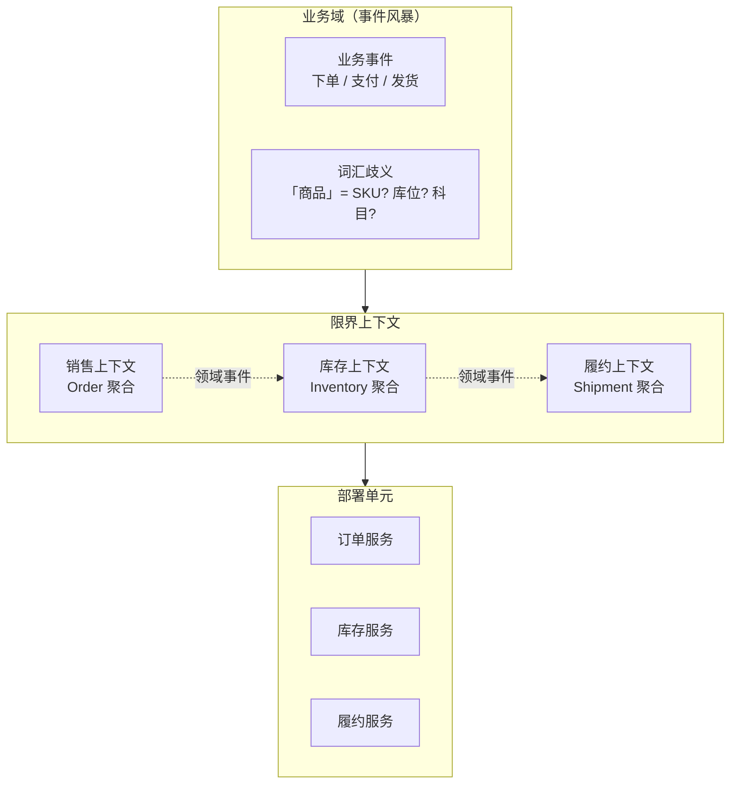
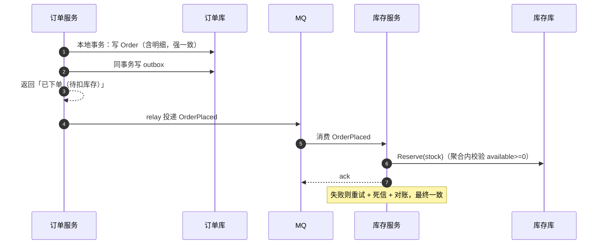
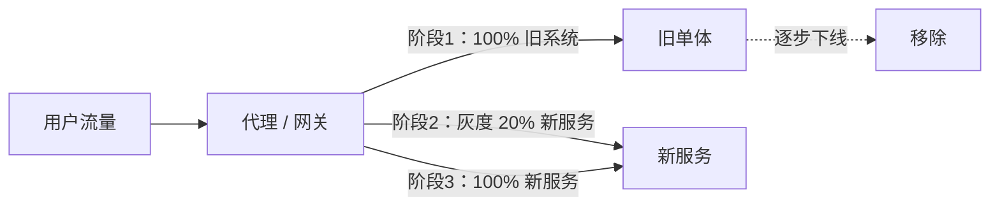
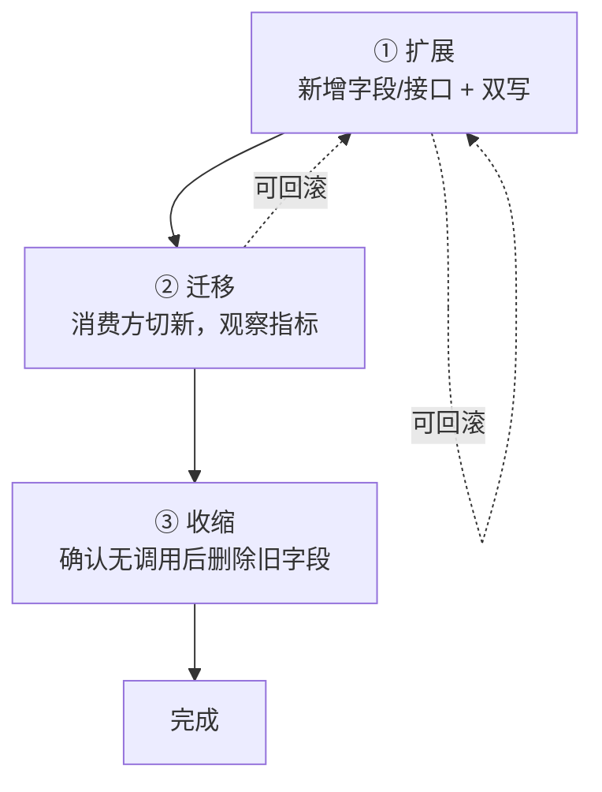

# DDD 与微服务经典面试题（含要点与追问）

> 这一篇考的不是"知不知道概念"，而是**边界判断力**：什么时候该拆、拆到什么粒度、拆完怎么保证一致。
> 每题给结论 + 前提 + 一个真实取舍，避免答成教科书。

## 目录

- [一、领域建模](#一领域建模)
- [二、微服务拆分](#二微服务拆分)
- [三、一致性与查询](#三一致性与查询)
- [四、落地与演进](#四落地与演进)
- [自测清单](#自测清单)
- [附录 A：15 分钟背诵卡](#附录-a15-分钟背诵卡)
- [附录 B：模拟面试 20 题（含追问链）](#附录-b模拟面试-20-题含追问链)
- [附录 C：口述版——3 分钟讲清拆分与建模](#附录-c口述版3-分钟讲清拆分与建模)
- [附录 D：关键图示](#附录-d关键图示)

---

## 一、领域建模

### 1. DDD 到底解决什么问题？

**核心问题是「业务复杂度」，不是"技术复杂度"。**

- 规则简单、以 CRUD 为主（后台管理、报表）→ DDD 是负担。
- 规则复杂、状态多、持续时间长（订单、结算、库存、风控）→ DDD 能显著降低沟通成本与改动成本。

DDD 分两层：

| 层 | 内容 |
| --- | --- |
| **战略设计** | 限界上下文、上下文映射、通用语言、子域划分 |
| **战术设计** | 实体、值对象、聚合、聚合根、领域服务、领域事件、仓储 |

> 追问：战术设计（聚合、仓储）能不能单独用？—— 可以，但只有战略设计（划边界）才解决真正的大问题；只抄战术模式，往往得到一堆"贫血实体 + 复杂 Service"。

---

### 2. 什么是限界上下文和通用语言？

- **限界上下文（Bounded Context）**：一个模型生效的**边界**。同一个词在不同上下文里含义可以不同。
- **通用语言（Ubiquitous Language）**：业务和开发在同一个上下文里用**同一套词汇**，并直接体现在代码命名里。

典型例子：「商品」在**销售上下文**里是"可售 SKU + 价格"，在**仓储上下文**里是"库位 + 批次"，在**财务上下文**里是"科目 + 税率"。强行合并成一个 `Product` 类，就是灾难的开始。

> 追问：怎么发现限界上下文？—— 事件风暴（把业务事件贴出来，看哪些词有歧义）、组织架构、现有系统的耦合点。**歧义出现的地方就是边界**。

---

### 3. 实体和值对象怎么区分？

| | 实体 Entity | 值对象 Value Object |
| --- | --- | --- |
| 标识 | 有唯一 ID，靠 ID 判断相等 | 无 ID，靠**所有属性**判断相等 |
| 可变性 | 可变（状态会演进） | **不可变**（改了就是新对象） |
| 例子 | 订单、用户、账户 | 金额、地址、时间区间、坐标 |

```csharp
public readonly record struct Money(decimal Amount, string Currency)
{
    public Money Add(Money other)
    {
        if (Currency != other.Currency) throw new InvalidOperationException("币种不一致");
        return new Money(Amount + other.Amount, Currency);
    }
}
```

> 追问：为什么值对象要不可变？—— 共享安全（不用担心被别人改）、可缓存、可做字典键；而且业务上"金额 100 元"改了就该是另一个值。

---

### 4. 聚合和聚合根的设计原则？

**聚合 = 一致性边界**。一个事务只修改一个聚合。

四条原则：

1. **聚合根是唯一入口**：外部只能通过根访问内部实体。
2. **聚合要小**：大聚合意味着大范围锁和并发冲突（比如"订单"聚合不要包含"商品"）。
3. **跨聚合只引用 ID**，不引用对象。
4. **一致性在聚合内是强一致，跨聚合靠最终一致**。

> 追问：订单和订单明细是一个聚合吗？—— 是，明细脱离订单没有意义，且要在同一事务里保证总额与明细一致。
> 追问：那库存和订单呢？—— 不是。订单创建只记录"预占"，库存扣减通过领域事件异步完成，属于跨聚合最终一致。

---

### 5. 领域服务、应用服务、仓储各自负责什么？

| 组件 | 职责 | 不该做的事 |
| --- | --- | --- |
| **应用服务** | 编排用例、事务边界、权限、DTO 转换 | 写业务规则 |
| **领域服务** | 跨聚合/跨实体的业务规则（无状态） | 编排流程、访问 DB |
| **仓储** | 聚合的持久化与重建 | 返回 DTO、做查询报表 |
| **领域事件** | 表达"发生了什么"，驱动后续反应 | 承担同步流程控制 |

> 追问：报表查询放哪？—— 不进仓储（仓储只服务聚合），走独立的查询服务/读模型（CQRS 的 Q 侧）。

---

### 6. 领域事件是什么？和集成事件有什么区别？

| | 领域事件 | 集成事件 |
| --- | --- | --- |
| 范围 | **进程内**，同一个限界上下文 | 跨服务/跨上下文 |
| 例子 | `OrderPlaced`、`StockDeducted` | `StockDeductedEto`（发到 MQ） |
| 传递 | 内存事件总线，事务内或事务后 | 消息中间件，必须幂等 |
| 一致性 | 通常同事务/同进程 | 最终一致，要 outbox 保证不丢 |

> 追问：领域事件一定要发到 MQ 吗？—— 不一定。**进程内的领域事件用本地事件总线**，只有需要跨边界时才转换成集成事件发出去。

---

### 7. 贫血模型和充血模型怎么选？

- **贫血模型**：实体只有属性，业务逻辑全在 Service（本质是事务脚本）。简单、直白、团队上手快。
- **充血模型**：业务规则写在实体/聚合里，外部只调方法。规则内聚、难绕过约束。

判断：**规则多且有不变式**（比如"订单只有待支付才能取消"）→ 充血更安全；**纯 CRUD** → 贫血更省事。

> 追问：充血模型最大的落地阻力？—— 团队习惯（习惯 Service 里堆逻辑）和 ORM 限制（有些 ORM 不好映射私有 setter + 集合封装）。

---

### 8. 什么时候不该用 DDD？

- 业务是 CRUD，规则可枚举。
- 团队不熟，强行上会得到"四不像"。
- 交付压力大、需求还在剧烈变化（先跑通再建模）。
- 数据量小、单体就能扛。

> 追问：那用什么？—— **模块化单体 + 事务脚本 + 清晰的模块边界**。边界比模式重要：先把模块分清楚，将来拆微服务才有依据。

---

## 二、微服务拆分

### 9. 单体、模块化单体、微服务怎么选？

| | 单体 | 模块化单体 | 微服务 |
| --- | --- | --- | --- |
| 部署 | 一个包 | 一个包（模块内自治） | 多服务独立部署 |
| 边界 | 靠自觉 | **编译期/包级强制** | 网络边界 |
| 一致性 | 本地事务 | 本地事务 | 分布式（Saga/消息） |
| 复杂度 | 低 | 中 | 高（运维、链路、数据） |
| 适用 | 早期、小团队 | **大多数业务的正确起点** | 多团队、独立伸缩、异构技术 |

> 一句话：**先做模块化单体，等到"团队被同一个发布卡住"再拆**。

---

### 10. 微服务该按什么拆？常见误区？

**正确维度**：业务能力 / 限界上下文 / 数据所有权 / 团队边界。

**四个经典误区**：

1. **按技术层拆**（controller 服务、service 服务）→ 一个需求改八个服务。
2. **按实体拆**（用户服务、地址服务、角色服务）→ 到处跨服务 JOIN。
3. **共享数据库** → 表面微服务，实际是分布式单体。
4. **拆得太细**（纳米服务）→ 网络调用爆炸，延迟与故障点倍增。

> 追问：怎么判断拆得对不对？—— 一个需求通常只改 1~2 个服务；每个服务有**唯一的数据 owner**；团队能独立发布。

---

### 11. 康威定律和团队拓扑？

**康威定律**：系统的架构会反映组织的沟通结构。

- 如果拆分的服务边界和团队边界不一致，跨团队的沟通成本会转成接口变更成本。
- 团队拓扑常见形态：**业务流团队**（端到端负责一个域）、**平台团队**（提供能力）、**赋能团队**（提供专家支持）、**复杂子系统团队**。

> 追问：先改组织还是先改架构？—— 通常是**同时演进**：先划出团队边界，再让架构跟上；只改架构不动组织，边界会被组织碾平。

---

### 12. 上下文映射有哪些模式？

| 模式 | 说明 |
| --- | --- |
| **防腐层 ACL** | 在自己边界内做适配层，隔离外部模型的污染（最常用） |
| 共享内核 | 两个上下文共享一小块模型（要严格版本管理，易腐化） |
| 客户-供应商 | 下游提需求，上游排期 |
| 遵奉者 | 下游完全照抄上游模型（省事但被动） |
| 开放主机服务 OHS | 上游提供稳定的公开协议 |
| 发布语言 | 用统一的 DTO/事件契约通信 |

> 追问：为什么 ACL 最重要？—— 外部系统的模型会变，ACL 让变化止步于边界；没有 ACL，外部字段一改，内部模型跟着烂。

---

### 13. 服务间通信：同步还是异步？

| | 同步（REST/gRPC） | 异步（消息/事件） |
| --- | --- | --- |
| 耦合 | 时间耦合（对方必须在线） | 解耦，可削峰 |
| 一致性 | 立即返回结果 | 最终一致 |
| 复杂度 | 低 | 高（幂等、顺序、重复、死信） |
| 适用 | 查询、强交互、需要即时结果 | 命令下发、状态广播、长流程 |

> 追问：新手最常犯的错？—— **所有调用都同步**，结果一个下游抖动整条链路雪崩；应该把"必须立刻知道结果"和"可以稍后知道"分开。

---

### 14. API 网关该做什么、不该做什么？

**该做**：路由、认证鉴权、限流、灰度、协议转换、日志与追踪埋点、响应聚合（谨慎）。

**不该做**：业务逻辑、数据聚合（会变成新的单体）、事务编排。

> 追问：网关会不会成为瓶颈？—— 会，所以网关要无状态、可水平扩展，且只做"轻逻辑"；重逻辑下沉到 BFF 或服务内。

---

### 15. 服务治理清单都有什么？

- 注册发现、配置中心（动态刷新）
- 负载均衡（含一致性哈希）
- 超时、重试、熔断、限流、隔离
- 链路追踪 + 指标 + 日志（三支柱）
- 灰度发布与回滚
- 契约测试（服务间兼容性）
- 容量与压测、故障演练

> 追问：这些必须一开始就全上吗？—— 不必，但**超时、重试上限、熔断**建议第一天就有，其余按规模补。

---

### 16. 「每服务一库」到底是为什么？

因为**数据所有权**：只有一个服务能写自己的数据，其他服务只能通过 API/事件获取。

- 好处：边界清晰、可独立演进/扩容/换存储。
- 代价：失去跨库 JOIN 和本地事务，需要 CQRS/Saga 补偿。

> 追问：共享数据库就一定错吗？—— 过渡期可以（比如绞杀者阶段），但必须明确**唯一写入方**，否则双写迟早不一致。

---

## 三、一致性与查询

### 17. 编排（Orchestration）和协同（Choreography）怎么选？

| | 编排 | 协同 |
| --- | --- | --- |
| 结构 | 中心协调器（状态机） | 各服务监听事件自行响应 |
| 可观测 | **好**，有完整流程状态 | 差，流程散落各处 |
| 耦合 | 协调器知道所有步骤 | 服务间松耦合 |
| 适用 | 步骤多、要补偿、要可视 | 简单事件广播、松耦合优先 |

> 追问：编排器会不会变成"分布式单体"？—— 只做**流程编排**（发命令、收事件、驱动状态机），不放业务规则就不会。

---

### 18. CQRS 是什么？什么时候用？

**命令查询职责分离**：写模型负责不变式（规范化、聚合），读模型负责查询（反规范化、宽表、ES）。

- 适用：读写比例悬殊、查询维度多、报表复杂。
- 代价：**最终一致的读延迟**、双模型维护、同步机制（事件/CDC）。

> 追问：CQRS 一定要配事件溯源吗？—— 不必，两者独立；CQRS 只需"写模型发事件、读模型订阅"。

---

### 19. 事件溯源（Event Sourcing）的代价是什么？

状态 = 事件流重放的结果。

代价清单：

- **版本演进**：事件 schema 一旦发布就很难改，要兼容老事件。
- **查询困难**：必须配 CQRS 读模型。
- **快照**：事件多了重放慢，需要定期快照。
- **存储增长与 GDPR**：删除某条数据要"墓碑事件"或加密擦除。
- **调试心智**：状态不是直接可见的。

> 追问：什么场景值得？—— 审计要求强（金融账务）、需要时间旅行/回放、天然事件驱动（IoT）。普通业务用**状态 + 变更日志**就够。

---

### 20. 跨服务查询怎么办？

三种解法：

1. **API 组合（BFF/网关聚合）**：实时，但 N 次调用、延迟叠加。
2. **读模型/宽表（CQRS）**：订阅事件维护一份可查的表，快但最终一致。
3. **专用查询服务（ES/数仓）**：复杂检索、报表。

> 追问：能跨库 JOIN 吗？—— 不能（不同实例），即使同实例也不该做，那等于绕过数据所有权。

---

### 21. 分布式事务怎么选？

详见 [distributed-interview.md](distributed-interview.md)，这里给结论：

- 优先 **本地消息表 + 幂等 + 对账**（大多数业务够用）。
- 长流程用 **Saga**（要补偿、要状态机）。
- 资金强一致用 **TCC**（要冻结字段、处理空回滚/悬挂）。
- **2PC/XA 只用于同库多数据源**，跨服务别用。

---

## 四、落地与演进

### 22. 怎么把一个单体拆成微服务？

**绞杀者模式（Strangler Fig）**：

1. 前面加一层**路由/代理**，新旧系统并存。
2. 挑**低风险、边界清晰**的模块先拆（如通知、搜索），不要先动核心交易。
3. 新服务接管流量，逐步扩大比例（10% → 50% → 100%）。
4. 旧代码路径下线，最后移除旧模块。

> 追问：最先拆什么？—— **无状态、依赖少、读多写少**的模块；核心账务最后动，且要有双跑对账。

---

### 23. 接口和数据怎么演进才不炸？

**扩展-收缩（Expand-Contract）三步**：

```text
① 扩展：新增字段/新接口，双写，老代码仍可用
② 迁移：消费方切到新接口，观察指标
③ 收缩：确认无调用后删除旧字段/旧接口
```

数据库同理：先加列（可空/有默认）→ 双写 → 切读 → 删旧列。**永远不要在同一次发布里"改语义 + 删字段"**。

> 追问：怎么确认"无调用"？—— 网关/服务端埋点统计 + 依赖分析，别靠"我觉得没人用"。

---

### 24. 多租户怎么设计？

| 方案 | 隔离 | 成本 | 适用 |
| --- | --- | --- | --- |
| 共享库共享表（`tenant_id`） | 低 | 最低 | SaaS 中小客户 |
| 共享库独立 schema | 中 | 中 | 中大型客户 |
| 独立库/实例 | 高 | 最高 | 大客户、合规要求 |

配套：租户上下文透传（网关 → 服务 → DB 拦截器自动加 `tenant_id`）、按租户限流与配额、租户级备份恢复。

> 追问：`tenant_id` 最容易出的问题？—— **漏加条件**导致越权；必须用框架层拦截或行级安全强制，而不是靠每个 SQL 手写。

---

### 25. 微服务怎么定 SLO？

- 从**用户视角**定（下单成功率、支付成功率），不是从机器指标定。
- 每个服务定自己的 SLI（延迟、错误率、饱和度），但**SLO 要对齐业务目标**。
- 错误预算：`1 - SLO`，用预算驱动发布节奏与稳定性投入。

> 追问：SLO 定多高？—— 参考历史数据和用户容忍度，99.9% 已经是每月 43 分钟；不要一律写 99.99%。

---

### 26. 一个订单域该怎么建模？

```text
聚合根：Order（订单）
  内部实体：OrderItem（明细）、OrderStatus（状态机）
  值对象：Money、Address、OrderNo
领域事件：OrderPlaced / OrderPaid / OrderCancelled
应用服务：PlaceOrderService（编排：校验 → 创建聚合 → 保存 → 发事件）
仓储：IOrderRepository（只针对 Order 聚合根）
跨聚合：库存、支付、履约通过事件协作
```

关键点：

- **状态机收敛在聚合内**（`order.Pay()` 内部校验当前状态）。
- **总额、明细一致性在聚合内强一致**。
- 跨聚合（库存/支付）用领域事件 + 最终一致。

> 追问：订单状态能不能用数据库字段随便改？—— 不能，所有流转必须过聚合方法，否则并发下会出现"已取消又被支付"。

---

### 27. 秒杀/库存在 DDD 里怎么落地？

把「库存」当独立限界上下文：

- 聚合根 `Inventory`（商品 + 可用/冻结），不变式：`available >= 0`。
- **预占（Reserve）/ 确认（Confirm）/ 释放（Release）** 三个领域动作，而不是裸露的 `UPDATE stock`。
- 秒杀场景把"预占"放到 Redis（Lua 原子），DB 侧只做批量落库；**Redis 是投影，不是事实源**。
- 订单侧通过 `StockReserved` 事件推进状态机。

> 追问：这和事务脚本写法差在哪？—— 差在**约束在哪**。事务脚本靠每条 SQL 自觉加 `WHERE stock >= 1`；聚合把不变式收在一个方法里，改规则只改一处。

---

### 28. 本仓库里的 DDD 痕迹（可直接当项目案例）

- 分层：`t1_frame/src/core/t1_frame.domain`（领域）、`.../application`（应用服务）、`.../webapi`（接口）—— 对应 DDD 的四层。
- 应用服务：`XxxAppService : ApplicationService` 承担用例编排与 `ObjectMapper.Map`。
- 领域/集成事件：`StockDeductedEto` 经 ABP 分布式事件总线发出，`StockDeductedHandler` 消费后写审计日志（幂等 upsert）—— 典型的**跨上下文集成事件**。
- 聚合与状态机：`SeckillService` 的 Lua 预扣 + `SeckillBatchWriter` 的批量落库，本质是"库存聚合的预占/确认"在秒杀场景下的投影实现。

> 追问：ABP 算不算 DDD 框架？—— 它提供分层骨架和基础设施（UoW、事件总线、仓储），但**边界和模型还得自己划**；框架不会替你做出正确的聚合设计。

---

## 自测清单

- [ ] DDD 解决的是业务复杂度，不是技术复杂度
- [ ] 限界上下文与通用语言，同一词在不同上下文含义不同
- [ ] 实体 vs 值对象的判定标准
- [ ] 聚合四条原则，为什么"一个事务只改一个聚合"
- [ ] 应用服务 / 领域服务 / 仓储 各自边界
- [ ] 领域事件 vs 集成事件（进程内 vs 跨服务）
- [ ] 贫血与充血的取舍，什么时候不该用 DDD
- [ ] 单体 / 模块化单体 / 微服务的选择依据
- [ ] 四个拆分误区（按技术层、按实体、共享库、纳米服务）
- [ ] 康威定律与团队拓扑
- [ ] 防腐层 ACL 的作用
- [ ] 同步与异步通信的取舍
- [ ] 网关该做/不该做什么
- [ ] 编排 vs 协同
- [ ] CQRS 的代价，事件溯源的五个坑
- [ ] 绞杀者模式与扩展-收缩
- [ ] 多租户三种隔离方案
- [ ] 订单域建模的关键点

---

# 附录 A：15 分钟背诵卡

1. DDD 治的是**业务复杂度**；CRUD 系统别硬套。
2. 战略设计划边界（限界上下文），战术设计落实现（聚合/实体/仓储）。
3. **同一业务词在不同上下文含义不同**，歧义处就是边界。
4. 实体靠 ID 相等，值对象靠全部属性相等且**不可变**。
5. 聚合 = **一致性边界**；一个事务只改一个聚合；跨聚合用 ID 引用 + 最终一致。
6. 聚合要小：大聚合 = 大锁范围 = 高冲突。
7. 应用服务编排用例，领域服务放跨聚合规则，仓储只服务聚合根。
8. 领域事件是**进程内**，要跨边界时转成集成事件（发 MQ）。
9. 贫血模型省事，充血模型安全；规则多且有不变式就用充血。
10. 微服务不是目标，**独立部署与独立伸缩**才是；先做模块化单体。
11. 四个拆分误区：按技术层、按实体、共享库、纳米服务。
12. 康威定律：架构反映组织；边界要和团队边界对齐。
13. ACL 防腐层让外部模型的变化止步于边界。
14. 所有调用都同步 = 一个下游抖全链路崩。
15. 网关只做轻逻辑：路由、认证、限流、埋点；别塞业务。
16. 每服务一库是为了**数据所有权**，代价是失去 JOIN 和本地事务。
17. 编排易观测、协同松耦合；编排器只做流程不放业务。
18. CQRS 换查询性能的代价是**读延迟**和双模型维护。
19. 事件溯源的五个坑：版本演进、查询、快照、删除、心智负担。
20. 拆分用绞杀者，演进用扩展-收缩，切换要能回滚。

> 记忆锚点：**边界 → 模型 → 通信 → 一致 → 演进**。

---

# 附录 B：模拟面试 20 题（含追问链）

### 1. 你怎么理解 DDD？

**开口**：它是应对**业务复杂度**的方法论，核心是划边界（限界上下文）和把不变式收进聚合。
**追问**：技术复杂度的系统需要吗？→ 不需要，高并发/高性能靠架构和基础设施，DDD 帮不上。

### 2. 限界上下文怎么划分？

**开口**：从业务事件和词汇歧义入手，同一词在不同场景含义不同就是边界；再结合团队与数据所有权。
**追问**：划错了会怎样？→ 一个需求改多个上下文，或者到处跨上下文同步数据。

### 3. 聚合为什么不能太大？

**开口**：聚合是一致性边界，也是并发边界；聚合越大，锁范围越大、并发冲突越多。
**追问**：那订单和库存能放一个聚合吗？→ 不能，它们生命周期和数据 owner 都不同，应该用事件做最终一致。

### 4. 一个事务能改多个聚合吗？

**开口**：同一个进程内的强一致场景可以，但会破坏边界的独立性；微服务下应改为"改一个聚合 + 发事件"。
**追问**：那一致性怎么保证？→ 事件驱动 + 幂等消费 + 对账，属于最终一致。

### 5. 应用服务和领域服务的区别？

**开口**：应用服务管流程（事务、权限、DTO），领域服务管跨实体的规则，且无状态。
**追问**：业务规则写在应用服务有什么问题？→ 规则散落在流程里，无法复用、难以测试、容易被绕过。

### 6. 值对象为什么不可变？

**开口**：共享安全、可缓存、可作为字典键；而且业务上"100 元"变了就是另一个值。
**追问**：性能上有代价吗？→ 有，频繁创建；但现代运行时下分配很便宜，优先正确性。

### 7. 什么时候不该用 DDD？

**开口**：CRUD 为主、规则简单、团队不熟、需求还在剧烈变化时。
**追问**：那用什么？→ 模块化单体 + 事务脚本，先把边界划清楚。

### 8. 单体、模块化单体、微服务怎么选？

**开口**：看组织是否被同一个发布卡住、是否有独立伸缩需求；大多数公司应该停在模块化单体。
**追问**：模块化单体的"模块"怎么强制？→ 分包/分程序集 + 架构测试（禁止跨模块直接引用内部类型）。

### 9. 微服务该怎么拆？

**开口**：按业务能力/限界上下文/数据所有权/团队边界，判据是一个需求只改 1~2 个服务。
**追问**：共享数据库可以吗？→ 过渡期可以，但必须只有唯一写入方。

### 10. 拆得太细有什么后果？

**开口**：网络调用爆炸、延迟叠加、故障点倍增、联调与运维成本失控。
**追问**：怎么判断过细？→ 一个业务动作要跨 5+ 服务，或者服务之间始终强同步。

### 11. 康威定律在实际中怎么体现？

**开口**：架构会向组织沟通结构收敛；团队边界不清，服务边界一定会被碾平。
**追问**：那先改组织还是先改架构？→ 并行演进，先把团队边界明确，再让架构跟上。

### 12. 防腐层（ACL）解决什么？

**开口**：隔离外部模型的变化，把外部字段/协议转换成内部模型。
**追问**：没有 ACL 会怎样？→ 外部一改字段，内部模型跟着改，测试和业务一起崩。

### 13. 同步和异步怎么选？

**开口**：必须立刻知道结果的用同步；状态广播、长流程用异步事件。
**追问**：异步的坑？→ 幂等、顺序、重复、死信、可观测性都要额外设计。

### 14. 网关会变成瓶颈吗？

**开口**：会，所以只做轻逻辑、无状态、可水平扩展。
**追问**：数据聚合放网关合适吗？→ 不合适，容易长成新的单体；应该放 BFF 或读模型。

### 15. 编排和协同怎么选？

**开口**：步骤多、需要补偿和可视化的用编排；简单广播用协同。
**追问**：编排器会不会变成分布式单体？→ 只做流程状态机、不放业务规则就不会。

### 16. CQRS 的代价是什么？

**开口**：读模型最终一致、双模型维护、事件同步的复杂度。
**追问**：什么时候值得？→ 读写比例悬殊、查询维度多、报表复杂。

### 17. 事件溯源你会用吗？

**开口**：只在需要审计、回放、时间旅行的场景用，普通业务用状态 + 变更日志即可。
**追问**：最大的坑？→ 事件 schema 演进（老事件要能一直重放）和删除合规。

### 18. 跨服务查询怎么做？

**开口**：API 组合、读模型宽表、专用查询服务三种，按实时性和复杂度选。
**追问**：为什么不能跨库 JOIN？→ 破坏数据所有权，且分库后根本做不到。

### 19. 怎么能安全地拆单体？

**开口**：绞杀者模式——加代理、先拆低风险模块、灰度切流、旧路径下线。
**追问**：核心账务什么时候拆？→ 最后，且要双跑对账、可一键回切。

### 20. 接口怎么演进不炸调用方？

**开口**：扩展-收缩：先加兼容字段并双写，再切消费方，最后删旧的。
**追问**：怎么确认没人用？→ 网关埋点 + 依赖分析，不要靠记忆。

---

# 附录 C：口述版——3 分钟讲清拆分与建模

> 面试官问「你怎么看微服务和 DDD」时用。约 800 字 ≈ 3 分钟。

### 逐字稿

**【开场 · 15 秒】**
我对这两个词的态度是：**DDD 是划边界的方法，微服务是边界的部署形态**。边界划错了，微服务只会把错误放大。

**【建模 · 45 秒】**
建模我先看业务复杂度。CRUD 系统我不套 DDD，模块化单体加事务脚本更划算；规则多、状态多、生命周期长的域才值得。
值得的时候，第一步是找限界上下文——同一个词在不同场景含义不同，歧义就是边界。比如「商品」在销售里是可售 SKU，在仓储里是库位和批次。
然后是聚合。聚合本质是**一致性边界**，一个事务只改一个聚合，聚合要小；跨聚合只引用 ID，用领域事件做最终一致。

**【拆分 · 45 秒】**
拆微服务我看四个维度：业务能力、数据所有权、团队边界、独立伸缩需求。判据很朴素——一个需求通常只改一到两个服务。
四个坑我一定避开：按技术层拆、按实体拆、共享数据库、拆成纳米服务。共享库尤其危险，那是分布式单体。
还要提康威定律：架构会向组织沟通结构收敛，所以边界要和团队边界一起演进。

**【一致性 · 45 秒】**
拆完最大的问题是数据。原则是每服务一库、唯一写入方，代价是失去 JOIN 和本地事务。
方案我按优先级排：本地消息表加幂等加对账能解决大部分；长流程用 Saga，编排便于观测、协同更松耦合；资金类用 TCC，但要处理空回滚、悬挂和幂等；2PC 只在同库多数据源用。
查询侧用 CQRS 读模型或专用查询服务，不要跨库 JOIN。

**【收尾 · 30 秒】**
演进上我用绞杀者模式拆单体，用扩展-收缩演进接口：先加兼容、再切流量、最后删旧的，任何一步都能回滚。
一句话总结：**微服务不是目标，能独立部署和独立伸缩才是；DDD 的价值不在模式，而在让你先想清楚边界**。

---

### 压缩版

**一句话版（10 秒）**
> DDD 划边界，微服务部署边界；先模块化单体，等团队被同一个发布卡住再拆。

**30 秒版**
> DDD 治业务复杂度：限界上下文找边界，聚合收不变式，领域事件做跨聚合最终一致。微服务按业务能力和数据所有权拆，避开按技术层拆、共享库这些坑。每服务一库、唯一写入方，一致性靠消息表加幂等加对账，长流程用 Saga，资金用 TCC。演进用绞杀者加扩展-收缩。

### 时间分配

| 段落 | 时长 | 只说一件事 |
| --- | --- | --- |
| 开场 | 15s | DDD 划边界、微服务部署边界 |
| 建模 | 45s | 限界上下文 → 聚合 → 领域事件 |
| 拆分 | 45s | 四个维度 + 四个坑 + 康威定律 |
| 一致性 | 45s | 每服务一库 + 消息表/Saga/TCC + CQRS |
| 收尾 | 30s | 绞杀者 + 扩展-收缩 |

### 被打断时怎么接

| 面试官插话 | 接续句 |
| --- | --- |
| 「你们为什么不用微服务？」 | 「当时团队被同一个发布卡住的信号还没出现，模块化单体的收益更大」 |
| 「聚合怎么划？」 | 「一个事务改一个聚合，跨聚合用 ID 引用加事件，聚合越小越好」 |
| 「Saga 用编排还是协同？」 | 「步骤多要补偿就用编排，简单广播用协同；编排器只放流程不放业务」 |
| 「拆完发现性能变差？」 | 「多半是同步调用链太长，改事件驱动或者加读模型；也可能是拆得过细」 |

---

# 附录 D：关键图示

### 1. 从限界上下文到部署单元



### 2. 聚合内强一致，跨聚合最终一致



### 3. 绞杀者模式



### 4. 扩展-收缩演进


