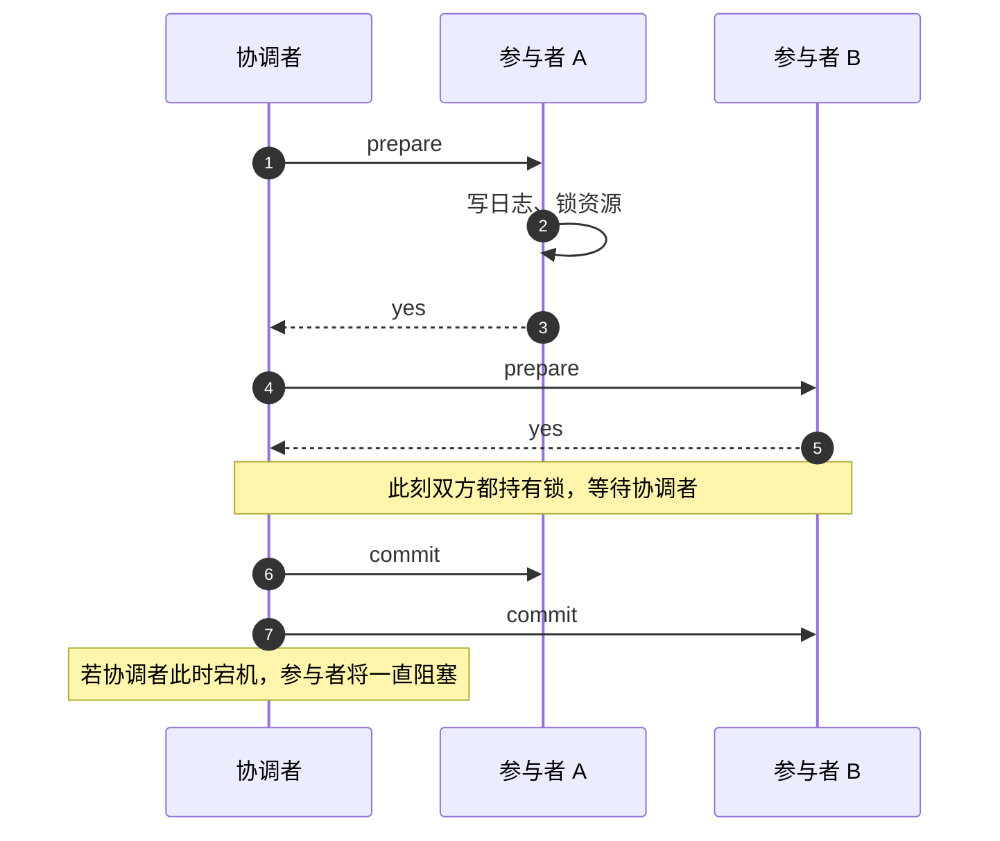
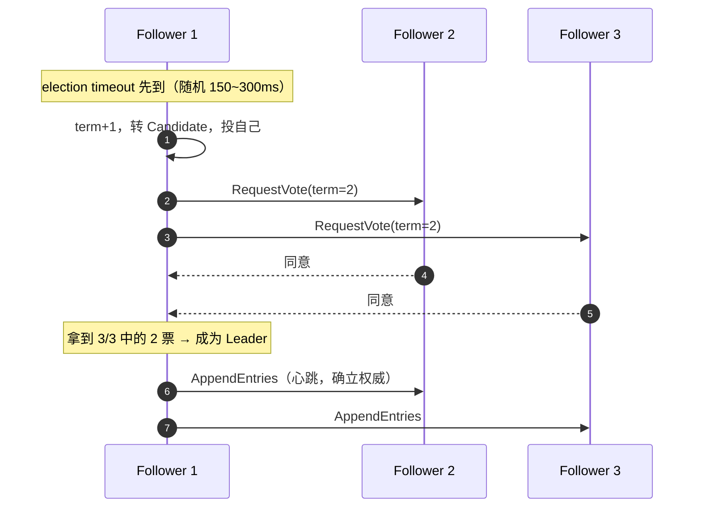
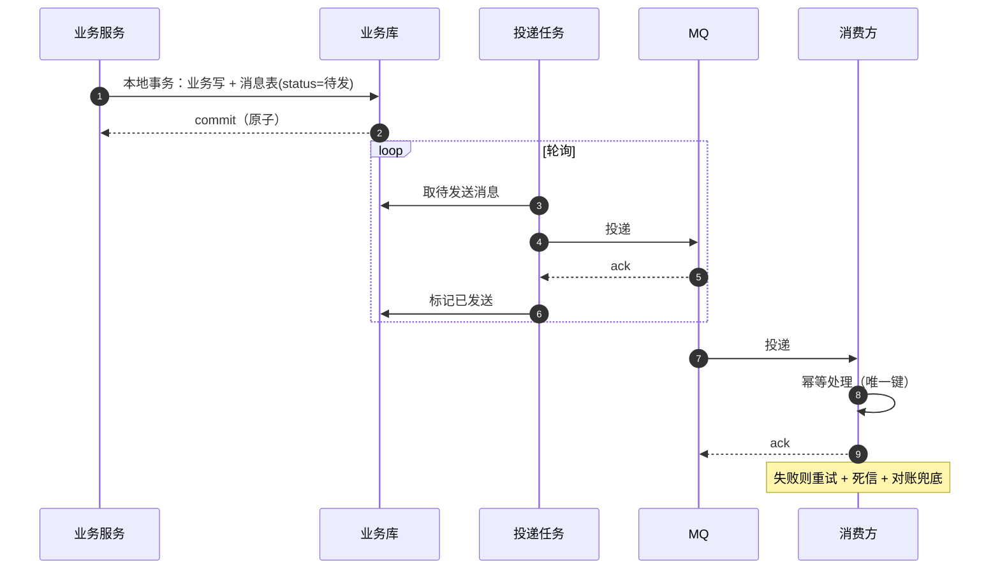
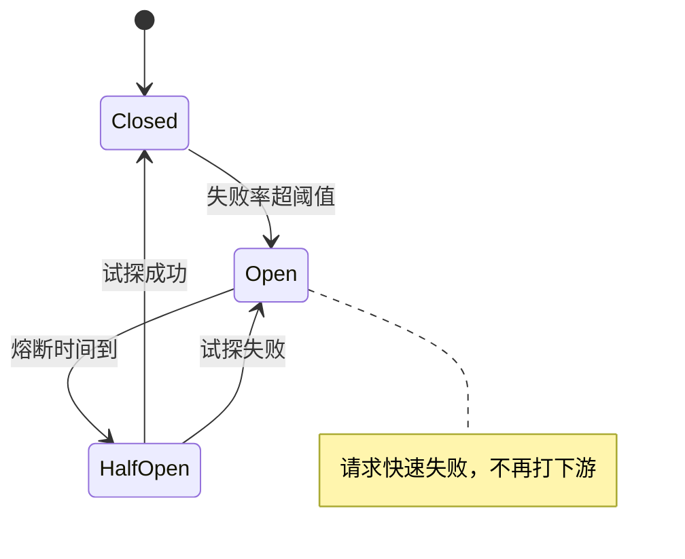

# 分布式系统经典面试题（含要点与追问）

> 覆盖「理论 → 共识 → 组件 → 架构」四层。理论题考的是**边界条件**（什么情况下不成立），架构题考的是**取舍**（为什么选这个）。
> 建议答法：先给结论，再给前提，最后给一个你见过的真实取舍。

## 目录

- [一、理论基础：CAP 与分布式事务](#一理论基础cap-与分布式事务)
- [二、共识与选举](#二共识与选举)
- [三、常见分布式组件](#三常见分布式组件)
- [四、架构实践](#四架构实践)
- [自测清单](#自测清单)
- [附录 A：15 分钟背诵卡](#附录-a15-分钟背诵卡)
- [附录 B：模拟面试 20 题（含追问链）](#附录-b模拟面试-20-题含追问链)
- [附录 C：口述版——3 分钟讲清分布式系统的取舍](#附录-c口述版3-分钟讲清分布式系统的取舍)
- [附录 D：关键时序图](#附录-d关键时序图)

---

## 一、理论基础：CAP 与分布式事务

> 本章只给 CAP 的速览结论；**完整版（PACELC、一致性谱系、会话保证、各中间件定位）见 [cap-interview.md](cap-interview.md)**。

### 1. CAP 到底是什么？为什么不能三者兼得？

| 字母 | 含义 | 常见误解 |
| --- | --- | --- |
| **C** Consistency | **线性一致性**（读到的永远是最新已提交值） | 很多人误当成"最终一致" |
| **A** Availability | 每个非故障节点都能在**有限时间**内返回**非错误**响应 | 不是"一直可用" |
| **P** Partition tolerance | 网络分区时系统仍能继续运行 | 说"选 CA"是不懂 |

**关键**：网络分区**不是可选项**（光缆会断、交换机会挂），所以真实选择是：**分区发生时，选 C 还是选 A**。

- **CP**：拒绝服务保证一致 → ZooKeeper、etcd、HBase。
- **AP**：继续服务保证可用，接受暂时不一致 → Eureka、Cassandra、Redis 主从。

> 追问：CAP 里的 C 和 ACID 的 C 是一回事吗？—— 不是。ACID 的 C 指"约束不被破坏"，是业务语义；CAP 的 C 是分布式副本间的一致性模型。

---

### 2. BASE 是什么？

- **B**asically Available：基本可用（降级、限流、部分功能不可用）
- **S**oft state：软状态（允许中间态）
- **E**ventually consistent：最终一致

BASE 是 AP 系统的工程化表述：**不是不要一致性，而是把一致的时延从毫秒级拉长到秒级**。

> 追问：最终一致里"最终"是多久？—— 必须可度量：靠重试次数、对账周期、补偿任务来定义 SLO，否则就是"永远不一致"。

---

### 3. 一致性模型从强到弱怎么排？

```text
线性一致（Linearizable）  ← 最强，等价于单机
  ↓
顺序一致（Sequential）
  ↓
因果一致（Causal）         ← 保证"原因"先于"结果"
  ↓
最终一致（Eventual）
```

> 追问：为什么大多数业务只用最终一致？—— 强一致需要协调（共识/锁），代价是延迟和可用性；订单、支付这类关键写可以用"状态机 + 幂等 + 对账"把最终一致做得足够好。

---

### 4. 分布式事务有哪几种方案？

| 方案 | 一致性 | 性能 | 侵入性 | 适用 |
| --- | --- | --- | --- | --- |
| **2PC / XA** | 强 | 差（同步阻塞、锁持有到提交） | 低 | 同库多数据源、内部系统 |
| **TCC** | 最终（业务层保证） | 好 | **高**（每个服务写三个接口） | 资金、库存等核心链路 |
| **Saga** | 最终 | 好 | 中（要写补偿） | 长流程、跨多个服务 |
| **本地消息表** | 最终 | 好 | 中 | 异步解耦场景（最常用） |
| **事务消息** | 最终 | 好 | 中 | 有 MQ 支持（RocketMQ） |
| **最大努力通知** | 最终 | 好 | 低 | 第三方回调、对账兜底 |

> 一句话选型：**能异步就不要同步 2PC；核心资金链路用 TCC；普通业务用本地消息表**。

---

### 5. 2PC 有什么问题？3PC 改进了什么？

**2PC**：

```text
阶段一 prepare：协调者问所有参与者「能提交吗」，参与者锁资源、写日志
阶段二 commit ：全部 yes → 提交；任一 no → 回滚
```

三个问题：

1. **同步阻塞**：prepare 后资源被锁，直到 commit，吞吐差。
2. **协调者单点**：协调者挂了，参与者一直等在 prepare 状态（阻塞）。
3. **数据不一致**：commit 阶段部分参与者没收到提交指令 → 部分提交部分回滚。

**3PC**：加一个 `CanCommit` 阶段，并给参与者**超时自动提交/回滚**能力，缓解阻塞；但**网络分区下仍可能不一致**，工程上很少用。

> 追问：为什么互联网公司很少用 XA？—— 跨服务长事务会把数据库连接和行锁持有几秒到几十秒，QPS 直接崩；而且中间件支持参差。

---

### 6. TCC 的三个经典问题是什么？

| 问题 | 场景 | 解法 |
| --- | --- | --- |
| **空回滚** | Try 没执行（或没到达），Cancel 却来了 | Cancel 时先查事务日志，没有 Try 记录就记一条"已空回滚"直接返回 |
| **悬挂** | Cancel 先到，Try 后到（网络延迟） | 执行 Try 前检查是否已有 Cancel 记录，有则拒绝 |
| **幂等** | 重复的 Confirm/Cancel | 事务控制表 + 唯一键，同一事务只允许一次状态流转 |

> 追问：TCC 的"预留资源"怎么设计？—— 常见做法是**冻结字段**（`frozen_stock`），Try 时把可用减冻结加，Confirm 扣冻结，Cancel 反过来。

---

### 7. 本地消息表和事务消息有什么区别？

**本地消息表**：

```text
同一本地事务里：① 业务写库 ② 写消息表（状态=待发送）
后台任务：轮询消息表 → 投 MQ → 改为已发送
消费端：幂等处理 → 回 ACK
```

**事务消息（RocketMQ）**：half message 先落 broker → 执行本地事务 → 提交/回滚 → broker 回查未知状态。

区别：本地消息表**自己存消息**（多一张表、要轮询），事务消息把这件事交给 MQ（需要 MQ 支持，回查要有幂等接口）。

> 追问：为什么这能保证"业务和消息同时成功"？—— 因为**业务写库和写消息在同一个本地事务**里，原子性由数据库保证；剩下的是"一定会投递"，靠重试 + 对账。

---

## 二、共识与选举

### 8. 为什么需要共识算法？

多副本要保证：**同一位置（index）上的日志，所有节点最终一致**。没有共识就无法回答"哪个副本说了算"，也就无法安全地选主、提交、回滚。

> 追问：主从复制不算共识吗？—— 异步主从只是"复制"，主库挂了可能丢数据（未同步部分）；共识要求**多数派确认**才算提交。

---

### 9. Raft 怎么选主？

三种角色：**Follower / Candidate / Leader**。

```text
① Follower 在 election timeout（150~300ms 随机）内没收到心跳 → 变 Candidate
② term + 1，给自己投票，并发 RequestVote 给所有人
③ 拿到多数派选票 → 成为 Leader，立刻发心跳确立权威
④ 若发现别人 term 更大 → 退回 Follower
```

**随机超时**是关键：避免所有节点同时竞选导致选票分裂。

> 追问：为什么会选不出来？—— 偶数节点刚好各半、网络分区导致无人过半、或者一直有更高 term 的干扰。Raft 靠随机超时+term 单调来收敛。

---

### 10. Raft 的日志复制与提交规则？

- Leader 收到写请求 → 追加到本地日志 → 并行 `AppendEntries` 给所有 Follower。
- Follower 写入成功并回复 → 当**多数派**都写入，Leader 提交该条目并应用到状态机。
- **日志匹配特性**：如果两个日志在某个 index 的 term 相同，则该 index 之前的所有日志都相同。

**提交规则（易错点）**：Leader **只能通过提交当前 term 的条目**来间接提交之前 term 的条目，不能直接提交旧 term 的条目。

> 追问：为什么？—— 旧 term 的条目可能存在于多数派但最终被覆盖（见 Raft 论文 Figure 8），直接提交会破坏一致性。

---

### 11. Raft 怎么防脑裂？

- **多数派才能选主**：5 节点里少数派（2 个）永远选不出 Leader。
- **term 单调递增**：旧 Leader 一旦发现更高 term，立刻退位。
- 分区恢复后，**旧 Leader 的未提交日志会被覆盖**（跟随新 Leader 的日志）。

结论：**Raft 不存在双主写入**，但少数派分区会**不可用**（这是 CP 的代价）。

---

### 12. Paxos、Raft、ZAB 什么关系？

| | 核心 | 特点 |
| --- | --- | --- |
| **Paxos** | prepare / accept 两阶段 | 理论基石，难实现、有活锁；Multi-Paxos 是工程化版本 |
| **Raft** | 强 Leader + 日志复制 | 可理解性优先，工程实现最多（etcd、TiKV、Consul） |
| **ZAB** | 类似 Raft，ZooKeeper 用 | 有 epoch/zxid，分恢复模式与广播模式 |

一句话：**Raft ≈ Multi-Paxos 的可理解版本**；ZAB 是为 ZK 的原子广播定制的变体。

---

### 13. 为什么集群推荐奇数节点？

- n 个节点容忍 `(n-1)/2` 个故障。
- 3 节点容 1，4 节点**也容 1** —— 第 4 台不增加容错，只增加通信与选举延迟。
- 5 节点容 2，7 节点容 3；节点越多，写延迟（要等多数派）越高。

> 追问：跨机房怎么部署？—— 3 机房 2:2:1 这类布局，只要保证**任一机房故障后剩下的仍有多数派**；权衡的是"能挂几个机房"。

---

### 14. etcd 除了存配置还能干什么？

- **服务注册与发现**（配合租约 lease + 心跳续约）
- **分布式锁**（`concurrency` 包，基于 revision + watch）
- **选主**（`election` 包）
- **配置中心**（watch 增量推送）
- **分布式协调**（Leader election、barrier）

> 追问：etcd 的 watch 为什么高效？—— 基于 MVCC 的 revision 增量推送，不是轮询。

---

## 三、常见分布式组件

### 15. 注册中心选 CP 还是 AP？

| | ZooKeeper | Eureka | Nacos |
| --- | --- | --- | --- |
| 模型 | **CP** | **AP** | 支持 AP（Distro）/ CP（Raft） |
| 选主期间 | 不可用 | 继续可用（可能拿到旧实例） | 按模式 |
| 特点 | 强一致，运维重 | 自我保护，宁可返回旧列表 | 二合一，国内常用 |

> 追问：注册中心挂了会怎样？—— 客户端应**本地缓存实例列表**，注册中心短暂不可用不影响已有调用（这也是 AP 更受欢迎的原因）。

---

### 16. 一致性哈希解决什么问题？

普通取模 `hash(key) % N`：增减节点会导致**几乎所有 key 重新分布**。

一致性哈希：把节点和 key 都映射到 `0~2^32-1` 的环上，key 顺时针找第一个节点。

- 增删节点只影响**相邻区间**的 key。
- **虚拟节点**（每个物理节点映射 100~200 个虚拟节点）解决数据倾斜。

> 追问：Redis Cluster 用一致性哈希吗？—— 不用，它用**固定 16384 个槽 + CRC16**，本质是"预分片"，迁移时按槽搬，更可控。

---

### 17. 限流、熔断、降级分别解决什么？

| 手段 | 解决 | 典型实现 |
| --- | --- | --- |
| **限流** | 进来的太多 | 令牌桶、漏桶、滑动窗口、Sentinel |
| **熔断** | 下游一直失败还继续打 | 断路器三态：Closed → Open（失败率超阈值）→ Half-Open（试探） |
| **降级** | 保核心丢非核心 | 返回兜底值、关闭非核心功能 |

> 追问：熔断和重试冲突吗？—— 冲突。下游已经熔断还重试会放大压力；正确做法是**熔断期间快速失败**，恢复后小流量试探。

---

### 18. 分布式 ID 有哪些方案？

| 方案 | 有序性 | 依赖 | 缺点 |
| --- | --- | --- | --- |
| UUID | 无序 | 无 | 索引差、占空间 |
| DB 自增 / 号段 | 递增 | DB | 单点、号段浪费 |
| **雪花（Snowflake）** | 趋势递增 | 机器号 | **时钟回拨** |
| Leaf（美团） | 递增 | DB / ZK | 号段模式要预分配 |

雪花结构：`1 位符号 + 41 位时间戳 + 10 位机器 + 12 位序列`。

> 追问：时钟回拨怎么处理？—— 小幅回拨就等待，大幅回拨就拒绝服务并告警；或者用"逻辑时钟 + 持久化最大时间戳"兜底。

---

### 19. 分布式锁选 Redis 还是 ZooKeeper？

| | Redis | ZooKeeper / etcd |
| --- | --- | --- |
| 一致性 | AP（主从切换可能丢锁） | **CP**（临时节点/租约） |
| 性能 | 高 | 中 |
| 释放 | 过期时间（可能提前释放） | 会话断开自动释放 |
| 阻塞等待 | 要自己轮询 | watch 通知 |
| 适用 | 高并发、能接受极小概率失效 | 强一致、低频操作（选主、元数据） |

> 追问：为什么 ZK 不会丢锁？—— 写要多数派确认；会话断开后临时节点被删，锁必然释放。

---

### 20. 分布式系统的时钟问题？

- **物理时钟不可靠**：NTP 会回拨、会跳变，不能用来判断"谁先发生"。
- **Lamport 逻辑时钟**：给事件编号，保证因果（a 因果早于 b ⇒ 时钟(a) < 时钟(b)），但**无法判断并发**。
- **向量时钟**：能判断并发，代价是空间。
- **HLC（混合逻辑时钟）**：物理 + 逻辑，工程折中（CockroachDB 用）。
- **TrueTime（Spanner）**：GPS + 原子钟给出误差区间，提交后 `commit-wait` 等误差过去，用**等待**换线性一致。

> 追问：为什么 Redis 的过期时间在分布式下要小心？—— 各节点时钟不同，TTL 语义可能是"近似"的；跨节点业务时间判断（如"订单 30 分钟未支付关闭"）应以**服务端统一时间**为准。

---

## 四、架构实践

### 21. 微服务怎么拆？

- 按**业务能力 / 限界上下文（DDD）**拆，不是按技术分层拆。
- 拆的判据：**团队边界、发布节奏、数据所有权**是否独立。
- 反模式：把"用户服务"拆成"用户查询服务 + 用户写入服务"（同一份数据两个 owner → 一致性灾难）。

> 追问：拆完发现要跨服务 JOIN 怎么办？—— 说明拆错了，或者该用**读模型/宽表**（CQRS）；不要用分布式 JOIN 硬缝。

---

### 22. 服务雪崩是怎么发生的？怎么防？

**链路**：下游慢 → 上游线程池被占满 → 上游也慢 → 层层放大 → 整站不可用。

**防护四件套**：

1. **超时**：必须有，且要小于上游的超时（层层递减）。
2. **隔离**：线程池隔离 / 信号量隔离，别让一个下游拖垮所有线程。
3. **熔断**：失败率超阈值快速失败，给下游喘息。
4. **限流 + 降级**：保住核心链路。

> 追问：超时设多少？—— 基于 P99 × 1.5~2，并保证**调用链上层超时 > 下层超时**，否则上层先放弃，下层白干。

---

### 23. 幂等、重试、背压分别怎么做？

| 主题 | 做法 |
| --- | --- |
| **幂等** | 业务唯一键 + 唯一索引 / 去重表 / 状态机 / upsert |
| **重试** | 只重试**幂等且可恢复**的错误；指数退避 + 抖动 + 最大次数；区分可重试（超时、5xx）与不可重试（4xx） |
| **背压** | 队列有界 + 拒绝策略 + 客户端的 `Retry-After`；不要让无限队列把内存吃光 |

> 追问：重试会不会放大故障？—— 会。所以要有**重试风暴保护**：熔断 + 令牌桶限制重试量 + 只在调用方单层重试。

---

### 24. 可观测性三支柱是什么？

| 支柱 | 内容 | 常用 |
| --- | --- | --- |
| **Metrics** | 聚合数值（QPS、RT、错误率、饱和度） | Prometheus + Grafana，RED / USE 方法 |
| **Logs** | 离散事件 | ELK / Loki，结构化 + traceID 关联 |
| **Traces** | 单次请求的跨服务调用链 | Jaeger / SkyWalking，OpenTelemetry 统一采集 |

> 追问：只有日志够吗？—— 不够。日志能看"发生了什么"，但答不了"整体健康度"（指标）和"慢在哪一跳"（链路）。

---

### 25. 同城双活和异地多活怎么做？

| 方案 | 做法 | 难点 |
| --- | --- | --- |
| 主备 | 备机房冷/热备，切换有 RTO | 切换演练、数据同步延迟 |
| 同城双活 | 两机房都接流量，数据库主从或双写 | 数据一致性、跨机房延迟（同城 1~3ms） |
| 异地多活（单元化） | 按用户/租户分片，每个单元自洽，单元内闭环 | **跨单元数据**（如全局库存）、路由与扩容 |

> 追问：多活最难的是什么？—— 不是流量调度，是**数据**：跨单元的写冲突、全局唯一 ID、库存这类共享资源。

---

### 26. 灰度发布怎么做？怎么回滚？

- **蓝绿**：两套环境切流量，回滚快，成本高。
- **金丝雀（灰度）**：按比例/用户/地域放量，配合指标观察。
- **滚动**：逐批替换实例，K8s 默认。

回滚三要素：**可回滚的代码**（向后兼容）、**可回滚的数据**（DDL 要兼容新旧两版）、**开关**（feature flag 秒级关闭）。

> 追问：上线后发现 DDL 导致旧版本崩了怎么办？—— 说明"扩展-收缩"没做：先加列（双写兼容）→ 再切读 → 最后删旧列。

---

### 27. 让你设计一个秒杀/库存系统，怎么答？

按四层答：

1. **接入层**：CDN 静态化、网关限流、验证码/防刷、黑名单。
2. **应用层**：无状态水平扩展；Redis Lua 原子预扣（幂等 + 扣减 + 写 outbox 一步完成）。
3. **异步层**：outbox → MQ → 批量落库；消费幂等；失败重试 + 死信。
4. **兜底层**：DB 条件更新 + 唯一索引防超卖；对账任务修少卖/多卖；监控预扣与订单的差值。

> 追问：Redis 挂了怎么办？—— 预扣数据要有持久化/重建路径；降级为"限流 + 数据库条件更新"，宁可少卖不可超卖。

---

## 自测清单

- [ ] CAP 里 C 的真实含义，为什么不能说"选 CA"
- [ ] BASE 三个词，以及"最终"要可度量
- [ ] 一致性模型从强到弱的排序
- [ ] 六种分布式事务方案的取舍
- [ ] 2PC 三个问题，3PC 改进了什么但没解决什么
- [ ] TCC 的空回滚、悬挂、幂等
- [ ] 本地消息表为什么能保证原子性
- [ ] Raft 选主流程与随机超时的作用
- [ ] Raft 提交规则（为什么不能直接提交旧 term 条目）
- [ ] Raft 如何防脑裂，代价是什么
- [ ] Paxos / Raft / ZAB 的关系
- [ ] 为什么用奇数节点
- [ ] 注册中心 CP 与 AP 的取舍
- [ ] 一致性哈希 + 虚拟节点
- [ ] 熔断三态与重试的关系
- [ ] 雪花 ID 的时钟回拨处理
- [ ] Redis 锁与 ZK 锁的本质差异
- [ ] 雪崩防护四件套
- [ ] 可观测性三支柱
- [ ] 同城双活 vs 单元化的难点

---

# 附录 A：15 分钟背诵卡

1. CAP 的 C 是**线性一致**，A 是「有限时间返回非错误」；P 不是选项，所以只有 CP / AP。
2. BASE = 基本可用 + 软状态 + 最终一致，本质是**把一致的时延拉长**。
3. 一致性强度：线性 > 顺序 > 因果 > 最终。
4. 事务方案：2PC 强但阻塞；TCC 侵入大但性能好；Saga 长流程；**本地消息表最常用**。
5. 2PC 三问题：同步阻塞、协调者单点、部分提交。3PC 加超时，仍未解决分区。
6. TCC 三坑：空回滚（先记日志）、悬挂（Try 前查 Cancel）、幂等（状态机 + 唯一键）。
7. 本地消息表靠「业务与消息同库同事务」拿到原子性，剩下靠重试 + 对账。
8. Raft 三角色：Follower / Candidate / Leader；**随机超时**避免选票分裂。
9. Raft 提交需**多数派**；Leader 只能直接提交**当前 term** 的条目。
10. 脑裂不存在双主：少数派选不出 Leader；代价是少数派不可用。
11. Raft ≈ Multi-Paxos 的可理解版；ZAB 是 ZK 的变体（epoch + zxid）。
12. n 节点容 `(n-1)/2`；4 台不比 3 台更可靠，只更慢。
13. 注册中心：ZK 是 CP（选主期不可用），Eureka 是 AP（自我保护），Nacos 两者皆有。
14. 一致性哈希只影响相邻区间，**虚拟节点**解决倾斜；Redis Cluster 是 16384 槽预分片。
15. 熔断三态：Closed → Open → Half-Open；熔断期间**禁止重试**。
16. 雪花 ID = 时间 + 机器 + 序列；时钟回拨小则等、大则拒。
17. Redis 锁 AP（可能丢），ZK 锁 CP（会话断开自动释放）。
18. 雪崩四件套：超时、隔离、熔断、限流降级；**超时层层递减**。
19. 可观测性三支柱：指标看健康、日志看细节、链路看慢在哪一跳。
20. 多活最难的是数据：跨单元写冲突、全局唯一 ID、共享库存。

> 记忆锚点：**CAP → 事务 → 共识 → 组件 → 架构**。

---

# 附录 B：模拟面试 20 题（含追问链）

### 1. 你怎么理解 CAP？

**开口**：分区的存在不是选择，所以实际是在分区发生时选一致性还是可用性。
**追问**：你们系统是 CP 还是 AP？→ 大部分业务 AP + 最终一致，只有资金记账类走 CP。

### 2. 为什么不用 XA？

**开口**：同步阻塞，连接和行锁持有到提交，跨服务时 QPS 直接崩。
**追问**：那强一致怎么办？→ 缩小事务边界，或者用 TCC 把锁的粒度换成业务冻结字段。

### 3. TCC 最难的是什么？

**开口**：不是写三个接口，是处理空回滚、悬挂和幂等这三种异常时序。
**追问**：怎么保证不悬挂？→ 事务控制表 + 状态机，Try 时校验是否已存在 Cancel 记录。

### 4. 本地消息表会不会重复投递？

**开口**：会，所以投递和消费都要幂等；重复由消费端唯一键兜住。
**追问**：消息表会不会撑爆？→ 定期归档已完成消息，只保留短期窗口。

### 5. Raft 选举为什么要随机超时？

**开口**：避免所有节点同时超时、同时竞选导致选票分裂，无法产生多数派。
**追问**：随机范围怎么定？→ 150~300ms（心跳间隔的若干倍），要大于网络抖动。

### 6. Raft 为什么要求多数派？

**开口**：任意两个多数派必然相交，保证新 Leader 一定包含已提交的日志。
**追问**：3 节点挂 2 个会怎样？→ 无法选出 Leader，集群不可写（CP 的代价）。

### 7. Raft 能直接提交旧 term 的日志吗？

**开口**：不能，只能通过提交当前 term 的条目间接提交，否则可能提交一条最终被覆盖的日志。
**追问**：新 Leader 上任会做什么？→ 先提交一条 no-op（或新条目），把旧日志一并带过去。

### 8. 为什么集群用奇数节点？

**开口**：4 节点和 3 节点容错都是 1，多出来那台只增加通信和选举延迟。
**追问**：那 5 节点一定比 3 节点好吗？→ 容错从 1 提到 2，但写延迟更高，看业务能接受哪种故障模型。

### 9. 注册中心选型看什么？

**开口**：看能不能接受"选主期间不可用"。ZK 是 CP，Eureka 是 AP，Nacos 两者都能配。
**追问**：为什么很多公司选 AP？→ 注册中心短暂返回旧实例比直接不可用更好，客户端还有本地缓存。

### 10. 一致性哈希和 Redis 槽有什么区别？

**开口**：一致性哈希是环上找下一个节点，只影响相邻区间；Redis 是固定 16384 槽的预分片，迁移按槽可控。
**追问**：一致性哈希的缺点？→ 数据倾斜，需要虚拟节点；节点少时尤其明显。

### 11. 熔断和限流的区别？

**开口**：限流控制进来的量，熔断控制打出去的量——下游不行了就别再打。
**追问**：熔断打开后还重试吗？→ 不能，要快速失败；恢复用小流量 Half-Open 试探。

### 12. 雪崩怎么防？

**开口**：超时、隔离、熔断、限流降级四件套，核心是别让一个慢下游占满线程。
**追问**：超时怎么设？→ P99×1.5~2，且上层超时大于下层。

### 13. 分布式 ID 怎么选？

**开口**：要趋势递增就用雪花或号段；UUID 只适合不需要排序的场景。
**追问**：雪花时钟回拨怎么办？→ 小回拨等待、大回拨拒绝并告警，或用持久化最大时间戳兜底。

### 14. Redis 锁丢锁的场景？

**开口**：主库加锁未同步就宕机，从库升主后锁消失；还有 GC 停顿超过租期。
**追问**：怎么缓解？→ `WAIT` 等同步确认，或换 etcd/ZK；强一致场景加 fencing token。

### 15. 单元化和双活有什么区别？

**开口**：双活是两个机房都承担流量，数据仍要同步；单元化是按用户分片，单元内自洽，减少跨机房依赖。
**追问**：单元化最难的是什么？→ 跨单元数据：全局库存、全局 ID、跨单元查询。

### 16. 微服务拆分的判据？

**开口**：按业务能力/限界上下文，判据是团队、发布节奏、数据所有权是否独立。
**追问**：拆完要跨服务 JOIN？→ 说明拆错了，或者该做读模型（CQRS），别做分布式 JOIN。

### 17. 最终一致怎么保证真的"最终"？

**开口**：靠可度量的 SLO：重试上限、对账周期、补偿任务、告警阈值。
**追问**：对账发现不一致怎么办？→ 自动修复（按主数据回灌）+ 人工兜底 + 记录差异原因。

### 18. 分布式事务能不能不用？

**开口**：多数场景可以先做"单库事务 + 异步事件 + 幂等 + 对账"，把分布式事务降级成最终一致。
**追问**：什么场景必须强一致？→ 资金记账的借贷平衡、库存的最终扣减。

### 19. 可观测性怎么落地？

**开口**：指标定 SLO（RED/USE），日志做结构化 + traceID，链路用 OpenTelemetry 统一采集。
**追问**：只有指标能定位问题吗？→ 不能，指标告诉你"哪里异常"，链路告诉你"哪一跳慢"。

### 20. 让你设计一个跨机房高可用方案？

**开口**：先定 RTO/RPO，再选主备/双活/单元化；数据同步方案决定一致性等级。
**追问**：切换怎么做才不慌？→ 常态演练 + 自动化切换脚本 + 双向核对，别等故障时才第一次切。

---

# 附录 C：口述版——3 分钟讲清分布式系统的取舍

> 面试官问「你怎么理解分布式系统」时用。约 800 字 ≈ 3 分钟。

### 逐字稿

**【开场 · 15 秒】**
我理解分布式系统就一句话：**用「局部不可用」和「短暂不一致」换「规模」和「容灾」**。所以所有设计问题最后都会落到两个取舍：一致性还是可用性，同步还是异步。

**【理论与事务 · 45 秒】**
理论上就是 CAP。要注意 CAP 里的 C 是**线性一致**，A 是"有限时间返回非错误响应"，而 P 不是可选项——网络一定会分区，所以实际只能选 CP 或 AP。工程上大多数人走 AP + BASE，用最终一致兜底，关键是把"最终"度量出来：重试上限、对账周期、补偿任务。
分布式事务我不迷信 2PC，同步阻塞加长事务会把连接和行锁占死。常规做法是本地消息表：业务和消息同库同事务，后台投递，消费幂等，再加对账。资金类核心链路才上 TCC，而且要处理好空回滚、悬挂和幂等这三个坑。

**【共识 · 40 秒】**
选主和复制靠共识。Raft 用随机选举超时避免选票分裂，提交需要多数派，而且 Leader 只能直接提交当前 term 的日志——这条规则不遵守会出现"提交了又被覆盖"。它的代价是少数派分区不可用，所以是 CP。节点数用奇数，因为 4 台和 3 台容错都是 1，多的那台只增加延迟。

**【组件 · 40 秒】**
组件层面都是同一套取舍：注册中心 ZK 是 CP、Eureka 是 AP，我更倾向 AP 加客户端缓存；分布式锁 Redis 快但主从切换可能丢锁，ZK/etcd 是 CP 所以不会；分布式 ID 要趋势递增就雪花或号段，UUID 只在不需要排序时用。
还有时钟问题：物理时钟会回拨，不能用它判断先后，所以有逻辑时钟、HLC，Spanner 干脆用 TrueTime 加 commit-wait 硬等。

**【架构与收尾 · 30 秒】**
架构上我关心四件事：拆分的边界是不是按业务而不是按技术；雪崩防护有没有超时、隔离、熔断、降级；可观测性三支柱齐不齐；以及高可用方案有没有真的演练过。
一句话收尾：**分布式系统不是设计出来的，是故障演练出来的**——没做过切换演练的多活，等于没有多活。

---

### 压缩版

**一句话版（10 秒）**
> 分布式用局部不可用和短暂不一致换规模与容灾；设计就是选一致性还是可用性、同步还是异步。

**30 秒版**
> CAP 里 P 不可选，所以选 CP 或 AP，多数业务走 AP + 最终一致。事务优先本地消息表 + 幂等 + 对账，核心链路才用 TCC。共识看 Raft：多数派提交、随机超时选举、奇数节点、代价是少数派不可用。组件都是同一取舍：注册中心 AP、锁要 CP、ID 要趋势递增。架构上盯拆分边界、雪崩防护、可观测性和故障演练。

### 时间分配

| 段落 | 时长 | 只说一件事 |
| --- | --- | --- |
| 开场 | 15s | 一句话本质：两个取舍 |
| 理论与事务 | 45s | CAP/BASE + 本地消息表 vs TCC |
| 共识 | 40s | Raft 三要素 + 奇数节点 |
| 组件 | 40s | 注册中心/锁/ID/时钟 各一句 |
| 架构与收尾 | 30s | 拆分、雪崩、可观测、演练 |

### 被打断时怎么接

| 面试官插话 | 接续句 |
| --- | --- |
| 「你们用 2PC 吗？」 | 「只在同库多数据源用过 XA，跨服务一律换成消息表 + 幂等」 |
| 「Raft 和 Paxos 区别？」 | 「Raft 是 Multi-Paxos 的可理解版本，加了强 Leader 和日志匹配约束」 |
| 「多活做过吗？」 | 「做过同城双活，最难的不是流量是数据——库存这种共享资源要单独设计」 |
| 「怎么证明最终一致真的最终了？」 | 「靠对账报表和差异告警，把不一致当成一个可观测指标」 |

---

# 附录 D：关键时序图

### 1. 2PC 的阻塞点



### 2. Raft 选举



### 3. 本地消息表



### 4. 熔断器状态机



> 图注：Half-Open 期间**只放少量请求**试探，成功后恢复；失败则重新计时，避免下游刚恢复就被打垮。
