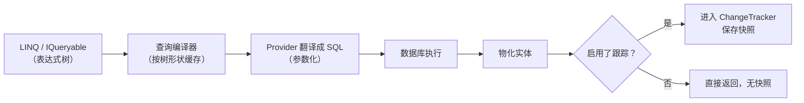
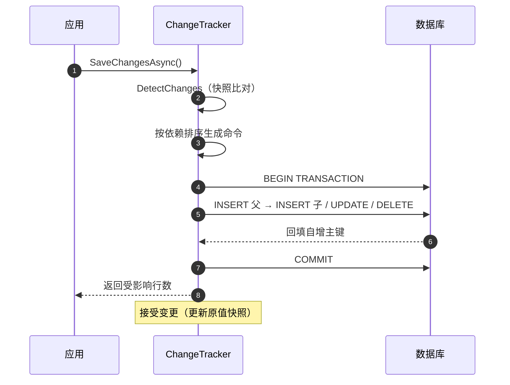
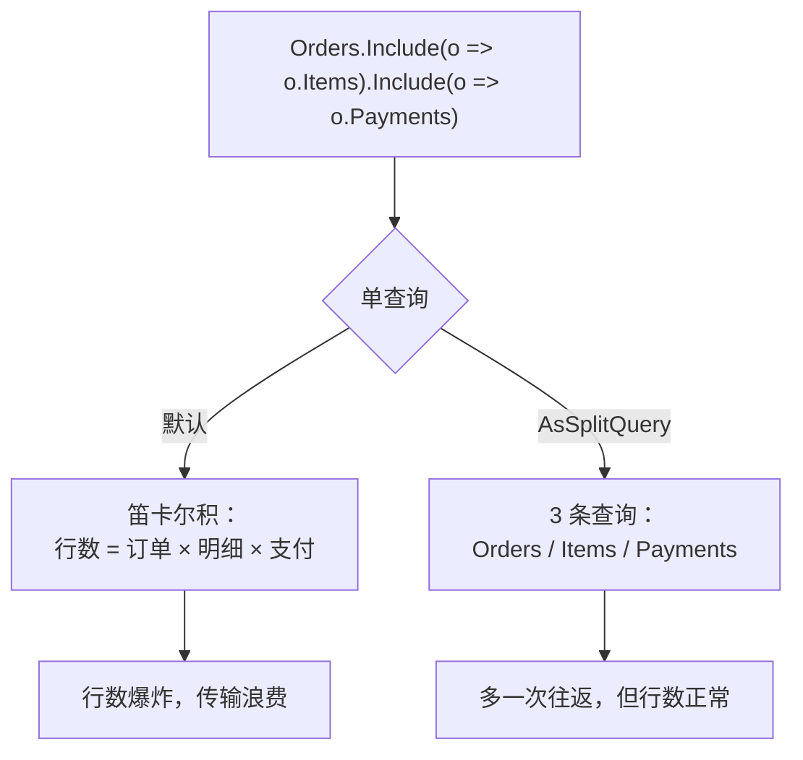
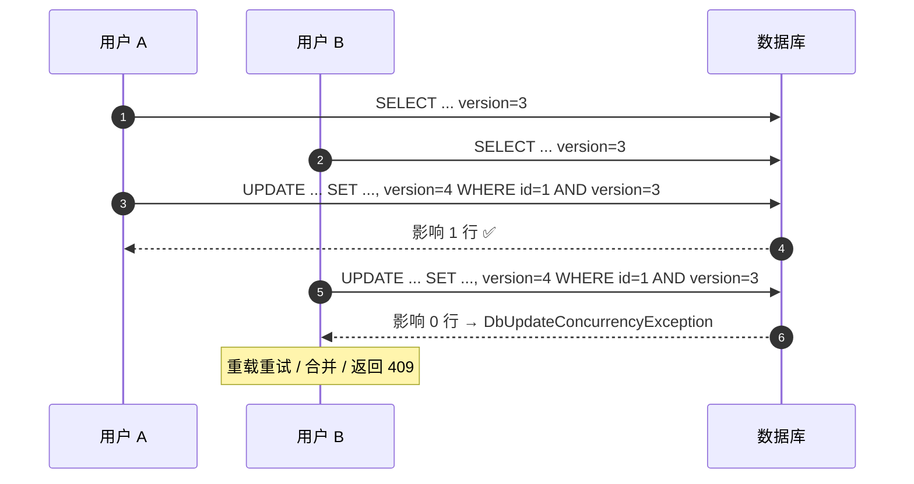

# EF Core 经典面试题（含要点与追问）

> 面向 .NET 后端：**DbContext 生命周期 → 建模映射 → 查询翻译 → 写入事务 → 迁移与诊断**。
> 重点在"为什么慢/为什么错"，而不是 API 罗列；代码按 EF Core 7/8 写。

## 目录

- [一、DbContext 与生命周期](#一dbcontext-与生命周期)
- [二、建模与映射](#二建模与映射)
- [三、查询](#三查询)
- [四、写入与事务](#四写入与事务)
- [自测清单](#自测清单)
- [附录 A：15 分钟背诵卡](#附录-a15-分钟背诵卡)
- [附录 B：模拟面试 20 题（含追问链）](#附录-b模拟面试-20-题含追问链)
- [附录 C：口述版——3 分钟讲清 EF Core 的取舍](#附录-c口述版3-分钟讲清-ef-core-的取舍)
- [附录 D：关键图示](#附录-d关键图示)

---

## 一、DbContext 与生命周期

### 1. EF Core 是什么？和 Dapper、ADO.NET 怎么选？

| | ADO.NET | Dapper | EF Core |
| --- | --- | --- | --- |
| 抽象层次 | SQL + 连接 | SQL + 对象映射 | **LINQ → SQL + 变更跟踪 + 迁移** |
| 控制力 | 最强 | 强 | 中（复杂 SQL 要退让） |
| 开发效率 | 低 | 中 | 高（CRUD、关系、并发） |
| 适合 | 极致性能/批量 | 读多写少、SQL 明确 | 领域模型复杂、要演进 schema |

> 追问：EF Core 一定比 Dapper 慢吗？—— 不一定。简单查询差距不大（几微秒级）；差距主要在**跟踪开销**和**生成的 SQL 不够优**，关掉跟踪 + 投影后差距明显缩小。

---

### 2. `DbContext` 的生命周期？线程安全吗？

- 默认注册为 **Scoped**（HTTP 请求一个实例）。
- **不是线程安全的**：同一实例不能并行执行查询/保存（`A second operation was started on this context...`）。
- 内部维护**变更跟踪器**（Identity Map），长期存活会累积实体 → 内存膨胀 + 脏数据。

> 追问：后台任务怎么用？—— 用 `IDbContextFactory<T>` 每次 `CreateDbContext()` 新建并按 `using` 释放，绝不要捕获 HTTP 请求作用域的实例。

---

### 3. `AddDbContextPool` 有什么用？有什么坑？

池化 `DbContext` 实例，省掉每次请求的初始化开销（模型缓存、服务解析）。

**三个坑**：

1. 构造函数不能注入 **Scoped** 服务（否则等于把 Scoped 提升为单例）。
2. `OnConfiguring` 不能放请求相关逻辑（如按租户切连接串）。
3. 池化实例在归还时**不会清空变更跟踪**（EF 会重置，但你不能依赖任何实例状态）。

> 追问：什么时候不池化？—— 需要按请求定制选项（多租户切库、动态连接串）时，用普通注册 + `IDbContextFactory`。

---

### 4. 什么是工作单元（UoW）？`SaveChanges` 是原子的吗？

`DbContext` 本身就是 UoW：**跟踪变更 → 一次 `SaveChanges` 提交**。

`SaveChanges` 默认在**一个数据库事务**里执行所有生成的命令（同库），所以是原子的；跨库/跨服务就不是了。

> 追问：多次 `SaveChanges` 会怎样？—— 每次一个事务，中途失败前面的已提交；需要整体原子就用显式事务包起来。

---

### 5. 变更跟踪是怎么实现的？为什么有时"改了没保存"？

两种机制：

- **快照（默认）**：加载时保存原值快照，`SaveChanges` 时 `DetectChanges()` 逐字段比对。
- **代理变更通知**：`ChangeTracker.UseChangeTrackingProxies()`，属性 setter 触发通知（需要 virtual 导航/属性）。

"改了没保存"的常见原因：

1. 用了 `AsNoTracking()` 查询 → 实体未被跟踪。
2. 查出来的是匿名对象/DTO 投影。
3. 手动 `Detach` 或实体在另一个上下文里。

> 追问：为什么大批量加载后 `SaveChanges` 变慢？—— `DetectChanges` 是 O(实体数 × 属性数)，几万个实体就会明显卡顿；批量场景用 `ExecuteUpdate`。

---

## 二、建模与映射

### 6. Code First、Database First、迁移的关系？

- **Code First**：写实体 → 生成/更新数据库（EF Core 主流方式）。
- **Database First**：从现有库反向生成实体（`dotnet ef dbcontext scaffold`）。
- **迁移（Migrations）**：Code First 的 schema 版本管理，把模型差异变成可执行的 SQL。

> 追问：能混用吗？—— 可以但不建议：手工改库后要补迁移，否则模型和库会漂移（`PendingModelChangesWarning`）。

---

### 7. Data Annotations、Fluent API、`IEntityTypeConfiguration` 怎么选？

| 方式 | 位置 | 适用 |
| --- | --- | --- |
| Data Annotations | 实体属性上 `[MaxLength]` `[Required]` | 简单的、与领域无关的约束 |
| Fluent API | `OnModelCreating` | 复杂映射、关系、索引、精度 |
| `IEntityTypeConfiguration<T>` | 独立配置类 | **推荐**：按实体拆文件，`ApplyConfigurationsFromAssembly` 批量注册 |

> 追问：为什么领域实体上少用注解？—— 会把持久化关注点渗进领域模型；Fluent API 放在基础设施层更干净。

---

### 8. 主键与自增怎么配？`ValueGeneratedOnAdd` vs `Never`？

- 约定：`Id` / `XxxId` 自动识别为主键；整型主键默认**自增**。
- `ValueGeneratedOnAdd()`：由数据库生成（自增/GUID 默认值）。
- `ValueGeneratedNever()`：**由应用赋值**（如雪花 ID、业务主键）。

```csharp
// 本仓库：商品详情主键由应用生成，不让数据库自增
modelBuilder.Entity<T1InventoryProductDetail>()
    .Property(e => e.Id).ValueGeneratedNever();
```

> 追问：什么时候必须 `Never`？—— 用分布式 ID（雪花/UUID）做主键时；否则 EF 会以为该值由库生成，插入后拿不到真实值。

---

### 9. 一对多、一对一、多对多怎么映射？级联删除默认是什么？

```csharp
// 一对多
modelBuilder.Entity<Order>()
    .HasMany(o => o.Items)
    .WithOne(i => i.Order)
    .HasForeignKey(i => i.OrderId)
    .OnDelete(DeleteBehavior.Cascade);

// 一对一（外键必须唯一）
modelBuilder.Entity<User>()
    .HasOne(u => u.Profile)
    .WithOne(p => p.User)
    .HasForeignKey<UserProfile>(p => p.UserId);

// 多对多（EF Core 5+ 可省略连接实体）
modelBuilder.Entity<Student>()
    .HasMany(s => s.Courses)
    .WithMany(c => c.Students);
```

**级联默认**：必需关系 → `Cascade`；可选关系 → `ClientSetNull`（EF Core 2.0+）。

> 追问：级联删除的风险？—— 一条 `DELETE` 可能连带删掉大量数据，且发生在数据库端（不走 EF 的事件/审计）；生产建议 `Restrict` + 应用层显式删。

---

### 10. Owned Type 和 Complex Type 有什么区别？

| | Owned Entity | Complex Type（EF 8） |
| --- | --- | --- |
| 是否独立跟踪 | 是（属于所有者） | **否**（值语义，内联） |
| 能否为 null | 可以 | 不可以（EF 8 限制） |
| 能否做集合 | 可以（`OwnsMany`） | 不可以 |
| 适合 | 需要表拆分/集合 | 纯值对象（地址、金额） |

```csharp
modelBuilder.Entity<Order>().OwnsOne(o => o.ShippingAddress);
```

> 追问：Owned 类型的坑？—— 每个属性的列名默认是 `ShippingAddress_Street` 这种前缀；且 **Owned 类型不能共享实例**（同一实例赋值给两个所有者会报错）。

---

### 11. 继承映射 TPH / TPT / TPC 怎么选？

| 策略 | 表结构 | 优点 | 缺点 |
| --- | --- | --- | --- |
| **TPH**（默认） | 一张表 + Discriminator | 查询快（无 JOIN） | 子类字段必须可空，表变宽 |
| TPT | 每类一张表 | 规范化、无冗余列 | 查询多表 JOIN，写入分散 |
| TPC（EF 7） | 每个具体类一张表（含公共列） | 无 JOIN、无空列 | 公共列重复，跨类型查询要 UNION |

> 追问：默认为什么是 TPH？—— 单表查询最快，且大部分继承层级字段少、区分度低；字段差异大时才考虑 TPT/TPC。

---

### 12. 值转换器（ValueConverter）能解决什么？

把 CLR 类型映射到数据库能存的类型：

```csharp
// 强类型 ID
modelBuilder.Entity<Order>()
    .Property(o => o.Id)
    .HasConversion(id => id.Value, v => new OrderId(v));

// 枚举存字符串（可读性优先）
modelBuilder.Entity<Order>()
    .Property(o => o.Status)
    .HasConversion<string>()
    .HasMaxLength(32);

// 字符串数组 → JSON
modelBuilder.Entity<Post>()
    .Property(p => p.Tags)
    .HasConversion(
        v => JsonSerializer.Serialize(v, (JsonSerializerOptions?)null),
        v => JsonSerializer.Deserialize<string[]>(v, (JsonSerializerOptions?)null)!);
```

> 追问：值转换器的坑？—— 转换后的列**无法用 LINQ 做原有语义的查询**（比如枚举存字符串后 `==` 可用，但数组 JSON 无法用 `Contains` 走索引）；且需要配 `ValueComparer` 才能正确判断变更。

---

### 13. 全局查询过滤器能做什么？

```csharp
// 软删除
modelBuilder.Entity<Order>().HasQueryFilter(o => !o.IsDeleted);

// 多租户（通过 DbContext 注入的 TenantId）
modelBuilder.Entity<Order>().HasQueryFilter(o => o.TenantId == _tenantId);
```

> 追问：怎么临时绕过？—— `IgnoreQueryFilters()`；注意它会**同时**忽略所有过滤器（软删除 + 多租户），生产上要谨慎。
> 追问：导航属性会自动带过滤吗？—— 会，EF Core 对导航也会应用过滤器（可能有警告提示）。

---

### 14. 乐观并发怎么配？冲突了怎么办？

```csharp
// 方式一：rowversion（SQL Server 的 timestamp）
modelBuilder.Entity<Order>().Property(o => o.RowVersion).IsRowVersion();

// 方式二：普通列做并发令牌（本仓库的做法）
modelBuilder.Entity<T1UserAccount>()
    .Property(e => e.version).IsConcurrencyToken();
```

`SaveChanges` 时 SQL 会变成 `UPDATE ... WHERE Id = @id AND version = @oldVersion`，影响行数为 0 → 抛 `DbUpdateConcurrencyException`。

三种处理：

1. **重载重试**：`entry.Reload()` 后按业务重试（限次数 + 退避）。
2. **合并**：读数据库当前值，按业务规则决定保留谁。
3. **提示用户**：冲突不可自动合并（如库存）时返回 409。

> 追问：并发令牌用 `byte[]` 还是 `int/long`？—— 都可以；`rowversion` 由数据库维护最省心，`int` 版本号需要应用自增（或触发器），但跨库可移植。

---

## 三、查询

### 15. 一条 LINQ 查询是怎么变成 SQL 的？

```text
IQueryable<T>（表达式树）
  → 查询编译器（缓存查询计划）
  → 关系型 provider 翻译成 SQL（含参数化）
  → 执行并物化（materialization）
  → 变更跟踪（若启用）
```

关键：**`IQueryable` 持有表达式树，`IEnumerable` 只是委托**；一旦 `ToList()`，后续操作全在内存。

> 追问：查询计划会缓存吗？—— 会（按表达式树形状缓存）；所以**避免用拼接的常量**，用参数（`EF.Parameter()` 或捕获变量）复用计划。

---

### 16. `AsNoTracking` 什么时候用、什么时候不能用？

- **用**：只读查询、报表、列表页。
- **不能用**：要改并保存、需要**标识解析**（同一实体在多处出现必须是同一实例）。

```csharp
// EF Core 5+
var orders = await db.Orders
    .AsNoTrackingWithIdentityResolution()   // 不跟踪但保证同实例
    .Include(o => o.Items)
    .ToListAsync();
```

> 追问：为什么 `Include` 时容易出问题？—— 关闭跟踪后，同一行被多条路径加载会变成**多个对象**；有循环引用时会指数膨胀，所以需要 identity resolution 或 `AsSplitQuery`。

---

### 17. N+1 是怎么产生的？怎么治？

```csharp
// 反例：先查订单列表，再逐条查客户 → 1 + N 次
var orders = await db.Orders.ToListAsync();
foreach (var o in orders) Console.WriteLine(o.Customer.Name);   // 懒加载或再次查询
```

治疗：

1. **`Include` / `ThenInclude`** 预加载（注意笛卡尔积）。
2. **投影 DTO**（最推荐）：一次查出所有需要的列。
3. **`AsSplitQuery`**：拆成多条查询避免行数爆炸。

> 追问：怎么发现 N+1？—— 开 `LogTo` 看 SQL 条数、用拦截器计数、或 MiniProfiler；**条数与返回行数同阶增长**就是 N+1。

---

### 18. `AsSplitQuery` 解决什么？代价是什么？

`Include` 多个集合时，SQL 会产生**笛卡尔积**（A×B 行）。`AsSplitQuery` 拆成多条查询，各自只 JOIN 一层。

- 好处：避免行数爆炸、减少重复传输。
- 代价：**多条往返**，且**无跨查询的一致性快照**（除非显式事务）。

> 追问：什么时候用？—— 多个集合导航 + 数据量大时；单集合或小数据量用单查询更快。

---

### 19. 分页怎么写？深分页怎么优化？

```csharp
// 普通分页
var page = await db.Orders.OrderBy(o => o.Id).Skip(20 * (n - 1)).Take(20).ToListAsync();

// 深分页优化：keyset（游标）
var page = await db.Orders
    .Where(o => o.Id > lastId)
    .OrderBy(o => o.Id)
    .Take(20)
    .ToListAsync();
```

> 追问：`Skip` 为什么慢？—— 数据库要**扫描并丢弃**前 N 行；keyset 分页直接走索引区间。

---

### 20. 延迟加载（Lazy Loading）为什么危险？

开启后（`UseLazyLoadingProxies`），访问导航属性会**偷偷发 SQL**：循环里访问就是 N+1，序列化时甚至会触发整棵树加载。

> 追问：怎么防？—— 保持关闭（默认），用显式 `Include` 或投影；API 层用 DTO 而不是直接序列化实体。

---

### 21. 原生 SQL 怎么用？怎么防注入？

```csharp
// 查询（返回实体）
var orders = await db.Orders
    .FromSql($"SELECT * FROM t_order WHERE status = {status}")
    .ToListAsync();

// EF Core 7+：任意类型查询
var rows = await db.Database
    .SqlQuery<OrderStat>($"SELECT status, COUNT(*) AS Total FROM t_order GROUP BY status")
    .ToListAsync();

// 非查询（7.0+ 推荐 ExecuteUpdate/ExecuteDelete 替代）
await db.Database.ExecuteSqlAsync($"UPDATE t_order SET status = 1 WHERE id = {id}");
```

**插值字符串会被转成参数**（`FormattableString` 重载），所以 `$"... {value}"` 是安全的；**拼接字符串不安全**（`FromSqlRaw` + 字符串连接 = 注入）。

> 追问：`FromSql` 能和 LINQ 组合吗？—— 能（`Where`/`OrderBy` 会包成子查询），但组合后**无法使用未映射的列**。

---

### 22. 高频查询怎么优化？

| 手段 | 收益 |
| --- | --- |
| `AsNoTracking` + 投影 DTO | 去掉跟踪与整行物化 |
| 编译查询 `EF.CompileQuery` | 省掉每次的查询编译（表达式树 → SQL） |
| 二级缓存（社区库/`HybridCache`） | 跨请求免查库 |
| 只查需要的列（`Select`） | 减少 IO 与反序列化 |
| 合理的索引（见下） | 消除全表扫 |
| `AsSplitQuery` / `ExecuteUpdate` | 避免笛卡尔积、避免加载全部实体 |

```csharp
private static readonly Func<AppDb, int, Task<Order?>> _byId =
    EF.CompileAsyncQuery((AppDb db, int id) => db.Orders.FirstOrDefault(o => o.Id == id));
```

> 追问：EF Core 8 有新东西吗？—— 有：`ExecuteUpdate/Delete` 增强、复杂类型、原始 SQL 查询未映射类型、`Primitive collections`。

---

### 23. 怎么看到 EF 生成的 SQL？

```csharp
optionsBuilder
    .LogTo(Console.WriteLine, LogLevel.Information)
    .EnableSensitiveDataLogging()      // 仅开发环境：会打印参数值
    .EnableDetailedErrors();

// 单条查询
var sql = db.Orders.Where(o => o.Id == 1).ToQueryString();
```

> 追问：`EnableSensitiveDataLogging` 能上生产吗？—— 不能，会把参数值（手机号、身份证）写进日志，属于数据泄露。

---

## 四、写入与事务

### 24. `SaveChanges` 内部做了什么？

```text
① DetectChanges（对比快照）
② 按依赖排序生成命令（插入父→子、删除子→父）
③ 批量执行（默认单条；可配 MaxBatchSize）
④ 回填自增主键/默认值
⑤ 提交事务（默认自动）
⑥ 接受变更（原值快照更新）
```

> 追问：批量插入一万条为什么慢？—— 每条一条 INSERT + 往返；用 `AddRange` + `MaxBatchSize`（SQL Server 有效，MySQL 有限）或 `EFCore.BulkExtensions` / `ExecuteUpdate`。

---

### 25. `ExecuteUpdate` / `ExecuteDelete`（EF 7）和 `SaveChanges` 有什么区别？

```csharp
await db.Orders.Where(o => o.Status == OrderStatus.Expired)
    .ExecuteUpdateAsync(s => s
        .SetProperty(o => o.Status, OrderStatus.Closed)
        .SetProperty(o => o.UpdatedAt, DateTime.UtcNow));

await db.Orders.Where(o => o.IsDeleted).ExecuteDeleteAsync();
```

- **直接发一条 SQL**，不加载实体、不走跟踪、不触发拦截器/审计。
- 适合批量操作；代价是**变更跟踪器里的旧数据会过期**（需要手动清理或重新加载）。

> 追问：`ExecuteDelete` 会触发数据库级联吗？—— 会（数据库外键约束生效），但 EF 的客户端级联不会。

---

### 26. 事务怎么用？保存点（Savepoint）呢？

```csharp
await using var tx = await db.Database.BeginTransactionAsync();
try
{
    // ... 多个 SaveChanges
    await tx.CommitAsync();
}
catch
{
    await tx.RollbackAsync();
    throw;
}

// 保存点：部分回滚
var sp = await db.Database.BeginTransactionAsync();
await db.Database.CreateSavepointAsync("afterOrder");
// ... 失败时
await db.Database.RollbackToSavepointAsync("afterOrder");
```

> 追问：`TransactionScope` 还用吗？—— 同库单上下文不需要（EF 自动事务）；跨库/跨资源才用，但分布式事务代价高，优先消息表 + 最终一致。

---

### 27. 拦截器（Interceptor）能做什么？

| 拦截器 | 用途 |
| --- | --- |
| `SaveChangesInterceptor` | 审计字段（CreatedAt/UpdatedAt/By）、软删除、领域事件收集 |
| `DbCommandInterceptor` | 记录/改写 SQL、慢查询告警 |
| `DbConnectionInterceptor` | 连接打开失败重试 |

```csharp
public sealed class AuditInterceptor : SaveChangesInterceptor
{
    public override ValueTask<InterceptionResult<int>> SavingChangesAsync(
        DbContextEventData e, InterceptionResult<int> result, CancellationToken ct = default)
    {
        foreach (var entry in e.Context!.ChangeTracker.Entries<IAuditable>())
        {
            if (entry.State == EntityState.Added)
                entry.Entity.CreatedAt = DateTime.UtcNow;
            if (entry.State is EntityState.Added or EntityState.Modified)
                entry.Entity.UpdatedAt = DateTime.UtcNow;
        }
        return base.SavingChangesAsync(e, result, ct);
    }
}
```

> 追问：拦截器和 `SaveChanges` 重写怎么选？—— 拦截器可注入依赖（当前用户、时钟），继承只适合极简场景；ABP 这类框架两种都用。

---

### 28. 迁移在生产环境怎么执行？

| 方式 | 评价 |
| --- | --- |
| 应用启动时 `Migrate()` | **不推荐**：多实例并发、失败导致服务起不来、DDL 锁表 |
| `dotnet ef migrations script --idempotent` | 生成幂等 SQL，由 DBA/流水线执行 ✅ |
| `dotnet ef migrations bundle` | 生成自包含可执行文件，适合 CI/CD ✅ |
| EF Core 9 的 migration bundle + `--connection` | 同上，参数化连接 |

**团队协作冲突**：多人同时 `Add-Migration` 会生成多个 `Migration` 文件，模型快照（`ModelSnapshot`）会打架 —— 解决方式是合并后重新生成一个迁移，或协调好顺序。

> 追问：生产 DDL 大表加列会锁表吗？—— MySQL 8 加末尾列是 INSTANT；改类型/加索引仍可能重建表，要用 online DDL 或 gh-ost。

---

### 29. 常见坑清单

1. **同实例并行查询** → `A second operation was started...`；用 `IDbContextFactory`。
2. **`AsNoTracking` 后又改实体** → 改了不保存。
3. **`Include` 多层集合** → 笛卡尔积，忘记 `AsSplitQuery`。
4. **`Skip/Take` 前没 `OrderBy`** → 分页结果不稳定。
5. **字符串拼接原生 SQL** → 注入。
6. **`ValueGeneratedNever` 没配** → 分布式 ID 插入后拿不到主键。
7. **多对多/级联删除** → 误删数据。
8. **全局过滤器 `IgnoreQueryFilters`** → 顺手把租户隔离也绕过了。
9. **`EnableSensitiveDataLogging` 上生产** → 敏感数据进日志。
10. **迁移在启动时执行** → 多实例并发冲突。

---

### 30. 本仓库的 EF Core 实践（可当项目案例）

| 实践 | 位置 |
| --- | --- |
| `AbpDbContext<T>` + 事件 outbox/inbox（`IHasEventOutbox` / `IHasEventInbox`） | `t1_frame/src/core/t1_frame.entityframeworkcore.abp/T1FrameAbpDbContext.cs` |
| 金额精度：`HasPrecision(18,4)` / `(18,2)` | 同上（`T1UserAccount.amount`、`T1InventoryOrder.unit_price`） |
| 业务唯一索引：`biz_no` / `order_no` 唯一 | 同上（幂等 + 防重） |
| **乐观锁**：`version` 配 `IsConcurrencyToken()` | 同上（`T1UserAccount.version`） |
| 应用生成主键：`ValueGeneratedNever()` | 同上（`T1InventoryProductDetail.Id`） |
| 设计时工厂：硬编码连接串 + `UseMySql(..., MySqlServerVersion(8,0,27))` | `.../t1_frame.entityframeworkcore.migrations/MytestContextFactory.cs` |
| 迁移项目独立 | `t1_frame/src/core/t1_frame.entityframeworkcore.migrations` |

> 追问：为什么迁移要独立项目 + 设计时工厂？—— 迁移需要能**在不启动 Web 主机**的情况下构造 `DbContext`；`IDesignTimeDbContextFactory<T>` 就是给 `dotnet ef` 用的入口。

---

## 自测清单

- [ ] EF Core / Dapper / ADO.NET 的选型
- [ ] `DbContext` 生命周期与非线程安全
- [ ] `AddDbContextPool` 的三个坑
- [ ] `SaveChanges` 是否原子、多上下文怎么办
- [ ] 变更跟踪两种机制、"改了没保存"的原因
- [ ] 三种配置方式与为什么少用注解
- [ ] `ValueGeneratedOnAdd` vs `Never`
- [ ] 级联删除默认行为与风险
- [ ] Owned Type 与 Complex Type 的区别
- [ ] TPH / TPT / TPC 的取舍
- [ ] 值转换器的用途与限制
- [ ] 全局查询过滤器与 `IgnoreQueryFilters` 的陷阱
- [ ] 并发令牌 + `DbUpdateConcurrencyException` 三种处理
- [ ] LINQ → SQL 的链路与查询计划缓存
- [ ] `AsNoTracking` 与 IdentityResolution
- [ ] N+1 的三种解法
- [ ] `AsSplitQuery` 解决什么、代价是什么
- [ ] 深分页 keyset
- [ ] 延迟加载为什么危险
- [ ] `FromSql` 插值与 SQL 注入
- [ ] `ExecuteUpdate/Delete` 与跟踪脱节
- [ ] 显式事务与 Savepoint
- [ ] 拦截器做审计字段
- [ ] 生产迁移的正确姿势（脚本/bundle）

---

# 附录 A：15 分钟背诵卡

1. `DbContext` 是 **Scoped + 非线程安全**；后台任务用 `IDbContextFactory`。
2. 池化省初始化，但构造函数不能注入 Scoped、不能放请求相关配置。
3. `SaveChanges` 默认在一个事务里 → 同库原子；多次调用则多次提交。
4. 默认**快照式**变更跟踪，`DetectChanges` 成本是 O(实体×属性)。
5. 三种配置方式首选 `IEntityTypeConfiguration` + 程序集批量注册。
6. `ValueGeneratedOnAdd` 交给库，`ValueGeneratedNever` 由应用赋值（雪花/UUID）。
7. 级联删除默认：必需关系 `Cascade`，可选 `ClientSetNull`；生产多用 `Restrict`。
8. Owned 会独立跟踪、可做集合；Complex Type（EF 8）是值语义、不能为 null。
9. 默认继承映射是 **TPH**（单表 + Discriminator），查询最快。
10. 值转换器解决类型不匹配，但转换后**无法按原语义查询**，还要配 `ValueComparer`。
11. 全局过滤器做软删除/多租户；`IgnoreQueryFilters` 会**一起绕过**所有过滤器。
12. 并发令牌改 SQL 为 `WHERE version = @old`，0 行受影响就抛 `DbUpdateConcurrencyException`。
13. `IQueryable` 是表达式树，`ToList()` 之后全在内存。
14. `AsNoTracking` 只读用；需要同实例时用 `AsNoTrackingWithIdentityResolution`。
15. N+1 三解法：`Include`、投影 DTO、`AsSplitQuery`。
16. 多个集合 `Include` 会笛卡尔积，用 `AsSplitQuery` 拆查询（代价是多次往返）。
17. 深分页用 keyset（`Where(Id > lastId)`），别用大 `Skip`。
18. 延迟加载默认关，开了会在循环/序列化时偷偷发 SQL。
19. `FromSql` 的插值会自动参数化；字符串拼接用 `FromSqlRaw` 才有注入风险。
20. `ExecuteUpdate/Delete`（EF 7）直接发 SQL，不跟踪、不触发拦截器。
21. 同库不需要 `TransactionScope`，显式事务 + Savepoint 足够。
22. 审计字段用 `SaveChangesInterceptor`，可注入当前用户与时钟。
23. 生产迁移用幂等脚本或 bundle，**别在启动时 `Migrate()`**。
24. 查询计划按表达式树形状缓存 → 用参数不要拼常量。
25. 看见 `A second operation was started` 就是并行用了同一个 `DbContext`。

> 记忆锚点：**生命周期 → 映射 → 查询翻译 → 写入事务 → 迁移**。

---

# 附录 B：模拟面试 20 题（含追问链）

### 1. EF Core 和 Dapper 怎么选？

**开口**：领域模型复杂、要 schema 演进用 EF Core；读多写少、SQL 要精确控制用 Dapper。
**追问**：EF 一定慢吗？→ 简单查询差距很小，差距来自跟踪和 SQL 质量，关跟踪 + 投影后就缩了。

### 2. `DbContext` 能单例吗？

**开口**：不能，非线程安全，而且变更跟踪器会无限累积实体。
**追问**：后台服务怎么用？→ `IDbContextFactory` 每次新建，using 释放。

### 3. `AddDbContextPool` 有什么限制？

**开口**：构造函数不能注入 Scoped，不能按请求切连接串，也不能依赖实例状态。
**追问**：为什么？→ 池化实例跨请求复用，Scoped 依赖会被提升成单例。

### 4. `SaveChanges` 是原子的吗？

**开口**：单次调用在同库是一个事务，所以原子；多次调用就是多个事务。
**追问**：要整体原子怎么办？→ 显式 `BeginTransaction` 包起来。

### 5. 为什么改了实体没保存？

**开口**：多半是 `AsNoTracking` 查出来的，或者投影成了 DTO，实体根本没被跟踪。
**追问**：怎么排查？→ 看 `ChangeTracker.Entries()` 里有没有这个实体、状态是不是 Modified。

### 6. 变更跟踪的原理？

**开口**：默认快照式，加载时存原值，`SaveChanges` 时逐字段比对生成 UPDATE。
**追问**：大批量时为什么慢？→ `DetectChanges` 是 O(实体×属性)，几万实体很明显。

### 7. 主键什么时候用 `ValueGeneratedNever`？

**开口**：主键由应用生成时（雪花 ID、业务主键），否则 EF 会以为库会生成，插入后拿不到值。
**追问**：自增主键有什么问题？→ 分库分表下需要步长/号段，分布式场景一般改用雪花。

### 8. 级联删除默认是什么？

**开口**：必需关系 Cascade、可选关系 ClientSetNull。
**追问**：生产建议？→ 显式 `Restrict` 或在应用层删，避免一条 DELETE 带走大量数据。

### 9. Owned 类型和 Complex Type 怎么选？

**开口**：需要独立跟踪或集合用 Owned；纯值对象用 EF 8 的 Complex Type。
**追问**：Owned 有什么坑？→ 列名带前缀、实例不能共享、查询默认内联。

### 10. TPH 和 TPT 怎么选？

**开口**：字段差异小用 TPH（无 JOIN）；需要规范化、子类字段差异大用 TPT/TPC。
**追问**：TPH 的代价？→ 子类字段在表里必须可空，表越来越宽。

### 11. 并发冲突怎么处理？

**开口**：配并发令牌（rowversion 或 version），冲突抛异常后重载重试或按业务合并。
**追问**：库存冲突能重试吗？→ 不能盲目重试，要用条件更新或让用户重新选择。

### 12. 怎么发现 N+1？

**开口**：看 SQL 条数是否与行数同阶增长，拦截器计数或日志观察。
**追问**：怎么修？→ Include、投影 DTO、必要时 AsSplitQuery。

### 13. `AsSplitQuery` 解决什么？

**开口**：多个集合 Include 时的笛卡尔积，拆成多条查询避免行数爆炸。
**追问**：代价？→ 多次往返，且跨查询没有一致性快照（除非显式事务）。

### 14. `AsNoTracking` 什么时候不能用？

**开口**：要修改保存时；或者需要同一实体在导航里是同一实例时。
**追问**：后者怎么解决？→ `AsNoTrackingWithIdentityResolution`。

### 15. 深分页为什么慢？

**开口**：`Skip` 要扫描并丢弃前 N 行。
**追问**：怎么改？→ keyset 分页，用上一页最后一条的排序键做条件。

### 16. 延迟加载有什么问题？

**开口**：访问导航就发 SQL，循环里就是 N+1，序列化会加载整棵树。
**追问**：你们开吗？→ 不开，用显式 Include 或投影。

### 17. `ExecuteUpdate` 和 `SaveChanges` 的区别？

**开口**：前者直接发一条 UPDATE，不加载实体、不走跟踪、不触发拦截器。
**追问**：有什么风险？→ 跟踪器里的旧值过期，需要重新加载或小心使用。

### 18. 原生 SQL 怎么防注入？

**开口**：用 `FromSql` 的插值重载（自动参数化），不要拼字符串走 `FromSqlRaw`。
**追问**：能和其他 LINQ 组合吗？→ 能，会被包成子查询，但未映射的列用不了。

### 19. 迁移在生产怎么执行？

**开口**：生成幂等脚本或 bundle，由流水线执行，不要在应用启动时 Migrate。
**追问**：为什么？→ 多实例并发执行、迁移失败服务起不来、DDL 锁表影响可用性。

### 20. EF Core 性能优化你会做哪几件事？

**开口**：先看 SQL（`ToQueryString`/日志），再关跟踪、做投影、补索引、拆笛卡尔积，最后才考虑编译查询和缓存。
**追问**：最常见的性能杀手？→ 跟踪 + N+1 + 缺索引，三者占了绝大多数。

---

# 附录 C：口述版——3 分钟讲清 EF Core 的取舍

> 面试官问「你 EF Core 用得怎么样」时用。约 800 字 ≈ 3 分钟。

### 逐字稿

**【开场 · 15 秒】**
我理解 EF Core 就三件事：**LINQ 翻译成 SQL、变更跟踪、schema 迁移**。它的价值是把 CRUD 和关系映射做掉，代价是**你不能完全控制 SQL**，所以性能问题要会看、会调。

**【生命周期 · 40 秒】**
`DbContext` 是 Scoped 且非线程安全，最常见的线上错误就是「同一个上下文并行查询」。后台任务一定用 `IDbContextFactory` 新建，不要捕获请求作用域的实例。
池化能省初始化开销，但构造函数不能注入 Scoped，也不能按请求切连接串，否则就是把 Scoped 提升成单例。

**【查询 · 50 秒】**
查询这块我只看两件事：生成什么 SQL、有没有跟踪。
看 SQL 用 `ToQueryString` 或日志。性能优化按顺序来：只读查询 `AsNoTracking`，然后投影成 DTO——这两步能砍掉大部分开销；再查 N+1，用 `Include` 或投影；多个集合 Include 会有笛卡尔积，用 `AsSplitQuery`；深分页改成 keyset。
延迟加载我一直关着，因为它会在循环和序列化时偷偷发 SQL。

**【写入与并发 · 45 秒】**
`SaveChanges` 默认是一个事务，同库场景是原子的；多次调用就要自己包显式事务。
批量操作用 EF 7 的 `ExecuteUpdate/ExecuteDelete`，它直接发 SQL，不加载实体也不走跟踪，但要注意跟踪器里的旧值会过期。
并发用乐观锁：配一个并发令牌，SQL 会变成带版本条件的 UPDATE，影响行数为 0 就抛异常，然后按业务选择重载重试、合并还是返回冲突。

**【迁移与收尾 · 30 秒】**
迁移一定不在应用启动时执行——多实例会并发跑、失败会导致服务起不来。正确做法是生成幂等脚本或 bundle，由流水线执行。
一句话总结：**EF Core 的正确用法是"用它的映射，但盯着它生成的 SQL"**——完全放开或完全不管，都会在线上吃亏。

---

### 压缩版

**一句话版（10 秒）**
> EF Core 帮你做映射和跟踪，但你必须盯着它生成的 SQL：关跟踪、做投影、补索引、控制迁移。

**30 秒版**
> `DbContext` 是 Scoped 且非线程安全，后台任务用工厂。查询先看 SQL 再优化：`AsNoTracking`、投影 DTO、Include 或 AsSplitQuery、keyset 分页。写入靠 `SaveChanges` 的隐式事务，批量用 `ExecuteUpdate`。并发用乐观锁版本列。迁移用幂等脚本或 bundle，不在启动时执行。

### 时间分配

| 段落 | 时长 | 只说一件事 |
| --- | --- | --- |
| 开场 | 15s | 三件事 + 一个代价 |
| 生命周期 | 40s | Scoped / 非线程安全 / 池化限制 |
| 查询 | 50s | 看 SQL → 关跟踪 → 投影 → N+1 → 分页 |
| 写入与并发 | 45s | SaveChanges 事务 / 批量 / 乐观锁 |
| 迁移与收尾 | 30s | 脚本或 bundle + 一句话总结 |

### 被打断时怎么接

| 面试官插话 | 接续句 |
| --- | --- |
| 「EF 性能是不是不行？」 | 「慢通常慢在跟踪和 N+1，不是框架本身；关跟踪加投影后差距很小」 |
| 「你们用 Code First 还是 DB First？」 | 「新库 Code First + 迁移，老库先用 scaffold 再接管」 |
| 「并发冲突怎么处理？」 | 「版本列 + 冲突异常，库存这种不能盲目重试，直接返回冲突让用户重选」 |
| 「线上 DDL 怎么做？」 | 「幂等脚本走流水线，大表用 online DDL 或 gh-ost，低峰执行并盯主从延迟」 |

---

# 附录 D：关键图示

### 1. 查询链路



### 2. SaveChanges 流程



### 3. N+1 与 AsSplitQuery



### 4. 乐观锁


