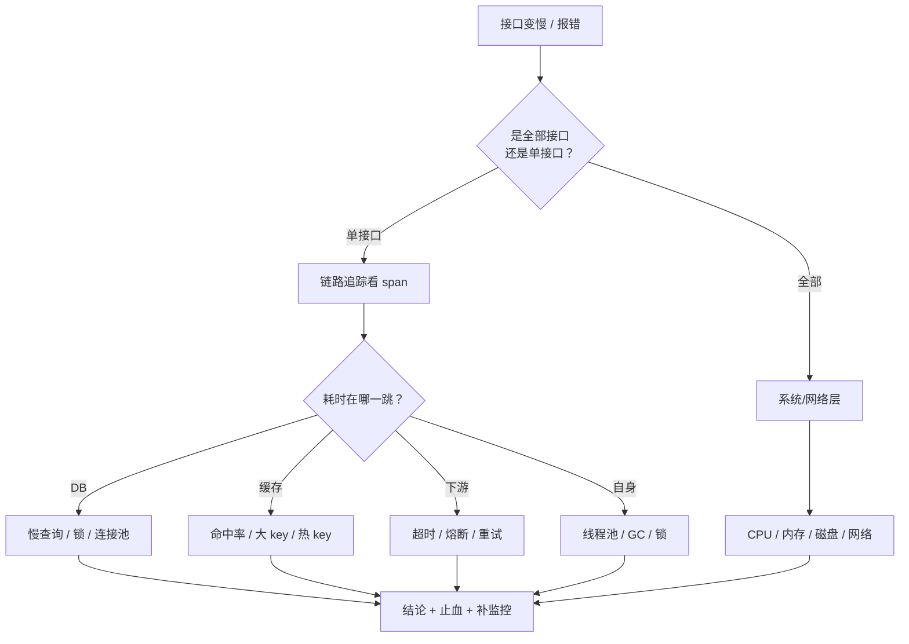
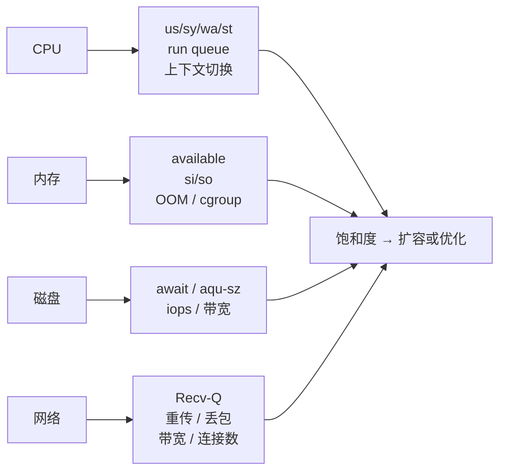
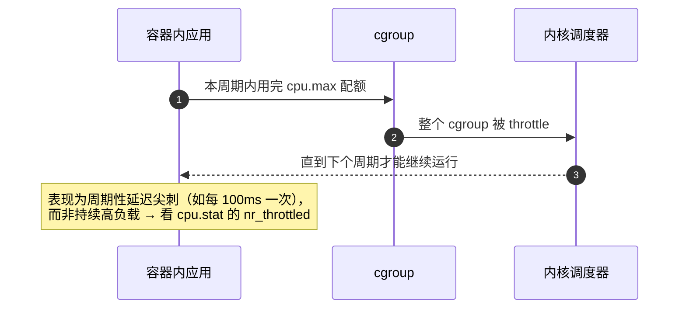

# Linux 性能排查实战（含要点与追问）

> 不是命令手册，而是**排查顺序**：先分层、再看指标、最后落到代码。面试里问「一个接口突然变慢」，考的就是这套路径。
> 每条都给「看什么指标 → 用什么命令 → 怎么下结论」。

## 目录

- [一、方法论](#一方法论)
- [二、CPU](#二cpu)
- [三、内存](#三内存)
- [四、磁盘与文件](#四磁盘与文件)
- [五、网络](#五网络)
- [六、进程与内核](#六进程与内核)
- [七、实战场景](#七实战场景)
- [自测清单](#自测清单)
- [附录 A：15 分钟背诵卡](#附录-a15-分钟背诵卡)
- [附录 B：模拟面试 20 题（含追问链）](#附录-b模拟面试-20-题含追问链)
- [附录 C：口述版——3 分钟讲清一次线上排查](#附录-c口述版3-分钟讲清一次线上排查)
- [附录 D：排查路径图](#附录-d排查路径图)

---

## 一、方法论

### 1. 排查为什么要分层？

因为**症状所在层 ≠ 根因所在层**。接口慢可能出在：客户端网络、LB 队列、应用线程池、GC、下游依赖、磁盘 IO、内核参数。

分层顺序：**业务指标 → 应用（线程/GC/锁）→ 系统资源（CPU/内存/IO/网络）→ 内核参数与硬件**。

> 追问：为什么不从 `top` 开始？—— `top` 只告诉你"哪台机器忙"，告诉不了"哪个请求慢"。**先定位到请求，再定位到机器**，效率高一个数量级。

---

### 2. USE 与 RED 方法？

| 方法 | 维度 | 用途 |
| --- | --- | --- |
| **USE**（资源视角） | Utilization 使用率、Saturation 饱和度、Errors 错误 | 逐资源检查：CPU、内存、磁盘、网络、控制器 |
| **RED**（服务视角） | Rate 请求速率、Errors 错误数、Duration 时延 | 面向微服务/接口，做仪表盘 |

> 追问：两个怎么配合？—— RED 用来**发现哪里不对**（哪个接口、哪个服务），USE 用来**确认是什么资源撑不住**。

---

### 3. 「60 秒排查」都看什么？

```bash
uptime                 # load average（1/5/15 分钟）
dmesg -T | tail -50    # 内核报错、OOM、硬件错误
vmstat 1 5             # r/b（可运行/阻塞）、si/so（swap）、cs（上下文切换）
mpstat -P ALL 1 3      # 每核 CPU 分布，发现单核打满
pidstat 1 5            # 每进程 CPU/内存/IO/切换
iostat -xz 1 3         # 磁盘 %util、await、队列
free -m                # available 而不是 free
sar -n DEV 1 3         # 网络吞吐
top -H -p <pid>        # 线程级热点
```

> 追问：为什么强调 `available`？—— `free` 只算完全空闲的内存，Linux 会尽量用满做缓存（`buff/cache`），看 `free` 会误判"内存不足"。

---

## 二、CPU

### 4. `load average` 到底代表什么？

**不是** CPU 使用率，而是**运行队列长度 + 不可中断睡眠（D 状态）任务数**的指数衰减平均值。

- 单核 load = 1.0 表示刚好跑满。
- **load 高但 CPU 空闲**：几乎一定是 IO 阻塞或锁等待（D 状态）。
- **load 高且 CPU 也高**：真的是算力不够。

> 追问：怎么看有几个核？—— `nproc` 或 `lscpu`；load 要和核数比较，8 核机器 load=8 才是 100%。

---

### 5. CPU 使用率怎么分解？

| 指标 | 含义 | 偏高说明 |
| --- | --- | --- |
| `us` | 用户态 | 业务代码在算（算法、序列化、正则） |
| `sy` | 内核态 | 系统调用多、锁竞争、网络密集 |
| `wa` | IO 等待 | 磁盘慢或 swap |
| `si` / `hi` | 软/硬中断 | 网卡流量大、中断未绑核 |
| `st` | 被虚拟化偷走 | 宿主机超卖（云上常见） |

> 追问：`sy` 高但业务代码没改过？—— 常见于日志暴涨（`write` 系统调用）、连接数暴涨（`epoll_wait` + 上下文切换）、或锁竞争导致的 futex 系统调用。

---

### 6. 上下文切换多少算多？

```bash
vmstat 1        # cs 列：每秒上下文切换次数
pidstat -w 1    # 每进程 cswch（自愿）/ nvcswch（非自愿）
```

- 自愿切换：等 IO、等锁（正常）。
- **非自愿切换**：时间片用完被抢占 → 线程数远超核数，说明**线程开太多**。

> 追问：线程池为什么不能无限大？—— 线程多了非自愿切换变多，cache/TLB 反复失效，吞吐反而下降。

---

### 7. CPU 100% 怎么定位到代码？

```bash
top -H -p <pid>                  # 找最热的 TID
printf '%x\n' <TID>              # 转十六进制
jstack <pid> | grep -A 30 <hex>  # Java
perf top -p <pid>                # 任意语言
perf record -F 99 -p <pid> -g -- sleep 30 && perf report   # 出火焰图
```

常见根因：死循环、正则回溯、频繁 GC、自旋锁、序列化热点、加解密。

> 追问：Java 里 `top` 热线程找不到栈？—— 可能是 GC 线程（`jstat -gcutil` 看）或 JIT 编译线程（C2），这两种在应用栈里看不到。

---

### 8. CPU 亲和性与 NUMA 有什么用？

- **绑核**（`taskset`）：减少迁移、提高 cache 命中；网络中断绑到固定核避免多核争抢。
- **NUMA**：跨节点访问内存延迟高 1.5~2 倍，数据库/网关这类应绑在同一 NUMA 节点。

> 追问：什么时候不该绑？—— 负载不均时绑核会浪费 CPU；先用 `mpstat -P ALL` 确认分布再绑。

---

## 三、内存

### 9. `free` 该怎么读？

```text
              total   used   free   shared  buff/cache   available
Mem:           31Gi   18Gi   1.2Gi   0.3Gi       12Gi        12Gi
Swap:         2.0Gi  0.5Gi   1.5Gi
```

- `buff/cache` 大不是问题，是内核在利用空闲内存。
- **`available` 才是"还能给应用多少"**。
- `Swap used` 有增长趋势 + `si/so` 非零 = 已经在换页，性能会崩。

> 追问：内存不足时内核做什么？—— 先回收 page cache，再回收可回收 slab，最后触发 **OOM Killer** 按 `oom_score` 杀进程。

---

### 10. 怎么判断是内存泄漏还是缓存过大？

| | 内存泄漏 | 缓存过大 |
| --- | --- | --- |
| 曲线 | 只涨不落，重启归零 | 涨到上限后平稳（有淘汰） |
| 手段 | `jmap -histo` / `dotnet-gcdump` / `pmap` 看对象增长 | 看缓存统计的 eviction 次数 |
| 治理 | 修代码（静态引用、未 Dispose） | 设上限、换 LRU、加 TTL |

> 追问：容器里 `free` 显示宿主机内存怎么办？—— 看 cgroup：`cat /sys/fs/cgroup/memory.max`（v2）或 `memory.limit_in_bytes`（v1）。

---

### 11. swap 到底该不该开？

- 开：避免瞬时峰值直接 OOM，代价是**换页导致延迟暴涨**（磁盘比内存慢 5 个数量级）。
- 关：内存不够就直接 OOM，行为可预测。
- 折中：`vm.swappiness=1~10`，只让内核在极端情况下用 swap。

> 追问：Redis 为什么要关 swap？—— 一次换页可能就是几十毫秒，直接破坏"低延迟"的假设。

---

### 12. 内存碎片与 THP？

- `mem_fragmentation_ratio` 高（Redis 视角）说明空闲内存有但**不连续**。
- **THP（透明大页）**：减少 TLB miss，但 `fork + COW` 场景下复制单位变 2MB，Redis 必须关。

```bash
cat /sys/kernel/mm/transparent_hugepage/enabled
echo never > /sys/kernel/mm/transparent_hugepage/enabled
```

> 追问：`vm.overcommit_memory` 三种取值？—— `0` 启发式、`1` 总是允许（Redis 建议）、`2` 严格不超卖。

---

## 四、磁盘与文件

### 13. `iostat` 的指标怎么读？

```bash
iostat -xz 1 3
```

| 指标 | 含义 | 判断 |
| --- | --- | --- |
| `r/s` `w/s` | IOPS | 对比设备上限 |
| `rkB/s` `wkB/s` | 吞吐 | 对比带宽上限 |
| `await` | 平均等待（含排队） | **最重要的单指标**，明显高于平时就是瓶颈 |
| `aqu-sz` | 平均队列长度 | > 1 说明有排队 |
| `%util` | 设备忙碌比例 | 接近 100% = 饱和（SSD 上参考意义下降） |

> 追问：机械盘和 SSD 的差异？—— 机械盘受寻道限制（随机 IOPS 几百），SSD 随机 IOPS 高几个数量级；`%util` 在 NVMe 上可能到 100% 但仍有富余（多队列）。

---

### 14. 磁盘满了但 `du` 找不到？

三种典型：

1. **已删除但被进程持有的文件**：`lsof +L1` 找到，重启进程或 `> /proc/<pid>/fd/<n>` 释放。
2. **inode 耗尽**：`df -i`，小文件（session、日志碎片）太多。
3. **被挂载点遮蔽**：目录下有文件但被另一个挂载覆盖。

> 追问：日志暴涨怎么根治？—— logrotate + 应用限速 + 打点告警（单位时间写入量）；排查时先看 `/var/log` 与应用的日志级别是否被误调成 DEBUG。

---

### 15. 磁盘 IO 高怎么定位到进程和文件？

```bash
iotop -oPa                # 按进程/线程看实际 IO
pidstat -d 1              # 每进程读写速率
perf record -e block:block_rq_issue   # 块设备级追踪
```

常见根因：日志同步写（`fsync` 频繁）、数据库刷盘、大文件扫描、备份任务抢占。

> 追问：`fsync` 为什么会拖慢整体？—— 它会把该文件的所有脏页落盘，且可能引发全局回写；应用层应批量提交而不是每条都 `fsync`。

---

## 五、网络

### 16. 连接数、队列怎么查？

```bash
ss -s                     # 总览：TCP 各状态计数
ss -lnt                   # 监听队列：Recv-Q 是当前 accept 队列积压，Send-Q 是 backlog
ss -tan state established | wc -l
ss -tan state time-wait | wc -l
```

> 追问：`Recv-Q` 持续不为 0 说明什么？—— **应用 `accept()` 太慢**（事件循环被阻塞、线程池满），新连接会排队甚至被丢弃。

---

### 17. 丢包和重传怎么排查？

```bash
netstat -s | grep -Ei 'retrans|drop|overflow'
ss -ti                    # 每连接的重传、rtt、cwnd
tcpdump -i eth0 -nn 'tcp port 8080 and (tcp[tcpflags] & tcp-rst != 0)'
```

排查顺序：**本机队列溢出（overflowed）→ 交换机/防火墙丢包 → 对端处理慢 → 链路质量（重传率高）**。

> 追问：重传率高但 `ping` 正常？—— `ping` 是 ICMP 小包，测不出大包和突发流量的问题；要用 `mtr` 或直接看 `ss -ti` 的 retrans 与 rtt 分布。

---

### 18. 带宽、延迟、连接数，哪个是瓶颈？

三个是不同维度：

- **带宽**：`sar -n DEV 1` 看 `rxkB/s` 是否接近网卡上限。
- **延迟**：`ss -ti` 的 `rtt`、`mtr` 逐跳。
- **连接数**：`ss -s` + `ulimit -n`，以及 conntrack 表（`nf_conntrack_count`）。

> 追问：为什么压测 QPS 上不去但 CPU 不高？—— 常见是**连接数上限**（fd、backlog、conntrack）或**客户端端口耗尽**，不是算力问题。

---

## 六、进程与内核

### 19. 进程状态 R / S / D / Z 分别是什么？

| 状态 | 含义 | 关注点 |
| --- | --- | --- |
| R | 运行/可运行 | 多且 CPU 高 = 算力不足 |
| S | 可中断睡眠 | 正常（等事件） |
| **D** | 不可中断睡眠 | IO 或内核锁等待，**load 高的元凶之一** |
| Z | 僵尸 | 父进程没 `wait()`，少量无害、大量说明父进程有 bug |

> 追问：僵尸进程能 `kill -9` 吗？—— 不能，它已经死了，只能让父进程回收（或杀父进程让 init 收养）。

---

### 20. 文件句柄泄漏怎么发现？

```bash
ls /proc/<pid>/fd | wc -l
lsof -p <pid> | awk '{print $5}' | sort | uniq -c | sort -rn | head
cat /proc/<pid>/limits | grep 'open files'
```

> 追问：句柄泄漏和内存泄漏有关联吗？—— 有，未关闭的连接/流常常同时持有缓冲区；先看 fd 增长曲线最快。

---

### 21. 常用内核参数怎么调？

| 参数 | 作用 | 常见值 |
| --- | --- | --- |
| `net.core.somaxconn` | accept 队列上限 | 4096+ |
| `net.ipv4.tcp_max_syn_backlog` | 半连接队列 | 8192 |
| `net.ipv4.tcp_tw_reuse` | 复用 TIME_WAIT（出站） | 1 |
| `fs.file-max` / `nofile` | 全局/进程 fd 上限 | 百万 / 65535+ |
| `vm.swappiness` | swap 倾向 | 1~10 |
| `vm.overcommit_memory` | 内存超卖策略 | Redis 建议 1 |
| `net.ipv4.tcp_congestion_control` | 拥塞控制 | `bbr`（高延迟链路） |

> 追问：调参有风险吗？—— 有，`tcp_tw_recycle` 在 NAT 下会误杀连接，且已从 4.12 移除；调参前先确认症状，别"一把梭"。

---

## 七、实战场景

### 22. 接口 P99 从 50ms 涨到 500ms，怎么查？

```text
① 看 RED 指标：是全部接口还是单接口？错误率是否同步上升？
② 看链路追踪：哪个 span 变长（DB / 缓存 / 下游 / 自身）
③ 应用层：线程池队列、GC 停顿、锁等待、连接池耗尽
④ 系统层：CPU（us/sy）、内存（si/so）、磁盘（await）、网络（重传/队列）
⑤ 变更关联：最近发布、配置、流量（大促/爬虫）
```

> 追问：平均 RT 正常但 P99 高怎么解释？—— 典型的**长尾**：少量请求卡在 GC、锁、慢查询或重试上；看分布不要只看均值。

---

### 23. 容器环境排查有哪些坑？

| 坑 | 表现 | 正确姿势 |
| --- | --- | --- |
| `free` 看到宿主机 | 误判内存 | 看 cgroup 的 `memory.max` / `memory.current` |
| CPU 被 throttle | RT 周期性抖动 | 看 `cpu.stat` 的 `nr_throttled`，调 `cpu.max` |
| `nproc` 是宿主核数 | 线程池开太大 | 用 cgroup quota 或 `JAVA_OPTS` 显式设定 |
| 容器内 `top` 不全 | 看不到别的容器 | 在宿主机用 `crictl`/`nsenter` 进入命名空间 |

> 追问：`nr_throttled` 高说明什么？—— CPU 配额被用超、被强制限流；每次限流会暂停整个 cgroup，表现为**周期性延迟尖刺**。

---

### 24. 压测结果和生产不一致怎么办？

先对齐四件事：**数据量、缓存命中率、下游延迟、机器规格（含 CPU 配额）**。压测能测出容量上限，但测不出"生产的数据分布"。

> 追问：那压测还有意义吗？—— 有，用于**找瓶颈和回归**（同一环境前后对比），而不是预测绝对 QPS。

---

### 25. 一次完整的排查该怎么记录？

固定模板（复盘时最有用）：

```text
现象：何时、哪个接口、错误率/延迟、影响面
时间线：每分钟的关键动作与观测值
假设 → 验证 → 结论（可证伪）
根因：直接原因 / 根本原因 / 诱发条件
处置：止血（回滚/限流）+ 修复（代码/参数）
后续：监控补齐、演练、SOP
```

> 追问：为什么强调"可证伪"？—— 排查最怕"我觉得是这个"，每个假设都要有指标支撑，否则会绕圈。

---

## 自测清单

- [ ] 排查分层顺序，为什么先看业务指标
- [ ] USE 与 RED 各自的视角
- [ ] 60 秒清单里的 10 个命令各看什么
- [ ] load average 含 D 状态，load 高 CPU 低怎么解释
- [ ] us/sy/wa/si/st 各自偏高的含义
- [ ] 自愿切换 vs 非自愿切换
- [ ] CPU 100% 定位到代码的四步
- [ ] `free` 的 available 与 OOM Killer
- [ ] swap 的取舍，Redis 为什么关
- [ ] 磁盘满但 `du` 找不到的三种情况
- [ ] `await` 与 `%util` 哪个更可信
- [ ] `Recv-Q` 不为 0 说明什么
- [ ] 丢包排查的四个层次
- [ ] 进程 R/S/D/Z 状态
- [ ] 容器里内存和 CPU 为什么要看 cgroup
- [ ] CPU throttling 为什么表现为周期性抖动

---

# 附录 A：15 分钟背诵卡

1. 排查顺序：**业务指标 → 应用 → 系统资源 → 内核/硬件**，别一上来就看 `top`。
2. USE 看资源（使用率/饱和度/错误），RED 看服务（速率/错误/时延）。
3. load average = 可运行 + **不可中断睡眠**，所以 IO 卡住也会高；要和核数比。
4. `available` 才是可用内存；`buff/cache` 大是好事。
5. `si/so` 非零 = 在用 swap，延迟会崩。
6. OOM Killer 按 `oom_score` 杀进程，容器里看 cgroup 限制。
7. `us` 高算力不足、`sy` 高系统调用多、`wa` 高磁盘慢、`si/hi` 高网络中断多、`st` 高被虚拟化偷走。
8. **非自愿切换高 = 线程太多**；自愿切换高 = 等 IO/锁。
9. CPU 100% 定位：`top -H` → 转 16 进制 → `jstack` / `perf top`。
10. 线程切换贵在 cache/TLB 污染，不在寄存器保存。
11. 磁盘看 `await` 和 `aqu-sz`，`%util` 在 NVMe 上参考意义下降。
12. 磁盘满但 `du` 小：已删除仍被持有的文件（`lsof +L1`）、inode 耗尽（`df -i`）、挂载遮蔽。
13. `ss -lnt` 的 `Recv-Q` 是 accept 队列积压 → 应用 accept 太慢。
14. 丢包四层：本机队列溢出 → 网络设备 → 对端处理慢 → 链路重传。
15. 带宽/延迟/连接数是三个维度，QPS 上不去先查 fd、backlog、conntrack。
16. D 状态 = 不可中断睡眠，是 load 高的隐形来源。
17. `somaxconn` 与 `listen(backlog)` 取小值；短连接服务要一起调大。
18. `tcp_tw_recycle` 已移除，NAT 下会误杀，别用。
19. 容器排查看 cgroup（`memory.max`、`cpu.stat` 的 `nr_throttled`），别看 `free` 和 `nproc`。
20. 排查记录要「可证伪」：每个假设都要有指标支撑。

> 记忆锚点：**先分层 → 再看指标 → 最后落到代码**。

---

# 附录 B：模拟面试 20 题（含追问链）

### 1. 服务器很卡，你怎么查？

**开口**：先问症状是"所有请求慢"还是"某个接口慢"，再按 CPU/内存/IO/网络分层看指标。
**追问**：第一步看什么？→ `uptime` + `vmstat 1`，确认是算力、内存还是 IO 问题。

### 2. load average 很高但 CPU 空闲？

**开口**：load 包含 D 状态（不可中断睡眠），说明卡在 IO 或内核锁。
**追问**：怎么确认？→ `vmstat` 的 `b` 列和 `wa`，`ps` 找 D 状态进程，`iostat` 看磁盘。

### 3. CPU 使用率高怎么定位到代码？

**开口**：`top -H` 找热线程 → 转 16 进制 → `jstack` 对栈；非 Java 用 `perf top` 或火焰图。
**追问**：栈里没热点？→ 大概率是 GC 或 JIT 线程，用 `jstat -gcutil` 和 `-XX:+PrintCompilation` 验证。

### 4. `sy` 高说明什么？

**开口**：系统调用或中断密集，常见于网络收发、日志同步写、锁竞争导致的 futex。
**追问**：怎么定位？→ `perf top` 看内核符号，`strace -c` 看系统调用分布。

### 5. 上下文切换多少算异常？

**开口**：没有绝对值，看「非自愿切换占比」；非自愿高就是线程数远超核数。
**追问**：怎么治？→ 调小线程池、改异步、减少锁竞争。

### 6. 内存看起来够用却 OOM 了？

**开口**：可能看的是宿主机内存，或 `available` 已经很低、或容器 cgroup 限制到了。
**追问**：怎么确认？→ `cat /sys/fs/cgroup/memory.max`、`dmesg` 看 OOM 日志里的 `oom_score`。

### 7. 内存泄漏怎么确认？

**开口**：看曲线是否只涨不落；再用 `jmap -histo:live` 或 `dotnet-gcdump` 看对象增长。
**追问**：常见泄漏源？→ 静态集合、未 Dispose、事件未退订、无界缓存、ThreadLocal 未清理。

### 8. swap 该开吗？

**开口**：开可避免瞬时 OOM，但换页会让延迟爆炸；生产一般 `swappiness=1~10`。
**追问**：Redis 为什么必须关？→ 一次换页几十毫秒，直接破坏低延迟假设。

### 9. 磁盘 IO 高怎么定位？

**开口**：`iostat -xz` 看 `await` 和 `aqu-sz`，再 `iotop -oPa` 看进程，必要时 `perf` 追块设备事件。
**追问**：`%util` 100% 一定是瓶颈吗？→ 不一定，多队列 SSD 还能有富余，看 `await` 更准。

### 10. 磁盘满了但 `du` 只找到一点？

**开口**：三种情况——已删除仍被进程持有、inode 耗尽、挂载点遮蔽。
**追问**：第一种怎么释放？→ `lsof +L1` 找到 fd，重启进程或清空 `/proc/<pid>/fd/<n>`。

### 11. `ss -lnt` 的 Recv-Q 不为 0？

**开口**：accept 队列有积压，说明应用 `accept()` 跟不上。
**追问**：根因通常是什么？→ 事件循环被阻塞（同步 IO）、线程池满、backlog 与 `somaxconn` 太小。

### 12. 连接数上不去，卡在哪？

**开口**：查 fd 上限、backlog、conntrack 表、客户端端口耗尽。
**追问**：客户端端口耗尽怎么缓解？→ 连接池复用、多目标 IP、调大 `ip_local_port_range`。

### 13. 丢包怎么排查？

**开口**：先看本机 `netstat -s` 的 overflow/drop，再查交换机/防火墙，最后看对端与链路重传率。
**追问**：`ping` 正常还会有问题吗？→ 会，ICMP 小包测不出大包和突发；看 `ss -ti` 的 retrans 与 rtt。

### 14. 进程 D 状态会一直占 CPU 吗？

**开口**：不占 CPU，但会计入 load，并且该进程无法被 kill -9 直到内核态返回。
**追问**：什么会导致长时间 D？→ NFS/网络存储故障、坏盘、内核 bug、大规模换页。

### 15. 僵尸进程怎么处理？

**开口**：父进程没 `wait()`，杀僵尸没用，要让父进程回收或杀掉父进程。
**追问**：危害大吗？→ 少量无感，大量会耗尽 PID，说明父进程有 bug。

### 16. 句柄泄漏怎么查？

**开口**：`ls /proc/<pid>/fd | wc -l` 看增长，`lsof` 按类型聚合。
**追问**：和内存泄漏的关系？→ 常同时出现，先看 fd 曲线定位最快。

### 17. 容器里 `top` 看到的 CPU 是宿主机的？

**开口**：不是，容器共享宿主机 `/proc`；要看 cgroup 的 `cpu.stat`、`cpu.max`。
**追问**：为什么会有周期性抖动？→ CPU 配额被 throttle（`nr_throttled` 增长），整组被暂停。

### 18. 压测 QPS 上不去怎么办？

**开口**：先确认压测机是不是瓶颈，再看服务端连接数、线程池、下游、DB。
**追问**：服务端 CPU 不高但 QPS 上不去？→ 多半是连接/队列/锁等待，不是算力。

### 19. 一次接口超时，怎么证明不是你的问题？

**开口**：用链路追踪给出 span 分解，指出耗时在下游或网络，并附上自己的线程池与 GC 指标。
**追问**：没有链路追踪呢？→ 临时加耗时日志或用 `tcpdump` 抓一次往返时延。

### 20. 排查完你会补什么？

**开口**：补监控（这次缺的指标）、补告警阈值、补预案（降级/回滚）、把过程写成可复用的 SOP。
**追问**：最常缺的指标是什么？→ **饱和度类**（队列长度、线程池使用率、连接池占用），使用率往往都有，饱和度总是缺。

---

# 附录 C：口述版——3 分钟讲清一次线上排查

> 面试官问「线上出问题你怎么定位」时用。约 800 字 ≈ 3 分钟。

### 逐字稿

**【开场 · 15 秒】**
我排查的固定套路是**先分层、再看指标、最后落到代码**。最忌讳一上来就 `top`，因为那只能告诉你"机器忙"，告诉不了"哪个请求慢"。

**【定位到请求 · 40 秒】**
第一步永远是看业务指标：是全部接口还是单接口？错误率有没有同步上升？然后用链路追踪把一次慢请求拆成 span，看耗时在 DB、缓存、下游还是自身。这一步做完，我通常已经知道该去查哪一层了。
如果只有平均值正常、P99 变高，那就是长尾问题——少量请求卡在 GC、锁、慢查询或重试上。

**【应用层 · 40 秒】**
应用层我先看三样：线程池队列有没有积压、GC 有没有长停顿、连接池有没有被打满。这三样反应最快，而且往往是"下游慢了导致上游线程被占满"的传导结果。
如果是 CPU 高，就 `top -H` 找热线程再对栈；如果是 `sy` 高，就往系统调用和锁竞争上想。

**【系统层 · 45 秒】**
系统层用 USE 方法逐资源看。CPU 看负载和 `us/sy/wa/si/st` 的分解；内存看 `available` 而不是 `free`，再看 `si/so` 有没有在换页；磁盘看 `await` 和队列长度；网络看连接队列（`ss -lnt` 的 `Recv-Q`）、重传率和带宽。
有个容易踩的坑是容器环境：`free` 和 `nproc` 看到的都是宿主机，得看 cgroup；CPU 配额被 throttle 时表现为周期性延迟尖刺，而不是持续高负载。

**【收尾 · 30 秒】**
最后我会把结论写成可证伪的记录：现象、时间线、每个假设的验证数据、根因（直接原因 + 根本原因 + 诱发条件）、止血手段和后续改进。
一句话总结：**性能问题不是猜出来的，是按层量出来的；排查的价值一半在定位，一半在把缺的监控补上**。

---

### 压缩版

**一句话版（10 秒）**
> 先分层定位到请求，再用 USE 逐资源看指标，最后落到代码；容器里记得看 cgroup。

**30 秒版**
> 排查顺序是业务指标、链路追踪、应用（线程池/GC/连接池）、系统资源（CPU/内存/IO/网络）、内核参数。load 高 CPU 低是 IO 或锁；`sy` 高是系统调用多；磁盘看 `await`；网络先看 `Recv-Q` 和重传。容器环境 `free`/`nproc` 不可信，要看 cgroup 和 throttle 计数。

### 时间分配

| 段落 | 时长 | 只说一件事 |
| --- | --- | --- |
| 开场 | 15s | 先分层，别先 `top` |
| 定位到请求 | 40s | RED 指标 + 链路 span + 长尾解释 |
| 应用层 | 40s | 线程池 / GC / 连接池 |
| 系统层 | 45s | USE 四资源 + 容器坑 |
| 收尾 | 30s | 可证伪记录 + 补监控 |

### 被打断时怎么接

| 面试官插话 | 接续句 |
| --- | --- |
| 「load 高但 CPU 低怎么解释？」 | 「load 含 D 状态，多半是 IO 或内核锁，用 `vmstat` 的 `b` 和 `wa` 确认」 |
| 「你怎么知道是下游的锅？」 | 「看 span 分解和错误码，必要时抓一次 tcpdump 看往返时延」 |
| 「容器里你们怎么排查？」 | 「看 cgroup 的 memory.max 和 cpu.stat，重点看 nr_throttled」 |
| 「排查完最重要的一步？」 | 「补饱和度类指标——队列长度和池占用率，这是最常缺的」 |

---

# 附录 D：排查路径图

### 1. 分层排查路径



### 2. USE 逐资源检查



### 3. 容器 CPU throttling


