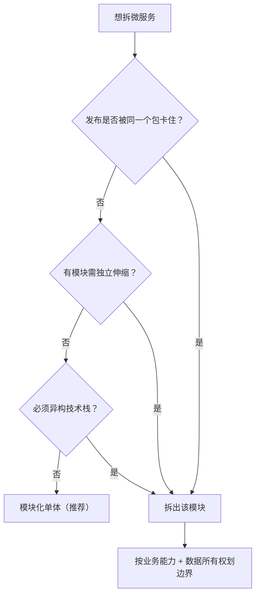
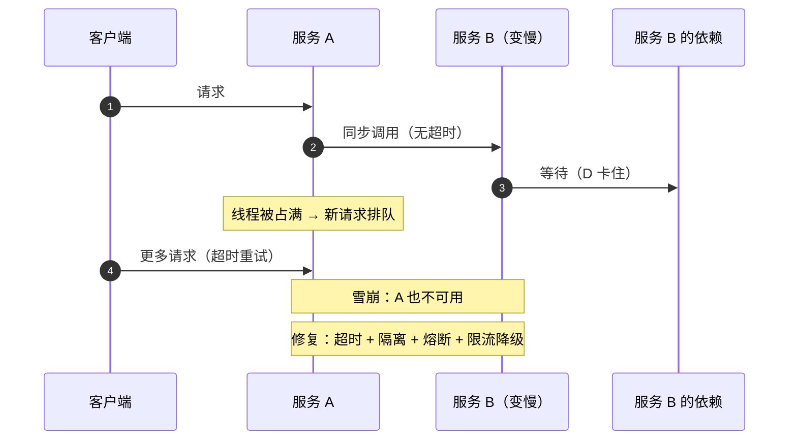
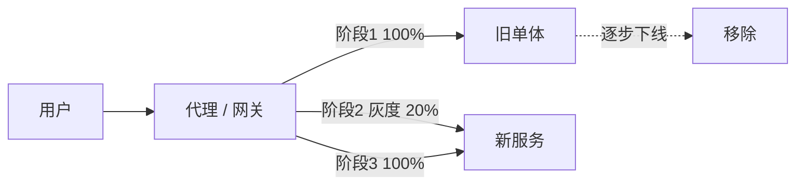
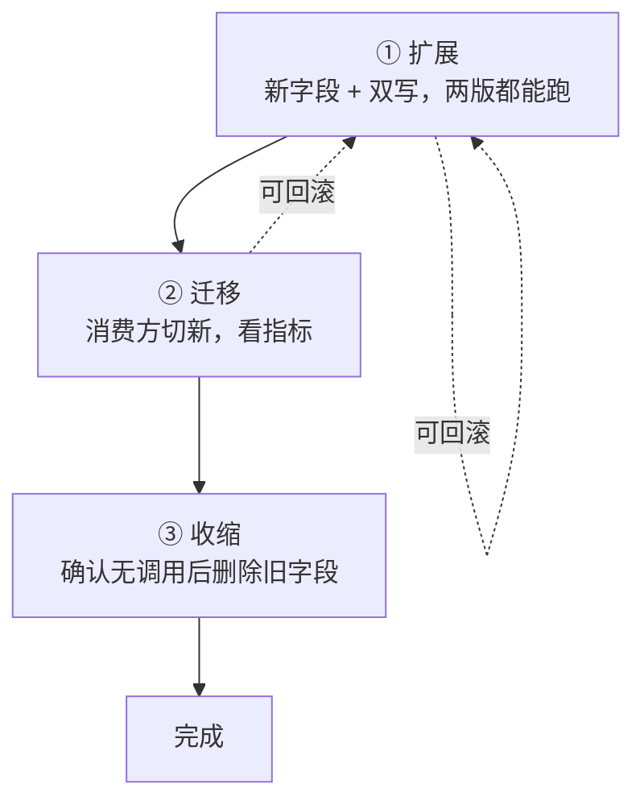

# 微服务经典面试题（含要点与追问）

> 只讲**服务化落地**：怎么拆、怎么通信、怎么保证一致、怎么演进。
> 领域建模本身见 [ddd-interview.md](ddd-interview.md)；共识与分布式理论见 [distributed-interview.md](distributed-interview.md)。

## 目录

- [一、拆分与边界](#一拆分与边界)
- [二、通信与治理](#二通信与治理)
- [三、一致性与查询](#三一致性与查询)
- [四、演进与运维](#四演进与运维)
- [自测清单](#自测清单)
- [附录 A：15 分钟背诵卡](#附录-a15-分钟背诵卡)
- [附录 B：模拟面试 20 题（含追问链）](#附录-b模拟面试-20-题含追问链)
- [附录 C：口述版——3 分钟讲清微服务落地](#附录-c口述版3-分钟讲清微服务落地)
- [附录 D：关键图示](#附录-d关键图示)

---

## 一、拆分与边界

### 1. 单体、模块化单体、微服务怎么选？

| | 单体 | 模块化单体 | 微服务 |
| --- | --- | --- | --- |
| 部署 | 一个包 | 一个包（模块自治） | 多服务独立部署 |
| 边界 | 靠自觉 | **编译期/包级强制** | 网络边界 |
| 一致性 | 本地事务 | 本地事务 | 分布式（Saga / 消息） |
| 复杂度 | 低 | 中 | 高（运维、链路、数据） |
| 适用 | 早期、小团队 | **大多数业务的正确起点** | 多团队、独立伸缩、异构技术 |

判断信号（只有这三条真正支持拆）：

1. **团队被同一个发布卡住**（发布队列冲突）。
2. **某些模块需要独立伸缩**（流量特征差异 10 倍以上）。
3. **技术栈必须异构**（AI 模型服务、特定语言生态）。

> 追问：QPS 高就一定要拆微服务吗？—— 不一定，先垂直扩容 + 加缓存 + 读写分离；拆服务解决的是**组织与部署耦合**，不是性能。

---

### 2. 微服务该按什么拆？常见误区？

**正确维度**：业务能力 / 限界上下文 / 数据所有权 / 团队边界。

**四个经典误区**：

1. **按技术层拆**（controller 服务、service 服务）→ 一个需求改八个服务。
2. **按实体拆**（用户服务、地址服务、角色服务）→ 到处跨服务 JOIN。
3. **共享数据库** → 表面微服务，实际是分布式单体。
4. **拆得太细**（纳米服务）→ 网络调用爆炸、故障点倍增。

> 追问：怎么判断拆得对不对？—— 一个需求通常只改 1~2 个服务；每个服务有**唯一数据 owner**；团队能独立发布。

---

### 3. 康威定律和团队拓扑？

**康威定律**：系统架构会反映组织的沟通结构。

- 边界与团队边界不一致 → 跨团队沟通成本转成接口变更成本。
- 常见团队形态：**业务流团队**（端到端负责一个域）、**平台团队**（提供能力）、**赋能团队**（专家支持）、**复杂子系统团队**。

> 追问：先改组织还是先改架构？—— 同时演进；只改架构不动组织，边界会被组织碾平。

---

### 4. 「每服务一库」到底为什么？代价是什么？

因为**数据所有权**：只有一个服务能写自己的数据，其他服务只能通过 API/事件获取。

| 收益 | 代价 |
| --- | --- |
| 边界清晰、独立演进 | 失去跨库 JOIN |
| 独立扩容/换存储 | 失去本地事务 → 要 Saga/消息 |
| 故障隔离 | 数据冗余与一致性成本 |

> 追问：过渡期能共享库吗？—— 可以（绞杀者阶段），但必须明确**唯一写入方**；双写迟早不一致。

---

### 5. 拆完发现要跨服务 JOIN 怎么办？

三选一：

1. **冗余/快照**：查询方存一份必要字段（订单存商品名快照）。
2. **读模型（CQRS）**：订阅事件维护宽表，查询直接读宽表。
3. **专用查询服务**：ES / 数仓，承担复杂检索与报表。

> 追问：能分布式 JOIN 吗？—— 不要。要么说明拆错了，要么用读模型；分布式 JOIN 的延迟和失败率都不可控。

---

## 二、通信与治理

### 6. 服务间通信：同步还是异步？

| | 同步（REST/gRPC） | 异步（MQ/事件） |
| --- | --- | --- |
| 耦合 | 时间耦合（对方必须在线） | 解耦、可削峰 |
| 一致性 | 立即拿到结果 | 最终一致 |
| 复杂度 | 低 | 高（幂等、顺序、重复、死信） |
| 适用 | 查询、强交互、必须立刻知道结果 | 命令下发、状态广播、长流程 |

> 追问：新手最常犯的错？—— 全部同步，一个下游抖动整条链路雪崩；应把"必须立刻知道"和"可以稍后知道"分开。

---

### 7. API 网关该做什么、不该做什么？

**该做**：路由、认证鉴权、限流、灰度、协议转换、日志与追踪埋点。

**不该做**：业务逻辑、数据聚合、事务编排。

> 追问：网关会成为瓶颈吗？—— 会，所以只做轻逻辑、无状态、可水平扩展；重逻辑下沉到 BFF 或服务内。

---

### 8. 服务治理清单都有什么？

注册发现、配置中心（动态刷新）、负载均衡（含一致性哈希）、超时/重试/熔断/限流/隔离、可观测性三支柱、灰度与回滚、契约测试、容量与压测、故障演练。

> 追问：第一天必须有什么？—— 超时、重试上限、熔断、traceId 透传；其余按规模补。

---

### 9. 服务雪崩怎么发生、怎么防？

**链路**：下游慢 → 上游线程池被占满 → 上游也慢 → 层层放大 → 整站不可用。

**防护四件套**：

1. **超时**：必须有，且**层层递减**（上层超时 > 下层超时）。
2. **隔离**：线程池隔离 / 信号量隔离，别让一个下游拖垮所有线程。
3. **熔断**：失败率超阈值快速失败（Closed → Open → Half-Open）。
4. **限流 + 降级**：保核心链路，非核心直接返回兜底值。

> 追问：超时设多少？—— 基于 P99 × 1.5~2；并保证整条链路的超时预算加起来不超过用户的容忍时间。

---

### 10. 幂等、重试、背压怎么做？

| 主题 | 做法 |
| --- | --- |
| **幂等** | 业务唯一键 + 唯一索引 / 去重表 / 状态机 / upsert |
| **重试** | 只重试幂等且可恢复的错误；指数退避 + 抖动 + 次数上限；区分 4xx（不重试）与 5xx/超时 |
| **背压** | 队列有界 + 拒绝策略 + `Retry-After`；不要让无限队列吃光内存 |

> 追问：重试会放大故障吗？—— 会；所以要有**重试风暴保护**：熔断 + 只在一层重试 + 限制重试总量。

---

## 三、一致性与查询

### 11. 编排（Orchestration）和协同（Choreography）怎么选？

| | 编排 | 协同 |
| --- | --- | --- |
| 结构 | 中心协调器（状态机） | 各服务监听事件自行响应 |
| 可观测 | **好**，有完整流程状态 | 差，流程散落 |
| 耦合 | 协调器知道所有步骤 | 服务间松耦合 |
| 适用 | 步骤多、要补偿、要可视 | 简单广播、松耦合优先 |

> 追问：编排器会变成分布式单体吗？—— 只做**流程状态机**（发命令、收事件），不放业务规则就不会。

---

### 12. CQRS 是什么？代价是什么？

写模型负责不变式（聚合、规范化），读模型负责查询（反规范化、宽表、ES）。

- 适用：读写比例悬殊、查询维度多、报表复杂。
- 代价：**读延迟（最终一致）**、双模型维护、同步机制（事件/CDC）。

> 追问：一定要配事件溯源吗？—— 不必，两者独立；CQRS 只需"写模型发事件、读模型订阅"。

---

### 13. 事件溯源的代价？

状态 = 事件流重放。

五个坑：

1. **版本演进**：事件 schema 一旦发布就要永久兼容。
2. **查询困难**：必须配读模型。
3. **快照**：事件多了重放慢。
4. **删除合规**：GDPR 类要求要墓碑事件或加密擦除。
5. **心智负担**：状态不直接可见。

> 追问：什么时候值得？—— 强审计（账务）、需要回放/时间旅行、天然事件驱动（IoT）。普通业务用"状态 + 变更日志"即可。

---

### 14. 跨服务查询的三种解法？

1. **API 组合（BFF/网关聚合）**：实时，但 N 次调用、延迟叠加。
2. **读模型/宽表**：订阅事件维护，快但最终一致。
3. **专用查询服务（ES/数仓）**：复杂检索与报表。

> 追问：怎么选？—— 先问"能不能接受 1 秒的不一致"：能就上读模型（成本最低、最常用）；不能就 API 组合。

---

### 15. 分布式事务怎么选？

| 方案 | 场景 |
| --- | --- |
| **本地消息表 + 幂等 + 对账** | 大多数业务（首选） |
| **Saga** | 长流程、需要补偿 |
| **TCC** | 资金/库存强一致，能接受侵入 |
| 2PC / XA | 仅同库多数据源，跨服务别用 |

> 追问：为什么 2PC 跨服务不能用？—— 同步阻塞把连接与行锁持到提交，吞吐崩；协调者单点还会让参与者长期阻塞。

---

## 四、演进与运维

### 16. 怎么把一个单体拆成微服务？

**绞杀者模式（Strangler Fig）**：

1. 前面加代理/网关，新旧并存。
2. 先拆**低风险、边界清晰**的模块（通知、搜索），别先动核心交易。
3. 灰度切流（10% → 50% → 100%）。
4. 旧路径下线，移除旧模块。

> 追问：最先拆什么？—— 无状态、依赖少、读多写少的模块；核心账务最后动，且要双跑对账。

---

### 17. 接口和数据怎么演进才不炸？

**扩展-收缩（Expand-Contract）**：

```text
① 扩展：新增字段/接口 + 双写，老代码仍可用
② 迁移：消费方切新接口，观察指标
③ 收缩：确认无调用后删除旧字段
```

数据库同理：先加可空列 → 双写 → 切读 → 删旧列。**永远不要在同一次发布里"改语义 + 删字段"**。

> 追问：怎么确认"无调用"？—— 网关/服务端埋点统计 + 依赖分析，不要凭记忆。

---

### 18. 多租户怎么设计？

| 方案 | 隔离 | 成本 | 适用 |
| --- | --- | --- | --- |
| 共享库共享表（`tenant_id`） | 低 | 最低 | SaaS 中小客户 |
| 共享库独立 schema | 中 | 中 | 中大型客户 |
| 独立库/实例 | 高 | 最高 | 大客户、合规 |

配套：租户上下文透传（网关 → 服务 → DB 拦截器自动加条件）、按租户限流配额、租户级备份恢复。

> 追问：`tenant_id` 最易出的问题？—— **漏加条件导致越权**；必须框架层强制（拦截器/行级安全），不能靠每条 SQL 自觉。

---

### 19. SLO 与可观测性怎么做？

- **SLO 从用户视角定**（下单成功率、支付成功率），不是机器指标。
- **SLI**：延迟、错误率、饱和度；**错误预算**驱动发布节奏。
- 三支柱：Metrics（RED/USE）、Logs（结构化 + traceId）、Traces（OpenTelemetry）。

> 追问：99.9% 是什么概念？—— 每月约 43 分钟不可用；不要一律写 99.99%，那是每周 1 分钟。

---

### 20. 灰度与回滚怎么做？

- **蓝绿**：两套环境切流量，回滚快、成本高。
- **金丝雀**：按比例/用户/地域放量，配指标观察。
- **滚动**：逐批替换，K8s 默认。

回滚三要素：**代码可回滚**（向后兼容）、**数据可回滚**（DDL 兼容新旧两版）、**开关**（feature flag 秒级关闭）。

> 追问：上线后 DDL 把旧版本搞崩了？—— 说明没做扩展-收缩；正确顺序是加列兼容 → 双写 → 切读 → 删旧。

---

### 21. 秒杀/库存在微服务下怎么落地？

四层答法：

1. **接入层**：CDN 静态化、网关限流、防刷。
2. **应用层**：无状态水平扩展；Redis Lua 原子预扣（幂等 + 扣减 + 写 outbox）。
3. **异步层**：outbox → MQ → 批量落库；消费幂等；失败重试 + 死信。
4. **兜底层**：DB 条件更新 + 唯一索引防超卖；对账修少卖/多卖。

> 追问：Redis 挂了怎么办？—— 降级为"限流 + 数据库条件更新"，宁可少卖不可超卖；预扣数据要能重建。

---

## 自测清单

- [ ] 拆微服务的三个真实信号（发布耦合 / 独立伸缩 / 异构技术）
- [ ] 四个拆分误区，为什么"按实体拆"会到处 JOIN
- [ ] 康威定律与团队拓扑
- [ ] 每服务一库的收益与代价
- [ ] 跨服务 JOIN 的三种解法
- [ ] 同步与异步的取舍，全同步为什么危险
- [ ] 网关该做/不该做什么
- [ ] 雪崩四件套，超时为什么层层递减
- [ ] 幂等、重试、背压三件套
- [ ] 编排 vs 协同，编排器的边界
- [ ] CQRS 的代价与适用
- [ ] 事件溯源的五个坑
- [ ] 分布式事务四方案选型
- [ ] 绞杀者模式与首拆对象
- [ ] 扩展-收缩三步，为什么不能同版本删字段
- [ ] 多租户三种隔离与 `tenant_id` 最大风险
- [ ] SLO 从用户视角定，99.9% 意味着什么
- [ ] 灰度三种方式与回滚三要素
- [ ] 秒杀四层设计

---

# 附录 A：15 分钟背诵卡

1. 拆微服务的三个真实信号：**发布被卡、独立伸缩、技术异构**；QPS 高不是理由。
2. 四个误区：按技术层拆、按实体拆、共享数据库、纳米服务。
3. 康威定律：架构收敛于组织；边界要和团队边界一起演进。
4. 每服务一库为了**数据所有权**；代价是失去 JOIN 和本地事务。
5. 跨服务查询三解法：API 组合、读模型、专用查询服务。
6. 全同步 = 一个下游抖动全链路崩；把"必须立刻知道"和"稍后知道"分开。
7. 网关只做轻逻辑：路由、认证、限流、灰度、埋点。
8. 雪崩四件套：超时（层层递减）、隔离、熔断、限流降级。
9. 熔断三态：Closed → Open → Half-Open；Open 期间禁止重试。
10. 幂等靠唯一键 + 唯一索引 / 状态机；重试要退避 + 抖动 + 上限。
11. 背压：队列有界 + 拒绝策略 + `Retry-After`。
12. 编排易观测，协同松耦合；编排器只放流程不放业务。
13. CQRS 用读延迟换查询性能，需要双模型维护。
14. 事件溯源五坑：版本、查询、快照、删除、心智。
15. 事务选型：消息表优先，长流程 Saga，资金 TCC，2PC 只用于同库多源。
16. 绞杀者：加代理 → 拆低风险模块 → 灰度切流 → 下线旧路径。
17. 扩展-收缩：先兼容，再迁移，最后删除；任何一步都能回滚。
18. 多租户三档隔离；`tenant_id` 必须框架强制，防越权。
19. SLO 从用户视角定，错误预算驱动发布节奏；99.9% ≈ 每月 43 分钟。
20. 回滚三要素：代码向后兼容、DDL 兼容双版本、feature flag。
21. 秒杀四层：接入限流、Redis 预扣、异步批量落库、DB 兜底 + 对账。

> 记忆锚点：**拆分 → 通信 → 一致 → 演进**。

---

# 附录 B：模拟面试 20 题（含追问链）

### 1. 为什么要拆微服务？

**开口**：真正站得住的理由只有三个——发布被同一个包卡住、模块需要独立伸缩、技术栈必须异构。
**追问**：性能不够怎么办？→ 先垂直扩容、缓存、读写分离，拆服务解决的是组织问题不是性能问题。

### 2. 你们是怎么拆的？

**开口**：按业务能力和限界上下文，判据是一个需求只改 1~2 个服务、数据有唯一 owner。
**追问**：拆完发现依赖很重？→ 说明拆错或需要读模型，不要用分布式 JOIN 硬缝。

### 3. 共享数据库行不行？

**开口**：过渡期可以，但必须唯一写入方；长期共享就是分布式单体。
**追问**：为什么会不一致？→ 双写没有统一的事务边界，先后顺序与失败处理都不可控。

### 4. 服务间同步还是异步？

**开口**：必须立刻拿结果的同步，状态广播和长流程异步。
**追问**：异步的风险？→ 幂等、顺序、重复、死信、可观测性都要额外设计。

### 5. 网关应该承担多少？

**开口**：只做路由、认证、限流、灰度、埋点；不做业务和数据聚合。
**追问**：为什么不能聚合数据？→ 网关没有数据所有权，容易长成新的单体。

### 6. 一个下游变慢，怎么防雪崩？

**开口**：超时、隔离、熔断、限流降级四件套，核心是别让慢调用占满线程。
**追问**：超时怎么设？→ P99×1.5~2，且上层超时大于下层。

### 7. 熔断打开后还能重试吗？

**开口**：不能，要快速失败；恢复用 Half-Open 小流量试探。
**追问**：重试应该在哪一层？→ 只在最靠近故障的一层，且总次数受限。

### 8. 重试会有什么副作用？

**开口**：放大故障、产生重复写、加剧下游排队。
**追问**：怎么防？→ 退避 + 抖动 + 上限，配合熔断与幂等。

### 9. 幂等有哪些实现？

**开口**：业务唯一键 + 唯一索引、去重表、状态机、upsert。
**追问**：没有业务唯一键？→ 客户端生成幂等 token，服务端去重表判定。

### 10. 编排和协同怎么选？

**开口**：步骤多、要补偿、要可视化用编排；简单广播用协同。
**追问**：编排器怎么避免变分布式单体？→ 只做流程状态机，业务规则留在各服务。

### 11. CQRS 值得上吗？

**开口**：读写比悬殊、查询维度多才值得；代价是读延迟和双模型维护。
**追问**：怎么同步？→ 领域事件或 CDC（binlog 订阅）。

### 12. 事件溯源你们用吗？

**开口**：只在强审计或需要回放的场景用，普通业务用状态 + 变更日志。
**追问**：最大风险？→ 事件 schema 要永久兼容，否则老数据放不出来。

### 13. 跨服务查列表怎么做？

**开口**：优先读模型宽表，其次 API 组合，复杂检索上 ES。
**追问**：宽表的数据从哪来？→ 订阅领域事件增量更新，定期全量校准。

### 14. 分布式事务你们怎么解？

**开口**：本地消息表 + 幂等 + 对账解决大部分；长流程 Saga；资金 TCC。
**追问**：消息表会不会重复投递？→ 会，靠消费端幂等收敛。

### 15. 怎么安全地拆单体？

**开口**：绞杀者模式，加代理、先拆低风险模块、灰度切流、旧路径下线。
**追问**：核心账务什么时候动？→ 最后，且双跑对账、可一键回切。

### 16. 接口怎么演进不炸调用方？

**开口**：扩展-收缩，先兼容双写、再切消费方、最后删旧。
**追问**：怎么确认没人用？→ 网关埋点 + 依赖分析。

### 17. 多租户怎么做隔离？

**开口**：按客户规模三档——共享表加 `tenant_id`、独立 schema、独立库。
**追问**：最大风险？→ 漏加租户条件越权，必须框架层强制。

### 18. SLO 怎么定？

**开口**：从用户视角定成功率与延迟，错误预算驱动发布。
**追问**：99.9% 意味着？→ 每月约 43 分钟不可用。

### 19. 灰度出问题怎么回滚？

**开口**：开关秒关 + 版本回滚；前提是代码向后兼容、DDL 兼容双版本。
**追问**：数据库改错了怎么办？→ 靠扩展-收缩的"先兼容再删"，以及双写过渡期。

### 20. 秒杀在微服务架构里怎么设计？

**开口**：接入限流 → Redis 预扣 → 异步批量落库 → DB 条件更新兜底 + 对账。
**追问**：为什么不让订单服务直接扣库存？→ 行锁竞争把 QPS 压到个位数，Redis 只是票闸。

---

# 附录 C：口述版——3 分钟讲清微服务落地

> 面试官问「你们微服务怎么落地」时用。约 800 字 ≈ 3 分钟。

### 逐字稿

**【开场 · 15 秒】**
我对微服务的态度是：**它不是目标，能独立部署和独立伸缩才是目标**。所以先问三个问题：发布是不是被同一个包卡住了、有没有模块需要独立伸缩、有没有必须异构的技术栈。三条都不满足，模块化单体就是最优解。

**【拆分 · 45 秒】**
拆的时候按业务能力和数据所有权，判据很朴素——一个需求通常只改一到两个服务，每份数据只有一个 owner。
四个坑我一定避开：按技术层拆、按实体拆、共享数据库、拆成纳米服务。共享库尤其危险，那是分布式单体。
还要提康威定律：架构会向组织沟通结构收敛，所以边界要和团队边界一起演进。

**【通信与治理 · 50 秒】**
通信上我把"必须立刻知道结果"和"可以稍后知道"分开。全同步的系统，一个下游抖动就能把整条链路拖垮，所以要配四件套：超时、隔离、熔断、限流降级。超时一定层层递减，上层超时大于下层。
重试只放在最靠近故障的一层，加退避和上限，熔断打开期间禁止重试，否则就是重试风暴。
异步场景一定配套幂等——业务唯一键加唯一索引是底线。

**【一致性与查询 · 40 秒】**
数据这边，每服务一库换来边界清晰，代价是失去 JOIN 和本地事务。跨服务查询我优先做读模型宽表，靠订阅事件更新，接受秒级不一致；不能接受就用 API 组合。
事务方案按优先级排：本地消息表加对账解决大部分，长流程 Saga，资金类 TCC，2PC 只在同库多数据源用。

**【演进与收尾 · 30 秒】**
演进上，拆单体用绞杀者模式：加代理、先拆低风险模块、灰度切流、旧路径下线。接口演进用扩展-收缩，先兼容、再迁移、最后删除，任何一步都能回滚。
一句话总结：**微服务的难点不在技术选型，而在边界、一致性和回滚这三件事上**。

---

### 压缩版

**一句话版（10 秒）**
> 微服务不是目标，独立部署与伸缩才是；难点是边界、一致性、回滚。

**30 秒版**
> 拆之前先确认发布是否被卡、是否需要独立伸缩。按业务能力和数据所有权拆，避开按技术层拆、共享库、纳米服务。通信分同步异步，配超时隔离熔断限流，重试只在一层且要幂等。每服务一库，查询用读模型，事务用消息表加对账。演进用绞杀者加扩展-收缩。

### 时间分配

| 段落 | 时长 | 只说一件事 |
| --- | --- | --- |
| 开场 | 15s | 目标不是微服务，而是独立部署与伸缩 |
| 拆分 | 45s | 三信号 + 四个坑 + 康威定律 |
| 通信与治理 | 50s | 同步异步划分 + 雪崩四件套 + 幂等 |
| 一致性与查询 | 40s | 每服务一库 + 读模型 + 事务选型 |
| 演进与收尾 | 30s | 绞杀者 + 扩展-收缩 + 三句总结 |

### 被打断时怎么接

| 面试官插话 | 接续句 |
| --- | --- |
| 「你们为什么拆了？」 | 「发布被卡住了 —— 五个团队抢同一个发布窗口，这才是真正的驱动因素」 |
| 「拆完性能更差了？」 | 「多半是同步调用链太长，改事件驱动或加读模型；也可能是拆得过细」 |
| 「一致性怎么保证？」 | 「消息表加幂等加对账；资金类才上 TCC」 |
| 「上线出问题多久能回滚？」 | 「开关级秒级，版本级分钟级；前提是代码和 DDL 都向后兼容」 |

---

# 附录 D：关键图示

### 1. 拆分判据



### 2. 雪崩与四件套



### 3. 绞杀者模式



### 4. 扩展-收缩


