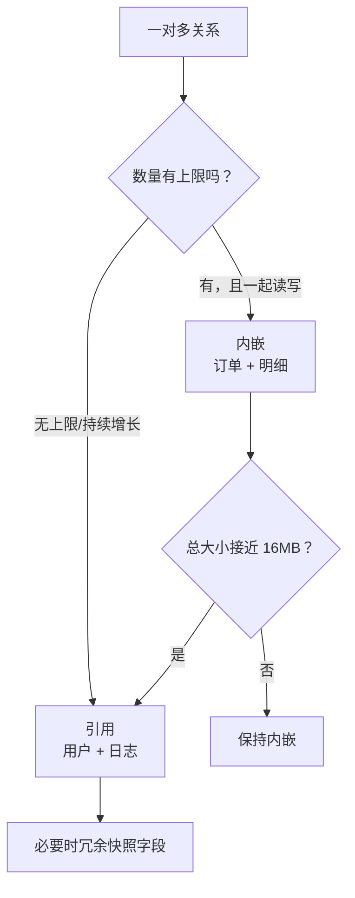
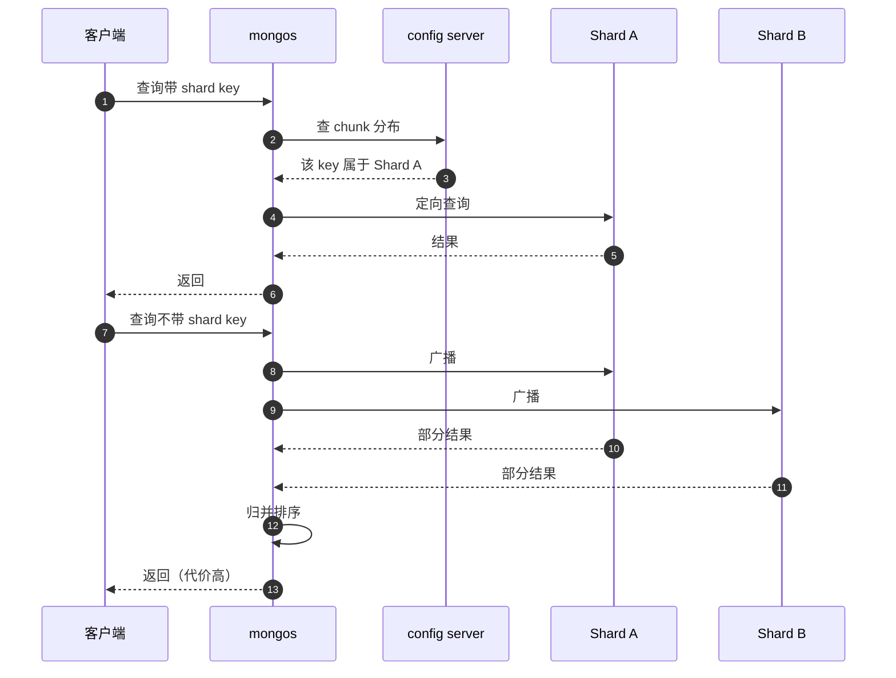
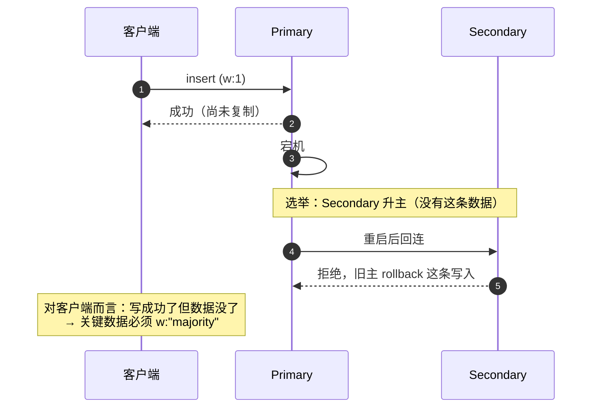

# MongoDB 经典面试题（含要点与追问）

> 以 **MongoDB 4.4 ~ 7.0 + WiredTiger** 为准。主线是「文档模型 → 索引 → 查询 → 事务 → 复制分片 → 运维」，重点在**建模取舍**和**索引设计**。
> 每题给结论 + 前提 + 追问；建议先遮住答案自测。

## 目录

- [一、模型与选型](#一模型与选型)
- [二、索引](#二索引)
- [三、查询与聚合](#三查询与聚合)
- [四、事务与一致性](#四事务与一致性)
- [五、复制与分片](#五复制与分片)
- [六、存储与运维](#六存储与运维)
- [七、场景题](#七场景题)
- [自测清单](#自测清单)
- [附录 A：15 分钟背诵卡](#附录-a15-分钟背诵卡)
- [附录 B：模拟面试 20 题（含追问链）](#附录-b模拟面试-20-题含追问链)
- [附录 C：口述版——3 分钟讲清 MongoDB 的取舍](#附录-c口述版3-分钟讲清-mongodb-的取舍)
- [附录 D：关键图示](#附录-d关键图示)

---

## 一、模型与选型

### 1. MongoDB 和 MySQL 怎么选？

| 维度 | MongoDB | MySQL |
| --- | --- | --- |
| 模型 | **文档（JSON/BSON）**，字段可动态 | 表 + 行 + 列，schema 强约束 |
| 事务 | 单文档原子；多文档事务（4.0+，有代价） | 完整 ACID |
| JOIN | 弱（`$lookup`，性能一般） | 强 |
| 扩展 | **原生分片**、副本集 | 分库分表要自己做 |
| 适合 | 结构多变、嵌套聚合、日志/内容/配置/审计、读多写少 | 强关系、强事务、复杂查询与报表 |

> 一句话：**关系复杂 + 强事务 → MySQL；文档形态天然匹配 + 水平扩展 → MongoDB**。

> 追问：MongoDB 不适合什么？—— 多表关联报表、跨文档强一致的高频写（比如账务）、需要复杂聚合 SQL 的场景。

---

### 2. BSON 是什么？ObjectId 怎么构成的？

**BSON** = Binary JSON，支持比 JSON 更多的类型：`Date`、`Decimal128`、`ObjectId`、`BinData`、`Timestamp`、`Int32/Int64`。

**ObjectId 是 12 字节**：

```text
4 字节  Unix 时间戳（秒）  → 天然近似有序
5 字节  随机值              → 进程/机器唯一
3 字节  自增计数器          → 同秒内唯一
```

优点：**客户端生成、无需中心化、趋势递增**（对 B 树插入友好）。

> 追问：为什么不用 UUID 做 `_id`？—— 完全随机导致 B 树随机插入、页分裂；ObjectId 前 4 字节有时间序，写放大更小。
> 追问：`_id` 能自定义吗？—— 能，但**一旦插入不可修改**；用业务唯一键（如 `biz_no`）做 `_id` 是很常见的幂等手法。

---

### 3. 内嵌（embed）还是引用（reference）？

判断四条：

1. **一对一**：内嵌（如用户 + 个人资料）。
2. **一对少（N 小且稳定）**：内嵌（订单 + 订单明细）。
3. **一对多（N 大或无上限）**：**引用**（用户 + 日志、文章 + 评论）。
4. **多对多**：引用 + 关联集合（如 `student_course`）。

硬约束：**单文档 16MB**，且**数组无节制增长**会导致文档膨胀、更新变慢、复制延迟。

> 追问：订单为什么可以内嵌明细？—— 明细有上限（几十条）、总是随订单一起读、且要做总额一致性，属于典型的"聚合"。
> 追问：评论能内嵌到文章吗？—— 不能，评论无上限，会撑爆 16MB，且只需分页读取一部分。

---

### 4. 反范式冗余什么时候可以接受？

- 读远多于写。
- 冗余字段几乎不变（商品名、用户名快照）。
- 能接受"历史数据保持当时的值"（订单里的商品名本来就该是快照）。

> 追问：冗余字段怎么同步？—— 同事务写、事件驱动更新、或干脆不更新（快照语义）。**不要指望"总能保持一致"**。

---

### 5. 集合需要预先创建吗？Capped Collection 有什么用？

- 集合**隐式创建**（首次写入），也可以显式 `createCollection` 指定选项（校验、大小、TTL）。
- **Capped Collection**：固定大小、循环覆盖、插入有序，读比写快。

用途：日志尾随、oplog 本身。但**不支持删除单条**、更新受限，现代场景更多用 TTL 索引代替。

> 追问：oplog 就是 capped collection？—— 是，在 `local` 库里，固定大小，循环覆盖。

---

### 6. Schema Validation 怎么用？

```javascript
db.createCollection("orders", {
  validator: { $jsonSchema: {
    bsonType: "object",
    required: ["order_no", "amount", "status"],
    properties: {
      order_no: { bsonType: "string" },
      amount:   { bsonType: "decimal" },
      status:   { enum: ["created", "paid", "cancelled"] }
    }
  }},
  validationLevel: "strict",      // strict | moderate
  validationAction: "error"       // error | warn
});
```

> 追问：MongoDB 无 schema 会不会失控？—— 会。「灵活」是给业务演进用的，不是给偷懒用的；建议**关键集合都上校验**，并且版本化字段（`schemaVersion`）。

---

## 二、索引

### 7. MongoDB 有哪些索引类型？

| 类型 | 用途 | 注意 |
| --- | --- | --- |
| 单键 | 最常见 | `_id` 自动创建 |
| **复合** | 多条件查询、排序 | 字段顺序决定能否命中 |
| **多键（Multikey）** | 数组字段 | 复合索引里**最多一个数组字段** |
| 唯一 | 幂等、防重 | 稀疏/部分索引可只约束子集 |
| TTL | 自动过期 | 单字段日期索引，后台每 60s 扫 |
| 文本 | 全文检索 | 每集合最多一个，分词有语言限制 |
| 地理 `2dsphere` | 附近的人 | GeoJSON 格式 |
| 部分（Partial） | 只索引满足条件的文档 | `partialFilterExpression` |
| 稀疏（Sparse） | 只索引有该字段的文档 | 4.2 后更推荐 partial |
| 哈希 | 分片哈希键 | 只支持等值 |

> 追问：TTL 索引是准时的吗？—— 不是，后台线程**每 60 秒**扫一次，删除有延迟；不能当精确调度器用。

---

### 8. 复合索引的字段顺序怎么定？ESR 原则？

**ESR = Equality → Sort → Range**：

```javascript
// 查询：status 等值、created_at 排序、amount 范围
db.orders.createIndex({ status: 1, created_at: -1, amount: 1 });
```

理由：

- **等值在前**：先把候选集缩到最小。
- **排序居中**：让排序直接用索引顺序，避免内存排序。
- **范围在后**：范围条件之后的字段无法继续用于定位（和 MySQL 最左前缀同理）。

> 追问：顺序错了会怎样？—— 排序会退化成内存 `SORT` 阶段（`find` 有 32MB 限制），或者干脆走 `COLLSCAN`。

---

### 9. 多键索引有什么限制？

- 一个文档的数组有 N 个元素 → 索引里有 N 条索引项（索引膨胀）。
- **复合索引里最多只能有一个数组字段**（否则组合数爆炸）。
- 数组元素过多会导致索引很大、写入慢；应设上限（如只保留最近 100 条）。
- `$elemMatch` 才能对"同一个元素满足多个条件"做精确匹配。

> 追问：`{tags: ["a","b"]}` 查询 `{tags: "a", tags: "b"}` 和 `$all` 有什么区别？—— 都表示"包含"，但要"同一元素同时满足多条件"必须用 `$elemMatch`。

---

### 10. 什么是覆盖查询（Covered Query）？

查询的**所有字段都在索引里**，且不返回 `_id`（或 `_id` 在索引里），引擎不需要回表取文档。

```javascript
db.users.createIndex({ email: 1, name: 1 });
db.users.find({ email: "a@b.com" }, { _id: 0, email: 1, name: 1 });   // covered
```

`explain()` 里表现为 `IXSCAN` 后**没有 `FETCH` 阶段**，`totalDocsExamined = 0`。

> 追问：为什么 `_id` 会影响？—— `_id` 默认返回，除非它在索引里或显式排除；否则必须 `FETCH`。

---

### 11. 哪些写法会导致索引失效？

| 写法 | 原因 | 替代 |
| --- | --- | --- |
| `$regex: "^abc"` ✅ / `"abc"` ❌ | 前缀锚定才能用索引 | 前缀匹配或用文本索引 |
| `$ne` / `$nin` | 否定条件要扫大部分文档 | 改成正向条件或加标记字段 |
| `$or` 中有一侧无索引 | 必须两边都能走索引 | 各建索引或改 `$in` |
| 类型不一致（字符串查数字） | BSON 类型参与排序 | 保证写入类型一致 |
| 对字段做 `$expr` 计算 | 无法用索引 | 预计算字段 |
| 排序字段与索引方向不一致 | 无法利用索引序 | 建对应方向的复合索引 |

> 追问：`$regex` 大小写不敏感（`i`）能用索引吗？—— 不能（4.2 前完全不行；之后有限支持 collation，但成本高），考虑存一份小写字段。

---

### 12. `explain()` 该看什么？

```javascript
db.orders.find({ status: "paid" }).explain("executionStats");
```

| 字段 | 含义 |
| --- | --- |
| `winningPlan.stage` | `IXSCAN`（好）、`COLLSCAN`（全表）、`FETCH`（回表）、`SORT`（内存排序） |
| `totalKeysExamined` | 扫了多少索引项 |
| `totalDocsExamined` | **回表取了多少文档**（核心指标） |
| `nReturned` | 返回多少条 |
| `executionTimeMillis` | 耗时 |

健康标准：**`totalDocsExamined ≈ nReturned`**。如果 `totalDocsExamined` 远大于 `nReturned`，说明索引选择性差或回表太多。

> 追问：`totalKeysExamined` 大但 `totalDocsExamined` 小呢？—— 覆盖查询的特征，通常可接受；但键扫描过多说明索引区分度低。

---

### 13. 索引越多越好吗？写放大体现在哪？

每次写入都要维护所有相关索引（B 树插入/分裂），因此：

- 写多的集合，索引数控制在必要范围（一般 ≤ 5~7 个）。
- 数组字段（多键）会让索引项数量随元素数放大。
- 用 `$indexStats` 找从未命中的索引，定期清理。

> 追问：怎么发现无用索引？—— `db.coll.aggregate([{$indexStats:{}}])` 看 `accesses.ops` 为 0 的索引。

---

## 三、查询与聚合

### 14. `find` 和 `aggregate` 怎么选？

- `find`：单集合、简单条件、需要走索引的常规查询，开销小。
- `aggregate`：分组、多阶段变换、`$lookup`、`$facet`。

性能要点：**`$match` 和 `$sort` 尽量放到管道最前面**，这样能命中索引并减少后续阶段的文档数。

> 追问：聚合能用索引吗？—— 只有**管道开头**的 `$match` / `$sort` 能利用索引；一旦进入 `$group`/`$unwind`，后续都是内存计算。

---

### 15. 常用聚合阶段有哪些？

| 阶段 | 作用 |
| --- | --- |
| `$match` | 过滤（可走索引） |
| `$sort` | 排序（放最前可走索引） |
| `$group` | 分组聚合（`$sum/$avg/$max/$push`） |
| `$project` | 字段裁剪/计算 |
| `$unwind` | 展开数组（会放大文档数） |
| `$lookup` | 左连接（性能一般） |
| `$facet` | 一次输入多路输出（分页 + 总数） |
| `$bucket` | 区间分桶 |
| `$graphLookup` | 递归/树查询 |

> 追问：`$unwind` 有什么风险？—— 文档数按数组长度放大；先 `$match` 缩小再展开，必要时 `$limit`。

---

### 16. `$lookup` 性能差怎么办？

`$lookup` 是"嵌套循环"式的关联，尤其在大集合上很慢。替代方案：

1. **内嵌**：把需要的数据冗余进文档（读多写少时最优）。
2. **应用层两次查询**：先查主表 `_id` 列表，再用 `$in` 查从表（可控且能命中索引）。
3. **预聚合**：用变更流/定时任务维护读模型。
4. 必要时才用 `$lookup`，且**被关联字段必须有索引**、外键侧先 `$match` 缩小。

> 追问：`$lookup` 的 `localField` 没索引会怎样？—— 每处理一个输入文档就要全表扫一次，量级立刻爆炸。

---

### 17. 深分页怎么优化？

```javascript
// 慢：跳过 N 条
db.orders.find().sort({ created_at: -1 }).skip(100000).limit(10);

// 快：游标分页（记住上一页最后一条的排序键）
db.orders.find({ created_at: { $lt: lastCreatedAt } })
         .sort({ created_at: -1 }).limit(10);
```

或用 `_id` 作为游标（天然唯一且有序）。`$facet` 适合"一次返回列表 + 总数"，但总量大时也不便宜。

> 追问：为什么 `skip` 慢？—— 引擎必须**遍历并丢弃**前 N 个文档，成本与 offset 成正比。

---

### 18. 哪些更新操作是原子的？

**单文档更新天然原子**：

- `$set` / `$unset` / `$inc` / `$push` / `$pull` / `$addToSet`
- `findAndModify`（或 `findOneAndUpdate`）：原子的"读-改-写"，返回改前或改后文档
- `arrayFilters`：精确更新数组里的匹配元素

> 追问：`findOneAndUpdate` 和先 `find` 再 `update` 有什么区别？—— 后者有竞态窗口（两个请求读到同一状态）；前者是一条命令内的原子操作，常用于**任务领取**、**库存扣减**、**幂等更新**。

---

### 19. 用 MongoDB 做幂等怎么做？

两层保障：

1. **唯一索引**：`createIndex({ biz_no: 1 }, { unique: true })`，重复插入抛 `E11000`。
2. **upsert**：`replaceOne({ biz_no }, doc, { upsert: true })` —— 重复执行结果收敛。

```javascript
// 本仓库 StockDeductedHandler 的做法（C#）：
await collection.ReplaceOneAsync(x => x.biz_no == eventData.biz_no, log,
    new ReplaceOptions { IsUpsert = true });
```

> 追问：`upsert` 并发插入同一 key 会怎样？—— 唯一索引会挡住第二个，可能抛 duplicate key，需要捕获并当作"已被别人插入"处理。

---

## 四、事务与一致性

### 20. 单文档原子性意味着什么？

对单个文档的修改（包括同文档内的多个字段、数组操作）是**原子且隔离**的，不需要事务。

所以要尽量把"必须一起变化"的数据放进同一个文档——这也是文档建模的核心动机。

> 追问：那跨文档怎么办？—— 4.0+ 支持多文档事务，但更推荐用"聚合划分"从模型上避免跨文档强一致。

---

### 21. 多文档事务的限制有哪些？

- 4.0 副本集、4.2 分片集群支持。
- **默认 60 秒**超时（`transactionLifetimeLimitSeconds`）。
- 单个事务的 oplog 条目受 16MB 限制，所以**事务不能太大**。
- 分片事务性能明显低于单分片，尽量让相关文档落在同一分片（用 shard key 对齐）。
- 事务内不能创建集合/索引（有限例外）。
- 持有锁与快照，长事务会拖慢复制与缓存。

> 追问：什么时候真该用？—— 跨集合的强一致写（如"账户扣款 + 流水"）；能用单文档或最终一致解决的，就别用。

---

### 22. `writeConcern` 和 `readConcern` 怎么配？

| 设置 | 级别 | 含义 |
| --- | --- | --- |
| `writeConcern` | `w:1` | 主节点写入即返回（默认，可能丢） |
| | `w:"majority"` | 多数派确认（不丢，延迟高） |
| | `j:true` | 写 journal（持久化到磁盘） |
| | `wtimeout` | 超时避免无限等待 |
| `readConcern` | `local` | 读本地（可能回滚） |
| | `majority` | 只读多数派已确认的数据 |
| | `linearizable` | 最强，仅主节点、性能最差 |
| | `snapshot` | 事务内一致性快照 |

> 一句话：**默认是"快但可能丢"，关键数据要 `w:"majority"` + `readConcern:"majority"`**。

---

### 23. 读偏好（readPreference）有哪些？代价是什么？

`primary` / `primaryPreferred` / `secondary` / `secondaryPreferred` / `nearest`。

- 读从库能分摊压力，但可能读到**旧数据**（复制延迟）。
- 写后立刻读（read-your-writes）必须走 `primary`，或用**因果一致性会话**。

> 追问：因果一致性怎么用？—— 客户端开 session，读写都带上 `session`，服务端用 `afterClusterTime` 保证读到不早于自己写入的进度。

---

## 五、复制与分片

### 24. 副本集怎么选主？会丢数据吗？

- 最多 50 个成员，其中 **7 个有投票权**；多数派（majority）才能选出主。
- 选举考虑：`priority` 高者优先、oplog 更新（更"新"）者优先、避免平票。
- 主节点挂了，从节点在数秒内完成选举（默认 `electionTimeoutMillis` 10s）。

**丢数据场景**：`w:1` 写入未复制到多数派就宕机 → 新主没有这条数据 → 旧主恢复后**回滚（rollback）**。

> 追问：怎么彻底避免？—— `w:"majority"` + `j:true`；代价是每次写多一次网络往返 + 刷盘。

---

### 25. oplog 是什么？太小会怎样？

- `local.oplog.rs`，**固定大小的 capped collection**，记录所有写操作的幂等重放形式。
- 从节点拉取 oplog 并重放 → 这就是复制。
- oplog 太小 → 从节点落后太多时**追不上**，需要**全量重新同步**（initial sync），代价极大。

> 追问：oplog 条目和文档一样受 16MB 限制吗？—— 是；所以**单文档 16MB 上限**也限制了单次写入的复制粒度。

---

### 26. 分片键怎么选？

三个维度：

1. **基数（Cardinality）**：取值要足够多（性别 = 2 → 差；用户 ID → 好）。
2. **频率（Frequency）**：避免热点值（如 `status:"paid"` 占了 90% 文档 → 热点 chunk）。
3. **单调性（Monotonic）**：单调递增（时间戳、自增 ID）会导致**写永远落在最后一个 chunk**（热点）；用哈希分片或复合键（`{tenantId: 1, createdAt: 1}`）。

特性：4.4 支持 `refineShardKey`，5.0 支持在线 `reshardCollection`（代价高）；**分片键一旦选定很难改**。

> 追问：哈希分片有什么代价？—— 范围查询会变成**广播到所有分片**（scatter-gather），只适合等值查询。

---

### 27. 分片集群由哪些组件组成？查询怎么路由？

```text
客户端 → mongos（路由）→ config server（元数据：chunk 分布）→ shard（实际数据）
```

- 查询带 shard key → **定向（targeted）**到一个/少数分片。
- 不带 shard key → **scatter-gather** 到所有分片再合并（`mongos` 做归并排序）。
- 跨分片聚合/排序代价高，尽量让查询带上分片键。

> 追问：`mongos` 是无状态的吗？—— 是，可水平扩展；但它是单点故障的"逻辑入口"，要部署多个 + 前面挂 LB。

---

### 28. chunk、balancer 和 jumbo chunk？

- 数据按 shard key 范围切成 **chunk（默认 128MB）**。
- **balancer** 后台在分片间迁移 chunk，保持均衡。
- **jumbo chunk**：某个 chunk 超过大小上限且**无法分裂**（因为同一个 shard key 值太多），会导致迁移失败、分布不均。

> 追问：怎么避免 jumbo？—— shard key 基数要够高；已经出现时只能改 shard key 或人工拆分/迁移。

---

## 六、存储与运维

### 29. WiredTiger 的关键机制？

- **文档级并发控制**（不是集合级/库级锁）。
- **MVCC + 快照**：读不阻塞写。
- **checkpoint**：默认每 60 秒把一致性快照落盘。
- **journal（WAL）**：默认每 100ms 刷一次，保证 checkpoint 之间的持久化。
- **压缩**：集合默认 snappy，可配 zstd（更省空间、更慢）。

> 追问：写入流程？—— 写内存 + 写 journal → 到达 checkpoint 时把脏页落盘 → journal 里旧的部分可回收。

---

### 30. 内存怎么配？working set 是什么？

- `storage.wiredTiger.engineConfig.cacheSizeGB`：默认 **50% ×（RAM - 1GB）** 或 256MB（取大）。
- 索引**全部常驻内存**，数据尽量让"热数据（working set）"留在缓存。
- 缓存不够 → 频繁 page fault → 性能断崖。

> 追问：怎么判断 working set 放得下？—— 看 `wiredTiger.cache` 的 "pages read into cache" 与 "evicted pages" 的比例，以及 page fault 速率。

---

### 31. 慢查询怎么定位？

```javascript
db.setProfilingLevel(1, { slowms: 100 });   // 记录 >100ms 的操作
db.system.profile.find().sort({ ts: -1 }).limit(10).pretty();
db.currentOp({ secs_running: { $gt: 5 } });  // 正在跑的慢操作
```

定位后：`explain("executionStats")` 看是 `COLLSCAN`、回表太多、还是内存排序。

> 追问：profiler 会影响性能吗？—— 会（写 `system.profile` 集合），生产建议只开慢查询 + 定期关，或用 `db.currentOp` 临时抓。

---

### 32. 备份怎么做？

| 方式 | 特点 |
| --- | --- |
| `mongodump` / `mongorestore` | 逻辑备份，可跨版本，慢 |
| 文件系统快照 | 快，需要 `fsyncLock` + 关闭均衡（分片） |
| 云厂商/Atlas 快照 | 带 PITR（oplog 回放） |

> 追问：为什么分片集群备份要停 balancer？—— 迁移中的 chunk 会让快照不一致，恢复后可能重复或缺失。

---

### 33. 常见坑清单

1. **文档 16MB 上限**：无节制内嵌数组会撞墙。
2. **内存排序 32MB 限制**（`find` 的 `SORT` 阶段）：必须靠索引排序，或用聚合的 `allowDiskUse`。
3. **`skip` 深分页**：改成游标分页。
4. **`$where` / JS 执行**：无法用索引且慢，禁用。
5. **无上限数组**：用引用或 `$slice` 只保留最近 N 条。
6. **正则非前缀匹配**：全表扫。
7. **无索引的 `$lookup`**：嵌套循环爆炸。
8. **大事务**：超过 16MB oplog 或 60s 超时直接失败。

> 追问：怎么提前发现？—— 上线前跑一遍 `explain` + 压测；生产靠 profiler 的慢查询排行。

---

## 七、场景题

### 34. 审计日志/事件流水怎么建模？

```javascript
{
  _id: ObjectId(),
  biz_no: "INV20261027001",     // 业务唯一键（幂等 + 查询）
  product_id: 1001,
  quantity: 2,
  remaining_stock: 98,
  source: "seckill",
  created_at: ISODate("2026-10-27T10:00:00Z")
}
```

设计要点：

- **只追加、不更新**（日志语义），用 `biz_no` 唯一索引做幂等。
- 按时间/业务维度建索引（`{biz_no:1}` 唯一、`{created_at:-1}`、`{product_id:1, created_at:-1}`）。
- 用 **TTL 索引** 控制保留期（如 90 天）。
- 量大时按时间分片（`{created_at: 1}`）或用时间后缀集合滚动。

> 追问：为什么不用关系库存审计？—— 字段会随业务演进增删，文档模型更省事；且审计通常只追加、检索模式固定。

---

### 35. 用 MongoDB 做任务队列可行吗？

可以，核心是**原子领取**：

```javascript
db.tasks.findOneAndUpdate(
  { status: "pending" },
  { $set: { status: "running", worker: "w1", locked_at: new Date() } },
  { sort: { priority: -1, created_at: 1 }, returnDocument: "after" }
);
```

配套：超时回收（`locked_at` 过期回到 pending）、重试计数、唯一键去重。

> 追问：为什么不推荐当主 MQ？—— 无消费组、无 ACK 语义、重试要自己写、吞吐与顺序都不如 Kafka/RabbitMQ；**只适合轻量内部任务**。

---

### 36. 本仓库里的 MongoDB 用法（可当项目案例）

- 连接与上下文：`t1_frame/src/core/t1_frame.entityframeworkcore.abp/T1FrameMongoDbContext.cs`。
- 审计落库：`StockDeductedHandler` 消费 `StockDeductedEto`，用 **`ReplaceOne + IsUpsert`** 按 `biz_no` 幂等写入 `t1_inventory_deduction_log`。
- 设计对应关系：这就是"事件驱动 + 幂等消费"的典型落地——消息可能重复（至少一次），但 upsert 让结果收敛。

> 追问：为什么用 `_id` 之外再建 `biz_no` 唯一索引？—— `_id` 由驱动生成，无法表达业务唯一性；幂等判断必须靠业务键。

---

## 自测清单

- [ ] MongoDB vs MySQL 的选型判据
- [ ] ObjectId 的 12 字节结构与"趋势递增"的意义
- [ ] 内嵌 vs 引用的四条判断
- [ ] 16MB 文档上限带来的建模约束
- [ ] 索引类型（复合/多键/TTL/文本/部分/哈希）各自适用
- [ ] ESR 原则与顺序错了的后果
- [ ] 多键索引"最多一个数组字段"的限制
- [ ] 覆盖查询的判定（无 `FETCH`）
- [ ] 索引失效的六种写法
- [ ] `executionStats` 里 `totalDocsExamined ≈ nReturned` 的含义
- [ ] `find` 与 `aggregate` 的选择，`$match` 前置
- [ ] `$lookup` 慢的原因与三种替代
- [ ] 深分页与游标分页
- [ ] `findOneAndUpdate` 为什么能防竞态
- [ ] 唯一索引 + upsert 做幂等
- [ ] 多文档事务的四个限制（60s / 16MB / 分片代价 / 锁）
- [ ] `writeConcern` 与 `readConcern` 的搭配
- [ ] 副本集选主与 rollback 丢数据场景
- [ ] oplog 太小会触发全量同步
- [ ] 分片键的三个维度与单调递增的陷阱
- [ ] WiredTiger 的 checkpoint / journal / 压缩
- [ ] 内存排序 32MB 限制与 `allowDiskUse`

---

# 附录 A：15 分钟背诵卡

1. 选型：**关系复杂 + 强事务 → MySQL；文档形态 + 水平扩展 → MongoDB**。
2. ObjectId = 4 字节时间 + 5 字节随机 + 3 字节计数器，12 字节，**趋势递增**。
3. 内嵌看三条：一对一内嵌、一对少内嵌、**一对多无上限用引用**。
4. 单文档 **16MB**，这是文档建模的硬边界。
5. 复合索引顺序按 **ESR**：等值 → 排序 → 范围。
6. 复合索引里**最多一个数组字段**（多键）。
7. 覆盖查询 = 所有字段都在索引里 + 排除 `_id`，explain 里无 `FETCH`。
8. 索引失效：非前缀正则、`$ne`/`$nin`、`$or` 一侧无索引、类型不一致、`$expr`、排序方向不符。
9. `explain` 核心：`totalDocsExamined` 应接近 `nReturned`；`COLLSCAN` 是红灯。
10. 聚合只有开头的 `$match`/`$sort` 能用索引。
11. `$lookup` 是嵌套循环，替代：内嵌、应用层两次查询、预聚合。
12. `skip` 深分页必须遍历丢弃前 N 条 → 改游标分页。
13. 单文档更新原子；`findOneAndUpdate` 是原子的读改写。
14. 幂等 = 业务唯一索引 + upsert，捕获 E11000。
15. 多文档事务：4.0+，默认 60s，单事务 oplog ≤16MB，分片事务更贵。
16. 默认 `w:1` 可能丢；关键数据用 `w:"majority"` + `j:true`。
17. 复制延迟下的读从库可能读旧数据；写后读走 primary 或因果会话。
18. 副本集最多 50 成员 / 7 投票；`w:1` 写入未复制就宕机会 rollback。
19. oplog 太小 → 追不上 → 全量 initial sync。
20. 分片键三要素：基数、频率、单调性；**单调递增会产生写热点**。
21. 不带 shard key 的查询 = scatter-gather。
22. jumbo chunk 由 shard key 基数不足导致，迁移会失败。
23. WiredTiger：文档级并发 + MVCC + 60s checkpoint + 100ms journal + snappy/zstd。
24. `cacheSizeGB` 默认 50% 内存；索引常驻，数据靠 working set。
25. `find` 的内存排序上限 32MB，用索引排序或聚合 `allowDiskUse`。
26. TTL 索引后台每 60s 扫一次，不精确。

> 记忆锚点：**模型 → 索引 → 查询 → 事务 → 复制分片 → 运维**。

---

# 附录 B：模拟面试 20 题（含追问链）

### 1. 什么场景你会选 MongoDB？

**开口**：文档形态天然匹配、字段经常演进、读多写少、需要水平扩展的时候。
**追问**：什么场景不选？→ 多表关联报表、强事务账务、需要复杂 SQL 聚合。

### 2. ObjectId 为什么比 UUID 好？

**开口**：前 4 字节是时间戳，趋势递增，B 树插入是顺序的，页分裂和写放大都小。
**追问**：那 UUID 完全不能用吗？→ 可以用作业务字段，但别做主键。

### 3. 内嵌还是引用？

**开口**：看基数——一对一和少量一对多内嵌，无上限的一对多用引用。
**追问**：边界是什么？→ 单文档 16MB，以及数组会不会无限增长。

### 4. 订单和订单明细能内嵌吗？

**开口**：能，明细数量有限、总是一起读、还要保证总额一致，属于同一个聚合。
**追问**：那商品信息呢？→ 冗余成快照字段，因为历史订单要保持当时的值。

### 5. 复合索引顺序怎么定？

**开口**：按 ESR——等值、排序、范围。
**追问**：顺序错了会怎样？→ 排序退化成内存 SORT（32MB 上限），或者直接全表扫。

### 6. 数组字段能建复合索引吗？

**开口**：能，但复合索引里最多只能有一个数组字段，否则组合数爆炸。

**追问**：数组元素太多有什么问题？→ 索引项膨胀、写入变慢，应该限制数组长度。

### 7. 什么是覆盖查询？

**开口**：查询字段全在索引里且不需要回表，explain 里没有 FETCH 阶段。
**追问**：`_id` 会影响吗？→ 会，默认返回 `_id`，除非它在索引里或显式排除。

### 8. 加了索引为什么还是慢？

**开口**：看 `totalDocsExamined` 和 `nReturned` 的比值，可能是选择性差或者回表太多。
**追问**：还可能是？→ 排序没走索引、`$or` 拆成多路、或者数据量太大要考虑分片。

### 9. 深分页怎么优化？

**开口**：`skip` 要遍历丢弃前 N 条，改成基于排序键的游标分页。
**追问**：前端要跳页怎么办？→ 限制最大页数，或者用 `$facet` 拿列表和总数但接受成本。

### 10. `findOneAndUpdate` 和先查后改有什么区别？

**开口**：前者是单条命令内的原子读改写，后者有竞态窗口。
**追问**：典型用途？→ 任务领取、库存扣减、幂等状态流转。

### 11. 怎么做幂等写入？

**开口**：业务键唯一索引 + upsert，重复执行结果收敛，冲突捕获 E11000 当成功。
**追问**：upsert 并发插入同一键会怎样？→ 唯一索引挡第二个，要捕获重复键异常。

### 12. 多文档事务有什么代价？

**开口**：默认 60 秒超时、单事务 oplog 16MB 上限、持有锁和快照、分片事务更贵。
**追问**：什么时候必须用？→ 跨集合强一致写，比如扣款和流水；能从模型上避免就别用。

### 13. `w:1` 会丢数据吗？

**开口**：会，主节点写入未复制就宕机，新主没有这条，旧主回来会 rollback。
**追问**：怎么避免？→ `w:"majority"` + `j:true`，代价是延迟。

### 14. `readConcern` 有什么用？

**开口**：控制读到什么程度的数据，`local` 可能回滚，`majority` 只读已确认的，`linearizable` 最强最慢。
**追问**：事务里呢？→ 用 `snapshot` 保证事务内一致快照。

### 15. 读从库有什么风险？

**开口**：复制延迟导致读到旧数据，写后立刻读会读不到自己的写。
**追问**：怎么保证 read-your-writes？→ 走 primary，或者用因果一致性会话。

### 16. oplog 太小会怎样？

**开口**：从节点落后太多追不上，触发全量 initial sync，期间主库压力巨大。
**追问**：oplog 多大合适？→ 至少能覆盖一次计划内维护窗口，看写入量和高峰期。

### 17. 分片键怎么选？

**开口**：看基数、频率、单调性；单调递增要做哈希或加前缀字段打散。
**追问**：选错了能改吗？→ 4.4 可以 refine，5.0 可以在线 reshard，但代价很高。

### 18. 不带 shard key 的查询会怎样？

**开口**：scatter-gather 到所有分片再合并，延迟和资源都放大。
**追问**：怎么缓解？→ 让高频查询带上 shard key，或者加读模型/冗余。

### 19. WiredTiger 为什么能高并发？

**开口**：文档级并发控制 + MVCC 快照，读不阻塞写。
**追问**：持久化怎么保证？→ 100ms 的 journal + 60s 的 checkpoint。

### 20. `find` 排序报内存超限怎么办？

**开口**：说明排序没走索引；先建对应方向的复合索引，或者改聚合并开 `allowDiskUse`。
**追问**：为什么排序没走索引？→ 索引顺序或方向不匹配、或者前面有范围条件破坏了排序可用性。

---

# 附录 C：口述版——3 分钟讲清 MongoDB 的取舍

> 面试官问「你怎么看 MongoDB」时用。约 800 字 ≈ 3 分钟。

### 逐字稿

**【开场 · 15 秒】**
我不把 MongoDB 当"没有 schema 的 MySQL"，它解决的是另一类问题：**数据结构本身是文档形态，而且需要水平扩展**。判断标准就两条：能否用聚合边界把强一致收敛到单文档；字段是否会持续演进。

**【模型 · 50 秒】**
建模上我守三条线。第一，**内嵌还是引用看基数**：一对一、少量一对多内嵌，无上限的一对多用引用，因为单文档有 16MB 硬上限。
第二，**把必须一起变的数据放进同一个文档**，这样单文档更新的原子性就能替代事务。
第三，冗余可以接受，但要接受"快照语义"——订单里的商品名本来就该是下单时的名字，不是现在的。
另外，schema 灵活不是不管，关键集合我会加 `$jsonSchema` 校验和版本字段。

**【索引 · 50 秒】**
索引是 MongoDB 性能的全部。复合索引按 **ESR** 排：等值、排序、范围；顺序错了排序就退化成内存 SORT，而 `find` 的内存排序上限只有 32MB。
数组字段是多键索引，一个复合索引里最多一个数组字段，而且索引项会随元素数膨胀。
判断有没有用好索引，看 `explain` 的 `totalDocsExamined` 是否接近 `nReturned`；`COLLSCAN` 就是红灯。覆盖查询能完全免回表。

**【复制与分片 · 45 秒】**
副本集靠 oplog 复制，选主需要多数派。默认 `w:1` 在宕机时可能丢，关键数据要 `w:"majority"` 加 `j:true`。oplog 太小会让从节点追不上，触发全量同步。
分片键看三个维度：基数、频率、单调性。用时间戳做分片键会产生写热点，因为永远写最后一个 chunk；要么哈希分片，要么加租户前缀打散。不带分片键的查询是广播到所有分片，代价很高。

**【收尾 · 30 秒】**
存储引擎是 WiredTiger：文档级并发、MVCC 快照、60 秒 checkpoint、100 毫秒 journal，缓存默认占一半内存，索引常驻，热数据靠 working set 留在内存。
一句话总结：**MongoDB 的优势是"模型贴合业务 + 天然分片"，代价是弱关联和弱事务；用它就把强一致收敛到单文档，跨文档一律靠幂等和最终一致**。

---

### 压缩版

**一句话版（10 秒）**
> 文档模型 + 天然分片，代价是弱 JOIN 和弱事务；把强一致收敛到单文档，跨文档靠幂等和最终一致。

**30 秒版**
> 选型看数据是否文档形态、是否需要水平扩展。建模按基数决定内嵌还是引用，守 16MB 边界。索引按 ESR 建复合索引，看 `totalDocsExamined` 判断好坏，数组字段是多键且最多一个。副本集靠 oplog、选主要多数派，关键写用 majority。分片键看基数频率单调性，避免时间戳写热点。引擎是 WiredTiger，文档级并发加 MVCC。

### 时间分配

| 段落 | 时长 | 只说一件事 |
| --- | --- | --- |
| 开场 | 15s | 不是"无 schema 的 MySQL"，是文档 + 扩展 |
| 模型 | 50s | 基数决定内嵌/引用、单文档原子性、快照语义 |
| 索引 | 50s | ESR、多键限制、explain 判定 |
| 复制与分片 | 45s | oplog + majority、分片键三维度 |
| 收尾 | 30s | WiredTiger + 一句话取舍 |

### 被打断时怎么接

| 面试官插话 | 接续句 |
| --- | --- |
| 「没有事务怎么办？」 | 「先把强一致收敛到单文档；真跨文档就用 4.0+ 事务，但要知道 60s 和 16MB 的限制」 |
| 「你们怎么保证不丢？」 | 「关键集合用 majority + journal，非关键用默认换吞吐」 |
| 「分片键选错了？」 | 「4.4 能 refine，5.0 能在线 reshard，但都是重操作，所以一开始就要看基数」 |
| 「线上踩过什么坑？」 | 「数组无上限增长撞 16MB，后来改成引用 + 只保留最近 N 条」 |

---

# 附录 D：关键图示

### 1. 内嵌 vs 引用的判断



### 2. 带分片键与不带的查询路径



### 3. 副本集写入与 rollback



### 4. ESR 复合索引


