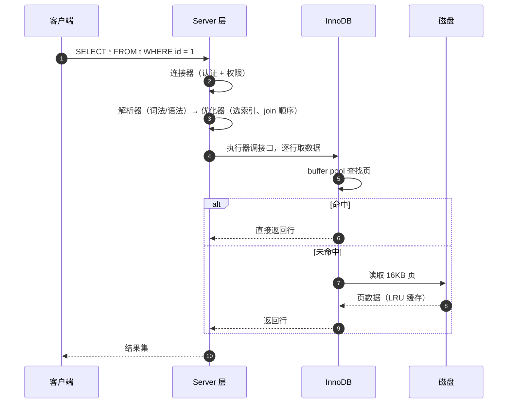
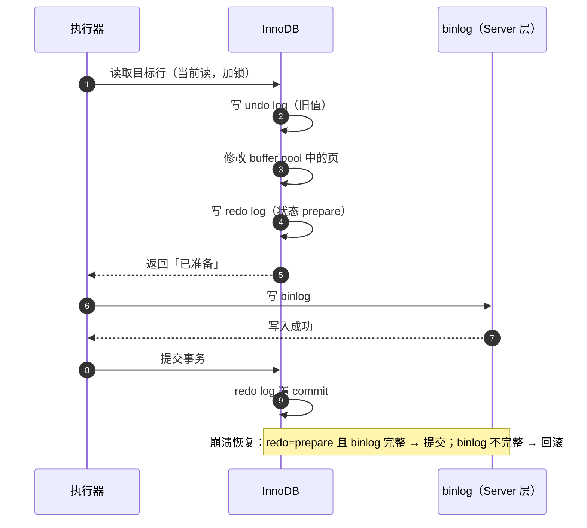
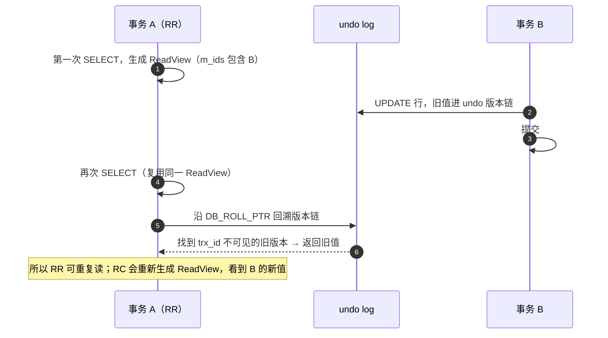
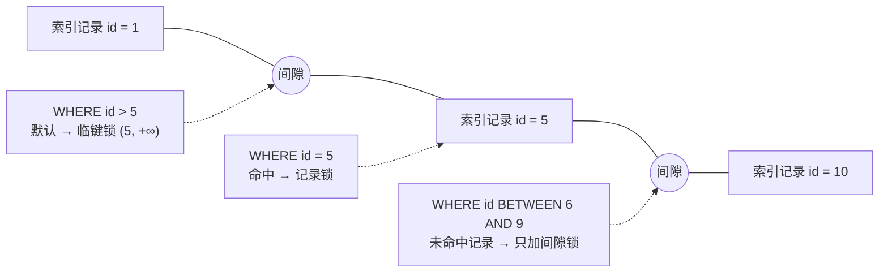

# MySQL 经典面试题（含要点与追问）

> 面向后端岗的 MySQL 高频题，以 **InnoDB + MySQL 8.0** 为准。按「一条 SQL 的旅程 → 索引 → 事务与锁 → 日志 → 优化 → 设计题」组织。
> 每题给出**要点答案**与**常见追问**；建议先遮住答案自测，标记答不出的题。

## 目录

- [一、架构与一条 SQL 的旅程](#一架构与一条-sql-的旅程)
- [二、索引](#二索引)
- [三、事务、MVCC 与锁](#三事务mvcc-与锁)
- [四、日志与持久化](#四日志与持久化)
- [五、优化与运维](#五优化与运维)
- [六、表设计与场景题](#六表设计与场景题)
- [自测清单](#自测清单)
- [附录 A：15 分钟背诵卡](#附录-a15-分钟背诵卡)
- [附录 B：模拟面试 20 题（含追问链）](#附录-b模拟面试-20-题含追问链)
- [附录 C：口述版——3 分钟讲清 InnoDB](#附录-c口述版3-分钟讲清-innodb)
- [附录 D：关键时序图](#附录-d关键时序图)

---

## 一、架构与一条 SQL 的旅程

### 1. 一条 SELECT 是怎么执行的？

```text
客户端 → 连接器（认证 + 权限 + 连接管理）
       → 查询缓存（8.0 已移除）
       → 解析器（词法/语法 → 语法树）
       → 预处理器（语义检查、展开 *）
       → 优化器（选索引、决定 join 顺序、生成执行计划）
       → 执行器（校验权限，调存储引擎接口逐行取数据）
       → InnoDB（buffer pool 命中则返回，未命中读磁盘页）
```

关键点：**优化器决定"怎么取"，执行器负责"真的取"**，两者分离。

> 追问：优化器一定选对索引吗？—— 不一定，它按**成本估算**（`rows` × 代价常数），统计信息不准或索引选择性问题时会选错，可以用 `FORCE INDEX` 或 `ANALYZE TABLE` 干预。

---

### 2. 一条 UPDATE 是怎么执行的？

```text
执行器 → InnoDB：
  ① 取行（命中 buffer pool，未命中就加载整页）
  ② 写 undo log（旧值，用于回滚 + MVCC）
  ③ 修改内存页，写 redo log（状态 prepare）
  ④ 通知 Server 层写 binlog
  ⑤ InnoDB 提交，redo log 置 commit
```

这就是著名的**两阶段提交**，目的：保证 redo log（引擎层）和 binlog（Server 层）一致。

> 追问：为什么不先写 binlog 再写 redo？—— 崩溃后 binlog 有、redo 没有，从库/备份会多出一条主库没提交的数据，主从不一致。

---

### 3. InnoDB 和 MyISAM 怎么选？

| 维度 | InnoDB | MyISAM |
| --- | --- | --- |
| 事务 | ✅ | ❌ |
| 行锁 | ✅ | ❌（只有表锁） |
| 崩溃恢复 | ✅（redo + 两阶段提交） | ❌ |
| 外键 | ✅ | ❌ |
| 聚簇索引 | ✅（主键即数据） | ❌（索引和数据分离） |
| 全文索引 | 5.6+ 支持 | 支持（更早） |
| 适用 | 默认选择、一切 OLTP | 已淘汰，只在极少数只读归档场景 |

> 一句话：**除了历史包袱，没有理由选 MyISAM**。

---

### 4. 为什么单表建议控制在 2000 万行以内？

不是硬限制，而是**经验阈值**：InnoDB 一页 16KB，B+ 树三层大约能放 2000 万行（非叶子节点存主键 + 指针，扇出约 1000+）。超过后树高变 4 层，多一次随机 IO。

真正的判断依据是**数据量和访问模式**，不是行数：

- 单行小、只走主键 → 上亿行也能扛。
- 宽表 + 二级索引多 + 范围查询多 → 几百万就该考虑拆分。

> 追问：树高 4 层和 3 层差多少？—— 多一次磁盘寻址，通常是 0.1~1ms 量级，但如果全走 buffer pool，差异很小。所以「2000 万」更像面试记忆点，工程上看的是**页数、缓存命中率和 QPS**。

---

## 二、索引

### 5. 为什么索引用 B+ 树，不用 B 树 / 哈希 / 红黑树？

| 结构 | 为什么不用 |
| --- | --- |
| 哈希 | 只支持等值，**范围查询、排序、最左前缀全都废**；还有哈希冲突（Memory 引擎用） |
| 红黑树 | 二叉结构，树高 O(logN)，千万行就是 20+ 层 → 20+ 次随机 IO，磁盘扛不住 |
| B 树 | 非叶子节点也存数据 → 单页能放的键更少 → 扇出小、树更高；范围查询要中序回溯 |
| **B+ 树** | **非叶子只存键**（扇出大，3 层搞定千万行）+ **叶子双向链表**（范围扫描顺序 IO）+ 数据都在叶子层（查询稳定） |

> 追问：为什么不用跳表？—— 跳表是内存结构，节点分散、缓存不友好，且无法按页组织成一次 IO。

---

### 6. 聚簇索引和二级索引的区别？什么是回表？

- **聚簇索引（主键索引）**：叶子节点直接存放**整行数据**。所以「主键即数据」，一张表只有一个。
- **二级索引（辅助索引）**：叶子节点存放 **索引列 + 主键值**。
- **回表**：通过二级索引找到主键后，再拿主键去聚簇索引查整行 → **两次 B+ 树查找**。

```sql
-- 假设 idx_name(name)
SELECT * FROM user WHERE name = '张三';
-- ① idx_name 找到主键 id=1  ② 聚簇索引按 id=1 取整行（回表）
```

> 追问：没有主键怎么办？—— InnoDB 会选第一个非空唯一索引，都没有就**生成 6 字节的隐藏 row_id**。所以「建表必须有主键」不是规范洁癖，是性能要求。

---

### 7. 联合索引的最左前缀原则是什么？

`idx(a, b, c)` 的 B+ 树按 `(a, b, c)` 排序，所以：

| 查询条件 | 能否用索引 |
| --- | --- |
| `a = ?` | ✅ |
| `a = ? AND b = ?` | ✅ |
| `a = ? AND b = ? AND c = ?` | ✅ |
| `b = ?` / `c = ?` / `b = ? AND c = ?` | ❌（跳过 a 就断链） |
| `a = ? AND c = ?` | 部分：只用 a，c 不能用于定位（但可走 ICP 过滤） |
| `a > ? AND b = ?` | 范围后的 b **不能用于定位**，只能过滤/排序失效 |

> 追问：`a = ? AND b > ? AND c = ?` 呢？—— a、b 能用，b 是范围条件，c 断链。所以**范围列尽量放最后**。
> 追问：为什么 `(a,b,c)` 不能跳过 a 直接用 b？—— 因为 B+ 树先按 a 排序，a 不确定时 b 在整棵树上是**局部有序、全局无序**，无法二分。

---

### 8. 什么是覆盖索引？什么是索引下推？

**覆盖索引**：查询需要的列全在索引里，**不用回表**。

```sql
-- idx_name_age(name, age)
SELECT name, age FROM user WHERE name = '张三';   -- Extra: Using index（覆盖）
SELECT * FROM user WHERE name = '张三';           -- 要回表
```

**索引下推（ICP，5.6+）**：把 WHERE 中能用索引列判断的条件下推到**存储引擎层**，减少回表次数。

```sql
-- idx_name_age(name, age)
SELECT * FROM user WHERE name LIKE '张%' AND age = 20;
-- 没有 ICP：按 name 前缀回表取整行，再在 Server 层过滤 age
-- 有 ICP：引擎内先用 age 过滤，符合条件的才回表
```

> 追问：怎么确认用了 ICP？—— `EXPLAIN` 的 `Extra` 出现 `Using index condition`。

---

### 9. 索引在哪些情况下会失效？

| 场景 | 原因 | 解法 |
| --- | --- | --- |
| 对索引列做函数/运算 `WHERE YEAR(create_time)=2026` | 索引存的是原值，函数后无法二分 | 改成范围查询 `create_time >= '2026-01-01'` |
| 隐式类型转换 `WHERE phone = 13800000000`（phone 是 varchar） | 字符串被转成数字比较，等价于对列做函数 | 加引号 |
| 前导通配 `LIKE '%张'` | 无序可依 | 改后缀匹配、全文索引、或反转存储 |
| `OR` 一侧无索引 | 另一侧即使有索引也要全表 | 拆成 `UNION ALL` 或补索引 |
| 不满足最左前缀 | 见第 7 题 | 调整索引顺序 |
| 索引选择性太差（如性别） | 优化器算出来全表更便宜 | 建联合索引或走覆盖索引 |
| `!=` / `NOT IN` / `IS NOT NULL`（视数据分布） | 可能扫描大部分行 | 看 `EXPLAIN` 的 `rows` 再决定 |

> 追问：为什么隐式转换会失效？—— `varchar` 列与数字比较时，MySQL 把**列**转成数字（而不是把常量转成字符串），列一变就相当于 `CAST(phone AS SIGNED)`，索引失效。

---

### 10. 为什么推荐自增主键？

- **顺序写入**：自增主键总是追加到 B+ 树最右叶，避免**页分裂**和随机 IO。
- **主键短**：主键会被所有二级索引存一份，用 `BIGINT` 比 UUID（36 字节）省大量空间。
- **页利用率高**：随机主键会导致页填充率下降、碎片增多。

> 追问：分布式下用雪花 ID 行不行？—— 行，但要注意**趋势递增且不暴露业务量**；纯 UUID 不建议做主键，可做业务唯一键。

---

### 11. 索引是不是越多越好？

不是。代价：

- **写放大**：每次 INSERT/UPDATE/DELETE 都要维护所有索引。
- **空间**：二级索引叶子存主键，索引多了占磁盘和 buffer pool。
- **优化器负担**：候选索引变多，选错概率上升。

原则：**为查询建索引，不为"以后可能用到"建索引**；定期用 `sys.schema_unused_indexes` 找无用索引。

---

### 12. 前缀索引与索引选择性？

```sql
ALTER TABLE user ADD INDEX idx_email(email(10));   -- 只索引前 10 个字符
```

- 好处：索引更小、更省内存。
- 代价：**无法覆盖索引、无法用于排序**，且可能回表次数变多。
- 选择性 = `COUNT(DISTINCT col) / COUNT(*)`，越接近 1 越好；一般要求 ≥ 0.1~0.2。

> 追问：怎么选前缀长度？—— 逐步加长，直到「前缀的 distinct 数 / 全列 distinct 数」接近 1（通常 0.9 以上）。

---

## 三、事务、MVCC 与锁

### 13. ACID 分别靠什么实现？

| 特性 | 实现 |
| --- | --- |
| **A 原子性** | undo log（回滚） |
| **C 一致性** | 由 A + I + D 共同保证（业务层也要兜） |
| **I 隔离性** | MVCC（快照读）+ 锁（当前读） |
| **D 持久性** | redo log（WAL）+ doublewrite + `innodb_flush_log_at_trx_commit=1` |

> 追问：一致性靠数据库就够了吗？—— 不够。约束、唯一索引、外键是数据库能管的；业务不变式（如"库存不能为负"）必须应用层或条件更新保证。

---

### 14. 四种隔离级别，RR 能解决幻读吗？

| 级别 | 脏读 | 不可重复读 | 幻读 |
| --- | --- | --- | --- |
| READ UNCOMMITTED | ✅ 会 | ✅ 会 | ✅ 会 |
| READ COMMITTED | ❌ | ✅ 会 | ✅ 会 |
| **REPEATABLE READ（默认）** | ❌ | ❌ | **分情况** |
| SERIALIZABLE | ❌ | ❌ | ❌ |

**RR 下的幻读**：

- **快照读**（普通 `SELECT`）：靠 MVCC 的 ReadView，看不到别的事务新插入的行 → 不会幻读。
- **当前读**（`SELECT ... FOR UPDATE` / `UPDATE` / `DELETE`）：靠 **next-key lock**（间隙锁）锁住区间 → 不会幻读。
- **但**：先快照读、再当前读（或反过来），仍可能"看到"新行 —— 这是 RR 的经典例外。

> 追问：那 RR 到底算不算解决幻读？—— 标准答案是「**基本解决**」：MVCC 管快照读、间隙锁管当前读；混合场景仍有边界情况，需要 `FOR UPDATE` 或业务层兜。

---

### 15. MVCC 是怎么实现的？

三件套：**隐藏列 + undo 版本链 + ReadView**。

- 每行有隐藏列：`DB_TRX_ID`（最后修改的事务 ID）、`DB_ROLL_PTR`（指向 undo 的指针）。
- 修改时把旧版本写进 undo log，形成**版本链**。
- `ReadView` 记录四个值：`m_ids`（活跃事务列表）、`min_trx_id`、`max_trx_id`、`creator_trx_id`。
- 判断规则：`trx_id < min_trx_id` 可见；`>= max_trx_id` 不可见；在中间则看 `m_ids` 是否包含。

**RC 与 RR 的唯一区别**：

- RC：**每次 SELECT 都生成新的 ReadView**（所以能读到别人已提交的新数据）。
- RR：**只在第一次 SELECT 时生成**，整个事务复用（所以可重复读）。

> 追问：MVCC 能完全替代锁吗？—— 不能。写写冲突、`UPDATE` 的当前读、唯一性检查都必须加锁；MVCC 只解决读不加锁的问题。

---

### 16. 快照读和当前读的区别？

| | 快照读 | 当前读 |
| --- | --- | --- |
| 语句 | 普通 `SELECT` | `SELECT ... FOR UPDATE` / `LOCK IN SHARE MODE` / `UPDATE` / `DELETE` / `INSERT` |
| 读什么 | ReadView 可见的历史版本 | **最新已提交版本** |
| 加锁 | 不加锁 | 加锁（记录锁 / 间隙锁） |
| 用途 | 高并发读 | 需要基于最新值做判断 |

> 追问：`UPDATE ... WHERE stock > 0` 是当前读吗？—— 是，所以它能防超卖；但要注意**它锁的是命中的行和间隙**，并发高时容易死锁。

---

### 17. InnoDB 有哪些锁？next-key lock 解决什么？

| 锁 | 范围 | 说明 |
| --- | --- | --- |
| 记录锁 Record Lock | 单条索引记录 | 唯一索引等值命中时退化为记录锁 |
| 间隙锁 Gap Lock | 开区间 `(x, y)` | 阻止插入，**只存在于 RR** |
| **临键锁 Next-Key Lock** | `(x, y]` 前开后闭 | 记录锁 + 间隙锁，RR 默认 |
| 插入意向锁 Insert Intention | 插入位置 | 插入前申请的间隙锁，多个插入不冲突 |

> 追问：RC 为什么没有间隙锁？—— RC 允许幻读，不需要阻止插入，锁范围更小、并发更高（很多互联网公司把默认改成 RC）。
> 追问：`WHERE id = 5` 加什么锁？—— 唯一索引等值且存在 → 记录锁；**不存在** → 间隙锁（这正是 RR 下"锁住不存在的行"的来源）。

---

### 18. 死锁怎么产生、怎么排查？

**产生**：两个事务以相反顺序持有并等待对方的锁 → 循环等待。

```sql
-- 事务 A：UPDATE t WHERE id=1; 然后 UPDATE t WHERE id=2;
-- 事务 B：UPDATE t WHERE id=2; 然后 UPDATE t WHERE id=1;
```

**排查**：

```sql
SHOW ENGINE INNODB STATUS;              -- LATEST DETECTED DEADLOCK 段落
SELECT * FROM information_schema.innodb_trx;
SELECT * FROM performance_schema.data_locks;
```

**处理**：

- InnoDB 默认开启 `innodb_deadlock_detect`，检测到就**回滚代价小的事务**；关闭则靠 `innodb_lock_wait_timeout` 超时。
- 根治：**统一加锁顺序**、缩小事务范围、走主键/唯一索引、避免大范围 `UPDATE`。

> 追问：死锁检测有代价吗？—— 有，每个等锁事务都要遍历等待图，高并发下 CPU 飙升。常见折中：业务保证无死锁 + 关掉检测，只留超时。

---

### 19. 间隙锁和插入意向锁为什么容易互相阻塞？

- 事务 A 执行 `SELECT * FROM t WHERE id BETWEEN 5 AND 10 FOR UPDATE` → 锁住 `(4, 10]` 这段间隙。
- 事务 B 要 `INSERT id=7` → 申请**插入意向锁**，与 A 的间隙锁冲突 → 阻塞。
- 多个事务都想插同一个间隙时，**插入意向锁之间不冲突**，但都要等间隙锁释放。

> 追问：这算 bug 吗？—— 不算，是 RR 保证不幻读的代价。所以高并发插入场景更适合 **RC + 应用层唯一约束**。

---

## 四、日志与持久化

### 20. redo log、undo log、binlog 三者的区别？

| | redo log | undo log | binlog |
| --- | --- | --- | --- |
| 层级 | InnoDB 引擎层 | InnoDB 引擎层 | **Server 层** |
| 类型 | 物理日志（页的修改） | 逻辑日志（旧值） | 逻辑日志（SQL / 行变更） |
| 作用 | 崩溃恢复（crash-safe） | 回滚 + MVCC | 主从复制 + 备份恢复 |
| 写入 | **循环写**（固定大小，write pos / checkpoint） | 随事务写，可 purge | **追加写**（不覆盖） |
| 落盘控制 | `innodb_flush_log_at_trx_commit` | — | `sync_binlog` |

> 追问：为什么 redo 是循环写而 binlog 是追加写？—— redo 只保证"已提交的修改不丢"，旧的部分刷完盘就没用了可以覆盖；binlog 要保留完整历史给从库和备份，不能覆盖。

---

### 21. 为什么需要两阶段提交？崩溃了怎么恢复？

**问题**：redo log 和 binlog 是两个独立的日志，必须同时成功。

```text
① InnoDB 写 redo，标记 prepare
② Server 写 binlog
③ InnoDB 把 redo 标记 commit
```

**恢复规则**（崩溃重启时）：

- redo 是 **prepare** 且 **binlog 完整** → 提交（保证主从不分叉）。
- redo 是 **prepare** 且 **binlog 不完整** → 回滚。
- redo 已 **commit** → 直接提交。

**核心思想**：以 binlog 是否完整作为"事务是否算数"的判据。

> 追问：能只用一个日志吗？—— 历史上 binlog 是 Server 层、redo 是引擎层，两者解耦导致必须协调；换成单一日志需要改架构（这也是很多新数据库的做法）。

---

### 22. doublewrite buffer 解决什么？

**页断裂（partial page write）**：16KB 的页写到一半断电 → 页损坏，且 redo log 也修不了（redo 是"对页做修改"，前提是页本身完好）。

**做法**：刷脏页前先顺序写到 doublewrite 区（连续 2MB 空间），再写到真实位置；崩溃恢复时用 doublewrite 里的完整副本修复。

> 追问：性能影响？—— 是两次写，但 doublewrite 是**顺序写 + 批量刷**，代价远小于随机写，通常可接受（`innodb_doublewrite=1` 默认开）。

---

### 23. change buffer 是什么？

对**非唯一二级索引**的写操作，如果目标页不在 buffer pool，先把变更记到 change buffer（内存 + 定期落盘），等页被读入时再 merge。

- 目的：把**随机 IO 变延迟批量 IO**。
- 只对非唯一索引有效（唯一索引必须读页判断冲突）。
- `innodb_change_buffer_max_size` 控制占比（默认 25%）。

> 追问：为什么唯一索引用不了？—— 唯一性检查必须读页确认有没有冲突，读进来就直接改页了，不需要 buffer。

---

### 24. binlog 三种格式怎么选？

| 格式 | 记录内容 | 优点 | 缺点 |
| --- | --- | --- | --- |
| STATEMENT | SQL 原文 | 日志小 | 函数/时间戳等**不确定语句**主从不一致 |
| ROW | 行变更前后值 | **最安全**，可恢复任意行 | 日志大（批量更新时暴涨） |
| MIXED | 自动切换 | 折中 | 行为不可预测 |

生产默认 **ROW**（`binlog_format=ROW`），配合 `binlog_row_image=MINIMAL` 减小体积。

> 追问：ROW 格式下能看到 SQL 吗？—— 只能看到行变更；排查可用 `mysqlbinlog -vv --base64-output=decode-rows`。

---

## 五、优化与运维

### 25. `EXPLAIN` 怎么看？

重点四个字段：

| 字段 | 关注点 |
| --- | --- |
| `type` | 访问类型，好到差：`system > const > eq_ref > ref > range > index > ALL`，**出现 `ALL` 基本就是要优化** |
| `key` | 实际用的索引；`NULL` 表示没用上 |
| `rows` | 预估扫描行数（不是精确值） |
| `Extra` | `Using index`（覆盖）、`Using index condition`（ICP）、`Using where`、**`Using filesort`**、**`Using temporary`**、`Using join buffer` |

> 追问：`Using index` 和 `Using index condition` 有什么区别？—— 前者是覆盖索引（不回表），后者是索引下推（减少了回表但可能仍回表）。
> 追问：`rows` 小就一定快吗？—— 不一定，估算基于统计信息；实际看 `EXPLAIN ANALYZE`（8.0.18+）的真实耗时。

---

### 26. 深分页怎么优化？

```sql
-- 问题：扫描 100010 行只返回 10 行
SELECT * FROM t ORDER BY id LIMIT 100000, 10;
```

三种解法：

1. **延迟关联**（覆盖索引先取主键，再回表）：
   ```sql
   SELECT t.* FROM t
   JOIN (SELECT id FROM t ORDER BY id LIMIT 100000, 10) x ON t.id = x.id;
   ```
2. **游标分页**（推荐，业务改造）：`WHERE id > #{lastId} ORDER BY id LIMIT 10`。
3. **限制最大页数**（产品层兜底）。

> 追问：为什么 `LIMIT 100000, 10` 慢？—— 它必须**先读并丢弃前 100000 行**（对二级索引还要回表），成本与 offset 成正比。

---

### 27. 大表 DDL 怎么做？

- **5.6+ 的 Online DDL**：`ALGORITHM=INPLACE, LOCK=NONE`，很多操作不阻塞读写（但重建表仍占 IO）。
- **8.0 Instant DDL**：加列（末尾）是秒级元数据操作。
- **pt-online-schema-change / gh-ost**：建影子表 + 触发器/binlog 同步 + 改名切换，适合超大表和不支持 online 的操作。
- 铁律：**低峰执行 + 监控主从延迟 + 可回滚**。

> 追问：`ALTER TABLE ... ADD COLUMN` 一定会锁表吗？—— 8.0 加末尾列是 INSTANT；但加在中间、改列类型、加索引（非 online）都可能重建表。

---

### 28. 主从复制的原理？

```text
主库：binlog dump 线程 → 发送 binlog
从库：IO 线程 → 写入 relay log
      SQL 线程 → 重放 relay log
```

- **异步复制**（默认）：主库不关心从库是否收到，主库挂了可能丢数据。
- **半同步**：至少一个从库 ACK 才算提交成功（`rpl_semi_sync_source`），可用性换一致性。
- **GTID**：每个事务有全局唯一 ID，切换主库时自动定位位点，不用手算 `binlog file + pos`。

> 追问：并行复制怎么做到的？—— 按 `LOGICAL_CLOCK`（同组提交的事务可并行）或 `WRITESET`（无冲突事务可并行），从库 SQL 线程从单线程变多线程。

---

### 29. 主从延迟的原因与解决？

**原因**：

1. 大事务（一次更新百万行）→ 从库重放慢。
2. 从库上无索引的 `UPDATE`/`DELETE` → 每行全表扫。
3. 从库承担大量读 + 单线程重放跟不上。
4. 大表 DDL、锁等待。

**解决**：

- 拆大事务、批量提交。
- 从库加索引（或改为 ROW + 主键更新）。
- 开**并行复制**、升级从库配置。
- 业务兜底：**强制读主**（写后立即读）、半同步、`WAIT_FOR_EXECUTED_GTID_SET`。

> 追问：怎么监控延迟？—— `SHOW SLAVE STATUS` 的 `Seconds_Behind_Master`（不准）+ `pt-heartbeat`（更准）。

---

### 30. 分库分表的时机与坑？

**时机**：单表 > 2000 万且索引优化到头、单库连接数/QPS/磁盘到瓶颈。

**坑（比方案更重要）**：

| 问题 | 应对 |
| --- | --- |
| 跨库 JOIN | 冗余字段 / 应用层组装 / ES 做查询 |
| 分布式事务 | 本地消息表 + 最终一致（不要轻易上 XA） |
| 跨分片分页/排序 | 各分片取 N 条再归并，或限制查询条件 |
| 全局唯一 ID | 雪花算法 / 号段模式 |
| 扩容 | 双倍分片 + 双写迁移 + 灰度切读 |
| 聚合统计 | 走离线数仓或汇总表 |

> 追问：什么时候不该分？—— 能加索引、能拆冷热数据、能上缓存的，先做这些；分库分表是**最后手段**。

---

### 31. 连接池怎么配？

- 不是越大越好：连接是**并发资源**，`maxActive` 超过数据库处理能力只会让排队更长。
- 经验公式：`connections ≈ CPU 核数 × 2 + 磁盘数`；实际看压测的 QPS 与 RT。
- 必配：`maxWait`（拿连接超时）、`validationQuery`、`minIdle`（预热）。
- 排查：`SHOW PROCESSLIST` 看是否堆积在 `Sleep`（连接泄漏）或 `Query`（慢 SQL）。

> 追问：连接泄漏的典型症状？—— 应用侧连接池耗尽、DB 侧大量 `Sleep` 连接，重启后短暂恢复。

---

### 32. `COUNT(*)` 为什么慢？怎么优化？

InnoDB **不保存总行数**（MVCC 下每行对不同事务可见性不同，无法缓存一个准确值），必须扫索引统计。

- `COUNT(*)` / `COUNT(1)`：优化器选**最小的索引树**扫描（通常是某个二级索引）。
- `COUNT(col)`：**不统计 NULL**，且要回表取值，更慢。

优化：用汇总表 / Redis 计数 / `SHOW TABLE STATUS` 的估算值（不准）/ 业务上就别要精确总数。

> 追问：为什么 InnoDB 不像 MyISAM 那样存一个 count？—— MyISAM 无事务、无 MVCC；InnoDB 不同事务看到的行数可能不同。

---

### 33. 慢查询怎么定位？索引怎么建？

**定位**：

```sql
SET GLOBAL slow_query_log = ON;
SET GLOBAL long_query_time = 1;
-- 或用 performance_schema.events_statements_summary_by_digest 排行
```

再用 `pt-query-digest` 聚合，按「总耗时 = 次数 × 单次耗时」排序，先治大头。

**建索引的套路**：

1. 先看 `WHERE` / `JOIN` / `ORDER BY` / `GROUP BY` 用到的列。
2. 按**等值在前、范围在后、排序尽量复用索引序**排联合索引。
3. 优先做**覆盖索引**，能免回表就免。
4. 建完用 `EXPLAIN` 验证，再压测看真实收益。

> 追问：为什么"等值在前范围在后"？—— 范围条件之后的列在 B+ 树里失去全局有序，无法继续定位（第 7 题）。

---

## 六、表设计与场景题

### 34. 给一个订单表设计索引，你怎么想？

```sql
CREATE TABLE t_order (
  id BIGINT UNSIGNED AUTO_INCREMENT PRIMARY KEY,
  order_no VARCHAR(32) NOT NULL,
  user_id BIGINT UNSIGNED NOT NULL,
  status TINYINT NOT NULL,
  created_at DATETIME NOT NULL,
  UNIQUE KEY uk_order_no (order_no),
  KEY idx_user_created (user_id, created_at),
  KEY idx_status_created (status, created_at)
) ENGINE=InnoDB DEFAULT CHARSET=utf8mb4;
```

思路：

- `order_no` 是**业务唯一键**，必须唯一索引（幂等 + 查询）。
- 「我的订单」= `user_id` 等值 + 时间排序 → `(user_id, created_at)` 天然有序，免排序。
- 后台按状态扫单 → `(status, created_at)`。
- 不要给 `status` 单独建索引（选择性太低）。

> 追问：为什么 `(user_id, created_at)` 能免排序？—— B+ 树在 `user_id` 相同时按 `created_at` 有序，直接顺着叶子链表取即可。

---

### 35. 唯一索引 vs 先查后插？

**先查后插有竞态**：两个请求都查到"不存在"，然后都插入 → 重复数据。

**唯一索引是原子的**：`INSERT` 时由存储引擎判重，冲突抛 `DuplicateKeyException`（错误码 1062）。

工程写法：

```sql
INSERT INTO t (biz_no, ...) VALUES (?, ...);   -- 捕获 1062 → 视为幂等成功
```

> 追问：`INSERT ... ON DUPLICATE KEY UPDATE` 和 `INSERT IGNORE` 怎么选？—— 前者会更新（可用于 upsert，但注意自增 ID 会跳号）；后者静默忽略（可能吞掉其他错误）。

---

### 36. 库存扣减里，乐观锁和悲观锁怎么选？

| 方案 | 写法 | 适用 |
| --- | --- | --- |
| 悲观锁 | `SELECT ... FOR UPDATE` 再 `UPDATE` | 冲突高、事务短 |
| 乐观锁 | `UPDATE ... SET stock = stock - 1, version = version + 1 WHERE id = ? AND version = ?` | 冲突低、读多写少 |
| **条件更新（推荐）** | `UPDATE ... SET stock = stock - 1 WHERE id = ? AND stock >= 1` | 最简单且天然防超卖 |

> 追问：为什么"条件更新"最常用？—— 一条语句内完成判断 + 修改，**原子**；影响行数为 0 就是库存不足，不需要先读后写。
> 追问：`UPDATE` 会不会锁太多？—— 走主键/唯一索引只锁单行；如果 `WHERE` 条件走的是普通索引或全表，会锁大量记录甚至间隙（第 17 题）。

---

### 37. `VARCHAR(255)` 有什么讲究？`INT(11)` 是什么意思？

- `VARCHAR(n)` 的 n 是**字符数**不是字节数（`utf8mb4` 下一个中文字最多 4 字节）；索引长度还受**单索引 3072 字节**限制（InnoDB，`DYNAMIC` 行格式）。
- `INT(11)` 的 11 **只是显示宽度**（配合 `ZEROFILL`），不影响存储和范围，**8.0.17 起已废弃**。
- 选型建议：`INT UNSIGNED` 够用就别用 `BIGINT`；时间用 `DATETIME`（8 字节，无时区问题）或 `TIMESTAMP`（4 字节，有 2038 问题和时区转换）。

> 追问：为什么推荐 `utf8mb4` 而不是 `utf8`？—— MySQL 的 `utf8` 是**阉割版（最多 3 字节）**，存不了 emoji 和部分生僻字。

---

### 38. 三范式与反范式怎么取舍？

- **范式**：减少冗余、避免更新异常（`user_id` 只存 id，不存昵称）。
- **反范式**：冗余字段换查询性能（订单表冗余 `user_name`、`product_name`），代价是**一致性要靠应用维护**。

判断标准：

1. 读多写少 + 冗余字段极少变更 → 可以冗余。
2. 需要强一致 → 用 JOIN 或视图，别冗余。
3. 冗余字段要有**同步机制**（同事务写 / 消息补偿 / 定时对账）。

> 追问：订单为什么要冗余商品名？—— 商品改名后历史订单应显示当时的名字，这既是性能也是**业务语义**（快照）。

---

## 自测清单

打勾表示能**不看资料讲清原理并写出 SQL**：

- [ ] 一条 SELECT / UPDATE 的完整执行路径
- [ ] 两阶段提交与崩溃恢复规则
- [ ] B+ 树 vs 哈希/红黑树/B 树的取舍
- [ ] 聚簇索引、二级索引、回表的图解
- [ ] 最左前缀、覆盖索引、ICP
- [ ] 索引失效的六种典型场景
- [ ] ACID 各自靠什么实现
- [ ] MVCC 三件套、RC 与 RR 的唯一区别
- [ ] 快照读 vs 当前读
- [ ] 记录锁 / 间隙锁 / 临键锁的加锁范围
- [ ] 死锁的排查命令与根治手段
- [ ] redo / undo / binlog 的区别
- [ ] doublewrite、change buffer 各自解决什么
- [ ] `EXPLAIN` 四个关键字段
- [ ] 深分页三种解法
- [ ] 主从复制链路、半同步、GTID
- [ ] 分库分表的坑与替代方案
- [ ] 条件更新为什么能防超卖

---

# 附录 A：15 分钟背诵卡

> 每条一句话，数字与结论优先。

### 架构与索引（1~12 题）

1. SELECT 五站：连接器 → 解析器 → 优化器 → 执行器 → 存储引擎。
2. UPDATE 五步：取行 → undo → 改页 + redo(prepare) → binlog → commit。
3. 单表 2000 万是**经验值**，看的是页数、缓存命中率和 QPS，不是行数。
4. B+ 树三个理由：**非叶子只存键（扇出大）**、**叶子链表（范围扫描）**、**数据都在叶子（查询稳定）**。
5. 聚簇索引叶子存整行，二级索引叶子存主键 → 二次查找就是**回表**。
6. 没有主键 InnoDB 会造 6 字节隐藏 `row_id` —— 所以建表必须有主键。
7. 最左前缀断链的本质：跳过 a，b 在整棵树上是**局部有序、全局无序**。
8. 联合索引排序口诀：**等值在前、范围在后、排序靠索引序**。
9. 覆盖索引（`Using index`）免回表；ICP（`Using index condition`）减少回表。
10. 索引失效六连：函数/运算、隐式转换、前导通配、OR 无索引侧、不满足最左、选择性太差。
11. 自增主键：顺序写避免页分裂 + 主键短（二级索引都存一份）。
12. 前缀索引省空间，但**不能覆盖、不能排序**；选择性建议 ≥ 0.1。

### 事务与锁（13~19 题）

13. ACID：A=undo、I=MVCC+锁、D=redo+doublewrite、C 靠三者共同保证。
14. RC 每次 SELECT 新建 ReadView，**RR 只在第一次建**——这是两者唯一区别。
15. MVCC = 隐藏列（`DB_TRX_ID`/`DB_ROLL_PTR`）+ undo 版本链 + ReadView。
16. 快照读不加锁读历史版本；当前读（`FOR UPDATE`/`UPDATE`）读最新并加锁。
17. 锁三件套：记录锁（单行）、间隙锁（开区间，**仅 RR**）、临键锁（前开后闭，默认）。
18. RC 没有间隙锁 → 并发更高，代价是幻读，靠唯一索引兜。
19. 死锁靠**统一加锁顺序 + 小事务 + 走主键更新**根治，不是靠调大超时。

### 日志与优化（20~33 题）

20. redo 物理、循环写、管崩溃恢复；undo 逻辑、管回滚和 MVCC；binlog 逻辑、追加写、管复制和备份。
21. 两阶段提交的判据：**redo 是 prepare 时，看 binlog 是否完整**。
22. doublewrite 防**页断裂**；change buffer 把随机写变延迟批量写（只对非唯一二级索引）。
23. binlog 生产用 **ROW**，配 `binlog_row_image=MINIMAL`。
24. `EXPLAIN` 先看 `type`，出现 `ALL` 就要动手；再看 `key`、`rows`、`Extra`。
25. `filesort` / `temporary` 是两大红灯。
26. 深分页三招：延迟关联、游标分页（推荐）、限制最大页数。
27. 大表 DDL：`ALGORITHM=INPLACE, LOCK=NONE` / Instant DDL / gh-ost，低峰执行。
28. 主从：binlog dump → IO 线程 → relay log → SQL 线程；半同步换一致性，GTID 免手算位点。
29. 主从延迟四因：大事务、无索引更新、从库压力、DDL；按此顺序治。
30. 分库分表是**最后手段**，先加索引、拆冷热、上缓存。
31. 连接池不是越大越好，`maxActive` 超过 DB 处理能力只会排队更久。
32. `COUNT(*)` 慢是因为 MVCC 下没有全局行数，优化器会走最小二级索引。
33. 建索引四步：看条件列 → 等值前范围后 → 尽量覆盖 → `EXPLAIN` 验证再压测。

> 记忆锚点：**旅程 → 索引 → 事务锁 → 日志 → 优化 → 设计**。

---

# 附录 B：模拟面试 20 题（含追问链）

### 1. 一条 SQL 从客户端发到返回，中间发生了什么？

**开口**：连接器认证与权限 → 解析器建语法树 → 优化器选索引和 join 顺序 → 执行器调引擎接口 → InnoDB 走 buffer pool。
**追问**：优化器凭什么选索引？→ 成本估算（`rows` × 代价常数 + 是否回表），统计信息不准就会选错。

### 2. 为什么用 B+ 树不用 B 树？

**开口**：B 树的非叶子也存数据，单页能放的键更少、扇出小、树更高；范围查询还要中序回溯。
**追问**：B+ 树三层能放多少？→ 非叶子扇出约千级，叶子页数千级，大约 2000 万行。

### 3. 什么是回表？怎么避免？

**开口**：二级索引拿到主键后回聚簇索引取整行，两次查树。
**追问**：怎么避免？→ 覆盖索引（`Using index`）、或者用主键查询、或者把需要的小字段放进联合索引。

### 4. 联合索引 (a,b,c)，`WHERE b=1 AND c=2` 能走索引吗？

**开口**：不能定位，因为跳过 a 后 b 在全局无序；但如果是覆盖索引做全扫描，可能显示 `Using index`。
**追问**：那怎么优化？→ 建 `(b, c)` 索引，或把 a 补进查询条件。

### 5. `WHERE a > 1 AND b = 2` 用 (a,b) 索引能用到 b 吗？

**开口**：不能用于定位（a 是范围），b 只能靠 ICP 过滤或者完全失效。
**追问**：所以索引顺序怎么排？→ 等值列在前、范围列在后。

### 6. 索引失效遇到过哪些？

**开口**：函数、隐式类型转换、前导通配、OR 一侧无索引、不满足最左、选择性差。
**追问**：怎么发现的？→ `EXPLAIN` 看 `key` 是否为 `NULL`、`type` 是否 `ALL`。

### 7. RC 和 RR 的区别到底是什么？

**开口**：只有一点——ReadView 生成的时机。RC 每次 SELECT 都建，RR 只在第一次建。
**追问**：那幻读呢？→ RC 有幻读；RR 靠 MVCC（快照读）+ 间隙锁（当前读）基本解决。

### 8. MVCC 能完全替代锁吗？

**开口**：不能，它只让读不加锁；写写冲突、唯一性检查、`UPDATE` 的当前读都必须加锁。
**追问**：那 MVCC 的意义？→ 读写不互相阻塞，读多写少的场景吞吐提升明显。

### 9. 间隙锁有什么用，为什么 RC 没有？

**开口**：锁住区间防插入 → 防幻读。RC 允许幻读，所以不需要，锁范围更小。
**追问**：那 RC 怎么防重复插入？→ 唯一索引，靠原子约束而不是锁。

### 10. 死锁了怎么处理？

**开口**：先 `SHOW ENGINE INNODB STATUS` 看死锁日志，再统一加锁顺序、缩小事务、走主键更新。
**追问**：`innodb_deadlock_detect` 关掉行不行？→ 可以，但只剩超时兜底，高并发下体验差。

### 11. 为什么有 redo log 还要 binlog？

**开口**：前者是引擎层的崩溃恢复，后者是 Server 层的复制与备份，职责不同。
**追问**：那怎么保证两者一致？→ 两阶段提交，以 binlog 完整性作为恢复判据。

### 12. `innodb_flush_log_at_trx_commit` 和 `sync_binlog` 怎么配？

**开口**：金融级 `1 + 1`（每次提交都刷盘），追求吞吐可以 `2 + 100` 之类，但会丢数据。
**追问**：丢多少？→ `2` 时丢最多 1 秒；`0` 时可能丢更多（由 OS 刷盘决定）。

### 13. `UPDATE` 会不会锁表？

**开口**：`WHERE` 走主键/唯一索引只锁单行；走普通索引会锁命中行 + 间隙；不走索引等于锁全表（RR 下接近全表 next-key lock）。
**追问**：怎么避免？→ 保证 `WHERE` 命中索引且尽量走主键，拆小批量更新。

### 14. 慢查询怎么排查？

**开口**：开 slow log → `pt-query-digest` 按总耗时排序 → `EXPLAIN` 看执行计划 → 改 SQL 或加索引。
**追问**：加了索引还是慢？→ 看是否回表太多、是否排序/临时表、是否锁等待、是否数据量大到要分片。

### 15. 深分页为什么慢，怎么改？

**开口**：`LIMIT offset, n` 要先扫描并丢弃 offset 行；改成延迟关联或游标分页。
**追问**：游标分页的缺点？→ 不能跳页，只能"下一页"，需要前端配合。

### 16. 主从延迟怎么排查？

**开口**：看 `Seconds_Behind_Master` + `pt-heartbeat`；再看是不是大事务、无索引更新、从库压力大。
**追问**：业务上怎么兜？→ 写后读强制走主库，或半同步复制。

### 17. 分库分表后跨库 JOIN 怎么办？

**开口**：避免跨库 JOIN——冗余字段、应用层组装、把查询场景丢给 ES。
**追问**：分页怎么办？→ 各分片取 N 条归并，或按分片键查询（避免全局排序）。

### 18. 库存扣减你会怎么写？

**开口**：`UPDATE ... SET stock = stock - 1 WHERE id = ? AND stock >= 1`，判断影响行数。
**追问**：为什么不用 `SELECT ... FOR UPDATE`？→ 也能防超卖，但锁持有时间长、并发低；条件更新一条语句搞定。

### 19. 唯一索引和"先查后插"有什么区别？

**开口**：先查后插有竞态窗口，唯一索引由存储引擎保证原子性。
**追问**：冲突了怎么处理？→ 捕获 1062，当作幂等成功返回。

### 20. 如果让你优化一条跑 5 秒的 SQL，你的步骤是？

**开口**：先看执行计划 → 定位是全表扫、回表多、排序临时表还是锁等待 → 对症加索引/改 SQL/改表结构。
**追问**：改完怎么验证？→ `EXPLAIN ANALYZE` 看实际耗时 + 压测看 QPS/RT + 观察主从延迟。

---

# 附录 C：口述版——3 分钟讲清 InnoDB

> 面试官问「讲讲你对 MySQL 的理解」时用。约 800 字 ≈ 3 分钟。

### 逐字稿

**【开场 · 15 秒】**
我讲 MySQL 一般围绕一件事：**InnoDB 怎么在保证事务的同时把随机 IO 变成顺序 IO**。索引、日志、MVCC、锁，其实都是在回答这个问题。

**【一条 SQL 的旅程 · 40 秒】**
一条查询走五站：连接器做认证和权限，解析器生成语法树，优化器按成本选索引和 join 顺序，执行器调存储引擎接口，最后 InnoDB 在 buffer pool 里找页，没命中才读磁盘。
写路径更值得讲：取行 → 写 undo → 改内存页并写 redo（prepare）→ 写 binlog → redo 置 commit。这就是**两阶段提交**，崩溃恢复时以 binlog 是否完整作为事务算不算数的判据。

**【索引 · 50 秒】**
索引用 B+ 树，三个理由：非叶子只存键所以扇出大，三层就能放两千万行；叶子是双向链表，范围查询是顺序 IO；数据都在叶子层，查询路径长度稳定。
聚簇索引叶子存整行，二级索引叶子存主键，所以要**回表**——覆盖索引就是为了免掉这一步。联合索引的核心是**最左前缀**：跳过前面的列，后面的列在整棵树上是局部有序全局无序，没法二分。所以索引设计口诀是等值在前、范围在后、排序尽量复用索引序。

**【事务与锁 · 45 秒】**
隔离性靠 MVCC 加锁。MVCC 是三件套：隐藏列 `DB_TRX_ID`、undo 版本链、ReadView。RC 和 RR 唯一的区别就是 ReadView 什么时候建——RC 每次查询都建，RR 只在第一次建。
锁这块一定分清快照读和当前读：普通 SELECT 不加锁读历史版本，`FOR UPDATE` 和 `UPDATE` 是当前读，读最新值并加锁。RR 默认是临键锁，等于记录锁加间隙锁，间隙锁就是用来防幻读的；RC 没有间隙锁，所以并发更高。

**【日志与优化 · 40 秒】**
日志三个各有分工：redo 是物理日志、循环写、管崩溃恢复；undo 是逻辑日志、管回滚和 MVCC；binlog 是 Server 层的逻辑日志、追加写、管复制和备份。doublewrite 防页断裂，change buffer 把非唯一二级索引的随机写变延迟写。
优化我按这个顺序：先 `EXPLAIN` 看 `type` 和 `Extra`，`ALL`、`filesort`、`temporary` 三个红灯；再看深分页、回表、索引失效；最后才考虑分库分表。

**【收尾 · 15 秒】**
如果让我总结 MySQL 的面试主线：**索引决定怎么找，日志决定怎么不丢，MVCC 和锁决定并发看到什么**。这三句话说清，细节都能挂上去。

---

### 压缩版

**一句话版（10 秒）**
> InnoDB 用 B+ 树把随机 IO 变顺序 IO，用 redo/undo/binlog 保证不丢和可回滚，用 MVCC 加锁控制并发可见性。

**30 秒版**
> 查询走连接器、解析器、优化器、执行器到引擎；写走两阶段提交。索引是 B+ 树，聚簇索引存整行、二级索引存主键所以要回表，联合索引守最左前缀。事务 ACID 靠 undo、redo、MVCC 和锁。RC 与 RR 只差 ReadView 的生成时机，RR 额外用间隙锁防幻读。优化先看执行计划，再谈分库分表。

### 时间分配

| 段落 | 时长 | 只说一件事 |
| --- | --- | --- |
| 开场 | 15s | 主线：并发 + 随机 IO 变顺序 IO |
| SQL 旅程 | 40s | 查询五站 + 更新两阶段提交 |
| 索引 | 50s | B+ 树三理由 → 回表 → 最左前缀口诀 |
| 事务与锁 | 45s | MVCC 三件套 → RC/RR 差别 → 快照读 vs 当前读 |
| 日志与优化 | 40s | 三个日志分工 → 执行计划三个红灯 |
| 收尾 | 15s | 索引 / 日志 / 可见性 三句话 |

### 被打断时怎么接

| 面试官插话 | 接续句 |
| --- | --- |
| 「为什么不用哈希索引？」| 「它只支持等值查询，范围、排序、最左前缀全废——这也是 Memory 引擎的局限」 |
| 「RR 到底解不解决幻读？」 | 「标准答案是基本解决：MVCC 管快照读、间隙锁管当前读，混合场景还有边界」 |
| 「你们线上死锁多吗？」 | 「高峰期有过，根因是批量更新没按主键顺序，后来统一排序 + 拆批就好了」 |
| 「分库分表做过吗？」 | 「做过，但我会先说清什么情况下不该分——能加索引、能拆冷热就不分」 |

---

# 附录 D：关键时序图

### 1. 一条 SELECT 的旅程



### 2. 一条 UPDATE 的两阶段提交



### 3. MVCC：快照读为什么能读到旧值



### 4. RR 下的加锁范围



> 图注：RR 默认 next-key lock 是**前开后闭**；唯一索引等值命中退化为记录锁；命中不到记录时只剩间隙锁——这就是「锁住不存在的行」的来源。
