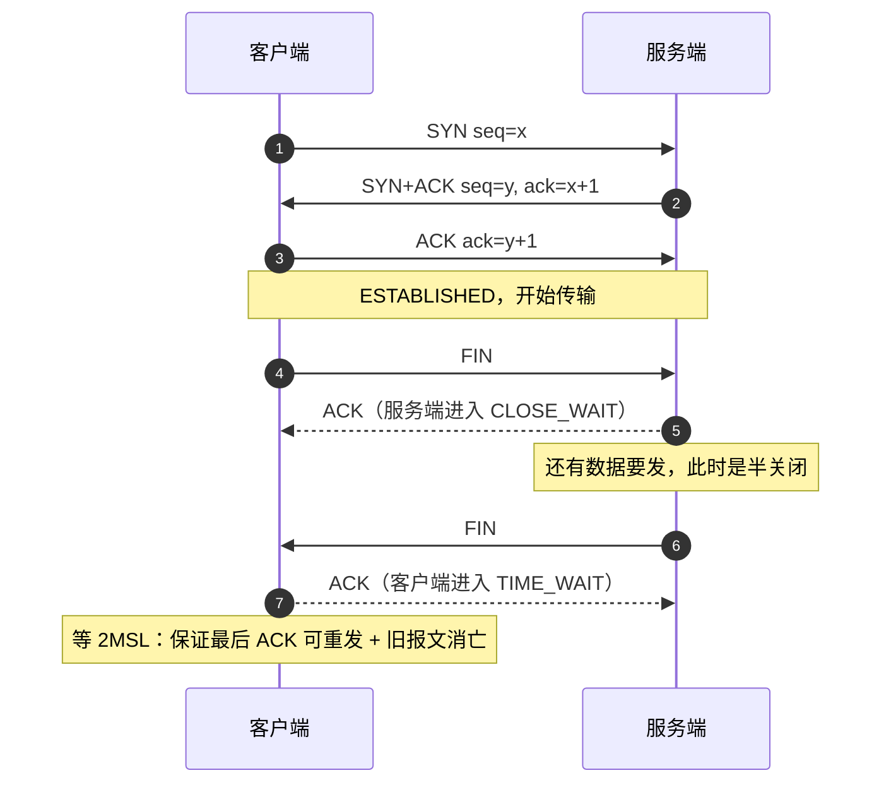
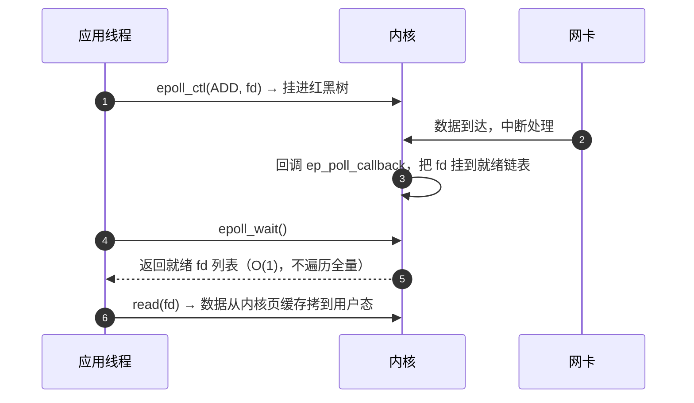
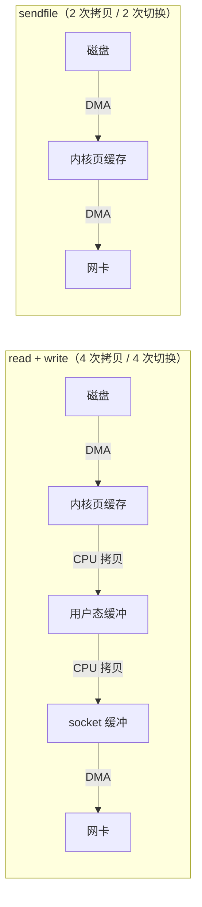
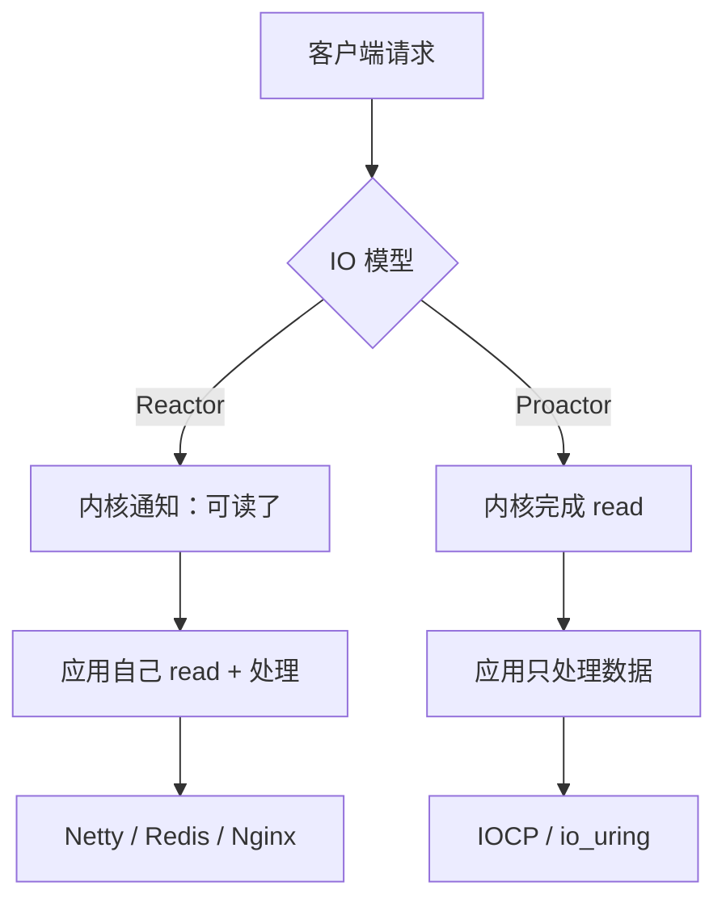

# 操作系统与网络经典面试题（含要点与追问）

> 后端面试里「解释现象」的那一类题：为什么 Redis 单线程能扛万级连接、为什么 Kafka 快、连接数为什么上不去、CPU 为什么 100%。
> 每条都尽量落到**可观测的现象 + 可操作的调优参数**，避免只背名词。

## 目录

- [一、TCP / HTTP 基础](#一tcp--http-基础)
- [二、IO 模型与高性能](#二io-模型与高性能)
- [三、进程、线程与内存](#三进程线程与内存)
- [四、排查与调优](#四排查与调优)
- [自测清单](#自测清单)
- [附录 A：15 分钟背诵卡](#附录-a15-分钟背诵卡)
- [附录 B：模拟面试 20 题（含追问链）](#附录-b模拟面试-20-题含追问链)
- [附录 C：口述版——3 分钟讲清「一次请求的系统开销」](#附录-c口述版3-分钟讲清一次请求的系统开销)
- [附录 D：关键时序图](#附录-d关键时序图)

---

## 一、TCP / HTTP 基础

### 1. 三次握手，为什么不是两次或四次？

```text
客户端 → 服务端：SYN  seq=x            （我要连，我的初始序号是 x）
服务端 → 客户端：SYN  seq=y, ack=x+1   （同意，我的序号是 y）
客户端 → 服务端：ACK  ack=y+1          （确认收到你的序号）
```

**为什么不是两次**：

- **防止历史连接**：网络中滞留的旧 SYN 到达服务端，若两次就建连，会建立一个客户端早已放弃的连接，服务端资源白占。
- **同步双方初始序号**：TCP 靠序号保证有序与可靠，双方都必须确认对方 ISR（初始序号）已被收到。

**为什么不是四次**：服务端的 `SYN` 和 `ACK` 可以合并成一个报文。

> 追问：第三个 ACK 丢了会怎样？—— 服务端处于 `SYN_RCVD`，会**超时重传 SYN+ACK**；客户端此时已 `ESTABLISHED`，收到重传会再回 ACK。若客户端已开始发数据，服务端也能靠数据包建立连接。

---

### 2. 四次挥手，为什么 TIME_WAIT 要等 2MSL？

```text
主动关闭方 → 被动关闭方：FIN
被动关闭方 → 主动关闭方：ACK      （此时被动方进入 CLOSE_WAIT）
被动关闭方 → 主动关闭方：FIN      （数据发完了）
主动关闭方 → 被动关闭方：ACK      （主动方进入 TIME_WAIT，2MSL 后关闭）
```

为什么不能三次：TCP 全双工，**两个方向要各自关闭**；被动方的 ACK 与自己的 FIN 之间可能还有数据要发，不能合并。

**TIME_WAIT 等 2MSL 的两个原因**：

1. **保证最后一个 ACK 能到达**：ACK 丢了对方会重传 FIN，此时本方还能再回一次 ACK。
2. **让旧连接的报文在网络中自然消亡**：避免同一四元组的新连接收到旧数据。

> 追问：`CLOSE_WAIT` 很多说明什么？—— 说明**本端应用没调 `close()`**，典型是连接泄漏或代码里异常路径没关流。这个只能改代码，调内核参数没用。

---

### 3. TCP 靠什么保证可靠传输？

| 机制 | 作用 |
| --- | --- |
| 序号 + 确认（ACK） | 保证有序、不丢 |
| 超时重传（RTO） | 丢了就重发，RTO 由 RTT 动态估算 |
| 快速重传（3 个重复 ACK） | 不用等超时，立刻重传 |
| SACK（选择性确认） | 只重传丢失的段，不重传整段 |
| 滑动窗口 | **流量控制**：接收方通告 `rwnd`，别发太快把对方打爆 |
| 拥塞控制 | **拥塞控制**：`cwnd` 探测网络容量 |

**拥塞控制四阶段**：慢启动（指数增长）→ 拥塞避免（线性）→ 快重传 → 快恢复。

> 追问：流量控制和拥塞控制的区别？—— 前者看**接收方**能力（`rwnd`），后者看**网络**能力（`cwnd`），实际发送窗口取两者最小值。

---

### 4. TCP 和 UDP 怎么选？为什么 HTTP/3 用 UDP？

| | TCP | UDP |
| --- | --- | --- |
| 连接 | 面向连接 | 无连接 |
| 可靠性 | 可靠、有序 | 不可靠、可乱序 |
| 开销 | 握手、重传、拥塞控制 | 头部 8 字节，几乎无状态 |
| 适用 | 绝大多数业务 | 音视频、游戏、DNS、QUIC |

**QUIC 基于 UDP 的原因**：TCP 的可靠性和拥塞控制是**在内核里写死的**，想改（比如减少握手、解决 TCP 层队头阻塞）只能等内核升级；UDP 之上自己实现可靠传输，可以快速迭代替换。

> 追问：QUIC 解决了什么？—— HTTP/2 的多路复用仍受 **TCP 层队头阻塞**影响（一个包丢了所有流都等），QUIC 每个流独立重传；另外 1-RTT / 0-RTT 建连。

---

### 5. 粘包是怎么产生的？怎么解决？

TCP 是**字节流**，没有消息边界——不是"粘"，是应用层把多条消息当成了一条。

| 方案 | 说明 |
| --- | --- |
| 长度前缀（推荐） | 先读 4 字节长度，再读 body（Netty `LengthFieldBasedFrameDecoder`） |
| 分隔符 | `\r\n`（HTTP）、`\0` |
| 固定长度 | 定长协议 |

> 追问：UDP 有粘包吗？—— 没有，UDP 保留消息边界（一次 send 对应一次 recv），但会丢包乱序。

---

### 6. HTTP/1.1、HTTP/2、HTTP/3 的差别？

| 版本 | 关键变化 | 遗留问题 |
| --- | --- | --- |
| 1.1 | keep-alive 复用连接、管道化（基本没人用） | 每个连接同时只能处理一个请求 → **应用层队头阻塞** |
| 2 | 二进制分帧 + **多路复用** + HPACK 头压缩 + 服务端推送 | **TCP 层队头阻塞**（丢一个包全等） |
| 3 | QUIC（UDP）+ 0/1-RTT + 流级独立 | 中间设备对 UDP 不友好，需要回退 |

> 追问：HTTP/1.1 的 keep-alive 解决的是队头阻塞吗？—— 不是，它解决的是**每次请求都要重新握手**的问题；队头阻塞要浏览器开 6 个并发连接来缓解。

---

### 7. HTTPS 握手发生了什么？TLS 1.3 为什么快？

简化流程：

1. ClientHello（支持的套件 + 随机数）
2. ServerHello（选定套件 + 证书 + 随机数）
3. 客户端验证证书链 → 用 ECDHE 交换出会话密钥
4. 双方切换到加密通道

TLS 1.3：**1-RTT** 建连（1.2 需要 2-RTT），支持 **0-RTT** 恢复（有重放风险，只适合幂等请求）；删掉了 RSA 密钥交换等不安全套件。

> 追问：为什么用非对称加密协商、对称加密传输？—— 非对称安全但慢（差几个数量级），只用来交换会话密钥；后续用对称加密。

---

## 二、IO 模型与高性能

### 8. 五种 IO 模型

| 模型 | 阻塞点 | 典型 |
| --- | --- | --- |
| 阻塞 IO | 数据没就绪就阻塞 | 最简单的 `read` |
| 非阻塞 IO | 轮询，返回 EAGAIN | 忙等，浪费 CPU |
| **IO 多路复用** | `select/epoll` 阻塞等就绪 | Redis、Netty、Nginx |
| 信号驱动 | 内核就绪发信号 | 用得少 |
| **异步 IO（AIO）** | 内核完成拷贝后通知 | io_uring、Windows IOCP |

关键区别：**前四种在"数据从内核拷贝到用户态"这一步仍然是同步的**，只有 AIO 是真异步。

> 追问：epoll 是同步还是异步？—— **同步**（多路复用），`epoll_wait` 返回时数据已在页缓存，但还要自己 `read` 拷贝。

---

### 9. select / poll / epoll 的区别？epoll 为什么高效？

| | select | poll | epoll |
| --- | --- | --- | --- |
| 数据结构 | 位图 | 数组 | **红黑树 + 就绪链表** |
| fd 上限 | 1024 | 无硬上限 | 无（受 `ulimit`） |
| 每次调用 | 全量拷贝 fd 集 | 全量拷贝 | 只在注册时拷贝一次 |
| 就绪判定 | **O(n) 遍历** | O(n) 遍历 | **O(1) 拿就绪链表** |

epoll 高效的本质：

- `epoll_ctl` 把 fd 挂到**内核红黑树**上，一次注册长期有效。
- fd 就绪时内核通过**回调**把它挂进就绪链表，`epoll_wait` 只返回链表长度，不需要遍历全量。
- 用户态与内核态共享 `mmap` 区域，避免每次拷贝。

> 追问：LT 和 ET 怎么选？—— LT（水平触发）编程简单，没处理完会一直通知；ET（边缘触发）只通知一次，**必须循环读到 `EAGAIN`**，配合非阻塞 fd，吞吐更高但容易写错。

---

### 10. Reactor 模式和 Proactor 的区别？

- **Reactor**：IO 就绪事件通知，**应用自己读写**（同步非阻塞）→ Netty、Redis、Nginx。
- **Proactor**：内核完成读写，**通知应用处理结果**（真异步）→ IOCP、io_uring。

单 Reactor 单线程（Redis）→ 单 Reactor 多线程 → 主从 Reactor 多线程（Netty）：主 Reactor 只接连接，从 Reactor 处理读写。

> 追问：Redis 单线程为什么够用？—— 命令都是内存操作、极快；瓶颈在网络往返，用多路复用 + Pipeline 就能扛住；真正的耗时操作（大 key 删除、AOF 刷盘）丢给后台线程。

---

### 11. 零拷贝是什么？用在哪？

传统 `read + write` 一次文件发送：**4 次拷贝 + 4 次上下文切换**（磁盘→内核页缓存→用户态→socket 缓冲→网卡）。

| 方案 | 拷贝次数 | 说明 |
| --- | --- | --- |
| `mmap + write` | 3 次 | 用户态与内核共享页缓存，省一次拷贝 |
| **`sendfile`** | **2 次（全 DMA）** | 内核直接把页缓存数据交给 socket，用户态完全不参与 |
| `splice` | 2 次 | 通过管道在两个 fd 间搬运，适合代理转发 |

Kafka 用 `sendfile` 发消息、Nginx 静态文件、Netty `FileRegion`。

> 追问：零拷贝真的"零"吗？—— 不是，DMA 拷贝仍然存在，省掉的是**CPU 拷贝和用户态/内核态切换**。
> 追问：什么时候零拷贝失效？—— 需要加密（TLS）或修改数据时，必须进用户态。

---

### 12. 用户态和内核态切换的代价？

- 每次系统调用 = 一次特权级切换（保留寄存器、切换栈、可能污染 cache/TLB），量级 **几十纳秒到微秒**。
- 高频小 IO 会被这个开销吃掉 → 所以有**批量**（`readv/writev`、`sendmmsg`）、**缓冲区**（用户态 buffer）、**rdtsc/vDSO**（部分系统调用免陷入）。

> 追问：为什么 Java 里 `System.currentTimeMillis` 比 `nanoTime` 慢？—— 前者可能走系统调用/vDSO 语义更重，后者走 TSC 时钟源。

---

## 三、进程、线程与内存

### 13. 进程、线程、协程的区别？

| | 进程 | 线程 | 协程 |
| --- | --- | --- | --- |
| 资源 | 独立地址空间 | 共享进程内存 | 共享线程栈外的堆 |
| 切换 | 页表切换，最贵 | 内核调度，寄存器 + 栈 | 用户态手动让出，最便宜 |
| 数量级 | 百 | 千 | 百万 |
| 例子 | 独立服务 | Java Thread | Go goroutine、C# async、Kotlin 协程 |

> 追问：协程为什么便宜？—— 切换不经过内核，只保存少量寄存器 + 栈指针；但要自己处理"阻塞调用会卡住整个线程"的问题。

---

### 14. 上下文切换的开销与减少手段？

开销来源：寄存器保存、栈切换、**cache/TLB 污染**（这部分往往比寄存器保存更贵）。

减少手段：

- 减少线程数（线程池，别一请求一线程）
- 无锁化 / 分段锁 / 减少锁竞争导致的阻塞唤醒
- 批处理、`io_uring` 减少系统调用
- 协程 / 异步 IO 替代阻塞线程

> 追问：怎么观测？—— `vmstat 1` 看 `cs`（context switch）列，`pidstat -w` 看每进程的 cswch/nvcswch。

---

### 15. 虚拟内存、缺页中断和 TLB？

- 每个进程有独立页表，虚拟地址 → 物理地址由 MMU 查表翻译。
- **TLB** 是页表缓存，命中就不用走多级页表。
- **缺页中断**：页不在内存 → 从磁盘换入（major），或只是还没建立映射（minor）。
- **大页（THP/HugePages）**：减少页表项和 TLB miss；但对 Redis 这类 `fork + COW` 的场景会放大内存复制（一页 2MB）。

> 追问：为什么建议关掉 Redis 的 THP？—— COW 以页为单位，2MB 的大页会让每次写复制 2MB，内存和延迟都爆炸。

---

### 16. `fork` 和写时复制（COW）？

`fork` 创建子进程时**不复制物理内存**，只复制页表并标记只读；任一方写入时触发缺页，内核才复制那一页。

- 优点：快照类操作（Redis `BGSAVE`、AOF 重写）代价低。
- 代价：写多的场景内存可能翻倍；页表复制本身随内存线性增长（几十 GB 实例 `fork` 可达数百毫秒）。

> 追问：怎么降低影响？—— 控制单实例内存、低峰执行、关 THP、`vm.overcommit_memory=1`、持久化放到从库做。

---

### 17. 文件描述符（fd）是什么？为什么会"too many open files"？

fd 是进程内**打开文件表的下标**，socket、文件、管道都占一个。

- 上限：`ulimit -n`（进程级）、`fs.file-max`（系统级）。
- 耗尽表现：`accept` 失败、`EMFILE`，新建连接直接拒绝。
- 排查：`ls /proc/<pid>/fd | wc -l`、`lsof -p <pid>`。

> 追问：连接泄漏和 fd 泄漏是一回事吗？—— fd 泄漏必然导致连接泄漏；但连接泄漏可能只是对端没关（服务端 fd 还在 `CLOSE_WAIT`）。

---

## 四、排查与调优

### 18. CPU 100% 怎么排查？

```bash
top -H -p <pid>          # 找出最热的线程（TID）
printf '%x\n' <TID>      # 转成 16 进制
jstack <pid> | grep -A 20 <hex>   # Java 场景定位栈
perf top -p <pid>        # 系统/语言无关的热点函数
```

常见原因：死循环、正则回溯、频繁 GC、锁自旋、大量系统调用。

> 追问：用户态高还是内核态高怎么区分？—— `top` 的 `%us` / `%sy`；`%sy` 高说明系统调用/软中断多（网络密集），`%us` 高说明业务代码在算。

---

### 19. 内存、磁盘、网络怎么快速排查？

| 维度 | 命令 | 看什么 |
| --- | --- | --- |
| 内存 | `free -m`、`vmstat 1` | `available` 而非 `free`；`si/so` 有值说明在 swap |
| 磁盘 | `iostat -x 1`、`iotop` | `%util` 接近 100、`await` 高 |
| 网络 | `ss -lnt`、`ss -s`、`tcpdump` | 队列积压、重传、`TIME_WAIT` 数 |
| 负载 | `uptime` | `load average` 含**不可中断睡眠**（D 状态），所以 IO 卡住也会高 |

> 追问：`load average` 高但 CPU 空闲？—— 典型的 IO 阻塞或锁等待，用 `ps aux | awk '$8 ~ /D/'` 找 D 状态进程。

---

### 20. `accept` 队列溢出（backlog）？

- **半连接队列（SYN queue）**：收到 SYN，回 SYN+ACK，等最后 ACK。
- **全连接队列（accept queue）**：已完成握手，等应用 `accept()`。
- 队列满：新连接被丢弃或回 RST（`tcp_abort_on_overflow`），表现为**偶发连接超时/被重置**。

```bash
ss -lnt    # Recv-Q 是当前全连接队列长度，Send-Q 是 backlog 上限
netstat -s | grep -i listen   # 看 overflowed 计数
```

> 追问：`backlog` 调多大？—— 应用 `listen(backlog)` 与内核 `somaxconn` 取小值；高并发短连接服务要一起调大。

---

### 21. TIME_WAIT 太多怎么办？

先判断是谁在 `TIME_WAIT`：**主动关闭方**。短连接服务端容易出现。

| 手段 | 说明 | 风险 |
| --- | --- | --- |
| 用长连接 / 连接池 | 根治 | 需要治理空闲连接 |
| `net.ipv4.tcp_tw_reuse=1` | 复用 TIME_WAIT 发起**出站**连接 | 只在客户端侧有效 |
| `tcp_max_tw_buckets` | 限制数量，超了直接销毁 | 可能破坏协议语义 |
| `tcp_tw_recycle` | **已在内核 4.12 移除** | NAT 环境下会误杀，别再用 |

> 追问：为什么服务端 TIME_WAIT 多反而是"正常"的？—— 谁主动关谁承担 TIME_WAIT；服务端主动关是为了尽快释放资源，这是设计而非 bug。

---

### 22. C10K 到 C10M 的演进？

- **C10K**：一连接一线程撑不住 → epoll + 事件驱动 + 非阻塞 IO。
- **C10M**：内核协议栈本身成瓶颈 → 内核旁路（DPDK）、eBPF/XDP、用户态协议栈、多队列网卡 + CPU 绑核。

> 追问：普通业务需要 C10M 吗？—— 不需要，单机几万连接用 epoll + 合理的 `ulimit` 与连接池就够；上 C10M 是负载均衡/网关层的事。

---

## 自测清单

- [ ] 三次握手为什么不是两次，第三次 ACK 丢了会怎样
- [ ] 四次挥手、TIME_WAIT 2MSL 的两个理由
- [ ] `CLOSE_WAIT` 堆积说明什么（只能改代码）
- [ ] 流量控制 `rwnd` 与拥塞控制 `cwnd` 的区别
- [ ] 粘包的本质与三种解法
- [ ] HTTP/1.1 → 2 → 3 各自解决了哪个队头阻塞
- [ ] 五种 IO 模型，为什么只有 AIO 是真异步
- [ ] epoll 高效的三点（红黑树、就绪链表、mmap）
- [ ] LT 与 ET 的编程差异
- [ ] 零拷贝三次演进与失效场景
- [ ] 进程/线程/协程的切换成本
- [ ] 虚拟内存、缺页、TLB、大页与 COW 的关系
- [ ] fd 上限与连接泄漏的排查
- [ ] CPU 100% 的定位四步
- [ ] backlog 两个队列与溢出表现

---

# 附录 A：15 分钟背诵卡

1. 三次握手：**同步双方 ISR + 防历史连接**，两次不够、四次多余（SYN 可与 ACK 合并）。
2. 四次挥手：全双工，两个方向各自关；`TIME_WAIT` 2MSL = 保证最后 ACK + 让旧报文消亡。
3. `CLOSE_WAIT` 多 = **应用没 close**，改代码；`TIME_WAIT` 多 = 主动关闭多，正常。
4. 可靠性五件套：序号确认、超时重传、快速重传、SACK、滑动窗口 + 拥塞控制。
5. `rwnd` 看接收方，`cwnd` 看网络，实际窗口取小。
6. 粘包不是 TCP 的错，是字节流无边界；解法：长度前缀 / 分隔符 / 定长。
7. HTTP/2 解决应用层队头阻塞，HTTP/3（QUIC）解决 TCP 层队头阻塞。
8. TLS 1.3：1-RTT 建连、0-RTT 恢复（有重放风险）。
9. 五种 IO：阻塞、非阻塞、多路复用、信号驱动、异步；只有 AIO 在拷贝阶段也不阻塞。
10. epoll 三个关键词：**红黑树注册、回调挂就绪链表、mmap 免拷贝**；`epoll_wait` O(1)。
11. LT 没处理会重复通知；ET 必须循环读到 `EAGAIN`。
12. Reactor = 就绪通知 + 自己读写；Proactor = 内核读完通知你。
13. 零拷贝三档：`mmap+write`（3 次）→ `sendfile`（2 次，全 DMA）→ 加密/改数据就失效。
14. 线程切换的大头是 **cache/TLB 污染**，不是寄存器。
15. 协程便宜是因为不经过内核调度；代价是阻塞调用会卡住整个线程。
16. `fork` = 复制页表 + COW；写多则内存翻倍，大实例 `fork` 有停顿。
17. THP 会让 COW 以 2MB 为单位复制 → Redis 必须关。
18. `load average` 包含不可中断睡眠，所以 IO 卡住也会高。
19. `backlog` 两个队列：SYN 队列 + accept 队列；`ss -lnt` 的 Recv-Q 是当前积压。
20. 排查四件套：`top -H` 找线程 → `jstack/perf` 找栈 → `vmstat/iostat` 看资源 → `ss/tcpdump` 看网络。

> 记忆锚点：**握手挥手 → IO 模型 → 内存与线程 → 排查工具**。

---

# 附录 B：模拟面试 20 题（含追问链）

### 1. 为什么要三次握手？

**开口**：两次无法确认客户端收到了服务端的初始序号，也无法防止网络里滞留的旧 SYN 建立无效连接。
**追问**：第三个 ACK 丢了，连接算建立了吗？→ 客户端认为建立了并可能已发数据；服务端会重传 SYN+ACK，最终靠数据或重传对齐。

### 2. TIME_WAIT 为什么要等 2MSL？

**开口**：一是保证最后那个 ACK 能重发，二是让旧连接的报文在网络中彻底消亡。
**追问**：能取消吗？→ 不能，但可以复用（`tcp_tw_reuse`）或改成长连接减少主动关闭。

### 3. 服务端大量 CLOSE_WAIT 是什么问题？

**开口**：被动关闭方没调 `close()`，是应用层的连接/文件句柄泄漏。
**追问**：怎么定位？→ `ss -tan state close-wait` 找到连接，对照代码里异常分支是否有 `finally` 关闭。

### 4. TCP 怎么保证不丢不乱？

**开口**：序号 + 确认 + 超时重传 + 快速重传 + SACK，配合滑动窗口做流量与拥塞控制。
**追问**：重传会导致重复数据吗？→ 会，所以接收方按序号去重，应用层仍要做幂等。

### 5. 拥塞控制四个阶段？

**开口**：慢启动（指数）、拥塞避免（线性）、快重传（3 个重复 ACK）、快恢复。
**追问**：为什么现在很多场景改用 BBR？—— 丢包不等于拥塞（尤其无线网络），BBR 按带宽和 RTT 建模，高丢包链路下吞吐更好。

### 6. 粘包怎么解决？

**开口**：本质是 TCP 字节流没有边界，用长度前缀或分隔符在应用层切分。
**追问**：Netty 里怎么做？→ `LengthFieldBasedFrameDecoder`，注意处理半包（`ByteToMessageDecoder` 会多次回调）。

### 7. epoll 为什么比 select 快？

**开口**：一次注册长期有效（红黑树），就绪靠内核回调挂链表，`epoll_wait` 只取链表，不用每次全量拷贝和遍历。
**追问**：epoll 一定比 select 快吗？—— 连接数少且都活跃时差距不大；fd 多但活跃少时优势明显。

### 8. LT 和 ET 怎么选？

**开口**：LT 简单安全，ET 性能好但必须非阻塞 + 循环读到 `EAGAIN`。
**追问**：ET 下漏读会怎样？→ 事件不再通知，连接"假死"，直到有新数据。

### 9. 零拷贝是怎么做的？

**开口**：`sendfile` 让数据从页缓存直接 DMA 到网卡，省掉用户态两次拷贝和切换。
**追问**：Kafka 为什么快？→ 顺序写 + 页缓存 + `sendfile` + 批量压缩，四个因素叠加。

### 10. 为什么 Redis 用单线程加多路复用？

**开口**：命令都是内存操作，瓶颈在网络；单线程免锁、无切换，多路复用扛连接数。
**追问**：那 6.0 为什么加多线程？→ 只加在读写和协议解析，执行仍单线程，保住原子性。

### 11. 进程和线程的区别？

**开口**：进程有独立地址空间，线程共享；切换进程要换页表，最贵。
**追问**：协程呢？→ 用户态调度，切换只存寄存器，百万级并发可行，但阻塞调用会卡线程。

### 12. 线程切换为什么贵？

**开口**：除了寄存器保存，主要是 cache 和 TLB 失效导致后续指令重新取数。
**追问**：怎么减少？→ 线程池、无锁/分段锁、批处理、异步 IO 替代阻塞线程。

### 13. 什么是缺页中断？

**开口**：访问的虚拟页不在物理内存，触发内核装页——minor 只需建立映射，major 要读磁盘。
**追问**：大页有什么好处和坏处？→ 减少 TLB miss；但 COW 复制单位变大，Redis 场景要关。

### 14. fork 之后内存会翻倍吗？

**开口**：不会立刻翻倍，是 COW；写多少复制多少，最坏接近 2 倍。
**追问**：fork 本身慢吗？→ 页表复制随内存线性增长，几十 GB 实例可达几百毫秒。

### 15. CPU 100% 怎么查？

**开口**：`top -H` 找热线程 → 转 16 进制 → `jstack` 对栈；非 Java 用 `perf top`。
**追问**：如果线程栈里没有热点？→ 可能是 GC 或 JIT 编译器线程，看 `jstat -gcutil`。

### 16. load average 高但 CPU 低？

**开口**：load 统计可运行 + **不可中断睡眠**，所以 IO 阻塞或锁等待也会推高。
**追问**：怎么确认？→ `vmstat` 看 `b` 列和 `wa`，`ps` 找 D 状态进程，`iostat` 看磁盘。

### 17. 服务偶发连接超时，怎么查？

**开口**：先看 accept 队列是否溢出（`ss -lnt` 的 Recv-Q、`netstat -s` 的 overflowed），再看 backlog 与 `somaxconn`。
**追问**：队列没溢出呢？→ 查 SYN 队列（SYN flood / 半连接）、防火墙、连接池上限、下游耗时。

### 18. TIME_WAIT 能复用吗？

**开口**：可以开启 `tcp_tw_reuse`（仅出站），但 `tcp_tw_recycle` 已被移除，NAT 下有害。
**追问**：最推荐的做法？→ 长连接 + 连接池，从根上减少主动关闭。

### 19. 为什么 HTTP/3 要基于 UDP？

**开口**：TCP 的可靠性和拥塞控制写死在内核，无法快速演进；UDP 上自建 QUIC 能解决 TCP 层队头阻塞并加速握手。
**追问**：QUIC 怎么保证可靠？→ 自己实现序号、ACK、重传、拥塞控制，每个流独立。

### 20. 一个接口 P99 突然从 50ms 涨到 500ms，你的排查顺序？

**开口**：先分层——接入层（队列、连接数）→ 应用（CPU、GC、锁、线程池）→ 依赖（DB、缓存、下游）→ 系统（磁盘、网络）。
**追问**：怎么快速分层？→ 看指标（RT 分解、错误率）、看日志（慢调用）、看链路追踪（哪个 span 涨了）。

---

# 附录 C：口述版——3 分钟讲清「一次请求的系统开销」

> 面试官问「你对操作系统和网络的理解」时用。约 800 字 ≈ 3 分钟。

### 逐字稿

**【开场 · 15 秒】**
我理解系统层的东西，喜欢从**一次请求的开销**倒推：数据从网卡进来，要经过内核协议栈、系统调用、用户态业务、再到磁盘或下游，每一步都有可观测的成本。

**【网络层 · 45 秒】**
先看连接。TCP 三次握手本质是**同步双方初始序号 + 防止历史连接**，第三个 ACK 丢了服务端会重传，所以不会卡死。断开是四次挥手，因为全双工要双向关；主动关闭方要等 2MSL，一是保证最后一个 ACK 能重发，二是让旧报文彻底消亡。
再看协议栈的现象：`CLOSE_WAIT` 多一定是应用没关连接，这是代码问题；`TIME_WAIT` 多是主动关闭多，是设计使然。粘包也不是 TCP 的错，字节流本来就没有边界。

**【IO 层 · 50 秒】**
IO 有五种模型，但只有 AIO 是真正的异步——前四种在「内核把数据拷到用户态」那一步仍然是同步的。
高性能服务几乎都用 IO 多路复用。epoll 之所以高效就三点：红黑树保存注册的 fd，回调把就绪的挂到链表，`epoll_wait` 只取链表；再加上 `mmap` 共享避免重复拷贝。所以 `epoll_wait` 是 O(1)，而 select 要每次全量拷贝和遍历。
再往上就是零拷贝。传统 `read + write` 是四次拷贝四次切换；`sendfile` 用 DMA 把页缓存直接送到网卡，只剩两次拷贝。Kafka 快，一半功劳在这儿。

**【进程与内存 · 40 秒】**
进程有独立地址空间，线程共享，协程是用户态调度所以最便宜。线程切换贵不在于保存寄存器，而在于 cache 和 TLB 被污染。
内存这块两个常考点：虚拟内存 + 缺页 + TLB，和 `fork` 的写时复制。COW 让快照很便宜，但写多会接近翻倍，而且大页会让每次复制变成 2MB——所以 Redis 必须关 THP。

**【排查与收尾 · 30 秒】**
排查我按资源分层：CPU 用 `top -H` 找线程再对栈，内存看 `available` 和 `si/so`，磁盘看 `iostat` 的 `await` 和 `%util`，网络看 `ss` 的队列和 `netstat -s` 的 overflow。
一句话收尾：**性能问题不是猜出来的，是按层量出来的**——每一层都要有能看的指标。

---

### 压缩版

**一句话版（10 秒）**
> 一次请求 = 协议栈 + 系统调用 + 用户态处理 + IO；优化就是减少拷贝、减少切换、减少阻塞。

**30 秒版**
> TCP 靠序号、确认、重传和窗口保证可靠，粘包是应用层没划边界。IO 模型里只有 AIO 真异步，epoll 靠红黑树 + 就绪链表 + mmap 做到 O(1)。零拷贝用 sendfile 把两次 CPU 拷贝省掉。线程切换贵在 cache/TLB 污染，协程便宜在不经过内核。排查按 CPU、内存、磁盘、网络分层。

### 时间分配

| 段落 | 时长 | 只说一件事 |
| --- | --- | --- |
| 开场 | 15s | 从「一次请求的开销」倒推 |
| 网络层 | 45s | 握手挥手 + 两个 wait 状态 + 粘包 |
| IO 层 | 50s | 五种模型 → epoll 三点 → 零拷贝 |
| 进程与内存 | 40s | 进程/线程/协程 + 缺页 + COW/THP |
| 排查与收尾 | 30s | 分层排查 + 「量出来不是猜出来」 |

### 被打断时怎么接

| 面试官插话 | 接续句 |
| --- | --- |
| 「epoll 一定比 select 快吗？」 | 「连接少且都活跃时差不多，优势在 fd 多而活跃少」 |
| 「零拷贝为什么不能用于 TLS？」 | 「加密必须进用户态改数据，省不掉那次拷贝」 |
| 「你们线上 TIME_WAIT 多吗？」 | 「客户端侧多，后来改成长连接和连接池就下去了」 |
| 「负载高但 CPU 空闲怎么解释？」 | 「load 含不可中断睡眠，多半是 IO 或锁等待，用 D 状态进程确认」 |

---

# 附录 D：关键时序图

### 1. TCP 建连与断开



### 2. epoll 的就绪通知



### 3. 传统 IO 与零拷贝



### 4. Reactor 与 Proactor


