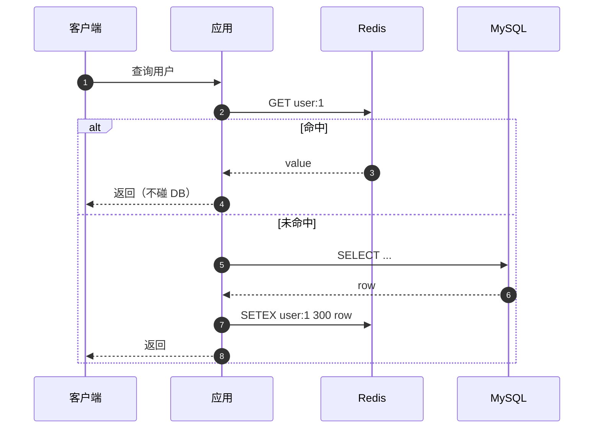
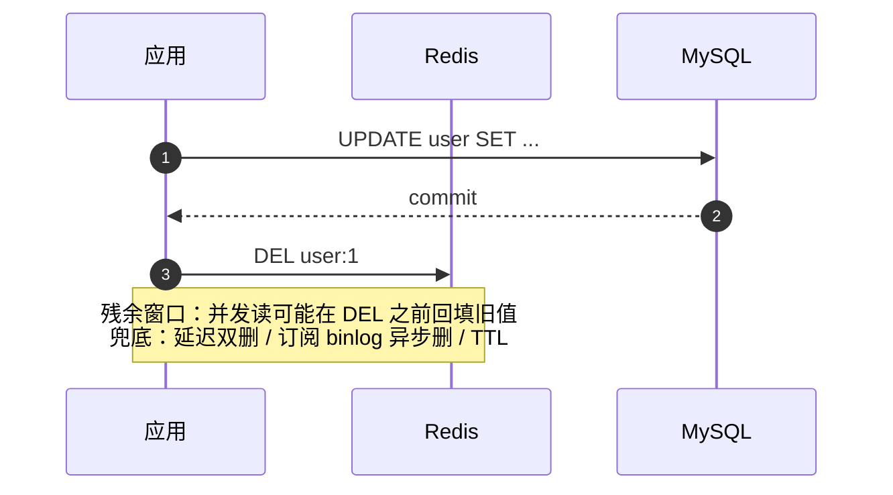
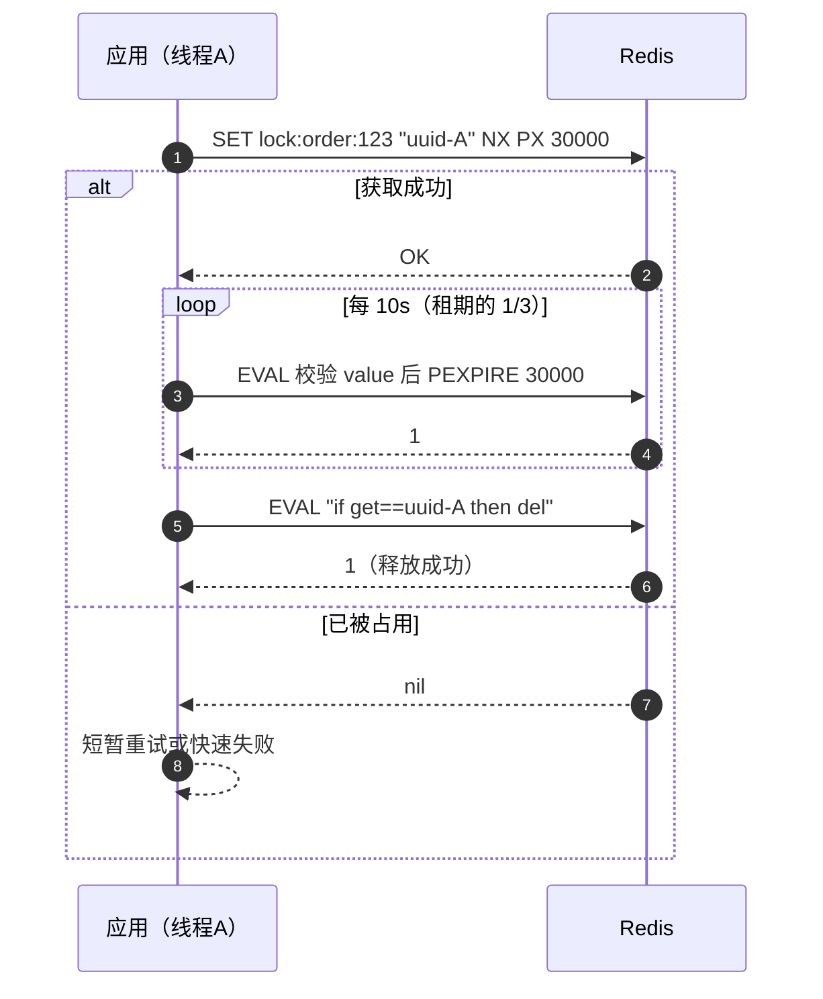
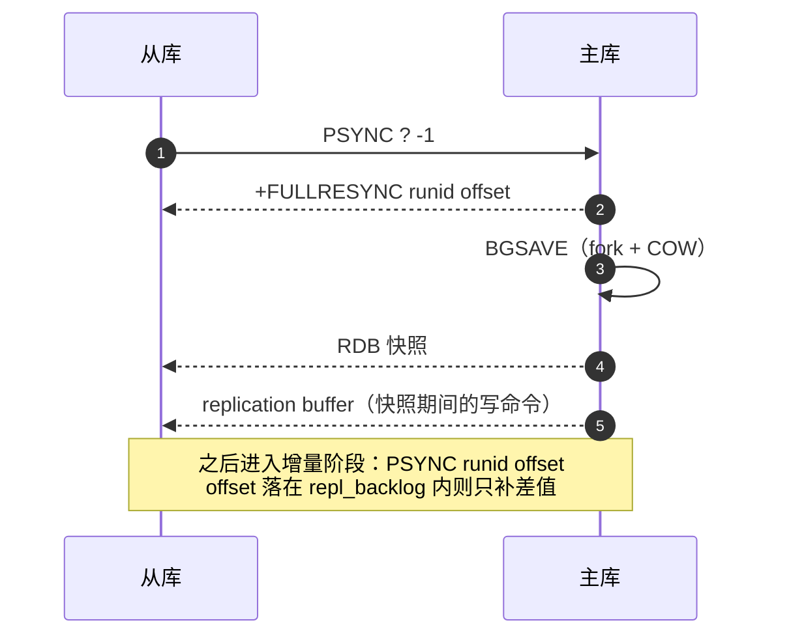

# Redis 经典面试题（含要点与追问）

> 面向后端 / 中间件岗位的 Redis 高频题整理。按「出现频率 + 易追问点」组织，每题给出**要点答案**和**常见追问**。
> 建议用法：先遮住答案自测，答不出的题目标记后重点复习。

## 目录

- [一、基础与选型](#一基础与选型)
- [二、持久化](#二持久化)
- [三、过期与内存](#三过期与内存)
- [四、缓存三大问题与一致性](#四缓存三大问题与一致性)
- [五、高可用](#五高可用)
- [六、分布式锁](#六分布式锁)
- [七、事务 / Lua / Pipeline](#七事务--lua--pipeline)
- [八、线上问题排查](#八线上问题排查)
- [九、典型场景设计](#九典型场景设计)
- [十、自测清单](#十自测清单)
- [附录 A：15 分钟背诵卡](#附录-a15-分钟背诵卡)
- [附录 B：模拟面试 20 题（含追问链）](#附录-b模拟面试-20-题含追问链)
- [附录 C：口述版——3 分钟讲清 Redis](#附录-c口述版3-分钟讲清-redis)
- [附录 D：关键时序图](#附录-d关键时序图)

---

## 一、基础与选型

### 1. Redis 为什么快？

四个层面，缺一不可：

| 层面 | 说明 |
| --- | --- |
| 内存 | 所有数据在内存，读写不落盘（持久化是异步/追加的） |
| 单线程执行命令 | 无锁、无上下文切换、无 CPU 缓存失效，命令都是 O(1)/O(logN) 的小操作 |
| IO 多路复用 | `epoll`（Linux）/ `kqueue` / `evport`，一个线程扛住上万连接 |
| 高效数据结构 | SDS、listpack、quicklist、跳表、intset，都是为「省内存 + 快」定制的 |

> 追问：单线程的瓶颈在哪？—— CPU 不是瓶颈，**网络 IO 和内存带宽**才是。所以 6.0 加的是多线程 IO，不是多线程执行命令。

```text
客户端 → 内核 socket buffer → epoll 就绪 → 读事件 → 解析 RESP → 执行命令 → 写回 buffer → 发送
```

---

### 2. Redis 是单线程的吗？6.0 的多线程改了什么？

**命令执行是单线程，但 Redis 进程不是单线程。**

- 主线程：接受连接、读请求、执行命令、写响应。
- 后台线程（`bio`）：
  - `close_file`：异步关闭大文件，避免 `close()` 卡主线程
  - `aof_fsync`：AOF 刷盘
  - `lazy_free`：`UNLINK` / `FLUSHALL ASYNC` 的异步内存释放（4.0+）
- Redis 6.0+：`io-threads` 把**读取请求 + 解析 + 写回响应**分摊到多个线程，命令执行仍在主线程，所以天然保持原子性。

```conf
io-threads 4                 # 建议 = CPU 核数，最多 8
io-threads-do-reads yes
```

> 追问：多线程 IO 会破坏原子性吗？—— 不会，"执行"这一段始终在主线程串行；多线程只做 socket 读写和协议解析。
> 追问：既然单线程，为什么 `KEYS *` 会卡死？—— 执行命令的线程被占满，期间所有请求（包括心跳）都排队。

---

### 3. Redis 与 Memcached 的区别？

| 维度 | Redis | Memcached |
| --- | --- | --- |
| 数据类型 | String/List/Hash/Set/ZSet/Bitmap/HLL/GEO/Stream | 仅 key-value（value 是 bytes） |
| 持久化 | RDB / AOF | 无 |
| 集群 | 原生 Cluster（16384 slot） | 客户端分片（一致性哈希） |
| 线程模型 | 命令单线程 + 多线程 IO | 多线程（有锁竞争） |
| 单 key 上限 | 512MB | 1MB（默认，可调） |
| 事务/脚本 | MULTI、Lua | 无（`gets/cas` 算轻量 CAS） |
| 适用 | 缓存 + 计数 + 排行 + 分布式锁 + 简单 MQ | 纯缓存、超大规模 KV |

> 一句话：Memcached 是「纯内存 KV」，Redis 是「数据结构服务器」，多数场景直接用 Redis。

---

### 4. Redis 有哪些数据类型？分别什么场景？

| 类型 | 典型命令 | 场景 |
| --- | --- | --- |
| String | `SET/GET/INCR/SETEX` | 缓存对象（JSON）、计数器、分布式锁、限流 |
| Hash | `HSET/HGETALL/HINCRBY` | 对象字段部分更新（用户资料、购物车） |
| List | `LPUSH/RPOP/LRANGE/BRPOP` | 简单队列、时间线、最新 N 条 |
| Set | `SADD/SINTER/SRANDMEMBER` | 去重、共同好友、抽奖、标签 |
| ZSet | `ZADD/ZREVRANGE/ZRANGEBYSCORE` | 排行榜、延迟队列、滑动窗口限流 |
| Bitmap | `SETBIT/BITCOUNT/BITOP` | 签到、活跃用户、布隆过滤器 |
| HyperLogLog | `PFADD/PFCOUNT/PFMERGE` | UV 统计（0.81% 误差，12KB 固定） |
| GEO | `GEOADD/GEOSEARCH` | 附近的人 / 门店 |
| Stream | `XADD/XREADGROUP/XACK` | 带消费组、可回溯的消息队列 |

> 追问：**ZSet 底层用了什么？** —— 元素少时用 listpack（7.0 前是 ziplist），超过阈值转 `dict + skiplist`：`dict` 让 `ZSCORE` 做到 O(1)，`skiplist` 让范围查询 O(logN)。
> 追问：**为什么用跳表不用红黑树？** —— ① 范围查询（`ZRANGE`）跳表沿底层链表顺序遍历，缓存友好，红黑树要中序回溯；② 实现简单、易调试；③ 插入删除只需改局部指针，不需要旋转；④ 并发/持久化场景更容易做无锁或分片。

---

### 5. 底层编码与转换阈值

| 类型 | 编码 | 转换条件（默认配置） |
| --- | --- | --- |
| String | `int` / `embstr`（≤44 字节）/ `raw` | 非整数、超长 → raw |
| List | `listpack`（7.0+，旧为 ziplist）/ `quicklist` | 元素 > `list-max-listpack-size 128` 个 或 单个 > 64 字节 |
| Hash | `listpack` / `hashtable` | `hash-max-listpack-entries 128` 或 `hash-max-listpack-value 64` |
| Set | `intset` / `listpack`(7.2+) / `hashtable` | 全整数且 ≤ `set-max-intset-entries 512` 用 intset；含非整数转 hashtable |
| ZSet | `listpack` / `skiplist` | `zset-max-listpack-entries 128` 或 `zset-max-listpack-value 64` |

> 面试点：**编码是单向的**。ziplist/listpack 转 hashtable/skiplist 后即使删除元素也不会退回（避免抖动）。
> 追问：怎么查看某个 key 的编码？—— `OBJECT ENCODING key`。

---

### 6. SDS 相比 C 字符串好在哪？

- **O(1) 取长度**：C 字符串要 `strlen` 遍历。
- **二进制安全**：可以存 `\0`、图片、序列化数据（C 字符串遇到 `\0` 就截断）。
- **杜绝缓冲区溢出**：拼接前检查 `free` 空间。
- **空间预分配 + 惰性释放**：小于 1MB 时按 2 倍扩容；缩容不立即 `free`，避免频繁 realloc。
- **兼容 C 函数**：末尾仍补 `\0`，可以直接传给 `printf` 一族。

```c
struct sdshdr {
    uint32_t len;    // 已用
    uint32_t alloc;  // 已分配（不含 header 和 \0）
    char buf[];
};
```

> 追问：`embstr` 和 `raw` 区别？—— `embstr` 把 `redisObject` 和 SDS 一次性分配（只读，改就转 `raw`），适合 ≤44 字节短字符串，减少一次内存分配和缓存不命中。

---

### 7. 为什么 Redis 单 key 上限是 512MB？

`len`/`alloc` 用 `uint32` 存（`sdshdr32` 上限 4GB），512MB 是官方保守限制，防止单个大 value 拖垮网络与内存。实际生产中 **value 超过 10KB 就该警惕**（大 key 问题见 Q33）。

---

## 二、持久化

### 8. RDB 的原理、触发方式、优缺点

**原理**：`fork()` 出子进程，子进程把内存快照写成二进制文件；父进程继续服务，靠 **Copy-On-Write（COW）** 保证快照一致。

**触发**：
- 自动：`save 900 1` / `save 300 10` / `save 60 10000`（任一满足）
- 手动：`SAVE`（阻塞主线程，禁用）、`BGSAVE`（fork 子进程）
- 关闭时：`SHUTDOWN` 会触发一次

**优点**：文件紧凑（二进制 + 压缩），恢复快，适合备份 / 主从全量同步。

**缺点**：两次快照之间的数据会丢；`fork` 与 COW 有内存和延迟开销（大实例可达数百毫秒）。

> 追问：COW 为什么会内存膨胀？—— 快照期间父进程每写一页，就复制一页；写入越密集，峰值内存越接近 2 倍。`vm.overcommit_memory=1` 要开，THP 要关。

---

### 9. AOF 的原理、刷盘策略、重写

**原理**：把每条写命令按 RESP 追加到 `appendonly.aof`，重启时重放。

```conf
appendonly yes
appendfsync everysec   # always | everysec | no
```

| 策略 | 数据安全 | 性能 | 说明 |
| --- | --- | --- | --- |
| `always` | 最高（最多丢 1 条） | 最差（每条命令一次 fsync） | 金融级场景 |
| `everysec` | 最多丢 1 秒 | 好（默认） | 后台线程 fsync |
| `no` | 由 OS 决定（通常 30s） | 最好 | 不可控，不建议 |

**AOF 重写**：`BGREWRITEAOF` fork 子进程，用**当前内存中的最终状态**生成最小命令集（不是压缩旧日志）。

重写期间的新命令写入 `aof_rewrite_buf`，子进程完成后追加到新文件，原子 `rename` 替换。

> 追问：为什么不读旧 AOF 而是读内存？—— 直接读内存快照生成的命令最少、最快，避免重放历史。
> 追问：重写失败会怎样？—— 老 AOF 保持不动，新文件丢弃，不影响服务。

---

### 10. 混合持久化 / Redis 7 多文件 AOF / 重启恢复顺序

- **混合持久化（4.0+，`aof-use-rdb-preamble yes`）**：AOF 重写时前半段写 RDB 格式（全量快照），后半段追加增量命令。兼顾「快恢复 + 少丢数据」。
- **Redis 7.0 多文件 AOF**：`appenddirname` 下的 base（RDB 或 AOF 格式）+ incr（增量）+ `manifest` 清单，重写不再产生巨型单文件，便于运维。
- **重启恢复优先级**：**有 AOF 就只加载 AOF**（混合持久化时先加载 RDB 段），没有 AOF 才加载 RDB。

> 追问：同时开 RDB + AOF，恢复用哪个？—— 用 AOF（更完整）；RDB 只当备份副本。

---

### 11. 生产怎么配？

```conf
save 900 1                 # RDB 兜底
appendonly yes
appendfsync everysec       # 性能与安全的平衡点
aof-use-rdb-preamble yes   # 混合持久化
no-appendfsync-on-rewrite no
auto-aof-rewrite-percentage 100
auto-aof-rewrite-min-size 64mb
```

思路：**AOF 保证秒级不丢，RDB 用于冷备、跨机房搬迁、主从全量同步**。

---

## 三、过期与内存

### 12. 过期键是怎么删的？

Redis 用**惰性删除 + 定期删除**组合：

- **惰性**：访问 key 时检查 `expireIfNeeded`，过期就删并返回 nil。缺点：不访问的 key 永远占内存。
- **定期**：`serverCron` 每 100ms（`hz 10`）随机抽 20 个带 TTL 的 key，删掉过期的；若过期比例 > 25% 就重复抽样；单轮 CPU 时间上限 25%，避免阻塞。

> 追问：主从库的过期呢？—— **从库不主动删**，等主库删除后同步 `DEL` 过来；从库读到自己已过期的 key 会返回 nil（逻辑过期），保证主从一致。
> 追问：内存满了但都是没过期的 key？—— 走内存淘汰策略（Q13）。

---

### 13. 内存淘汰策略（8 种）

```conf
maxmemory 4gb
maxmemory-policy allkeys-lru
```

| 策略 | 范围 | 行为 |
| --- | --- | --- |
| `noeviction` | - | 写满了直接报 OOM（默认） |
| `allkeys-lru` | 所有 key | 淘汰最久未使用的（**纯缓存首选**） |
| `allkeys-lfu` | 所有 key | 淘汰访问频率最低的（4.0+，抗「偶发扫描污染」） |
| `allkeys-random` | 所有 key | 随机淘汰 |
| `volatile-lru` | 有 TTL 的 | 淘汰最久未使用的 |
| `volatile-lfu` | 有 TTL 的 | 淘汰频率最低的 |
| `volatile-random` | 有 TTL 的 | 随机淘汰 |
| `volatile-ttl` | 有 TTL 的 | 优先淘汰剩余 TTL 最短的 |

> 追问：**LRU 怎么实现的？** —— 不是标准 LRU。每个对象 24 bit 时钟（秒级精度），淘汰时**随机采样 `maxmemory-samples 5` 个 key，淘汰最旧的那个**，用采样换内存和性能。
> 追问：缓存 + 持久化数据混存怎么配？—— 用 `volatile-*`，让 Redis 只淘汰带 TTL 的缓存，保住没设过期时间的业务数据（但要保证缓存 key 都设了 TTL）。

---

### 14. 内存碎片怎么看？怎么治？

```bash
INFO memory
# mem_fragmentation_ratio = used_memory_rss / used_memory
```

- `1 ~ 1.5` 正常；`> 1.5` 碎片较多（频繁删除/修改、不同大小对象交替分配）。
- `< 1` 说明发生了 swap，性能会崩。

手段：`activedefrag yes`（4.0+，主动整理）、`lazyfree-lazy-expire yes`、重启 / 主从切换重建、`jemalloc` 的 size class 调整。

---

## 四、缓存三大问题与一致性

### 15. 缓存穿透

**问题**：查询**根本不存在**的数据，缓存永远不命中，请求全打到 DB（常见于恶意扫 ID）。

**方案**：

1. **缓存空值**：DB 查不到也写 `key -> null`，TTL 短（30~60s），防同一个 key 反复打。
2. **布隆过滤器**：入口先过 BF，不存在的直接返回。注意：**有误判率、不支持删除**（要用 Counting Bloom / 布谷鸟过滤器）。
3. 参数校验 + 限流 + 风控。

> 追问：布隆过滤器为什么不能删？—— 多个 key 共享 bit 位，置 0 会误伤其他 key。

---

### 16. 缓存击穿

**问题**：**单个热点 key 过期瞬间**，大量并发请求同时打到 DB（和穿透的区别：这个 key 是存在的）。

**方案**：

| 方案 | 做法 | 代价 |
| --- | --- | --- |
| 互斥锁 / 单飞 | 未命中时 `SET lock NX PX 3000`，只有拿到锁的线程查 DB 并回填，其余线程短暂自旋或返回旧值 | 吞吐下降、要处理锁超时 |
| 逻辑过期 | value 里带 `expireTime`，物理上永不过期；发现逻辑过期就异步线程重建，其余请求先返回旧值 | 有短暂脏数据，实现复杂 |
| 热点预热 + 永不过期 | 后台定时刷新，配合主动更新 | 需要识别热点 key |

---

### 17. 缓存雪崩

**问题**：**大批 key 同一时刻过期**，或 **Redis 整体宕机**，流量瞬间压垮 DB。

**方案**：

1. TTL 加随机值（`base + random(0, 300)`），打散过期时间。
2. 多级缓存：本地 Caffeine + Redis，本地兜住一部分。
3. 高可用：哨兵 / Cluster，避免单点。
4. 熔断降级 + 限流：DB 侧兜底（Sentinel / Polly），非核心接口直接返回兜底值。
5. 缓存预热：启动时批量加载热点数据。

> 面试答题模板：**穿透是"查不存在的"，击穿是"单个热点过期"，雪崩是"大量同时过期或整体宕机"** —— 三个词分清楚，方案自然对得上。

---

### 18. 缓存与数据库一致性：为什么删缓存而不是更新缓存？

**结论：先更新 DB，再删缓存（Cache Aside）。**

为什么不是「更新缓存」：

- 并发写时更新顺序不可控，容易出现「A 写旧值晚于 B 写新值」→ 缓存长期脏。
- 很多缓存是**计算出来的聚合值**，每次写都重算浪费。
- 删除是幂等的，失败可重试；更新顺序错了就是脏数据。

为什么是「先更 DB 再删缓存」：反过来（先删缓存再更 DB）在「删完 → 并发读回填旧值 → DB 更新」时必然脏。

**残余不一致窗口**：读请求在「DB 更新后、缓存删除前」读到了旧值并回填。概率极小，可用：

- **延迟双删**：更新 DB → 删缓存 → `sleep(几百 ms)` → 再删一次。（sleep 时长难定，不推荐作为主方案）
- **订阅 binlog（Canal / Debezium）**：DB 提交后异步删缓存，把「删」这个动作交给可靠的消息流，天然带重试。
- **加读写锁 / 版本号**：强一致场景才值得，会牺牲性能。
- **最终一致 + TTL 兜底**：绝大多数业务够用，TTL 就是最后一道保险。

> 追问：能保证强一致吗？—— 不能（除非把缓存和 DB 放进同一个分布式事务，代价极高）。工程上要的是**最终一致 + 不一致窗口足够小**。
> 追问：删缓存失败了怎么办？—— 重试（本地重试表 / MQ 补偿 / binlog 重放），并靠 TTL 兜底。

---

## 五、高可用

### 19. 主从复制流程

**首次全量同步（`PSYNC ? -1`）**：

1. 从库连主库，发 `PSYNC`，主库回 `+FULLRESYNC <runid> <offset>`。
2. 主库 `BGSAVE` 生成 RDB，同时把期间的新写命令写入 `replication buffer`。
3. RDB 传给从库，从库清空旧数据后加载。
4. 主库把 buffer 里的增量命令发给从库。

**增量同步（`PSYNC <runid> <offset>`）**：主库维护 `repl_backlog`（环形缓冲，默认 1MB），offset 还在范围内就只补差值。

> 追问：`repl_backlog` 太小会怎样？—— 断线稍久就 offset 越界，被迫全量重传（复制风暴）。
> 追问：主从延迟怎么排查？—— `INFO replication` 看 `master_repl_offset` 与从库 `slave_repl_offset`；`WAIT 1 100` 可做强一致确认；延迟大时考虑 `repl-diskless-sync yes` 减少磁盘 IO。

---

### 20. 主从延迟的成因与缓解

成因：主库写入量大（buffer 溢出 → 全量）、大 key 传输、从库 `appendfsync always`、网络带宽打满、从库单线程重放跟不上。

缓解：分片（Cluster 拆写压力）、`repl-diskless-sync`、控制大 key、从库 `replica-serve-stale-data` 与业务降级、**读己之写**场景强制读主库。

---

### 21. 哨兵（Sentinel）原理

职责：**监控、通知、自动故障转移、配置中心**。

- **主观下线（sdown）**：单个哨兵在 `down-after-milliseconds` 内 ping 不通。
- **客观下线（odown）**：达到 `quorum` 个哨兵都认为它下线。
- **Leader 选举**：哨兵之间基于 Raft 思想投票，需要**多数派**（`majority = n/2 + 1`）同意。
- **选新主**：从库按 ① `replica-priority` 小者优先 → ② 复制 offset 最大（数据最新） → ③ `runid` 最小 排序。
- **脑裂**：网络分区时旧主仍在写，切换后数据丢失。缓解：

```conf
min-replicas-to-write 1     # 至少 1 个健康从库才允许写
min-replicas-max-lag 10     # 从库延迟不超过 10s
```

> 追问：quorum 和 majority 是一回事吗？—— 不是。quorum 决定「是否客观下线」（相对小），majority 决定「谁能当 Leader」（必须过半）。

---

### 22. Cluster：槽、重定向、为什么是 16384

- **16384 个 hash slot**，`CRC16(key) % 16384` 定位。
- **MOVED**：槽已永久迁移到别的节点，客户端应刷新路由表后重试。
- **ASK**：槽正在迁移，临时去目标节点取（客户端**不刷新**路由表）。
- **gossip**：节点间用 cluster bus（端口 = 服务端口 + 10000）交换状态，含节点数、槽位 bitmap、故障标记。
- **故障转移**：需要**主节点多数派**投票；从节点按 offset/优先级竞选。

**为什么是 16384（不是 65535）**：

- 心跳包携带槽位 bitmap，`16384 bit = 2KB`，`65535 bit = 8KB`。每秒多次心跳，8KB 太浪费带宽。
- 官方设计目标集群规模约 **1000 节点**，16384 个槽足够分（每节点十几个槽也合理）。
- 槽多到 65535 对定位精度没有实际收益。

> 追问：Cluster 的局限？—— ① 多 key 命令要求同槽（用 `{hash tag}` 强制），② 事务 / Lua 只能操作同槽 key，③ 不支持多数据库（只有 db0），④ 只保证单 key 强一致，跨槽无原子性，⑤ `SELECT` 不可用。

---

## 六、分布式锁

### 23. SET NX PX 的正确姿势

```bash
# 加锁：value 必须是唯一标识（UUID + 线程号），才能安全释放
SET lock:order:123 "uuid-abc" NX PX 30000

# 释放：必须用 Lua 保证「判断 + 删除」原子
EVAL "if redis.call('get', KEYS[1]) == ARGV[1] then return redis.call('del', KEYS[1]) else return 0 end" 1 lock:order:123 uuid-abc
```

**四个必须**：

1. `NX`（不存在才设）—— 互斥。
2. `PX`（带过期）—— 防死锁（进程崩溃锁不释放）。
3. 唯一 value —— 防「误删别人的锁」。
4. Lua 释放 —— 防「GET 判断完、DEL 之前锁过期被别人拿走」的竞态。

> 追问：为什么不用 `SETNX` + `EXPIRE` 两条命令？—— 中间可能崩溃，锁永不过期；`SET NX PX` 是原子的。

---

### 24. 锁过期了任务还没跑完怎么办？

- **看门狗（watchdog）**：Redisson 默认租期 30s，后台每 `lease/3`（10s）续期一次，只要业务线程存活就不断续；线程挂了就不再续，锁自然释放。
- 代价：依赖客户端存活，GC 停顿超过租期仍会丢锁。

---

### 25. 可重入锁怎么实现？

Redis 侧用 Hash：`HSET lock uuid:threadId 1`，重入就 `HINCRBY +1`，释放时减到 0 才 `DEL`，同样用 Lua 保证原子。这就是 Redisson `RLock` 的做法。

---

### 26. Redlock 的争议

Redlock 思路：N（通常 5）个**独立** Redis 实例，依次加锁，超过 `N/2+1` 成功且总耗时小于锁有效期才算成功。

**Martin Kleppmann 的批评**：

- 依赖**时钟**（进程 GC 停顿、系统时间跳变都会让「有效期内」的判断失效）。
- 长时间 GC 后恢复，业务以为自己还持锁，其实锁已过期被别人拿走 → 两个进程同时写。
- 解决方向是 **fencing token**（单调递增的版本号，由存储层校验），而不是靠锁本身。
- antirez 回应：Redlock 适合「效率优先」场景，不适合「正确性优先」的强一致场景。

> 面试结论：**Redlock 不解决强一致**。普通业务用单实例/哨兵 + `SET NX PX` + 看门狗足够；真要求强一致，上 **ZooKeeper / etcd**（基于 CP 共识，有 session 和 fencing 语义）。

---

### 27. 主从切换导致锁丢失

主库加锁成功后还没同步就给宕机了，从库升主 → 锁凭空消失。

对策：`WAIT 1 100`（等至少 1 个从库确认，牺牲可用性换一致性），或直接用 Redlock / etcd。**这也是分布式锁本质上是「租约」而非「互斥」的根本原因**。

---

## 七、事务 / Lua / Pipeline

### 28. MULTI/EXEC 为什么没有回滚？

```bash
MULTI
SET a 1
INCR a
LPOP a        # 运行期错误：类型不对
EXEC
```

- **入队错误**（命令不存在、参数个数错）：整个事务 `EXEC` 直接失败，一条都不执行。
- **运行期错误**（类型不匹配）：**只有出错的那条失败，其他照常执行**，Redis 不回滚。

原因：Redis 追求简单高性能，回滚需要额外的 undo 日志，而「运行期错误」在单线程模型下多是**程序 bug**，不是业务需要撤销的场景。

> 追问：需要全有或全无怎么办？—— 用 **Lua 脚本**（脚本内报错虽然也会留下部分写入，但可以先用 `TYPE` 校验），或把关键逻辑写成单条原子命令（`SET`、`HSET`、`ZADD`）。

---

### 29. WATCH 乐观锁

```bash
WATCH balance
val = GET balance
MULTI
SET balance <val - 100>
EXEC          # 若 balance 在 WATCH 后被改过 → 返回 nil，整个事务不执行，需重试
```

适合读多写少；冲突多时重试成本高，不如 Lua。

---

### 30. Pipeline vs 事务 vs Lua

| 能力 | Pipeline | MULTI/EXEC | Lua |
| --- | --- | --- | --- |
| 减少 RTT | ✅ | ✅ | ✅ |
| 原子性 | ❌（中间可能插入别人命令） | ✅（不被插队，但运行期错误不回滚） | ✅（整体串行执行） |
| 能否读结果做判断 | ❌ | ❌ | ✅ |
| 阻塞风险 | 低 | 低 | **脚本过长会阻塞主线程** |

> 实践：批量写用 Pipeline；需要「读-判断-写」原子性用 Lua（脚本要短，别在里面循环十万次）；`EVALSHA` 避免每次传脚本体。

---

## 八、线上问题排查

### 31. 大 key

**判定**：String > 10KB；Hash/List/Set/ZSet 元素 > 5000 或总大小 > 10MB（经验值，各厂不同）。

**危害**：网络带宽打满、命令阻塞（`HGETALL` 大 hash 直接卡主线程）、删除卡顿（`DEL` 同步释放内存）、集群槽倾斜、RDB/AOF 重写慢。

**治理**：

- 拆分：大 hash 按字段范围拆成多个 key，或改存多行。
- 异步删除：`UNLINK` + `lazyfree-lazy-user-del yes`。
- 遍历用 `HSCAN/SSCAN/ZSCAN`（`SCAN` 类命令有 `COUNT` 但**不保证一次返回全量**，也不保证不重复）。
- 巡检：`redis-cli --bigkeys`、`MEMORY USAGE key`、RDB 离线分析。

---

### 32. 热 key

单 key QPS 过高（如秒杀商品、热搜），把某个节点的 CPU/网卡打满。

- 探测：`redis-cli --hotkeys`（需 LFU）、客户端埋点、代理层统计。
- 治理：本地缓存（多级缓存）、只读副本分散、**key 拆分**（`hotkey:{1..N}` 随机后缀，读时随机 hit，写时广播或聚合）、限流。

---

### 33. 慢查询怎么查？

```bash
CONFIG SET slowlog-log-slower-than 10000   # 微秒，10ms
CONFIG SET slowlog-max-len 128
SLOWLOG GET 10
```

只统计**命令执行时间**，不含网络和排队。常见慢命令：`KEYS`、`HGETALL` 大 hash、`SMEMBERS` 大 set、`ZRANGE` 全量、`FLUSHALL`、Lua 长脚本。

> 追问：`KEYS *` 为什么生产禁用？—— O(N) 遍历全库且阻塞主线程；用 `SCAN 0 COUNT 1000` 游标迭代。

---

### 34. fork 与 COW：为什么 RDB/AOF 重写时会卡？

`fork()` 本身要复制页表，内存越大越慢（几十 GB 实例可达数百 ms）。这期间主线程被阻塞。

优化：

- 关 THP（`transparent_hugepage`），否则 COW 单位从 4KB 变 2MB，内存翻倍。
- 开 `vm.overcommit_memory=1`。
- 单实例内存别太大（建议 ≤ 10GB），拆成多个实例。
- 业务低峰做 `BGSAVE`，或用从库做持久化（主库关 RDB/AOF）。

---

### 35. 还能问什么

- **连接数打满**：`maxclients`、`CLIENT LIST` 找来源，检查客户端连接池是否泄漏。
- **内存突然涨**：`INFO memory` + `MEMORY STATS`；复制缓冲区 / 客户端输出缓冲区（`client-output-buffer-limit normal 0 0 0` 会 OOM）。
- **主从全量同步风暴**：多个从库同时重连 → 加 `repl-diskless-sync-delay`、逐台重启。
- **`used_memory` 高但 `used_memory_dataset` 低**：大量过期 key 未清理 / 碎片。

---

## 九、典型场景设计

### 36. 排行榜（ZSet）

```bash
ZADD rank:2026:10 980 "u1001"
ZINCRBY rank:2026:10 15 "u1001"
ZREVRANGE rank:2026:10 0 9 WITHSCORES   # Top10
ZREVRANK rank:2026:10 "u1001"           # 自己第几
```

要点：分数相同按 member 字典序；取「我的排名」是 O(logN)；按周期分 key（日榜/周榜），用 `ZUNIONSTORE` 合并。

---

### 37. 签到 / 活跃用户（Bitmap）

```bash
SETBIT sign:u1:202610 26 1        # 10 月 27 日签到
BITCOUNT sign:u1:202610           # 本月签到天数
BITOP AND active:2d active:1d active:2d   # 连续两天活跃
```

一年 365 天只需 46 字节，极致省内存。注意 offset 很大时会预分配（`SETBIT k 100000000 1` 直接吃 12MB）。

---

### 38. UV 统计（HyperLogLog）

```bash
PFADD uv:20261027 user1 user2 user3
PFCOUNT uv:20261027
PFMERGE uv:week uv:20261027 uv:20261026
```

固定 12KB，标准误差 0.81%，**只增不删**（删元素只能重建）。日 UV 用它，精确去重再用 Set。

---

### 39. 附近的人（GEO）

底层是 ZSet + geohash（52 bit 整数分值），支持 `GEOADD/GEOSEARCH/GEODIST`，半径查询本质是九宫格 + 距离排序。

---

### 40. 限流

| 算法 | 实现 | 特点 |
| --- | --- | --- |
| 固定窗口 | `INCR k` + `EXPIRE 60`，超过阈值拒绝 | 有临界突刺（59s 和 61s 各 100 次） |
| 滑动窗口 | `ZADD k now now` + `ZREMRANGEBYSCORE` + `ZCARD` | 精确，内存随 QPS 增长 |
| 令牌桶 | Lua：读 `tokens`、按时间补齐、不足则拒 | 允许突发，最贴近真实网关 |
| 漏桶 | Lua + 队列 | 平滑输出，不允许突发 |

令牌桶 Lua 骨架：

```lua
local key, rate, cap, now = KEYS[1], tonumber(ARGV[1]), tonumber(ARGV[2]), tonumber(ARGV[3])
local t = redis.call('HMGET', key, 'tokens', 'ts')
local tokens = tonumber(t[1]) or cap
local ts = tonumber(t[2]) or now
tokens = math.min(cap, tokens + (now - ts) * rate)
local allowed = tokens >= 1
if allowed then tokens = tokens - 1 end
redis.call('HMSET', key, 'tokens', tokens, 'ts', now)
redis.call('PEXPIRE', key, 60000)
return allowed and 1 or 0
```

---

### 41. 消息队列：List / Pub-Sub / Stream

| 方案 | 可靠性 | 消费组 | 回溯 | 适用 |
| --- | --- | --- | --- | --- |
| List (`LPUSH`+`BRPOP`) | 消费即删，进程崩溃丢消息 | ❌ | ❌ | 简单任务队列 |
| Pub/Sub | 不持久，离线即丢 | ❌ | ❌ | 实时通知、广播 |
| Stream | 持久 + ACK + pending 重投 | ✅ | ✅（按 ID） | 轻量可靠 MQ |

Stream 关键命令：`XADD` / `XREADGROUP GROUP g c COUNT 10 BLOCK 2000 STREAMS s >` / `XACK` / `XPENDING` / `XAUTOCLAIM`（处理「消费者挂了消息卡在 pending」）。

> 追问：为什么不用 Redis 当主 MQ？—— 无事务消息、无顺序保证（分片后）、堆积受内存限制、无死信队列，重业务还是 Kafka / RabbitMQ。

---

### 42. 秒杀预扣减（本项目实践）

思路：**Redis 挡流量，DB 只做落库**。

1. `INCR`/Lua 原子**预扣**库存，返回失败直接拒绝（不碰 MySQL）。
2. 预扣成功写入 **outbox**（List / Stream），由后台批量消费者异步入库。
3. 超卖用「扣减量大的一方做最终校验」+ 唯一索引兜底。

本仓库对应实现见：

- `t1_frame/src/webapi/t1_frame.webapi.abp/HostWebHostModule.cs` —— `Redis:IsEnabled`、`AddStackExchangeRedisCache`
- `t1_frame/src/webapi/t1_frame.webapi.abp/Controllers/SeckillController.cs` —— 1000 QPS 秒杀入口，只访问 Redis + 内存队列
- `t1_frame/src/webapi/t1_frame.webapi.abp/Controllers/InventoryController.cs` —— `DeductWithRedisAsync`
- 详细设计：[../seckill-1000qps.md](../seckill-1000qps.md)、[../inventory-deduction.md](../inventory-deduction.md)

---

## 十、自测清单

能不打磕巴讲清楚就打勾：

- [ ] 单线程为什么快？6.0 多线程到底多在哪？
- [ ] 五种基本类型的底层编码，以及转换阈值
- [ ] 跳表 vs 红黑树，为什么 ZSet 选跳表
- [ ] RDB / AOF / 混合持久化，重启加载顺序
- [ ] `appendfsync` 三种策略的取舍
- [ ] 过期删除：惰性 + 定期（20 个 / 25% / 25ms）
- [ ] 8 种淘汰策略，`allkeys-lru` 和 `volatile-lru` 的区别
- [ ] 穿透 / 击穿 / 雪崩，各自 2~3 个方案
- [ ] 为什么「先更 DB 再删缓存」，还有哪些残余不一致窗口
- [ ] 主从全量 + 增量同步流程，`repl_backlog` 的作用
- [ ] 哨兵的 sdown / odown / Leader 选举 / 脑裂参数
- [ ] Cluster 16384 的由来、MOVED 与 ASK 的区别
- [ ] 分布式锁的四要素，看门狗，Redlock 争议
- [ ] 为什么 MULTI 没有回滚
- [ ] 大 key / 热 key 的识别与治理
- [ ] fork + COW 为什么会抖动，怎么优化
- [ ] ZSet 排行榜、Bitmap 签到、HLL UV、GEO、令牌桶限流各写一遍

---

# 附录 A：15 分钟背诵卡

> 面试前 15 分钟只看这节。每条一句话，细节回正文对应题号。

### 基础与数据结构（1~7 题）

1. 快四要素：**全内存 + 单线程无锁 + epoll 多路复用 + 定制数据结构**。
2. 「单线程」只指**命令执行**；6.0 多线程只做 socket 读写与协议解析，不碰执行。
3. 九种类型记场景：String 计数/锁、Hash 对象、List 队列、Set 去重、ZSet 排行、Bitmap 签到、HLL UV、GEO 附近、Stream 带 ACK 的 MQ。
4. 编码转换**单向**：listpack/ziplist → hashtable/skiplist 后不回退（阈值 128 条 / 64 字节，intset 512）。
5. SDS：O(1) 取长度、**二进制安全**、预分配 + 惰性释放；`embstr` ≤ 44 字节（`redisObject` + SDS 一次分配）。
6. ZSet = `dict` + `skiplist`：`ZSCORE` O(1)、范围查询 O(logN)。
7. 不用红黑树：范围查询走链表更缓存友好、实现简单无需旋转、局部改指针。

### 持久化与内存（8~14 题）

8. RDB：`fork` + **COW**，文件小恢复快；缺点丢窗口 + fork 阻塞。
9. AOF：`everysec` 是默认也是平衡点；重写读**当前内存快照**生成最小命令集。
10. 混合持久化（4.0+）：AOF 前半段 RDB + 后半段增量；**重启优先加载 AOF**。
11. 过期删除 = 惰性 + 定期（每 100ms 抽 20 个，过期率 > 25% 继续，单轮 ≤ 25% CPU）。
12. 淘汰 8 种：纯缓存用 `allkeys-lru`，混存用 `volatile-*`；LRU 是**采样近似**（`maxmemory-samples 5`）。
13. 从库**不主动删过期 key**，等主库同步 `DEL`，自己读到过期返回 nil。
14. 内存碎片看 `mem_fragmentation_ratio`（1~1.5 正常，>1.5 开 `activedefrag`，<1 说明在 swap）。

### 缓存与一致性（15~20 题）

15. 三兄弟一句话：**穿透=查不存在，击穿=单热点过期，雪崩=大批过期或宕机**。
16. 穿透三招：空值缓存（短 TTL）、布隆过滤器（有误判、不可删）、参数校验 + 限流。
17. 击穿三招：互斥锁/单飞、逻辑过期 + 异步重建、热点永不过期 + 预热。
18. 雪崩五招：TTL 随机、多级缓存、哨兵/Cluster、熔断降级、缓存预热。
19. 一致性：**先更 DB 再删缓存**；残余窗口 ≤ 毫秒级，靠延迟双删 / binlog 订阅 / TTL 兜底。
20. 为什么删不更新：更新顺序不可控会长期脏；删除幂等可重试；聚合值重算浪费。

### 高可用（21~25 题）

21. 主从全量：`PSYNC` → `BGSAVE` + `replication buffer` → 传 RDB → 补增量；增量靠 `repl_backlog` + runid + offset。
22. 哨兵：`sdown` 单个哨兵判定，`odown` 达到 `quorum`；选 Leader 要 **majority（过半）**，两者不是一回事。
23. 选主规则：`replica-priority` 小 → offset 大（数据新）→ runid 小。
24. 脑裂兜底：`min-replicas-to-write 1` + `min-replicas-max-lag 10`。
25. Cluster：`CRC16 % 16384`；**MOVED 永久**（刷新路由）、**ASK 临时**（不刷新）；16384 = 心跳 bitmap 2KB 的带宽权衡；多 key 要 `{hash tag}`。

### 分布式锁 / 事务 / 运维（26~42 题）

26. 锁四要素：`SET NX PX` + 唯一 value + Lua 比较后删 + 看门狗续期。
27. Redlock 不解决强一致（时钟/GC 停顿），强一致上 etcd/ZK + **fencing token**。
28. 主从切换会丢锁 → `WAIT 1 100` 或换 CP 系统。
29. `MULTI` 运行期错误**不回滚**（设计取舍）；要全有或全无用 Lua。
30. Pipeline 减 RTT 但**无原子性**；Lua 原子但长脚本阻塞主线程。
31. 大 key：String >10KB 或集合 >5000；治理用 `UNLINK` / `HSCAN` / 拆分。
32. 热 key：本地缓存、读写分离、**key 加随机后缀拆分**、限流。
33. 慢查询只统计命令执行时间；`KEYS` 生产禁用，用 `SCAN`。
34. fork 抖动治理：关 THP、`vm.overcommit_memory=1`、单实例别超 10GB、从库做持久化。
35. 秒杀：Lua 原子预扣 + outbox + 异步入库，Redis 只是「票闸」。

> 记忆锚点：**快 → 结构 → 持久化 → 过期淘汰 → 三大问题 → 一致性 → 高可用 → 锁 → 运维 → 场景**。

---

# 附录 B：模拟面试 20 题（含追问链）

> 每题给「开口第一句」和追问走向。练法：先自己说 30 秒，再看追问答案。

### 1. Redis 为什么快？

**开口**：内存 + 单线程无锁 + epoll + 定制数据结构，四件事共同作用。
**追问**：那瓶颈在哪？→ 网络 IO 和内存带宽，所以 6.0 加的是多线程 IO 而不是多线程执行。

### 2. 单线程怎么扛住上万连接的？

**开口**：epoll 把「等数据」这件事交给内核，主线程只在事件就绪时处理，避免一连接一线程的上下文切换。
**追问**：单线程会不会成为瓶颈？→ 命令都是 O(1)/O(logN)，真正的瓶颈是网络往返，所以要用 Pipeline / Lua 批量。

### 3. 6.0 多线程会破坏原子性吗？

**开口**：不会，多线程只做读请求、解析、写响应，命令执行始终串行。
**追问**：那为什么默认不开？→ 收益依赖高并发小包场景，单机 QPS 不高时开线程反而有调度开销。

### 4. ZSet 为什么用跳表不用红黑树？

**开口**：范围查询沿底层链表顺序遍历，缓存友好；实现简单、不需要旋转。
**追问**：跳表怎么保证 O(logN)？→ 多层索引 + 随机层数（每层 1/4 概率），期望高度 O(logN)。

### 5. 一个 key 特别大会有什么问题？

**开口**：阻塞主线程、拖垮网络、删除卡顿、集群倾斜。
**追问**：已经存在了怎么删？→ `UNLINK` + `lazyfree-lazy-user-del yes`；遍历用 `HSCAN`，别用 `HGETALL`。

### 6. 穿透、击穿、雪崩怎么区分？

**开口**：穿透是查不存在的数据，击穿是单个热点过期，雪崩是大批同时过期或整体宕机。
**追问**：分别最有效的一招？→ 布隆过滤器 / 互斥锁 / TTL 加随机值。

### 7. 布隆过滤器有什么缺点？

**开口**：有误判率、不支持删除、需要预估容量。
**追问**：要删怎么办？→ Counting Bloom 或布谷鸟过滤器，或者重建整个过滤器。

### 8. 为什么先更新 DB 再删缓存，而不是先删缓存？

**开口**：先删缓存会出现「删完 → 并发读回填旧值 → DB 更新」的必然脏数据窗口。
**追问**：先更 DB 再删就完全一致吗？→ 不是，还有「读在删之前拿到旧值」的极小窗口，靠延迟双删或 binlog 兜底。

### 9. 延迟双删的 sleep 怎么定？

**开口**：经验值是「一次读请求 + 主从同步」的最大耗时，通常几百毫秒。
**追问**：为什么生产很少用它当主方案？→ 时长难精确、sleep 占线程；更可靠的是订阅 binlog 异步删。

### 10. 分布式锁怎么防止误删别人的锁？

**开口**：value 用唯一标识（UUID+线程号），释放时用 Lua 先比较再删除。
**追问**：不用 Lua 会怎样？→ GET 判断完、DEL 之前锁过期被别人拿到，就会删掉别人的锁。

### 11. 锁过期了业务还没跑完怎么办？

**开口**：看门狗续期，Redisson 默认 30s 租期、每 1/3 时间续一次。
**追问**：续期期间进程 GC 停顿了？→ 超过租期仍会丢锁，所以锁只能保证「大概率互斥」，强一致要 fencing token。

### 12. 主从切换时锁会丢吗？

**开口**：会，主库加锁还没同步就宕机，从库升主后锁凭空消失。
**追问**：怎么缓解？→ `WAIT 1 100` 等待同步确认，或直接用 etcd/ZK。

### 13. 主从延迟怎么排查？

**开口**：`INFO replication` 比 `master_repl_offset` 和从库 `slave_repl_offset`。
**追问**：延迟大是什么原因？→ 大 key 传输、从库单线程重放跟不上、`appendfsync always`、网络带宽满。

### 14. 哨兵的 quorum 和 majority 有什么区别？

**开口**：quorum 决定是否判客观下线，majority 决定谁能当故障转移的 Leader。
**追问**：3 个哨兵挂 1 个还能切换吗？→ 能，2/3 满足 majority；挂 2 个就没法选主了。

### 15. 为什么 Cluster 是 16384 个槽？

**开口**：心跳要携带槽位 bitmap，16384 位 = 2KB，65535 位 = 8KB，每秒多次心跳带宽扛不住；官方目标规模约 1000 节点，16384 足够。
**追问**：槽和 key 怎么映射？→ `CRC16(key) % 16384`，要放一起就用 `{hash tag}`。

### 16. MOVED 和 ASK 的区别？

**开口**：MOVED 表示槽已永久迁走，客户端要刷新路由表；ASK 表示正在迁移，这次临时去目标节点取，不刷新路由。
**追问**：迁移过程中客户端会怎样？→ 旧节点先回 ASK，客户端带 `ASKING` 访问新节点，迁完再回 MOVED。

### 17. MULTI 为什么没有回滚？

**开口**：运行期错误（类型不对）只影响那一条，Redis 认为这是程序 bug 而不是业务要撤销的场景；回滚需要 undo 日志，违背简单高性能的设计。
**追问**：那怎么保证原子？→ 用 Lua 脚本，或者拆成单条原子命令。

### 18. RDB 期间写操作会怎样？

**开口**：父进程正常服务，写时触发 COW 复制页，内存峰值可能接近 2 倍。
**追问**：怎么降低影响？→ 关 THP、`vm.overcommit_memory=1`、控制单实例内存、低峰执行、从库做持久化。

### 19. 内存满了怎么办？

**开口**：先看是不是**没设 TTL 的垃圾数据**，再看淘汰策略是否匹配场景。
**追问**：纯缓存和混存怎么选策略？→ 纯缓存 `allkeys-lru`；混存 `volatile-lru` 但要保证缓存 key 都有 TTL，否则淘汰不动。

### 20. 让你重做秒杀，你会改什么？

**开口**：先把 Redis 定位成「票闸」而不是账本，库存的最终一致性交给 DB + 对账。
**追问**：最容易被忽略的是什么？→ **可观测性**：命中率、大 key、slowlog、内存碎片、主从延迟，这些指标不全，出事只能靠猜。

---

# 附录 C：口述版——3 分钟讲清 Redis

> 面试官问「讲讲你对 Redis 的理解」时用。约 800 字，250 字/分钟 ≈ 3 分钟，**每段一个信息点**。

### 逐字稿

**【开场 · 15 秒】**
我一般不只把 Redis 当缓存看，它是个**内存数据结构服务器**：缓存只是其中最常用的一个用法，计数、排行、分布式锁、限流、简单消息队列都能落在它身上。所以我的选型判断是——**先看数据结构是否匹配，再看一致性要求能不能接受**。

**【数据结构 · 40 秒】**
它真正值钱的是那几个类型：String 做计数和锁，Hash 存对象字段做局部更新，List 和 Stream 做队列，Set 做去重和交并差，ZSet 做排行榜和滑动窗口。底层还分编码，小数据用 listpack、intset，超过阈值才转哈希表和跳表——所以「为什么快」的答案里，数据结构定制占很大一块。跳表而不是红黑树，是因为范围查询要顺序遍历，链表对 CPU 缓存更友好。

**【内存与持久化 · 40 秒】**
持久化我只讲取舍：RDB 是快照，文件小、恢复快，但会丢一个窗口；AOF 是追加日志，`everysec` 最多丢一秒；生产上我一般两个都开，混合持久化，重启优先读 AOF。这里最容易被追问的是 `fork`：快照期间父进程写一页就复制一页，内存可能接近翻倍，所以单实例不能太大，THP 要关。

**【高可用 · 40 秒】**
高可用是主从、哨兵、Cluster 三层。主从是全量 RDB 加 `repl_backlog` 增量；哨兵负责选主，注意 `quorum` 和 `majority` 不是一回事；Cluster 用 16384 个槽分片，16384 这个数字是心跳包里槽位 bitmap 的带宽权衡，不是性能玄学。跨槽的多 key 操作要用 hash tag 硬拽到同一个槽。

**【缓存一致性 · 40 秒】**
缓存这块我会先说三个坑：穿透查的是不存在的数据，用空值缓存或布隆过滤器；击穿是单个热点过期，用互斥锁或逻辑过期；雪崩是大批同时过期或整库宕机，靠 TTL 随机、多级缓存和熔断。
一致性我的标准答案是**先更新 DB 再删缓存**，因为更新缓存顺序不可控、删除是幂等的。剩下的极小窗口用延迟双删或订阅 binlog 兜底，最终一致，TTL 是最后一道保险。

**【案例与收尾 · 35 秒】**
落地举例就是秒杀：Redis 用 Lua 原子预扣库存，同一脚本把消息推进 outbox，后台 relay 投 Kafka 批量落库，Redis 在这里只是「票闸」，不是账本。
如果让我重做，我会先把指标打出来：命中率、大 key、slowlog、内存碎片、主从延迟。**没有这些指标，Redis 就是个黑盒**，出问题只能重启了事。

---

### 压缩版

**一句话版（10 秒）**
> Redis 是内存数据结构服务器；用它先看结构匹不匹配，再想清楚一致性、大 key 和持久化怎么兜底。

**30 秒版**
> 它快在内存、单线程无锁、epoll 和定制编码。持久化 RDB 加 AOF 混合，注意 fork 的 COW 开销。高可用分主从、哨兵、Cluster 三层，Cluster 是 16384 槽的哈希分片。缓存三坑是穿透、击穿、雪崩，一致性先更库再删缓存。线上盯命中率、大 key、慢查询和内存碎片。

### 时间分配

| 段落 | 时长 | 只说一件事 |
| --- | --- | --- |
| 开场 | 15s | 定位是数据结构服务器，不是单纯缓存 |
| 数据结构 | 40s | 类型 → 场景 → 编码 → 跳表为什么不是红黑树 |
| 内存与持久化 | 40s | RDB/AOF 取舍 + fork/COW 的代价 |
| 高可用 | 40s | 主从 → 哨兵（quorum≠majority）→ Cluster 16384 |
| 缓存一致性 | 40s | 三坑 + 先更库再删缓存 + TTL 兜底 |
| 案例与收尾 | 35s | 秒杀里 Redis 是票闸 + 五个必盯指标 |

### 被打断时怎么接

| 面试官插话 | 接续句 |
| --- | --- |
| 「既然是单线程，怎么会快？」 | 「这就是我下面要说的四点，第一个是内存——」 |
| 「持久化丢数据怎么办？」 | 「所以生产是混合持久化，且关键链路不把 Redis 当账本」 |
| 「集群怎么分片？」 | 「16384 个槽做 CRC16，跨槽多 key 要用 hash tag」 |
| 「缓存和 DB 不一致怎么处理？」 | 「标准做法先更库再删缓存，残余窗口用 binlog 兜底」 |
| 「你们线上踩过什么坑？」 | 「大 key 和热 key 都踩过：一个大 hash 的 HGETALL 直接把主线程卡住，后来拆 key 加 SCAN」 |

---

# 附录 D：关键时序图

### 1. Cache Aside 读



### 2. Cache Aside 写（先更库，再删缓存）



### 3. 分布式锁：获取 → 续期 → 释放



### 4. 主从全量同步


