# 库存扣减示例（t1_frame.webapi.abp）

基于主 ABP 项目实现的电商库存扣减示例，直接复用现有环境：

- **MySQL**：商品、商品目录、库存、库存流水、订单；条件更新 / 乐观锁 / 唯一索引
- **Redis**：Lua 预扣、SETNX 幂等、扣减失败回补
- **RabbitMQ / Kafka**：扣减成功后通过 ABP 分布式事件总线发布 `StockDeductedEto`
- **MongoDB**：消费者把审计日志写入 `t1_inventory_deduction_log`
- **Vue 前端**：商品商店、购物车下单、库存管理、订单管理、审计日志

不依赖本地 SQLite，也不再需要单独的示例项目。

---

## 1. 启动

```powershell
dotnet run --project t1_frame/src/webapi/t1_frame.webapi.abp/t1_frame.webapi.abp.csproj --launch-profile http
```

- Swagger：<http://localhost:5288/swagger>
- 环境配置来自 `appsettings.Development.json`（MySQL / Redis / RabbitMQ / Kafka / MongoDB 已配置好）

启动时会自动完成：

1. 幂等创建 `t1_inventory_stock_flow`、`t1_inventory_order`、`t1_inventory_product_detail`
2. 为已有订单表补充 `unit_price`、`customer_name` 列（按 `information_schema` 判断，重复启动不会报错）
3. 初始化 4 个在售商品：库存扣减演示商品、机械键盘 K87、降噪耳机 H1、便携显示器 M16

---

## 2. 接口

ABP 约定控制器前缀为 `/api/app/inventory`。

| 方法 | 路径 | 说明 |
| --- | --- | --- |
| GET | `/api/app/inventory` | 查询当前库存 |
| POST | `/api/app/inventory/reset?stock=100` | 重置库存、流水、订单和 Redis |
| POST | `/api/app/inventory/deduct-naive?quantity=1` | 错误示范：读-改-写 |
| POST | `/api/app/inventory/deduct-atomic?quantity=1` | 推荐：MySQL 条件更新 |
| POST | `/api/app/inventory/deduct-optimistic?quantity=1` | 乐观锁 + 重试 |
| POST | `/api/app/inventory/deduct-with-redis?quantity=1` | Redis Lua 预扣 + MySQL 落库 |
| POST | `/api/app/inventory/deduct-idempotent?bizNo=xxx&quantity=1` | Redis SETNX + 唯一索引幂等 |
| POST | `/api/app/inventory/run-concurrency-test?mode=atomic&requests=150&quantity=1&initialStock=100&parallelism=6` | 并发压测 |
| GET | `/api/app/inventory/audit-logs?take=20` | 查询 MongoDB 审计日志 |

> `parallelism` 用于限制同时打开的 MySQL 连接数。本机 MySQL `max_connections=20`，
> 建议用 6~8，避免把连接池打满。

给 Vue 前端使用的显式 REST 路由前缀是 `/api/inventory`，额外提供：

| 方法 | 路径 | 说明 |
| --- | --- | --- |
| GET | `/api/inventory/dashboard` | 商品数、总库存、低库存、订单数 |
| GET | `/api/inventory/products` | 商品列表 |
| POST | `/api/inventory/products` | 新建商品 |
| POST | `/api/inventory/products/{id}/stock?stock=n` | 调整库存并同步 Redis |
| PUT | `/api/inventory/products/{id}` | 编辑价格、描述、图片、分类、上架状态 |
| POST | `/api/inventory/sales` | 商店下单（多商品、幂等、整单事务） |
| GET | `/api/inventory/sale-orders?skip=0&take=20&status=1` | 按销售单分组的订单分页 |
| POST | `/api/inventory/sale-orders/{saleNo}/pay` | 支付整张销售单 |
| POST | `/api/inventory/sale-orders/{saleNo}/cancel` | 取消整张销售单并回补库存 |
| POST | `/api/inventory/orders/{id}/pay` | 模拟支付单行订单（CAS） |
| POST | `/api/inventory/orders/{id}/cancel` | 取消订单；属于销售单时取消整单并回补 |
| GET | `/api/inventory/orders?skip=0&take=20&status=1` | 订单明细分页 |
| GET | `/api/inventory/stock-flows?skip=0&take=20` | MySQL 库存流水分页 |
| GET | `/api/inventory/audit-logs?take=100` | MongoDB 消息审计分页 |

下单请求示例：

```json
{
  "requestId": "SALE20261019122333001",
  "customerName": "张三",
  "items": [
    { "productId": 2, "quantity": 1 },
    { "productId": 3, "quantity": 2 }
  ]
}
```

返回销售单号、总金额、每行订单号与剩余库存。相同 `requestId` 重复提交会返回原订单，不重复扣库存。

---

## 3. 实测结果

### 3.1 单次接口

```text
reset(100)              -> stock = 100
deduct-atomic(1)        -> stock = 99,  eventPublished = true
deduct-optimistic(1)    -> stock = 98,  eventPublished = true
deduct-with-redis(1)    -> stock = 97,  eventPublished = true
deduct-idempotent(2)    -> stock = 95
deduct-idempotent(2)    -> 幂等命中，stock 仍为 95
audit-logs              -> MongoDB 中可查到对应 bizNo
```

### 3.2 并发压测（150 请求 / 100 库存 / parallelism=6）

| mode | successCount | failCount | finalStock | deducted | lostUpdates |
| --- | --- | --- | --- | --- | --- |
| `naive` | 150 | 0 | 75 | 25 | **125** |
| `atomic` | 100 | 50 | 0 | 100 | 0 |
| `optimistic` | 100 | 50 | 0 | 100 | 0 |
| `redis` | 100 | 50 | 0 | 100 | 0 |

`lostUpdates = successCount × quantity - deductedQuantity`，大于 0 表示订单成功但库存没扣够。

`naive` 模式故意在读写之间加 `Task.Delay(30)`，稳定复现丢失更新。

### 3.3 销售单分组与取消回补

```text
下单 CANCELTEST01：演示商品 ×1 + 机械键盘 ×2
→ 销售单 2 行，总金额 ¥6,997.00
→ 库存：演示商品 100→99，键盘 50→48

按销售单查看：
→ 1 张销售单，客户 Cancel Test，2 行，状态待支付

取消 CANCELTEST01：
→ 两行订单状态 1/2 → 5
→ 库存回补：演示商品 99→100，键盘 48→50
→ 流水写入 CANCEL-CANCELTEST01-01/02，source=cancel
→ 再次支付返回 403

已支付订单 PAYCANCEL01：
→ 支付后状态 2
→ 取消后状态 5，库存 79→80，流水写入 CANCEL-PAYCANCEL01-01
```

---

## 4. 关键实现

### 4.1 MySQL 条件更新（防超卖核心）

```csharp
var affected = await db.T1GoodsStock
    .Where(x => x.Id == product.Id && x.goods_stock >= quantity)
    .ExecuteUpdateAsync(setters => setters
        .SetProperty(x => x.goods_stock, x => x.goods_stock - quantity));

if (affected == 0)
{
    // 库存不足
}
```

判断和扣减在同一条 SQL 中完成；必须检查受影响行数。

### 4.2 乐观锁

```csharp
var affected = await db.T1GoodsStock
    .Where(x => x.Id == product.Id
                && x.goods_stock == snapshot.goods_stock
                && x.goods_stock >= quantity)
    .ExecuteUpdateAsync(...);
```

注意：MySQL 默认 `REPEATABLE READ`，重试必须**开启新事务**，否则会一直读到同一份快照。

### 4.3 Redis Lua 预扣

```lua
local stock = redis.call('GET', KEYS[1])
if not stock then return -1 end
if tonumber(stock) < tonumber(ARGV[1]) then return -2 end
redis.call('DECRBY', KEYS[1], ARGV[1])
return 1
```

坑点：`DECRBY` 返回扣减后的值，最后一件扣到 `0`。如果把 `0` 当失败，会永久少卖一件。
所以失败用负数标记，成功固定返回 `1`。

数据库落库失败时 `INCRBY` 回补 Redis：

```csharp
finally
{
    if (needCompensation)
    {
        await redis.StringIncrementAsync(key, quantity);
    }
}
```

### 4.4 幂等

- Redis `SET inventory:idem:{bizNo} 1 NX EX 600` 挡并发重复请求
- MySQL `t1_inventory_stock_flow.biz_no` 唯一索引兜底
- 重复请求直接返回第一次的扣减结果，不再扣库存

### 4.5 事件与审计

```csharp
await _distributedEventBus.PublishAsync(new StockDeductedEto { ... });
```

- 发布成功返回 `eventPublished = true`
- 消费者 `StockDeductedHandler` 把日志写入 MongoDB
- MongoDB 用 `biz_no` 作为 `_id`，消息重复消费时覆盖而不是新增
- MQ 故障只记录日志，不影响已经提交的扣减结果

### 4.6 商品目录与销售

商品目录单独放在 `t1_inventory_product_detail`，与 `t1_goods_stock` 一对一：

| 字段 | 说明 |
| --- | --- |
| `Id` | 商品 ID，与 `t1_goods_stock.Id` 一致 |
| `price` | 售价 `decimal(18,2)` |
| `description` | 商品描述 |
| `image_url` | 商品图片 |
| `category` | 分类 |
| `is_on_sale` | 是否在商店上架 |

下单 `CreateSaleAsync` 的核心流程：

1. 按 `ProductId` 合并购物车行，校验数量 > 0
2. 一次性加载商品、目录，校验存在、已上架、库存充足
3. 用 `requestId` 查 `order_no` 前缀，命中则返回原订单（幂等）
4. 逐个商品执行 `stock >= quantity` 条件扣减
5. 写 `t1_inventory_order` 和 `t1_inventory_stock_flow`
6. 同一事务提交，发布 `StockDeductedEto`（`source = sale`）
7. 任一行失败整单回滚

订单行使用 `order_no = {saleNo}-01`、`-02` 的格式；`unit_price`、`customer_name` 记录成交价格与买家。
支付接口用 CAS 更新状态：

```csharp
await db.T1InventoryOrder
    .Where(x => x.Id == orderId && x.status == 1)
    .ExecuteUpdateAsync(setters => setters.SetProperty(x => x.status, 2));
```

### 4.7 按销售单分组与取消回补

商店订单每行都会写入 `sale_no`；库存演示订单没有销售单号，分组时用订单号代替。
分组的聚合规则：

- 状态：全部已关闭 → 5；存在待支付 → 1；存在已支付 → 2；否则 5
- 金额：`SUM(unit_price * quantity)`
- 件数：`SUM(quantity)`
- 行数：订单行数
- 时间：组内最早创建时间

取消流程：

```csharp
// 1. 状态 CAS：待支付/已支付 -> 已关闭
var cancelled = await db.T1InventoryOrder
    .Where(x => x.Id == order.Id && (x.status == 1 || x.status == 2))
    .ExecuteUpdateAsync(s => s.SetProperty(x => x.status, 5));

// 2. 回补库存
await db.T1GoodsStock
    .Where(x => x.Id == order.product_id)
    .ExecuteUpdateAsync(s => s.SetProperty(
        x => x.goods_stock, x => x.goods_stock + order.quantity));

// 3. 写一条 source = cancel 的流水，biz_no = CANCEL-{orderNo}
```

关键点：

- 只有 CAS 成功的那次请求会回补库存，避免并发重复取消。
- 已关闭的订单再次取消会直接跳过，接口保持幂等。
- 回补流水 `biz_no` 唯一，可作为取消操作的对账依据。
- 取消已支付订单在演示里等同退款 + 回补库存，真实业务应接入支付退款。
- 支付整单与取消整单都在一个事务里处理多行订单。

### 4.8 1000 QPS 秒杀通道

同步事务方案在单 SKU 上约 10 TPS，瓶颈是同一行库存锁 + 每次 commit 的刷盘。
秒杀通道把 MySQL 移出请求路径：

```text
HTTP → Redis Lua 分桶预扣 + LPUSH outbox → 立即返回
     → SeckillOutboxRelay（RPOPLPUSH + Kafka acks=all）
     → SeckillKafkaConsumer（500 条/批，手动提交 offset）
     → SeckillBatchWriter（MySQL 单事务批量落库）
```

- 8 个库存桶，按 `requestId` 哈希选择起始桶，Lua 环形扫描
- 幂等键、扣减、写 Redis List outbox 在同一个 Lua 脚本里
- outbox + processing 积压超过 10 万条时返回 `busy`
- 进程崩溃后，启动时把 processing 中未确认的消息放回 outbox 重投
- Kafka 消费者按 `order_no` 幂等，允许至少一次投递
- Controller 加 `[DisableAuditing]`、`[UnitOfWork(IsDisabled = true)]`
- 实测 1592 QPS @ 200 并发，3042 QPS @ 400 并发，10000 单 0 失败

完整方案、接口和压测结果见 [seckill-1000qps.md](seckill-1000qps.md)。

---

## 5. 代码位置

```text
t1_frame/src/core/t1_frame.entityframeworkcore.abp/
├── T1InventoryStockFlow.cs       # 库存流水（biz_no 唯一索引）
├── T1InventoryOrder.cs           # 订单（sale_no、单价、买家、状态）
├── T1InventoryProductDetail.cs   # 商品目录（价格/图片/描述/上架）
├── InventoryDeductionLog.cs      # MongoDB 审计文档
├── InventorySchema.cs            # 幂等建表 + 商品初始化
├── T1FrameAbpDbContext.cs        # DbSet / 唯一索引配置
└── HostEntityFrameworkModule.cs  # 启动时初始化

t1_frame/src/application/t1_frame.application.abp/Inventory/
├── IInventoryAppService.cs
├── InventoryAppService.cs        # 扣减 + 商品管理 + 销售 + 支付 + 压测
└── InventoryDtos.cs

t1_frame/src/application/t1_frame.application.abp/Handler/
└── StockDeductedHandler.cs       # MQ 消费 -> MongoDB

t1_frame/src/webapi/t1_frame.webapi.abp/Controllers/
└── InventoryController.cs        # /api/inventory REST API

t1_frame/src/common/t1_frame.response.abp/Eto/
└── StockDeductedEto.cs

t1_frame/frontend/inventory-web/src/views/
├── ShopView.vue                  # 商品商店、购物车、下单
├── InventoryView.vue             # 库存管理、商品编辑、压测
├── OrdersView.vue                # 订单管理、模拟支付
└── AuditView.vue                 # 消息审计 / 库存流水
```

---

## 6. Vue 前端

前端项目：`t1_frame/frontend/inventory-web`

```powershell
# 终端 1：后端
dotnet run --project t1_frame/src/webapi/t1_frame.webapi.abp/t1_frame.webapi.abp.csproj --launch-profile http

# 终端 2：前端
cd t1_frame/frontend/inventory-web
npm install
npm run dev
```

打开 <http://localhost:5173>。

| 页面 | 功能 |
| --- | --- |
| 商品商店 | 在售商品网格、分类/搜索、商品详情、购物车、下单、下单成功回执 |
| 库存管理 | 库存总览、搜索、新建商品、编辑价格/描述/图片/分类、上下架、调整库存、四种扣减方式、并发压测 |
| 订单管理 | 按销售单/按明细双视图、状态筛选、分页、客户/金额、支付整单、取消整单并回补库存 |
| 审计日志 | MongoDB 消息审计 + MySQL 库存流水、来源筛选、自动刷新、分页 |

开发环境通过 Vite 代理 `/api` → `http://localhost:5288`，后端同时为
`localhost:5173` / `localhost:4173` 配置了 CORS。

### 6.1 换肤

顶栏“主题”菜单内置 11 套主题，色板来自 `theme-factory` skill：

| 主题 | 风格 |
| --- | --- |
| 库存台账 | 默认，冷灰绿 + 青绿 |
| 深海 / 科技创新 / 午夜星河 | 深色主题 |
| 日落大道 / 森林冠层 / 金色时刻 | 暖色 + 衬线标题 |
| 现代极简 / 冰霜 / 沙漠玫瑰 / 植物园 | 浅色主题 |

- 通过 `document.documentElement.dataset.theme` 切换 CSS 变量
- 同时覆盖 Element Plus 的 primary、surface、text、border 变量
- 持久化：`localStorage.inventory-theme`
- 标题字体：Bricolage Grotesque / Fraunces / Space Grotesk

### 6.2 多语言

支持 **简体中文 / English**，顶栏“ZH / EN”切换：

- `vue-i18n` 管理页面文案，`ElConfigProvider` 同步 Element Plus 语言
- 页面、表格、弹窗、确认框、Toast、状态、来源标签全部翻译
- 后端常见业务错误（库存不足、已下架、重复请求、订单状态变化）做中英映射
- 持久化：`localStorage.inventory-locale`
- 商品名称/描述来自数据库，保持原样；分类做中英显示映射

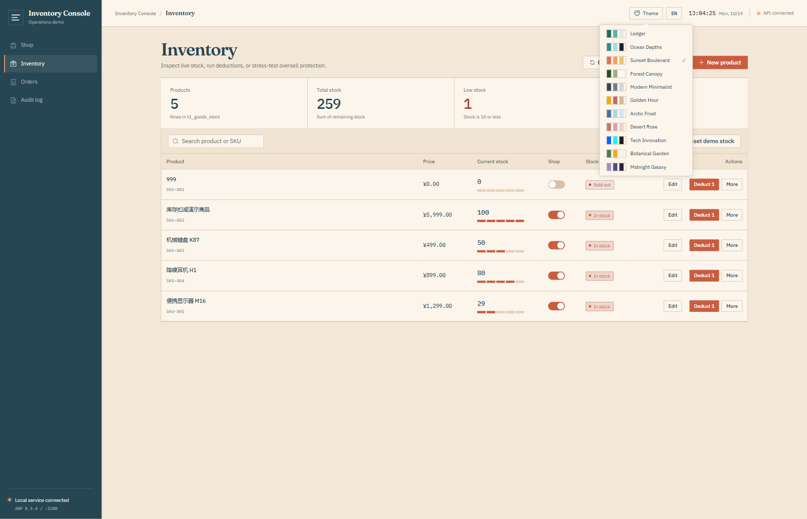

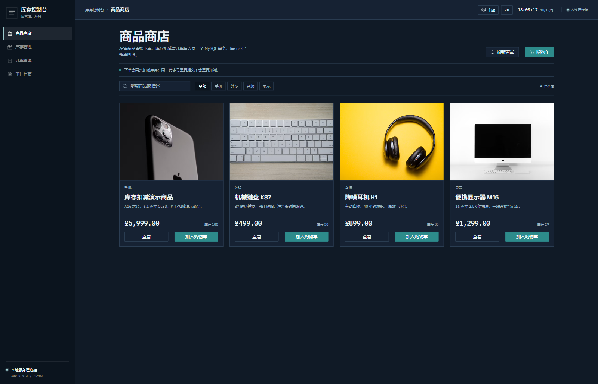

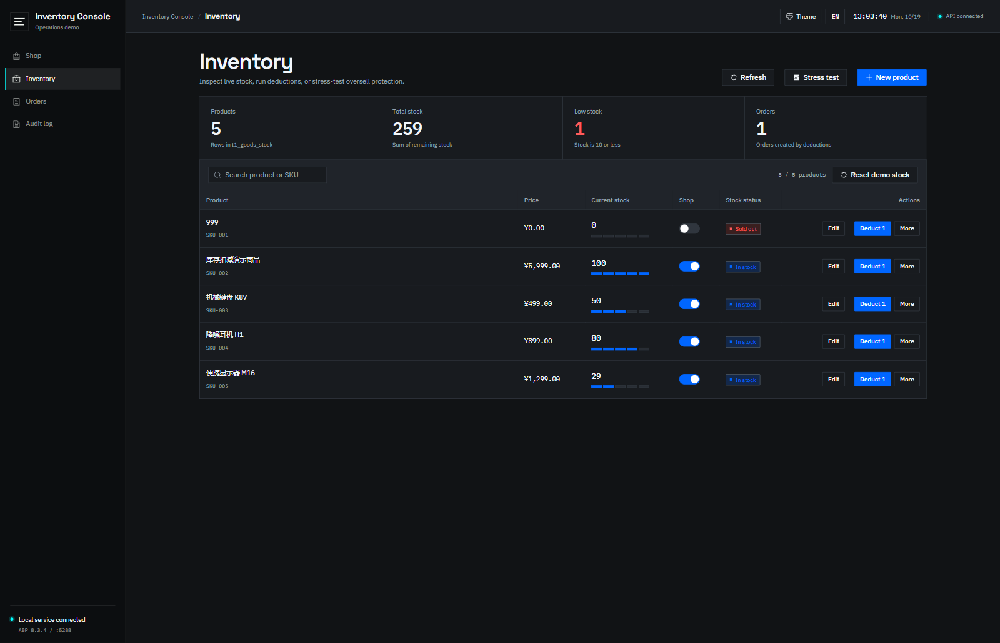

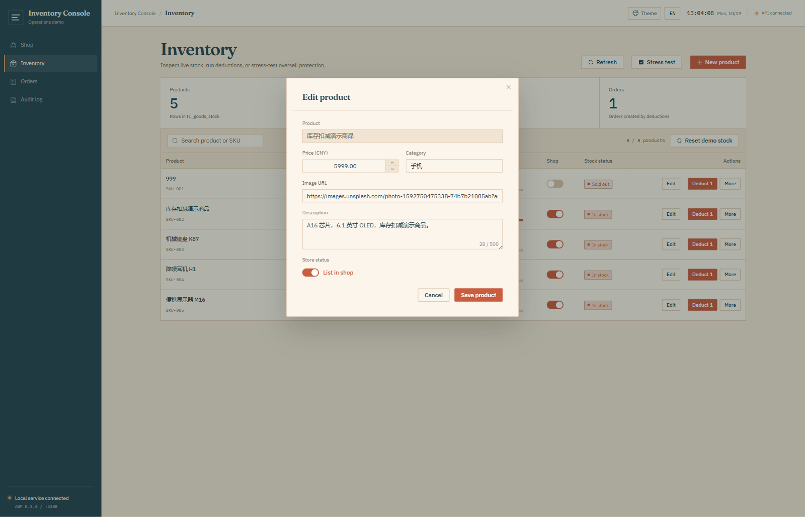

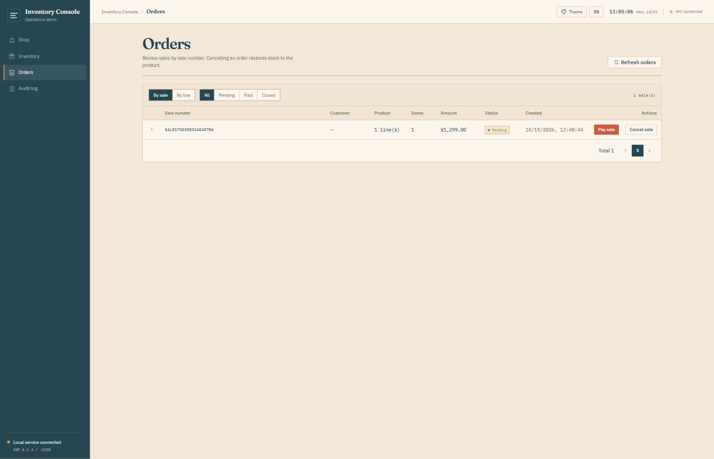

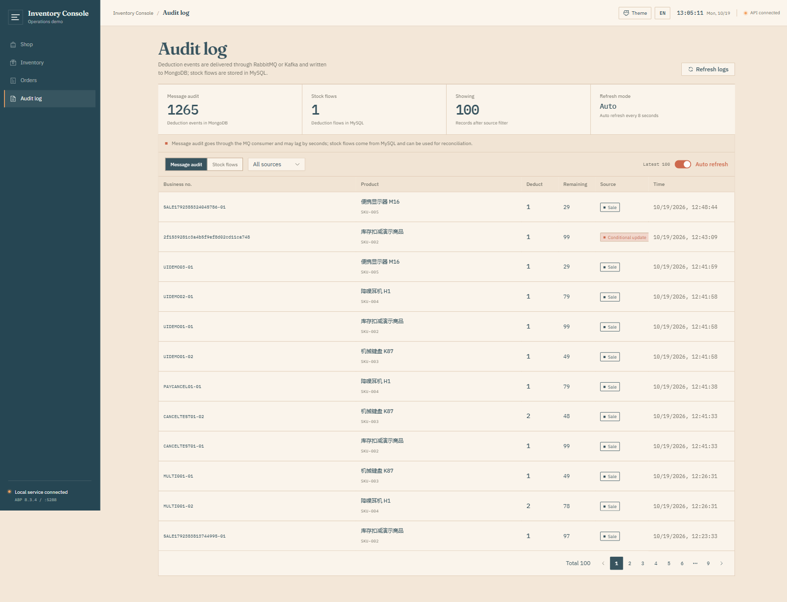

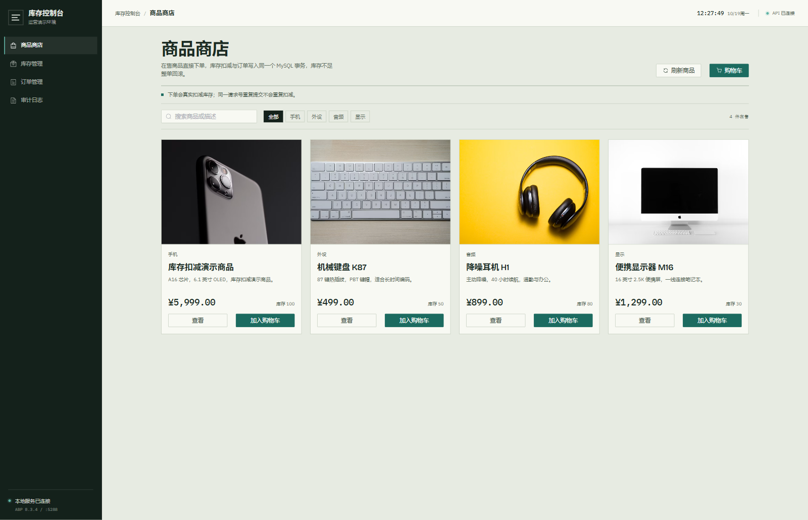

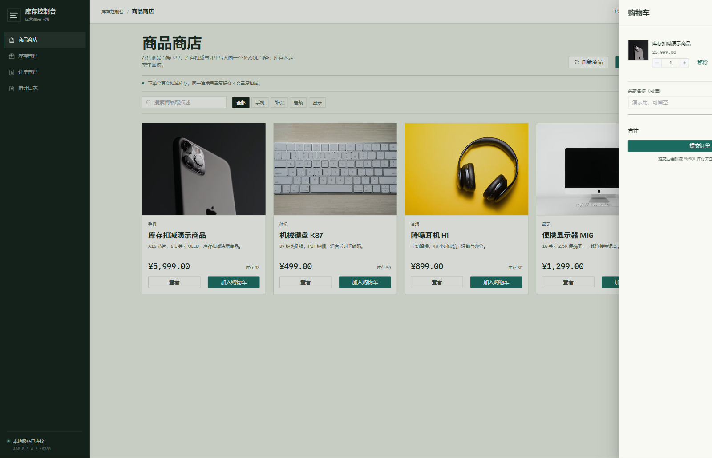

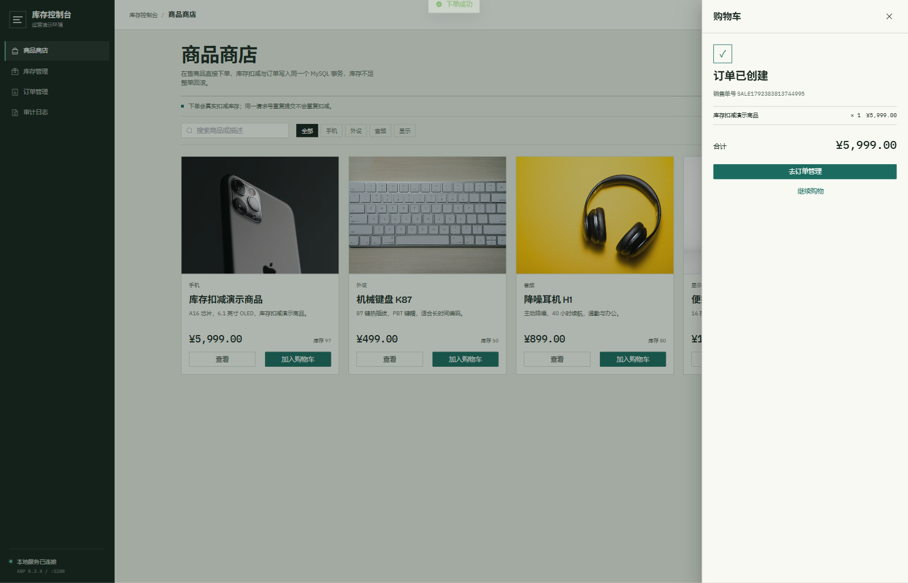

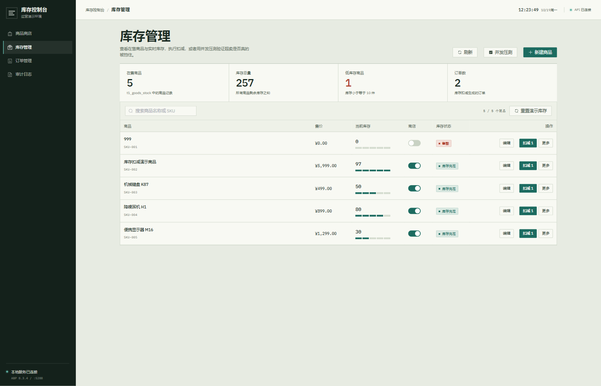

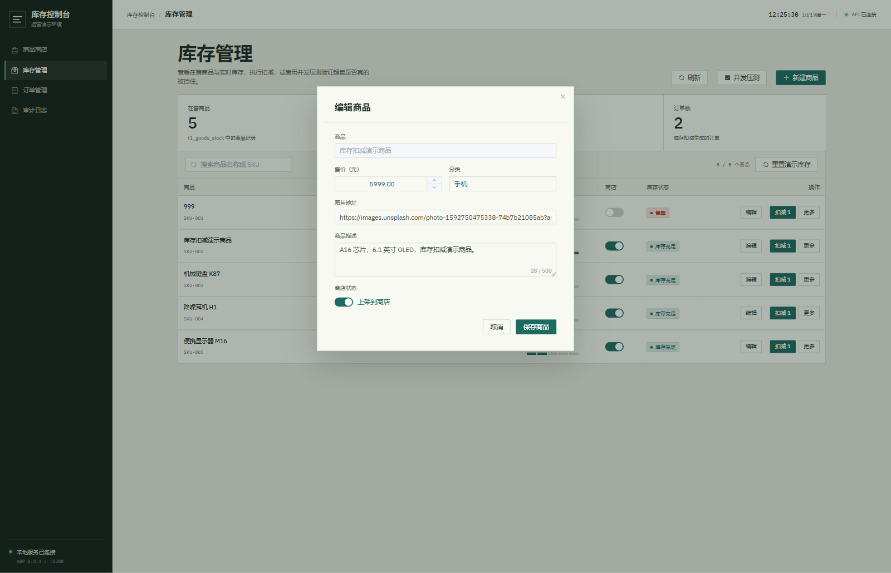

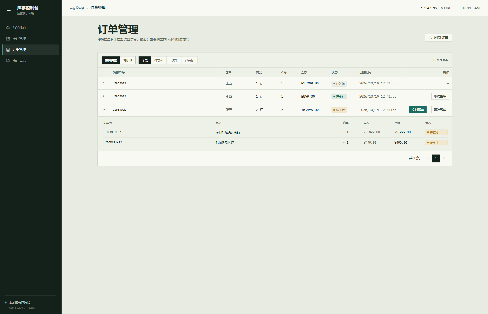

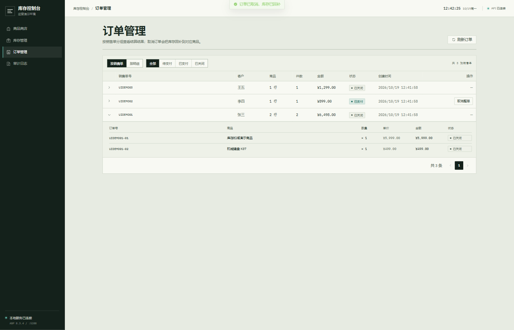

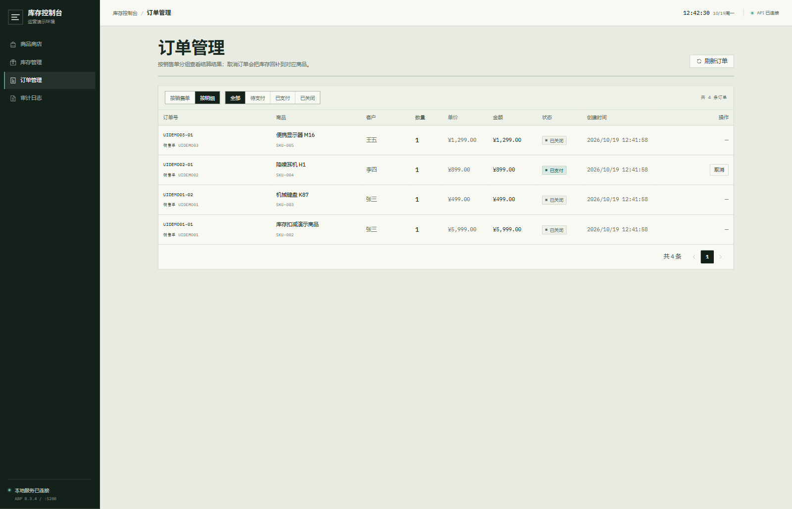

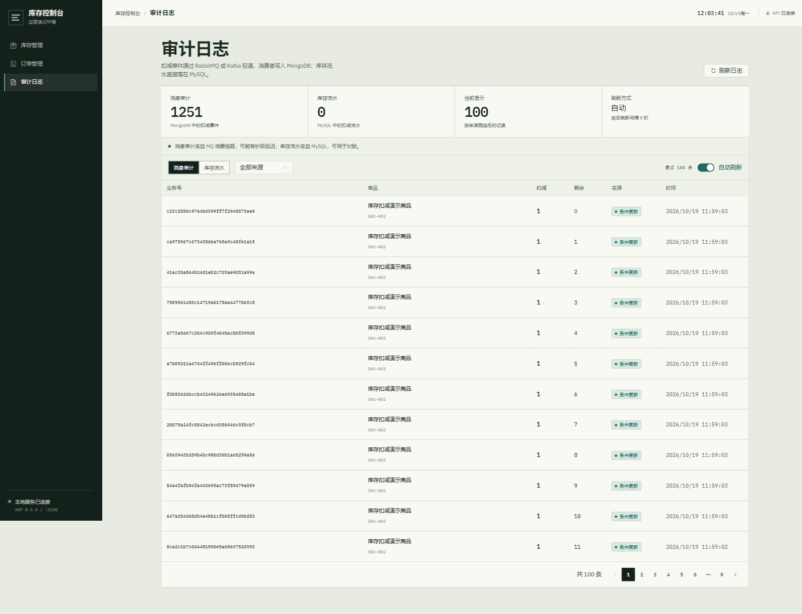

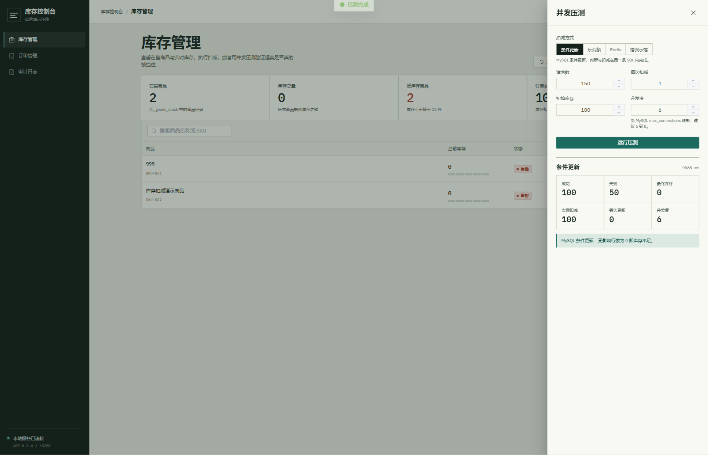

## 7. 说明

- 主项目没有为 `T1FrameAbpDbContext` 配置 EF 迁移，因此示例用 `InventorySchema` 执行幂等 DDL。
  如果后续把 `T1FrameAbpDbContext` 纳入迁移，可以把这几张表移到 migration 中。
- 商品商店只展示 `is_on_sale = true` 的商品；库存为 0 的商品仍会展示为「售罄」。
- 结算幂等靠客户端 `requestId` + `order_no` 前缀；重复提交返回原订单，不会重复扣库存。
- Redis key：`inventory:stock:{productId}`；幂等 key：`inventory:idem:{bizNo}`。
- 压测接口的 `parallelism` 上限为 16，默认 8；请根据 MySQL `max_connections` 调整。
- 秒杀场景可以把 `deduct-with-redis` 改成“Redis 预扣成功后只发 MQ、异步落库”，
  当前实现为了演示一致性，采用同步落库 + 失败回补。
